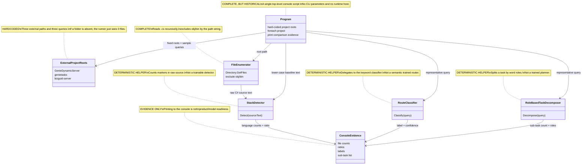

# 36.LibraryComparison

Documentation status: D36 documented - parent review passed.

## 1. Quick map for Luba

`36.LibraryComparison` is a small console runner for comparing already-existing helper components on several external .NET projects. It does not train a model and does not connect to a product runtime system: it takes hard-coded sibling-project paths (e.g. `../GenieDynamicServer`), reads `.cs` files, calls `StackDetector.Detect(string)`, `RouteClassifier.Classify(string)`, and `RoleBasedTaskDecomposer.Decompose(string)`, and then prints the comparison and benchmark-like lines to the console.

The main use of the project is historical evidence tooling: to quickly see how the deterministic helpers behave on real libraries. The main boundary is that the console output here is not a readiness gate, not a checkpoint, not an `ILearningMachine` lifecycle, and does not prove the quality of a trained semantic reasoning model.

## 2. UML / data flow



| Node | What it does | Status | Where it lives |
|---|---|---|---|
| `Program` | Top-level console script: sets the projects, creates helpers, runs the comparison loop. | Complete historical runner utility | `36.LibraryComparison/Program.cs` |
| `ExternalProjectRoots` | Hard-coded external paths and query strings for the comparison. | Hardcoded evidence input | `36.LibraryComparison/Program.cs` |
| `FileEnumerator` | Reads `.cs` files from an external folder and skips `obj`/`bin`. | Complete local branch | `36.LibraryComparison/Program.cs` |
| `StackDetector` | Detects the language by marker counts in the source text. | Deterministic helper | `21.AgentInfrastructure/Indexing/StackDetector.cs` |
| `RouteClassifier` | Classifies a query via the keyword classifier from the semantic compiler. | Deterministic helper | `22.AgentAlgorithms/Routing/RouteClassifier.cs` |
| `RoleBasedTaskDecomposer` | Splits a query into sub-tasks by simple word roles and boundaries. | Deterministic helper | `22.AgentAlgorithms/Tasks/RoleBasedTaskDecomposer.cs` |
| `ConsoleEvidence` | Prints file count, ratio, label, confidence, sub-task summary. | Evidence only | `36.LibraryComparison/Program.cs` |

### 2.1 Simulations by UML connection

| Connection | Example input | Branch simulation | Expected result | What must not be taken as the result |
|---|---|---|---|---|
| `Program -> ExternalProjectRoots` | Running the exe without arguments | `Program.cs` takes three tuples: root, name, query. | The loop gets `GenieDynamicServer`, `genietasks`, `bizguid-server`. | This is not a configurable benchmark harness and not coverage of all of Luba's projects. |
| `Program -> FileEnumerator` | `root="../GenieDynamicServer"` | If the folder exists, `Directory.GetFiles(..., "*.cs", AllDirectories)` reads the list; otherwise returns an empty array. | `csFiles.Length` is printed to the console. | Zero files does not prove that the project is empty; the path may be absent on the machine. |
| `FileEnumerator -> StackDetector` | One `.cs` file with `Task<`, `namespace`, `using` | The runner reads the raw text and calls `Detect(src)`. | The `CSharp` counter increases if the detector succeeds. | This is not accuracy on a labeled dataset; it is marker voting on the found files. |
| `Program -> StackDetector` | The same file after `ToLowerInvariant()` | The runner deliberately spoils the case and calls the detector again for a baseline. | `baselineCs` shows how much CSharp remained after lower-case normalization. | This is not a new model and not proof of universal normalization; it is a local demonstration of marker sensitivity. |
| `Program -> RouteClassifier` | `query="fix exception in Excel converter service"` | The query is passed to `Classify(string)`, the classifier normalizes tokens and calls the keyword route. | A label and confidence are printed to the console. | Confidence 0.95 is not a trained semantic confidence; it is a deterministic wrapper score. |
| `Program -> RoleBasedTaskDecomposer` | `query="design the task lifecycle flow with authentication"` | The query is passed to `Decompose(string)`, where words get roles and possible split indices. | The number of sub-tasks and roles is printed to the console. | The sub-tasks are not an agent plan of a production orchestrator. |
| `Helpers -> ConsoleEvidence` | Any successful helper result | The runner forms `StackDetector`, `RouteClassifier`, `TaskDecomposer` lines. | A person sees the comparison/evidence in the console. | Console output/log is not product readiness, model readiness, or phase done. |

## 3. No-code algorithms

### 3.1 Selecting external projects for comparison

Analogy: it is a notebook with three pre-written addresses. The runner does not ask the user where to go; it goes only to these addresses.

| Field | Value |
|---|---|
| Class/module | top-level `Program` |
| Method/function | top-level statements in `Program.cs` |
| Parameters | No CLI parameters; the `projects` array contains `(root, name, query)` |
| Input | Running the console project |
| Output | Three iterations of the comparison loop or empty file counts if the external folders are absent |
| Status | Complete, hardcoded, historical |

Steps:
1. The `projects` array is created.
2. For each element the `root`, human-readable `name`, and representative `query` are taken.
3. These values are used by all subsequent helpers.

Branches:

| Branch | Example input | Why it is chosen | Expected result | QA |
|---|---|---|---|---|
| External folder exists | `../bizguid-server` exists | `Directory.Exists(root)` true | The runner reads `.cs` files. | Documented from source; runtime was not run. |
| External folder absent | the path is absent on the machine | `Directory.Exists(root)` false | `csFiles=[]`, ratios will be 0. | Honest runtime gap: the doc phase does not check local external folders. |

What it does NOT do: it does not accept a path from the user, does not build a reproducible benchmark dataset, does not save a report.

### 3.2 Enumerating `.cs` files

Analogy: it is a cleaner who looks only at the working rooms and skips the trash folders `obj` and `bin`.

| Field | Value |
|---|---|
| Class/module | top-level `Program` |
| Method/function | ternary branch around `Directory.GetFiles(root, "*.cs", SearchOption.AllDirectories)` |
| Parameters | `root:string`, search pattern `"*.cs"`, `SearchOption.AllDirectories` |
| Input | The path to an external .NET project |
| Output | `string[] csFiles` |
| Status | Complete local branch |

Steps:
1. Checks the existence of `root`.
2. If the path exists, gets all `.cs` files recursively.
3. Filters out paths containing `obj` or `bin`.
4. If the path is absent, returns an empty array.

What it does NOT do: it does not read `.csproj`, does not check the solution graph, does not exclude generated files by complex rules.

### 3.3 Checking `StackDetector` on raw source and a lower-case baseline

Analogy: the detector is like a person who recognizes a language by its characteristic words. If you lowercase all the letters in advance, some C# features are lost.

| Field | Value |
|---|---|
| Class | `StackDetector` |
| Method | `Detect(string sourceText)` |
| Parameters | `sourceText`: the full text of a single file |
| Input | Raw `.cs` text, then a lower-case copy |
| Output | `OperationResult<StackInfo>` with `Language` |
| Status | Deterministic helper |

Steps of the current runner:
1. For each file reads the raw source via `File.ReadAllText(f)`.
2. Calls `stackDetector.Detect(src)`.
3. If the result is successful, increases the language counter.
4. Separately reads the same file as `ToLowerInvariant()`.
5. Calls `Detect` again to show a baseline after normalization.
6. Prints `csRatio`, `baseRatio`, and the difference.

Branches:

| Branch | Example input | Why it is chosen | Expected result | QA |
|---|---|---|---|---|
| Raw C# markers | `namespace X { Task<int> Run(); }` | `Task<`, `namespace`, `using` give a CSharp score | `StackLanguage.CSharp` | `AgentInfrastructureTests` contains `StackDetector_*` tests. |
| Lower-case baseline | `task<int>` instead of `Task<int>` | Some markers are case-sensitive | The CSharp score may drop | `AutonomousLearningTests` and `AgentInfrastructureTests` cover the "before normalization" rule. |
| Empty/no markers | empty text or irrelevant text | All scores equal 0 | `StackLanguage.Unknown` | `StackDetector_Unknown_EmptySource`. |

What it does NOT do: this is not a trained language detector, not an accuracy benchmark on a labeled sample, and not proof of quality on all languages.

### 3.4 Classifying the representative query

Analogy: it is a sorter of incoming notes by keywords. It does not understand the task like a human; it calls the keyword classifier and assigns a nominal confidence.

| Field | Value |
|---|---|
| Class | `RouteClassifier` |
| Method | `Classify(string semanticTokens)` |
| Parameters | `semanticTokens`: for example `"fix exception in Excel converter service"` |
| Input | The representative query from a hardcoded project tuple |
| Output | `OperationResult<DomainClassification>`: `Label`, `Confidence`, `Evidence` |
| Status | Deterministic helper |

Steps:
1. Empty input returns fail `EMPTY`.
2. Non-empty input is split into tokens, tokens are lowercased and cleaned of punctuation.
3. The label is taken from `SemanticCompiler29.RouteClassifier.ClassifyByKeywords`.
4. The confidence is `0.95` if the label is not `UNKNOWN`, otherwise `0.2`.
5. The runner prints the query, label, and confidence.

What it does NOT do: it does not use a trained semantic router model, does not save the routing decision, does not prove quality on a real corpus.

### 3.5 Decomposing the query into sub-tasks

Analogy: it is an editor who looks for where in a sentence one job ended and another began. It looks at verbs, nouns, and conjunctions, not at a trained model.

| Field | Value |
|---|---|
| Class | `RoleBasedTaskDecomposer` |
| Method | `Decompose(string taskDescription)` |
| Parameters | `taskDescription`: for example `"design the task lifecycle flow with authentication"` |
| Input | The representative query |
| Output | `OperationResult<IReadOnlyList<SubTask>>` |
| Status | Deterministic helper |

Steps:
1. An empty string returns fail `EMPTY_TASK`.
2. A non-empty string is split into words.
3. Each word gets a role via `TagWord`.
4. The hard-split words `then`, `also`, `additionally` always create a boundary.
5. A conjunction `and/or/but/nor` creates a boundary only if both sides look like full tasks and the leading verbs differ.
6. If there are no split indices, one sub-task with the role `InferRole` is returned.
7. If there are split indices, the runner prints the number of sub-tasks and shortened descriptions.

What it does NOT do: it does not create an agent plan, does not call `AgentOrchestrator`, is not a trainable planner.

## 4. Where the logic sits in the code

| Logic | File | Why this place matters | What it proves | What it does not prove |
|---|---|---|---|---|
| Hardcoded project inputs | `36.LibraryComparison/Program.cs:7-12` | Shows that the runner does not accept CLI args. | Three fixed root/query. | Not a benchmark suite. |
| Helper construction | `36.LibraryComparison/Program.cs:14-16` | Shows the direct creation of concrete helpers. | No dependency injection or host runtime. | Not product orchestration. |
| File enumeration | `36.LibraryComparison/Program.cs:26-30` | Shows the `.cs` scan and the `obj/bin` filter. | What exactly goes into the comparison. | Not a clean corpus. |
| Stack detection call | `36.LibraryComparison/Program.cs:38-45` | Shows the raw file text to the detector. | Detect is called before baseline normalization. | Not trained detection. |
| Route classification | `22.AgentAlgorithms/Routing/RouteClassifier.cs:16-29` | Explains the label/confidence. | A keyword classifier wrapper. | Not a semantic model confidence. |
| Task decomposition | `22.AgentAlgorithms/Tasks/RoleBasedTaskDecomposer.cs:49-65` | Shows the empty branch and hard split. | A rule-based split path. | Not a learned planner. |
| Project references | `36.LibraryComparison/LibraryComparison.csproj:10-13` | Shows the dependency boundary. | Uses the 21 and 22 projects. | Not a separate production library. |

## 5. Short code quotations

`36.LibraryComparison/Program.cs:17-26`

```csharp
var projectsRoot = args.Length > 0 && !string.IsNullOrWhiteSpace(args[0])
    ? Path.GetFullPath(args[0])
    : Path.GetFullPath(Path.Combine(ResolveRepoRoot(), ".."));

var projects = new[]
{
    (Path.Combine(projectsRoot, "GenieDynamicServer"), "GenieDynamicServer", "fix exception in Excel converter service"),
    (Path.Combine(projectsRoot, "genietasks", "A1ProjectManagement"), "genietasks", "design the task lifecycle flow with authentication"),
    (Path.Combine(projectsRoot, "bizguid-server"), "bizguid-server", "how does the Excel converter work"),
};
```

Why it matters: this shows the fixed input roots. Without CLI arguments the runner derives the three sibling projects from the repo layout (`ResolveRepoRoot()` then its parent); a caller may override the base directory via the first positional argument, but it still does not build a portable benchmark set.

`36.LibraryComparison/Program.cs:14-16`

```csharp
var stackDetector   = new StackDetector();
var routeClassifier = new RouteClassifier();
var taskDecomposer  = new RoleBasedTaskDecomposer();
```

Why it matters: concrete helpers from neighboring projects are created. This is a regular console comparison path, not host-managed runtime composition.

`36.LibraryComparison/Program.cs:26-30`

```csharp
    var csFiles = Directory.Exists(root)
        ? Directory.GetFiles(root, "*.cs", SearchOption.AllDirectories)
                   .Where(f => !f.Contains("obj") && !f.Contains("bin"))
                   .ToArray()
        : [];
```

Why it matters: here it is visible which files go into the check. If the external path is absent, the runner honestly works with an empty array, rather than crashing or proving the state of the external project.

`36.LibraryComparison/Program.cs:38-45`

```csharp
    foreach (var f in csFiles)
    {
        try
        {
            string src = File.ReadAllText(f);
            var r = stackDetector.Detect(src);
            if (r.IsSuccess)
                stackCounts[r.Value!.Language.ToString()]++;
```

Why it matters: this is the raw-source branch of `StackDetector`. The input is the text of one file; the output is an increment of the language counter. This is not a trained detector and not a held-out metric.

`21.AgentInfrastructure/Indexing/StackDetector.cs:26-39`

```csharp
    public OperationResult<StackInfo> Detect(string sourceText)
    {
        int csScore = CSharpMarkers.Count(m => sourceText.Contains(m));
        int tsScore = TypeScriptMarkers.Count(m => sourceText.Contains(m));
        int pyScore = PythonMarkers.Count(m => sourceText.Contains(m));

        if (csScore == 0 && tsScore == 0 && pyScore == 0)
            return OperationResult<StackInfo>.Ok(new StackInfo(StackLanguage.Unknown, []));

        var language = (csScore >= tsScore && csScore >= pyScore) ? StackLanguage.CSharp
                     : (tsScore >= pyScore)                       ? StackLanguage.TypeScript
                     :                                              StackLanguage.Python;

        return OperationResult<StackInfo>.Ok(new StackInfo(language, []));
```

Why it matters: the detector is a marker-count algorithm. It selects the maximum score, not a trained model and not a semantic parser.

`22.AgentAlgorithms/Routing/RouteClassifier.cs:16-29`

```csharp
    public OperationResult<DomainClassification> Classify(string semanticTokens)
    {
        if (string.IsNullOrWhiteSpace(semanticTokens))
            return OperationResult<DomainClassification>.Fail("Empty input.", "EMPTY");

        var tokens = semanticTokens.Split(' ', StringSplitOptions.RemoveEmptyEntries)
                                   .Select(t => t.ToLowerInvariant().Trim('.', ',', '?', '!'))
                                   .ToArray();

        var label = SemanticCompiler29.RouteClassifier.ClassifyByKeywords(semanticTokens);
        var confidence = tokens.Length > 0 && label != SemanticCompiler29.Domain.UNKNOWN ? 0.95 : 0.2;

        return OperationResult<DomainClassification>.Ok(
            new DomainClassification(label, confidence, tokens));
```

Why it matters: the confidence here is nominal and deterministic. It is not a trained semantic quality score.

`22.AgentAlgorithms/Tasks/RoleBasedTaskDecomposer.cs:49-65`

```csharp
    public OperationResult<IReadOnlyList<SubTask>> Decompose(string taskDescription)
    {
        if (string.IsNullOrWhiteSpace(taskDescription))
            return OperationResult<IReadOnlyList<SubTask>>.Fail("Task description is empty.", "EMPTY_TASK");

        var words = taskDescription.Split(' ', StringSplitOptions.RemoveEmptyEntries);
        var roles = words.Select(TagWord).ToArray();

        var splitIndices = new List<int>();
        for (int i = 0; i < words.Length; i++)
        {
            // Hard-split words always mark a boundary
            if (_hardSplits.Contains(Normalize(words[i])))
            {
                splitIndices.Add(i);
                continue;
            }
```

Why it matters: the decomposer starts with rule-based role tagging and hard-split words. This is not a DPO-trained planner and not an agent orchestrator.

`36.LibraryComparison/LibraryComparison.csproj:10-13`

```xml
  <ItemGroup>
    <ProjectReference Include="..\21.AgentInfrastructure\AgentInfrastructure.csproj" />
    <ProjectReference Include="..\22.AgentAlgorithms\AgentAlgorithms.csproj" />
  </ItemGroup>
```

Why it matters: D36 is a thin console over already-existing helpers from 21 and 22, not a separate ML library.

## 6. Test, e2e, and QA mapping

The tests were found and cross-referenced by helper, but not run in this documentation subphase. There is no direct test of `36.LibraryComparison` as a console application in the found anchors.

| Behavior | Verification level | Current evidence | Status | Next work order if gap |
|---|---|---|---|---|
| `StackDetector.Detect(string)` raw source before normalization | unit/regression | `Tests/AgentInfrastructureTests.cs` contains `StackDetector_*`; `Tests/AutonomousLearningTests.cs` contains a preprocessing-order check. | covered by existing tests, not run now | Not needed for documentation; a runtime run separately if evidence is required. |
| `RouteClassifier.Classify(string)` | unit/regression | `Tests/AgentAlgorithmsTests.cs` contains `RouteClassifier_*`. | covered by existing tests, not run now | No. |
| `RoleBasedTaskDecomposer.Decompose(string)` | unit/regression | `Tests/AgentAlgorithmsTests.cs` contains decomposition, false conjunction, and boundary weight tests. | covered by existing tests, not run now | No. |
| D36 console loop over external roots | manual/runtime gap | Source shows the loop; no direct test found for `36.LibraryComparison`. | gap honestly recorded | Add a focused console-runner test only if D36 becomes active tooling. |
| Console output as evidence | documentation/static | Source prints comparison lines only. | not product evidence | Do not use as a readiness gate. |

## 7. Component status

| Component | File | Status | What actually works now |
|---|---|---|---|
| `Program` | `36.LibraryComparison/Program.cs` | Legacy/comparison runner | Top-level console loop, hardcoded roots, helper calls, console prints. |
| `LibraryComparison.csproj` | `36.LibraryComparison/LibraryComparison.csproj` | Complete project wiring | `Exe` on `net9.0`, references 21 and 22. |
| `StackDetector` | `21.AgentInfrastructure/Indexing/StackDetector.cs` | Deterministic helper | `Detect(string sourceText)` counts markers and returns `StackInfo`. |
| `RouteClassifier` | `22.AgentAlgorithms/Routing/RouteClassifier.cs` | Deterministic helper | `Classify(string semanticTokens)` wraps the keyword domain classifier. |
| `RoleBasedTaskDecomposer` | `22.AgentAlgorithms/Tasks/RoleBasedTaskDecomposer.cs` | Deterministic helper | `Decompose(string taskDescription)` uses roles, hard splits, conjunction boundary rules. |
| Console evidence | `36.LibraryComparison/Program.cs` | Evidence only | Prints counts, ratios, labels, confidence, and sub-task summaries; no persisted report. |

## 8. Anti-false-done and anti-determinism

- `36.LibraryComparison` is historical/comparison/evidence tooling, not a product runtime.
- Console output, logs, copied numbers, or comparison prints are not product readiness, not model readiness, and not phase completion proof.
- `StackDetector`, `RouteClassifier`, and `RoleBasedTaskDecomposer` are deterministic/helper calls unless a separate source-backed trained lifecycle proves otherwise.
- D36 is not an `ILearningMachine`, has no checkpoint, manifest, locator, export/import, fresh-load, or continue-training path.
- Hard-coded external roots mean the results depend on the local machine state; missing folders or changed external repos change the output.
- No `dotnet test`, build, runtime smoke, or training was run in this documentation phase.

Documentation status: D36 documented - parent review passed.
Last verified against source: 2026-06-08.
Known gaps: no direct D36 console-runner test found; no runtime execution in this documentation-only subphase.
