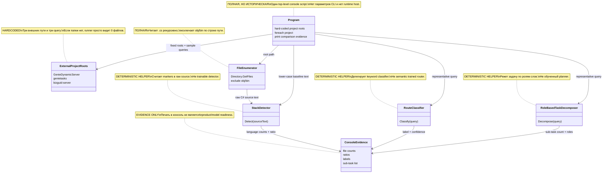

# 36.LibraryComparison

Documentation status: D36 documented - parent review passed.

## 1. Краткая карта для Лубы

`36.LibraryComparison` - это маленький консольный runner для сравнения уже существующих helper-компонентов на нескольких внешних .NET проектах. Он не обучает модель и не подключается к продуктовой runtime-системе: он берет жестко заданные пути `C:\Projects\...`, читает `.cs` файлы, вызывает `StackDetector.Detect(string)`, `RouteClassifier.Classify(string)` и `RoleBasedTaskDecomposer.Decompose(string)`, а затем печатает в консоль сравнение и похожие на benchmark строки.

Главная польза проекта - историческое evidence tooling: быстро посмотреть, как deterministic helpers ведут себя на реальных библиотеках. Главная граница - console output здесь не является readiness gate, не является checkpoint, не является `ILearningMachine` lifecycle и не доказывает качество обученной semantic reasoning модели.

## 2. UML / поток данных



| Узел | Что делает | Статус | Где живет |
|---|---|---|---|
| `Program` | Top-level console script: задает проекты, создает helpers, запускает цикл сравнения. | Полная историческая runner-утилита | `36.LibraryComparison/Program.cs` |
| `ExternalProjectRoots` | Жестко заданные внешние пути и query-строки для сравнения. | Hardcoded evidence input | `36.LibraryComparison/Program.cs` |
| `FileEnumerator` | Читает `.cs` файлы из внешней папки и пропускает `obj`/`bin`. | Полная локальная ветка | `36.LibraryComparison/Program.cs` |
| `StackDetector` | Определяет язык по marker counts в исходном тексте. | Deterministic helper | `21.AgentInfrastructure/Indexing/StackDetector.cs` |
| `RouteClassifier` | Классифицирует query через keyword classifier из semantic compiler. | Deterministic helper | `22.AgentAlgorithms/Routing/RouteClassifier.cs` |
| `RoleBasedTaskDecomposer` | Делит query на подзадачи по простым ролям слов и границам. | Deterministic helper | `22.AgentAlgorithms/Tasks/RoleBasedTaskDecomposer.cs` |
| `ConsoleEvidence` | Печатает file count, ratio, label, confidence, sub-task summary. | Evidence only | `36.LibraryComparison/Program.cs` |

### 2.1 Симуляции по связям UML

| Связь | Пример входа | Симуляция ветки | Ожидаемый результат | Что запрещено принимать за результат |
|---|---|---|---|---|
| `Program -> ExternalProjectRoots` | Запуск exe без аргументов | `Program.cs` берет три tuple: root, name, query. | Цикл получает `GenieDynamicServer`, `genietasks`, `bizguid-server`. | Это не конфигурируемый benchmark harness и не покрытие всех проектов Лубы. |
| `Program -> FileEnumerator` | `root="C:\Projects\GenieDynamicServer"` | Если папка существует, `Directory.GetFiles(..., "*.cs", AllDirectories)` читает список; иначе возвращает пустой массив. | `csFiles.Length` печатается в консоль. | Ноль файлов не доказывает, что проект пустой; возможно, путь отсутствует на машине. |
| `FileEnumerator -> StackDetector` | Один `.cs` файл с `Task<`, `namespace`, `using` | Runner читает raw text и вызывает `Detect(src)`. | Увеличивается счетчик `CSharp`, если detector успешен. | Это не accuracy на размеченном датасете; это marker voting на найденных файлах. |
| `Program -> StackDetector` | Тот же файл после `ToLowerInvariant()` | Runner специально портит регистр и снова вызывает detector для baseline. | `baselineCs` показывает, сколько CSharp осталось после lower-case normalization. | Это не новая модель и не proof универсальной нормализации; это локальная демонстрация чувствительности markers. |
| `Program -> RouteClassifier` | `query="fix exception in Excel converter service"` | Query передается в `Classify(string)`, classifier нормализует tokens и вызывает keyword route. | В консоль печатается label и confidence. | Confidence 0.95 не является обученной semantic confidence; это deterministic wrapper score. |
| `Program -> RoleBasedTaskDecomposer` | `query="design the task lifecycle flow with authentication"` | Query передается в `Decompose(string)`, где слова получают роли и возможные split indices. | В консоль печатается число подзадач и роли. | Подзадачи не являются агентным планом production orchestrator-а. |
| `Helpers -> ConsoleEvidence` | Любой successful helper result | Runner формирует строки `StackDetector`, `RouteClassifier`, `TaskDecomposer`. | Человек видит comparison/evidence в консоли. | Console output/log не является product readiness, model readiness или phase done. |

## 3. Алгоритмы без кода

### 3.1 Выбор внешних проектов для сравнения

Аналогия: это блокнот с тремя заранее записанными адресами. Runner не спрашивает пользователя, куда идти; он идет только по этим адресам.

| Поле | Значение |
|---|---|
| Класс/модуль | top-level `Program` |
| Метод/функция | top-level statements в `Program.cs` |
| Параметры | Нет CLI параметров; массив `projects` содержит `(root, name, query)` |
| Вход | Запуск консольного проекта |
| Выход | Три итерации comparison loop или пустые file counts, если внешних папок нет |
| Статус | Полная, hardcoded, historical |

Шаги:
1. Создается массив `projects`.
2. Для каждого элемента берется `root`, человекочитаемое `name` и representative `query`.
3. Эти значения используются всеми последующими helpers.

Ветки:

| Ветка | Пример входа | Почему выбирается | Ожидаемый результат | QA |
|---|---|---|---|---|
| Внешняя папка есть | `C:\Projects\bizguid-server` существует | `Directory.Exists(root)` true | Runner читает `.cs` файлы. | Документировано по source; runtime не запускался. |
| Внешней папки нет | путь отсутствует на машине | `Directory.Exists(root)` false | `csFiles=[]`, ratios будут 0. | Честный runtime gap: doc phase не проверяет локальные внешние папки. |

Что НЕ делает: не принимает path от пользователя, не строит reproducible benchmark dataset, не сохраняет отчет.

### 3.2 Перечисление `.cs` файлов

Аналогия: это уборщик, который смотрит только рабочие комнаты и пропускает мусорные папки `obj` и `bin`.

| Поле | Значение |
|---|---|
| Класс/модуль | top-level `Program` |
| Метод/функция | ternary branch around `Directory.GetFiles(root, "*.cs", SearchOption.AllDirectories)` |
| Параметры | `root:string`, search pattern `"*.cs"`, `SearchOption.AllDirectories` |
| Вход | Путь к внешнему .NET проекту |
| Выход | `string[] csFiles` |
| Статус | Полная локальная ветка |

Шаги:
1. Проверяет существование `root`.
2. Если путь есть, получает все `.cs` файлы рекурсивно.
3. Фильтрует пути, содержащие `obj` или `bin`.
4. Если путь отсутствует, возвращает пустой массив.

Что НЕ делает: не читает `.csproj`, не проверяет solution graph, не исключает generated files по сложным правилам.

### 3.3 Проверка `StackDetector` на raw source и lower-case baseline

Аналогия: detector похож на человека, который узнает язык по характерным словам. Если заранее сделать все буквы маленькими, часть C# признаков теряется.

| Поле | Значение |
|---|---|
| Класс | `StackDetector` |
| Метод | `Detect(string sourceText)` |
| Параметры | `sourceText`: полный текст одного файла |
| Вход | Raw `.cs` text, затем lower-case copy |
| Выход | `OperationResult<StackInfo>` с `Language` |
| Статус | Deterministic helper |

Шаги текущего runner-а:
1. Для каждого файла читает raw source через `File.ReadAllText(f)`.
2. Вызывает `stackDetector.Detect(src)`.
3. Если результат успешный, увеличивает счетчик языка.
4. Отдельно читает тот же файл как `ToLowerInvariant()`.
5. Снова вызывает `Detect`, чтобы показать baseline после нормализации.
6. Печатает `csRatio`, `baseRatio` и разницу.

Ветки:

| Ветка | Пример входа | Почему выбирается | Ожидаемый результат | QA |
|---|---|---|---|---|
| Raw C# markers | `namespace X { Task<int> Run(); }` | `Task<`, `namespace`, `using` дают CSharp score | `StackLanguage.CSharp` | `AgentInfrastructureTests` содержит тесты `StackDetector_*`. |
| Lower-case baseline | `task<int>` вместо `Task<int>` | Некоторые markers case-sensitive | CSharp score может упасть | `AutonomousLearningTests` и `AgentInfrastructureTests` покрывают правило "до нормализации". |
| Empty/no markers | пустой текст или нерелевантный текст | Все score равны 0 | `StackLanguage.Unknown` | `StackDetector_Unknown_EmptySource`. |

Что НЕ делает: это не обученный language detector, не accuracy benchmark на размеченной выборке и не доказательство качества на всех языках.

### 3.4 Классификация representative query

Аналогия: это сортировщик входящих записок по ключевым словам. Он не понимает задачу как человек; он вызывает keyword classifier и ставит условную confidence.

| Поле | Значение |
|---|---|
| Класс | `RouteClassifier` |
| Метод | `Classify(string semanticTokens)` |
| Параметры | `semanticTokens`: например `"fix exception in Excel converter service"` |
| Вход | Representative query из hardcoded project tuple |
| Выход | `OperationResult<DomainClassification>`: `Label`, `Confidence`, `Evidence` |
| Статус | Deterministic helper |

Шаги:
1. Пустой input возвращает fail `EMPTY`.
2. Непустой input делится на tokens, tokens приводятся к lowercase и очищаются от пунктуации.
3. Label берется из `SemanticCompiler29.RouteClassifier.ClassifyByKeywords`.
4. Confidence равен `0.95`, если label не `UNKNOWN`, иначе `0.2`.
5. Runner печатает query, label и confidence.

Что НЕ делает: не использует обученную semantic router модель, не сохраняет routing decision, не доказывает качество на реальном corpus-е.

### 3.5 Декомпозиция query на подзадачи

Аналогия: это редактор, который ищет, где в предложении одна работа закончилась и началась другая. Он смотрит на глаголы, существительные и союзы, а не на обученную модель.

| Поле | Значение |
|---|---|
| Класс | `RoleBasedTaskDecomposer` |
| Метод | `Decompose(string taskDescription)` |
| Параметры | `taskDescription`: например `"design the task lifecycle flow with authentication"` |
| Вход | Representative query |
| Выход | `OperationResult<IReadOnlyList<SubTask>>` |
| Статус | Deterministic helper |

Шаги:
1. Пустая строка возвращает fail `EMPTY_TASK`.
2. Непустая строка делится на слова.
3. Каждое слово получает роль через `TagWord`.
4. Hard-split слова `then`, `also`, `additionally` всегда дают границу.
5. Союз `and/or/but/nor` дает границу только если обе стороны похожи на полноценные задачи и ведущие глаголы отличаются.
6. Если split indices нет, возвращается одна подзадача с ролью `InferRole`.
7. Если split indices есть, runner печатает количество подзадач и укороченные описания.

Что НЕ делает: не создает агентный план, не вызывает `AgentOrchestrator`, не является trainable planner.

## 4. Где логика сидит в коде

| Логика | Файл | Почему это место важно | Что доказывает | Чего не доказывает |
|---|---|---|---|---|
| Hardcoded project inputs | `36.LibraryComparison/Program.cs:7-12` | Показывает, что runner не принимает CLI args. | Три фиксированных root/query. | Не benchmark suite. |
| Helper construction | `36.LibraryComparison/Program.cs:14-16` | Показывает прямое создание concrete helpers. | Нет dependency injection или host runtime. | Не product orchestration. |
| File enumeration | `36.LibraryComparison/Program.cs:26-30` | Показывает `.cs` scan и `obj/bin` filter. | Что именно попадает в comparison. | Не clean corpus. |
| Stack detection call | `36.LibraryComparison/Program.cs:38-45` | Показывает raw file text to detector. | Detect вызывается до baseline normalization. | Не trained detection. |
| Route classification | `22.AgentAlgorithms/Routing/RouteClassifier.cs:16-29` | Объясняет label/confidence. | Keyword classifier wrapper. | Не semantic model confidence. |
| Task decomposition | `22.AgentAlgorithms/Tasks/RoleBasedTaskDecomposer.cs:49-65` | Показывает empty branch и hard split. | Rule-based split path. | Не learned planner. |
| Project references | `36.LibraryComparison/LibraryComparison.csproj:10-13` | Показывает dependency boundary. | Использует 21 и 22 projects. | Не отдельная production библиотека. |

## 5. Короткие цитаты кода

`36.LibraryComparison/Program.cs:7-12`

```csharp
var projects = new[]
{
    (@"C:\Projects\GenieDynamicServer", "GenieDynamicServer", "fix exception in Excel converter service"),
    (@"C:\Projects\genietasks\A1ProjectManagement", "genietasks", "design the task lifecycle flow with authentication"),
    (@"C:\Projects\bizguid-server", "bizguid-server", "how does the Excel converter work"),
};
```

Почему важно: это доказывает hardcoded input. Runner не получает пути из CLI и не строит переносимый benchmark набор.

`36.LibraryComparison/Program.cs:14-16`

```csharp
var stackDetector   = new StackDetector();
var routeClassifier = new RouteClassifier();
var taskDecomposer  = new RoleBasedTaskDecomposer();
```

Почему важно: создаются concrete helpers из соседних проектов. Это обычный console comparison path, а не host-managed runtime composition.

`36.LibraryComparison/Program.cs:26-30`

```csharp
    var csFiles = Directory.Exists(root)
        ? Directory.GetFiles(root, "*.cs", SearchOption.AllDirectories)
                   .Where(f => !f.Contains("obj") && !f.Contains("bin"))
                   .ToArray()
        : [];
```

Почему важно: здесь видно, какие файлы попадают в проверку. Если внешний путь отсутствует, runner честно работает с пустым массивом, а не падает и не доказывает состояние внешнего проекта.

`36.LibraryComparison/Program.cs:38-45`

```csharp
    foreach (var f in csFiles)
    {
        try
        {
            string src = File.ReadAllText(f);
            var r = stackDetector.Detect(src);
            if (r.IsSuccess)
                stackCounts[r.Value!.Language.ToString()]++;
```

Почему важно: это raw-source ветка `StackDetector`. Вход - текст одного файла; выход - увеличение счетчика языка. Это не обученный detector и не held-out metric.

`21.AgentInfrastructure/Indexing/StackDetector.cs:26-39`

```csharp
    public OperationResult<StackInfo> Detect(string sourceText)
    {
        int csScore = CSharpMarkers.Count(m => sourceText.Contains(m));
        int tsScore = TypeScriptMarkers.Count(m => sourceText.Contains(m));
        int pyScore = PythonMarkers.Count(m => sourceText.Contains(m));

        if (csScore == 0 && tsScore == 0 && pyScore == 0)
            return OperationResult<StackInfo>.Ok(new StackInfo(StackLanguage.Unknown, []));

        var language = (csScore >= tsScore && csScore >= pyScore) ? StackLanguage.CSharp
                     : (tsScore >= pyScore)                       ? StackLanguage.TypeScript
                     :                                              StackLanguage.Python;

        return OperationResult<StackInfo>.Ok(new StackInfo(language, []));
```

Почему важно: detector - marker-count algorithm. Он выбирает максимальный score, а не обученную модель и не semantic parser.

`22.AgentAlgorithms/Routing/RouteClassifier.cs:16-29`

```csharp
    public OperationResult<DomainClassification> Classify(string semanticTokens)
    {
        if (string.IsNullOrWhiteSpace(semanticTokens))
            return OperationResult<DomainClassification>.Fail("Empty input.", "EMPTY");

        var tokens = semanticTokens.Split(' ', StringSplitOptions.RemoveEmptyEntries)
                                   .Select(t => t.ToLowerInvariant().Trim('.', ',', '?', '!'))
                                   .ToArray();

        var label = SemanticCompiler29.RouteClassifier.ClassifyByKeywords(semanticTokens);
        var confidence = tokens.Length > 0 && label != SemanticCompiler29.Domain.UNKNOWN ? 0.95 : 0.2;

        return OperationResult<DomainClassification>.Ok(
            new DomainClassification(label, confidence, tokens));
```

Почему важно: confidence здесь условная и deterministic. Она не является trained semantic quality score.

`22.AgentAlgorithms/Tasks/RoleBasedTaskDecomposer.cs:49-65`

```csharp
    public OperationResult<IReadOnlyList<SubTask>> Decompose(string taskDescription)
    {
        if (string.IsNullOrWhiteSpace(taskDescription))
            return OperationResult<IReadOnlyList<SubTask>>.Fail("Task description is empty.", "EMPTY_TASK");

        var words = taskDescription.Split(' ', StringSplitOptions.RemoveEmptyEntries);
        var roles = words.Select(TagWord).ToArray();

        var splitIndices = new List<int>();
        for (int i = 0; i < words.Length; i++)
        {
            // Hard-split words always mark a boundary
            if (_hardSplits.Contains(Normalize(words[i])))
            {
                splitIndices.Add(i);
                continue;
            }
```

Почему важно: decomposer начинает с rule-based role tagging и hard-split слов. Это не DPO-trained planner и не агентный orchestrator.

`36.LibraryComparison/LibraryComparison.csproj:10-13`

```xml
  <ItemGroup>
    <ProjectReference Include="..\21.AgentInfrastructure\AgentInfrastructure.csproj" />
    <ProjectReference Include="..\22.AgentAlgorithms\AgentAlgorithms.csproj" />
  </ItemGroup>
```

Почему важно: D36 - тонкая консоль над уже существующими helpers из 21 и 22, а не отдельная ML library.

## 6. Test, e2e и QA mapping

Тесты были найдены и сопоставлены по helper-ам, но не запускались в этой документационной подфазе. Прямого теста `36.LibraryComparison` как console application в найденных anchors нет.

| Поведение | Уровень проверки | Текущий evidence | Статус | Следующий work order если gap |
|---|---|---|---|---|
| `StackDetector.Detect(string)` raw source до нормализации | unit/regression | `Tests/AgentInfrastructureTests.cs` содержит `StackDetector_*`; `Tests/AutonomousLearningTests.cs` содержит проверку порядка preprocessing. | covered by existing tests, not run now | Не нужен для документации; runtime run отдельно, если понадобится evidence. |
| `RouteClassifier.Classify(string)` | unit/regression | `Tests/AgentAlgorithmsTests.cs` содержит `RouteClassifier_*`. | covered by existing tests, not run now | Нет. |
| `RoleBasedTaskDecomposer.Decompose(string)` | unit/regression | `Tests/AgentAlgorithmsTests.cs` содержит decomposition, false conjunction и boundary weight tests. | covered by existing tests, not run now | Нет. |
| D36 console loop over external roots | manual/runtime gap | Source shows loop; no direct test found for `36.LibraryComparison`. | gap honestly recorded | Add focused console-runner test only if D36 becomes active tooling. |
| Console output as evidence | documentation/static | Source prints comparison lines only. | not product evidence | Do not use as readiness gate. |

## 7. Статус компонентов

| Компонент | Файл | Статус | Что реально работает сейчас |
|---|---|---|---|
| `Program` | `36.LibraryComparison/Program.cs` | Legacy/comparison runner | Top-level console loop, hardcoded roots, helper calls, console prints. |
| `LibraryComparison.csproj` | `36.LibraryComparison/LibraryComparison.csproj` | Полная project wiring | `Exe` on `net9.0`, references 21 and 22. |
| `StackDetector` | `21.AgentInfrastructure/Indexing/StackDetector.cs` | Deterministic helper | `Detect(string sourceText)` counts markers and returns `StackInfo`. |
| `RouteClassifier` | `22.AgentAlgorithms/Routing/RouteClassifier.cs` | Deterministic helper | `Classify(string semanticTokens)` wraps keyword domain classifier. |
| `RoleBasedTaskDecomposer` | `22.AgentAlgorithms/Tasks/RoleBasedTaskDecomposer.cs` | Deterministic helper | `Decompose(string taskDescription)` uses roles, hard splits, conjunction boundary rules. |
| Console evidence | `36.LibraryComparison/Program.cs` | Evidence only | Prints counts, ratios, labels, confidence and sub-task summaries; no persisted report. |

## 8. Anti-false-done и anti-determinism

- `36.LibraryComparison` - historical/comparison/evidence tooling, not product runtime.
- Console output, logs, copied numbers or comparison prints are not product readiness, not model readiness and not phase completion proof.
- `StackDetector`, `RouteClassifier` and `RoleBasedTaskDecomposer` are deterministic/helper calls unless a separate source-backed trained lifecycle proves otherwise.
- D36 is not an `ILearningMachine`, has no checkpoint, manifest, locator, export/import, fresh-load or continue-training path.
- Hard-coded external roots mean results depend on local machine state; missing folders or changed external repos change the output.
- No `dotnet test`, build, runtime smoke or training was run in this documentation phase.

Documentation status: D36 documented - parent review passed.
Last verified against source: 2026-06-08.
Known gaps: no direct D36 console-runner test found; no runtime execution in this documentation-only subphase.
