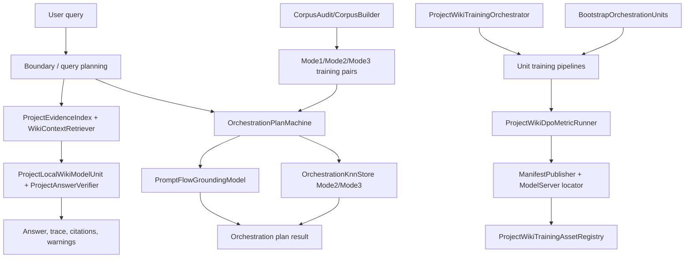

# 42.ProjectWikiDomain

Documentation status: D42 documented - parent review passed.

## 1. Human map for Luba

`42.ProjectWikiDomain` is the domain of a local project wiki and orchestration planning. Inside there are several different types of logic, and they must not be mixed:

- runtime wiki answer: `ProjectWikiQueryPlanningFlow` plans the search, `ProjectEvidenceIndex` and `WikiContextRetriever` fetch evidence, `ProjectLocalWikiModelUnit` assembles the answer, `ProjectAnswerVerifier` checks citations;
- runtime orchestration machine: `OrchestrationPlanMachine` uses the trained state of `PromptFlowGroundingModel` and `OrchestrationKnnStore`;
- training/publishing pipeline: generators, runners, `ProjectWikiDpoMetricRunner`, manifest publishers, and the registry prepare trainable-unit artifacts;
- bootstrap/support: `BootstrapOrchestrationUnits`, `HumanIntentBoundaryClassifier`, corpus audit, and fixture helpers are deterministic infrastructure.

The main honesty boundary: `PromptFlowGroundingModel` and `OrchestrationKnnStore` are trainable/learned grounding assets when their state is used by the runtime machine. `FlowReferenceDetector` is only a corpus/audit/fixture/eval helper, not runtime grounding. The old `PromptFlowIndex`, `_flowIndex`, `FlowIndexRef`, `RetrievalSource`, `KnownFlowRetrieval` must not be described as the current runtime model.

## 2. UML and data movement



| Connection | Example input | What happens | Expected result | What must not be counted as proof |
|---|---|---|---|---|
| Query -> boundary | `33* files, 34 not now` | `HumanIntentBoundaryClassifier` extracts the allowed/forbidden scope. | `FLOW-33` allowed, `FLOW-34` forbidden. | This is not a trained classifier. |
| Query -> query planning | "Where does DiscountCode travel?" | `ProjectWikiQueryPlanningFlow` builds steps before retrieval. | An entity-impact plan with DTO/mapper/persistence/workflow checks. | The plan does not prove the completeness of the evidence. |
| Plan -> evidence index | `campaign display name` | Direct hit + BM25 over the evidence index. | Hits with source `direct`/`bm25`. | BM25 is not semantic proof. |
| Retrieval -> answer | evidence hits found | The answer unit builds the answer, the verifier checks the citations. | An answer with trace and confidence. | A templated answer is not a trained LLM. |
| Prompt -> machine | `flow 33` after training | Learned grounding looks for a trained pair. | `LearnedFlowGrounding`. | A fresh machine must not pass through this branch. |
| Prompt -> fallback | migration/review/testing prompt | The policy guard does not allow a learned flow-specific plan. | `Mode2Generalization`. | The fallback does not prove flow learning. |
| Corpus -> training | Mode1/2/3 pairs | Mode1 trains `PromptFlowGroundingModel`, Mode2/3 go into the KNN stores. | A checkpoint state with weights/stores/ids. | A corpus report is not runtime evidence by itself. |
| Orchestrator -> pipeline | "Train code trace builder..." | The router selects a unit pipeline. | A batch, a metric, a possible manifest. | A manifest is not product quality. |
| Bootstrap -> pipeline | a bootstrap logical unit request | Deterministic wrappers return results. | A support signal. | Bootstrap is not trained orchestration. |

### 2.1. Connection simulations in plain words

These examples are not for running code, but so that it is clear which data actually crosses the UML arrows and what result is expected on each branch.

| Connection/branch | Example input | What is passed on | Expected result | What it does NOT prove |
|---|---|---|---|---|
| Host/API request -> PromptToTask/ProjectWiki/Orchestration path | The user asks: "Document how Campaign.GetCampaignName works and where it is located." | In the project wiki branch this becomes a `ProjectWikiQuestionRequest`; in the orchestration branch a similar prompt goes into `OrchestrationPlanMachine`. | For the wiki, an answer trace with evidence ids is expected; for orchestration, a route mode and plan text are expected. | The host/API request by itself does not prove that there was a trained model or a production plugin runtime. |
| `ProjectLocalWikiOrchestrator` -> `ProjectEvidenceIndex` | Question: "Which method returns the campaign display name?" | `ProjectWikiQueryPlanningFlow` builds a retrieval query, then `ProjectEvidenceIndex.Search` looks for direct/BM25 evidence. | An evidence hit like `ask:Campaign.GetCampaignName` is returned. | A BM25/direct hit does not prove semantic reasoning. |
| `ProjectEvidenceIndex`/`WikiContextRetriever` -> `ProjectAnswerVerifier` | Evidence found, `AllowSemantic=false`. | The retriever returns `Mode3LexicalEvidence`; the answer unit assembles the answer; the verifier checks that the citations belong to this project id. | `PROJECT_WIKI_ANSWER_READY`, citation accuracy may be `1`. | This does not prove semantic retrieval or a trained LLM, only a source-grounded lexical path. |
| `OrchestrationPlanMachine` -> `PromptFlowGroundingModel` | After training, `flow 33` comes in. | The machine passes the prompt and the `HumanIntentContract` to learned grounding. | If confidence >= 0.75 and the flow is not forbidden, the result is `LearnedFlowGrounding` with `FLOW-33`. | One fixture does not prove generalization to all user prompts. |
| `OrchestrationPlanMachine` -> `OrchestrationKnnStore` | Prompt "translate flow 33 from python/react native to node/react". | The policy guard does not allow a learned flow-specific path, so the machine looks for the nearest Mode2 pair. | `Mode2Generalization`, not a learned flow-specific plan. | The Mode2 fallback does not prove flow-specific learned grounding. |
| AI result/correction -> DPO metric/training/publisher/adaptive evidence | The training pipeline received 50 chosen/rejected rows and 50 held-out rows. | The runner computes unit metrics, `ProjectWikiDpoMetricRunner` checks the DPO rows, the publisher can create a manifest only after a gate. | A DPO metric report and a `generated_capability_manifest.json` are possible. | A JSON/report/manifest/copy/registry entry is not model readiness without load/use/continue evidence. |
| `OrchestrationCorpusAudit` -> `OrchestrationCorpusBuilder` | The source dir contains flow docs and grok/explanation files. | The audit collects corpus sources; the builder makes Mode1/Mode2/Mode3 pairs and leakage gates. | The build report should show counts and no exact prompt overlap. | The audit/build report is not runtime grounding and not a silent exclude/report-0 trick. |

## 3. No-code algorithms in plain language

### A. `OrchestrationPlanMachine.GeneratePlanAsync(string prompt, CancellationToken ct = default)`

Where the logic is: `42.ProjectWikiDomain/OrchestrationPlanMachine.cs`. Input: prompt and cancellation token. Output: `OperationResult<OrchestrationGenerationResult>`.

Current behavior: cancellation gives `CANCELLED`; the boundary classifier builds a contract; a skill-load prompt returns passthrough; approval phrasing adds `PLAN_ONLY_PENDING_APPROVAL`; an explanation prompt goes into Mode3; the learned route passes only if `PromptFlowGroundingModel.TryGround` returned a confidence >= 0.75 and the policy guard allows it; otherwise the Mode2 KNN fallback is used.

```csharp
        var grounding = _promptFlowGroundingModel.TryGround(prompt, contract);
        if (grounding is not null &&
            grounding.Confidence >= 0.75 &&
            AllowsLearnedGrounding(grounding, contract))
        {
            var learned = _promptFlowGroundingModel.FindLearnedPair(prompt, contract, grounding);
            if (learned is not null)
            {
                var text = _routeComposer.RenderLearnedFlowPlan(learned, grounding, contract, prompt);
                return Task.FromResult(OperationResult<OrchestrationGenerationResult>.Ok(new OrchestrationGenerationResult(
                    text,
                    GenerationRouteMode.LearnedFlowGrounding,
                    BoundarySource.Classifier,
                    true,
                    contract.Kind,
                    grounding,
                    warnings)));
            }
        }

        if (contract.AllowedFlowScope.Any())
            warnings.Add("learned_grounding_low_confidence_fallback_to_mode2");

        var nearestPlan = _mode2Knn.FindNearest(prompt, PairMode.Mode2Generalization);
        var planText = _routeComposer.RenderMode2Plan(nearestPlan, contract, prompt);
        return Task.FromResult(OperationResult<OrchestrationGenerationResult>.Ok(new OrchestrationGenerationResult(
            planText,
```

Source: `42.ProjectWikiDomain/OrchestrationPlanMachine.cs:86-113`. The quote proves the actual learned route and fallback, but not full product quality.

### B. `OrchestrationPlanMachine.TrainOrchestrationBatchAsync(OrchestrationTrainingBatch batch, CancellationToken ct = default)`

Input DTO: `OrchestrationTrainingBatch`. Output DTO: `OperationResult<OrchestrationTrainingBatchResult>`. The method skips already-trained pair ids; Mode1 trains `PromptFlowGroundingModel`; Mode2 puts pairs into `_mode2Knn`; Mode3 into `_humanExplanationKnn`.

```csharp
        foreach (var pair in batch.Pairs)
        {
            if (_trainedPairIds.Contains(pair.PairId))
                continue;

            if (pair.Mode == PairMode.Mode1LearnedFlowGrounding)
            {
                _promptFlowGroundingModel.Train(pair);
                _mode1PromotedPairIds.Add(pair.PairId);
                mode1++;
            }
            else if (pair.Mode == PairMode.Mode2Generalization)
            {
                _mode2Knn.Add(pair);
                _mode2PromotedPairIds.Add(pair.PairId);
                mode2++;
            }
            else if (pair.Mode == PairMode.Mode3HumanExplanation)
            {
                _humanExplanationKnn.Add(pair);
                _mode3PromotedPairIds.Add(pair.PairId);
                mode3++;
            }

            _trainedPairIds.Add(pair.PairId);
```

Source: `42.ProjectWikiDomain/OrchestrationPlanMachine.cs:173-198`.

### C. `PromptFlowGroundingModel.TryGround(string prompt, HumanIntentContract contract)`

Input: prompt + human boundary contract. Output: `FlowGroundingResult?`. This is a learned grounding asset: without KNN/weights it returns null; with trained state it computes token weights, the nearest Mode1 pair, and confidence.

```csharp
    public FlowGroundingResult? TryGround(string prompt, HumanIntentContract contract)
    {
        if (_knn.Count == 0 || _weights.Count == 0)
            return null;

        var queryText = BuildQueryText(prompt, contract);
        var tokens = OrchestrationKnnStore.Tokenize(queryText).ToHashSet(StringComparer.OrdinalIgnoreCase);
        var best = _weights
            .Select(pair => new
            {
                FlowRef = pair.Key,
                Score = ScoreTokens(tokens, pair.Value.FlowRefWeights),
                Weights = pair.Value
            })
            .OrderByDescending(item => item.Score)
            .ThenBy(item => item.FlowRef, StringComparer.Ordinal)
            .FirstOrDefault();

        if (best is null || best.Score <= 0.0)
            return null;

        var nearest = _knn.FindNearestWithScore(queryText, PairMode.Mode1LearnedFlowGrounding);
        if (nearest is null || nearest.Score <= 0.0)
            return null;

        var confidence = Math.Min(1.0, 0.70 + best.Score * 0.10 + (nearest?.Score ?? 0.0) * 0.20);
        if (confidence < 0.50)
            return null;
```

Source: `42.ProjectWikiDomain/PromptFlowGroundingModel.cs:21-48`.

### D. `OrchestrationKnnStore.FindNearestWithScore(string prompt, PairMode? mode = null)`

Input: prompt and optional `PairMode`. Output: `OrchestrationNearestPair?`. This is KNN memory over training pairs: tokenization + Jaccard + tie-break by `PairId`.

```csharp
    public OrchestrationNearestPair? FindNearestWithScore(string prompt, PairMode? mode = null)
    {
        var promptTokens = Tokenize(prompt).ToHashSet(StringComparer.OrdinalIgnoreCase);
        return _pairs
            .Where(pair => mode is null || pair.Mode == mode)
            .Select(pair => new OrchestrationNearestPair(
                pair,
                Jaccard(promptTokens, Tokenize(pair.Prompt).ToHashSet(StringComparer.OrdinalIgnoreCase))))
            .OrderByDescending(item => item.Score)
            .ThenBy(item => item.Pair.PairId, StringComparer.Ordinal)
            .FirstOrDefault();
    }
```

Source: `42.ProjectWikiDomain/OrchestrationKnnStore.cs:32-43`.

### E. Checkpoint lifecycle: `ExportCheckpoint(...)` / `ImportCheckpoint(...)`

The checkpoint saves the learned grounding KNN/weights, the Mode2/Mode3 stores, and the trained/promoted ids. This is stronger than a JSON-only report, but still requires load/use/eval for a readiness claim.

```csharp
    public OrchestrationPlanMachineCheckpoint ExportCheckpoint(OrchestrationLoopCheckpoint? loop = null)
        => new(
            2,
            MachineId,
            DomainTag,
            _currentVersion,
            DateTimeOffset.UtcNow,
            _promptFlowGroundingModel.ExportPairs(),
            _promptFlowGroundingModel.ExportWeights(),
            _mode2Knn.ExportPairs(),
            ExportPatternMap(_mode2Knn),
            _humanExplanationKnn.ExportPairs(),
            ExportPatternMap(_humanExplanationKnn),
            _trainedPairIds.Order(StringComparer.Ordinal).ToArray(),
            _mode1PromotedPairIds.Order(StringComparer.Ordinal).ToArray(),
            _mode2PromotedPairIds.Order(StringComparer.Ordinal).ToArray(),
            _mode3PromotedPairIds.Order(StringComparer.Ordinal).ToArray(),
            loop);

    public OperationResult<bool> ImportCheckpoint(OrchestrationPlanMachineCheckpoint checkpoint)
```

Source: `42.ProjectWikiDomain/OrchestrationPlanMachine.cs:306-325`.

### F. `HumanIntentBoundaryClassifier.Classify(string prompt)`

This is a deterministic policy guard. It extracts the requested/forbidden flow scope, phase scope, and approval gate phrases. It is not a trainable classifier.

```csharp
        var requestedSpans = DetectRequestedFlowSpans(text);
        var forbidden = DetectForbiddenFlowScope(text);
        var allowed = requestedSpans
            .Select(FormatFlowScope)
            .Where(value => value is not null)
            .Cast<string>()
            .Except(forbidden, StringComparer.Ordinal)
            .Distinct(StringComparer.Ordinal)
            .ToArray();
        var phases = DetectPhaseScope(text);
        var constraints = new List<string>();
        var requiresExplicitApprovalGate = ContainsAny(
            normalized,
            "until i approve",
            "until approved",
            "wait for approval",
            "pending approval",
            "requires approval",
            "require approval",
            "do not continue until",
            "don't continue until");
```

Source: `42.ProjectWikiDomain/HumanIntentBoundaryClassifier.cs:19-39`.

### G. `OrchestrationCorpusBuilder`, `OrchestrationCorpusAudit`, and `FlowReferenceDetector`

Imagine a textbook editor: `OrchestrationCorpusAudit` first looks at which flow documents and explanations even exist in the folders, and `OrchestrationCorpusBuilder` turns this material into Mode1/Mode2/Mode3 training pairs and checks whether the same prompt leaked between train and held-out. This is a corpus/audit/training-data helper layer, not a runtime generation path.

`FlowReferenceDetector` is allowed here only as a corpus/audit/fixture/eval helper: it helps find flow mentions in files/fixture strings, but does not participate in the runtime `GeneratePlanAsync`. An exact prompt leakage or overlap is a signal of audit failure that must fail/spoil the gate; it must not be silently excluded and shown as report-0 as if there was no problem. `OrchestrationPilotLoopRunner` then takes the pairs, trains `OrchestrationPlanMachine`, writes the checkpoint/report, and checks fixtures/resume.

```csharp
        var report = new OrchestrationCorpusBuildReport(
            sourceDir,
            outputPath,
            pairs.Count,
            pairs.Count(pair => pair.Mode == PairMode.Mode1LearnedFlowGrounding && !pair.IsHeldOut),
            pairs.Count(pair => pair.Mode == PairMode.Mode1LearnedFlowGrounding && pair.IsHeldOut),
            pairs.Count(pair => pair.Mode == PairMode.Mode2Generalization && !pair.IsHeldOut),
            pairs.Count(pair => pair.Mode == PairMode.Mode2Generalization && pair.IsHeldOut),
            pairs.Count(pair => pair.Mode == PairMode.Mode3HumanExplanation && !pair.IsHeldOut),
            pairs.Count(pair => pair.Mode == PairMode.Mode3HumanExplanation && pair.IsHeldOut),
            pairs.Count(pair => pair.Mode == PairMode.Mode3HumanExplanation),
            NoExactPromptOverlap(pairs, PairMode.Mode1LearnedFlowGrounding),
            NoExactPromptOverlap(pairs, PairMode.Mode2Generalization),
            NoExactPromptOverlap(pairs, PairMode.Mode3HumanExplanation),
            !mode3TrainBundles.Overlaps(mode3EvalBundles),
            !mode3TrainRefs.Overlaps(mode3EvalRefs),
            false);
```

Source: `42.ProjectWikiDomain/OrchestrationCorpusBuilder.cs:61-77`.

```csharp
    public void NoRuntimeFlowReferenceDetectorUsage()
    {
        Assert.DoesNotContain(nameof(FlowReferenceDetector), ReadProjectFile("42.ProjectWikiDomain", "OrchestrationPlanMachine.cs"));
        Assert.DoesNotContain(nameof(FlowReferenceDetector), ReadProjectFile("42.ProjectWikiDomain", "TrainedRouteComposerUnit.cs"));
        Assert.DoesNotContain(nameof(FlowReferenceDetector), ReadProjectFile("42.ProjectWikiDomain", "HumanIntentBoundaryClassifier.cs"));
    }
```

Source: `Tests/OrchestrationPlanTests.cs:326-331`.

### H. `ProjectLocalWikiOrchestrator.AskWithTraceAsync(ProjectWikiQuestionRequest request, CancellationToken ct = default)`

Input: `ProjectWikiQuestionRequest`. Output: `OperationResult<ProjectWikiAnswerTraceResult>`. The algorithm does query plan -> retrieval -> answer -> verification -> trace. This is runtime composition, not a trained LLM.

```csharp
        var planned = await _queryPlanningFlow.PlanAsync(BuildUserQuestion(request), ct);
        if (!planned.IsSuccess)
            return planned.MapError<ProjectWikiAnswerTraceResult>();

        var context = await _retriever.RetrieveAsync(request, planned.Value!, ct);
        if (!context.IsSuccess)
            return context.MapError<ProjectWikiAnswerTraceResult>();

        var answer = await _modelUnit.AnswerAsync(request, context.Value!, ct);
        if (!answer.IsSuccess)
            return answer.MapError<ProjectWikiAnswerTraceResult>();

        var answerValue = answer.Value!;
        var enrichedWarnings = answerValue.Warnings
            .Concat(planned.Value!.Warnings)
            .Concat(["query_plan_applied"])
            .Distinct(StringComparer.Ordinal)
            .ToArray();
        answerValue = answerValue with { Warnings = enrichedWarnings };

        var verified = _verifier.Verify(answerValue, _evidenceIndex, request.ProjectId);
        if (verified.IsPassed)
        {
            var passedTrace = BuildTrace(request, planned.Value!, context.Value!, answerValue, verified, stopwatch, cpuStart, memoryStart, "PASS");
            return OperationResult<ProjectWikiAnswerTraceResult>.Ok(new ProjectWikiAnswerTraceResult(answerValue, planned.Value!, passedTrace));
        }
```

Source: `42.ProjectWikiDomain/ProjectLocalWikiOrchestrator.cs:58-82`.

### I. Evidence/retrieval path

`ProjectEvidenceIndex.Search(string query, int topK = 5)` looks for direct evidence and BM25, then dedupes. `WikiContextRetriever.RetrieveAsync(...)` applies context routing: missing/wrong/stale branches give an empty lexical context; the semantic-unavailable branch honestly falls back to Mode3 lexical.

```csharp
    public AgentInfrastructure.OperationResult<IReadOnlyList<ProjectWikiEvidenceHit>> Search(string query, int topK = 5)
    {
        if (string.IsNullOrWhiteSpace(query))
            return AgentInfrastructure.OperationResult<IReadOnlyList<ProjectWikiEvidenceHit>>.Ok([]);

        var searched = _search.Search(query, Math.Max(1, topK));
        if (!searched.IsSuccess)
            return AgentInfrastructure.OperationResult<IReadOnlyList<ProjectWikiEvidenceHit>>.Fail(searched.Error, "BM25_SEARCH_FAILED");

        var directHits = FindDirectEvidenceHits(query);
        var bm25Hits = searched.Value!
            .Where(result => _recordsById.ContainsKey(result.ExternalId))
            .Select(result => new ProjectWikiEvidenceHit(
                _recordsById[result.ExternalId],
                result.Score,
                "bm25"))
            .ToArray();
```

Source: `42.ProjectWikiDomain/ProjectEvidenceIndex.cs:104-120`.

```csharp
        if (routingDecision?.Value?.RouteKind is ProjectWikiContextRouteKind.MissingEvidenceAbstention or
            ProjectWikiContextRouteKind.WrongProjectRejection or
            ProjectWikiContextRouteKind.StaleDocumentationRejection)
        {
            return OperationResult<ProjectWikiRetrievedContext>.Ok(new ProjectWikiRetrievedContext(
                ProjectWikiRetrievalMode.Mode3LexicalEvidence,
                [],
                null,
                false,
                queryPlanWarnings
                    .Concat(routingDecision.Value.Warnings)
                    .Concat(["context_routing_forced_no_answer"])
                    .Distinct(StringComparer.Ordinal)
                    .ToArray()));
        }
```

Source: `42.ProjectWikiDomain/WikiContextRetriever.cs:55-68`.

### J. Training orchestrator and the trainable-unit pipeline pattern

`ProjectWikiTrainingOrchestrator.RunAsync(string prompt, string artifactRoot, string batchId = "", string serverBaseUrl = "https://models.local", string learningDataRoot = "", CancellationToken ct = default)` validates the artifact root, an optional registry continuation gate, then routes the prompt into a specific unit pipeline: request routing, query planning, context routing, answer composer, entity impact, answer verifier, code trace, documentation generator, stack/version, system boundary, trace aggregator.

```csharp
        var routed = _router.Route(prompt);
        if (!routed.IsSuccess)
            return routed.MapError<ProjectWikiTrainingOrchestratorResult>();

        var decision = routed.Value!;
        return decision.RouteKind switch
        {
            ProjectWikiRequestRouteKind.ProjectWikiRequestRouterTraining => FromRequestRouting(
                decision,
                await _requestRouting.RunOneBatchAsync(artifactRoot, SelectBatchId(batchId, "project-wiki-request-routing-batch-001"), serverBaseUrl, ct)),
            ProjectWikiRequestRouteKind.StackVersionTraining => FromStackAndVersion(
                decision,
                await _stackAndVersion.RunOneBatchAsync(artifactRoot, SelectBatchId(batchId, "stack-version-classifier-batch-001"), serverBaseUrl, ct)),
            ProjectWikiRequestRouteKind.SystemBoundaryMapperTraining => FromSystemBoundaryMapper(
                decision,
                await _systemBoundaryMapper.RunOneBatchAsync(artifactRoot, SelectBatchId(batchId, "system-boundary-mapper-batch-001"), serverBaseUrl, ct)),
            ProjectWikiRequestRouteKind.CrossStackBusinessFlowGraphTraining => FromCrossStackBusinessFlowGraph(
                decision,
                await _crossStackBusinessFlowGraph.RunOneBatchAsync(artifactRoot, SelectBatchId(batchId, "cross-stack-business-flow-graph-batch-001"), serverBaseUrl, ct)),
            ProjectWikiRequestRouteKind.CodeTraceTraining => FromCodeTrace(
                decision,
                await _codeTrace.RunOneBatchAsync(artifactRoot, SelectBatchId(batchId, "code-trace-builder-batch-001"), serverBaseUrl, ct)),
```

Source: `42.ProjectWikiDomain/ProjectWikiTrainingOrchestrator.cs:133-154`.

A representative pipeline using the code trace as an example:

```csharp
        var train = await _generator.BuildBatchAsync(batchId, heldOut: false, ct);
        if (!train.IsSuccess)
            return train.MapError<CodeTraceBuilderTrainingPipelineResult>();
        var trainBatch = train.Value!;

        var heldOut = await _generator.BuildBatchAsync($"{batchId}-heldout", heldOut: true, ct);
        if (!heldOut.IsSuccess)
            return heldOut.MapError<CodeTraceBuilderTrainingPipelineResult>();
        var heldOutBatch = heldOut.Value!;

        var run = await _runner.TrainAndEvaluateAsync(trainBatch.Pairs, heldOutBatch.Pairs, ct);
        if (!run.IsSuccess)
            return run.MapError<CodeTraceBuilderTrainingPipelineResult>();
```

Source: `42.ProjectWikiDomain/CodeTraceBuilderTrainingPipeline.cs:53-65`.

### K. `ProjectWikiDpoMetricRunner.TrainAndEvaluateAsync(...)`

Input: `unitId`, `batchId`, 50 training rows, 50 held-out rows, `artifactRoot`. Output: `OperationResult<ProjectWikiDpoMetricRunResult>`. The method requires exactly 50/50 rows and validates the rows before the DPO metric path.

```csharp
        if (trainingRows.Count != 50)
            return OperationResult<ProjectWikiDpoMetricRunResult>.Fail("DPO metric training batch must contain exactly 50 rows.", "DPO_TRAINING_BATCH_SIZE_NOT_50");

        if (heldOutRows.Count != 50)
            return OperationResult<ProjectWikiDpoMetricRunResult>.Fail("DPO metric held-out batch must contain exactly 50 rows.", "DPO_HELDOUT_BATCH_SIZE_NOT_50");

        var validation = ValidateRows(trainingRows.Concat(heldOutRows));
        if (!validation.IsSuccess)
```

Source: `42.ProjectWikiDomain/ProjectWikiDpoMetricRunner.cs:68-75`.

### L. Manifest publication

`CodeTraceBuilderManifestPublisher.PublishAsync(...)` requires a passed training result, writes a local policy/tokenizer/manifest, and then uses the model-server repository/locator. This is an asset publication pattern, not proof of production remote inference.

```csharp
        var trainingRunId = $"code-trace-builder-{DateTimeOffset.UtcNow:yyyyMMddHHmmss}";
        var runRoot = Path.Combine(artifactRoot, CodeTraceBuilderUnit.UnitId, trainingRunId);
        Directory.CreateDirectory(runRoot);
        var policyPath = Path.Combine(runRoot, "policy.bin");
        var tokenizerPath = Path.Combine(runRoot, "tokenizer.json");
        var manifestPath = Path.Combine(runRoot, "generated_capability_manifest.json");
        await File.WriteAllTextAsync(policyPath, JsonSerializer.Serialize(new
        {
            unit_id = CodeTraceBuilderUnit.UnitId,
            kind = "code_trace_builder_policy_state",
            training_result = trainingResult,
            created_at_utc = DateTimeOffset.UtcNow
        }, JsonOptions), ct);
```

Source: `42.ProjectWikiDomain/CodeTraceBuilderManifestPublisher.cs:48-60`.

### M. `BootstrapOrchestrationUnits`

Bootstrap units implement `ILogicalUnit` wrappers around the old deterministic logic. They are useful as a support/start point for training, but are not trained orchestration.

```csharp
        // Build the intent using the same Regex logic as the original BuildIntent method.
        var intent = BuildIntent(request.Input);

        // Wrap the result in the LogicalUnitResult envelope required by ILogicalUnit.
        var result = new LogicalUnitResult<TaskOrchestrationIntent>(
            UnitId: request.UnitId,
            UnitRole: "intent-builder",
            DomainTag: request.DomainTag,
            Output: intent,
            Confidence: 1.0, // Bootstrap units are deterministic — confidence is always 1.
```

Source: `42.ProjectWikiDomain/BootstrapOrchestrationUnits.cs:32-41`.

## 4. Hierarchy and status

| Level | What exists in D42 | Honest status |
|---|---|---|
| `ILearningMachine<TDomain>` | `OrchestrationPlanMachine : ILearningMachine<OrchestrationPlanDomain>` | A real trainable machine with checkpoint export/import and runtime generation. |
| `ILogicalOrchestrator` | `OrchestrationPlanOrchestrator`, `ProjectLocalWikiOrchestrator` | The orchestrators wrap the machine/wiki path, but do not themselves prove model quality. |
| `ILogicalFlow` | `ProjectWikiQueryPlanningFlow` and related adapters | Deterministic/planned flow infrastructure. |
| `ILogicalUnit` | project wiki units and bootstrap units | Some units are trainable-adjacent through the pipeline; bootstrap units are deterministic support. |
| Product asset lifecycle | DPO runner + publishers + registry | There is a pattern generator -> runner -> metric -> publisher/manifest; readiness requires load/use/continue evidence. |

## 5. Tests and QA mapping

The tests were read, but not run in this documentation subphase.

| Test file | What it covers | What it does not prove |
|---|---|---|
| `Tests/OrchestrationPlanTests.cs` | Fresh vs trained machine, learned grounding, Mode2/Mode3 routing, checkpoint export/import/resume, no runtime `FlowReferenceDetector`, removed flow contracts. | Does not prove quality of all real human prompts outside the fixtures. |
| `Tests/ProjectWikiDomainTests.cs` | Evidence index, lexical fallback, query planning, training runners/pipelines, manifest publishing patterns, project wiki orchestrator metrics. | Local/temp artifacts are not equal to a production deployment; the tests were not run now. |

```csharp
    public async Task FreshUntrainedMachine_DoesNotGroundFlow33()
    {
        var result = await new OrchestrationPlanMachine().GeneratePlanAsync("flow 33");
        Assert.NotEqual(GenerationRouteMode.LearnedFlowGrounding, result.Value!.RouteMode);
        Assert.Null(result.Value.FlowGrounding);
        Assert.DoesNotContain("LEARNED_FLOW_GROUNDING_PLAN", result.Value.PlanText);
    }

    [Fact]
    public async Task TrainedMachine_FixtureFlow33ProducesLearnedStructure()
    {
        var result = await (await TrainedMachineAsync()).GeneratePlanAsync("flow 33");
        Assert.Contains("LEARNED_FLOW_GROUNDING_PLAN", result.Value!.PlanText);
        Assert.Equal("FLOW-33", result.Value.FlowGrounding!.FlowRef);
```

Source: `Tests/OrchestrationPlanTests.cs:400-413`.

```csharp
        var result = await orchestrator.Value!.RunAsync(new LogicalOrchestratorRequest(
            "run-project-wiki",
            ProjectLocalWikiOrchestrator.ScenarioId,
            "Document how Campaign.GetCampaignName works and where it is located.",
            new LogicalExecutionFlags(),
            new Dictionary<string, object>
            {
                ["allow_semantic"] = false,
                ["top_k"] = 2
            }));

        Assert.True(result.IsSuccess, result.ErrorMessage);
        Assert.Equal("PROJECT_WIKI_ANSWER_READY", result.Value!.OverallVerdict);
        Assert.Equal(ProjectLocalWikiOrchestrator.FlowId, result.Value.SelectedFlowId);
        Assert.Equal("askapediaweb", result.Value.FlowResult.Metrics["project_id"]);
        Assert.Equal("Mode3LexicalEvidence", result.Value.FlowResult.Metrics["retrieval_mode"]);
        Assert.Equal("1", result.Value.FlowResult.Metrics["citation_accuracy"]);
```

Source: `Tests/ProjectWikiDomainTests.cs:1812-1828`.

## 6. Anti-false-done

- A JSON report, manifest, static checker, smoke report, fixture-only probe, deterministic bootstrap, or corpus audit must not be taken as a finished trained unit.
- `FlowReferenceDetector` must not be described as runtime grounding.
- `PromptFlowIndex`, `_flowIndex`, `FlowIndexRef`, `RetrievalSource`, `KnownFlowRetrieval` are not the current runtime logic.
- `BootstrapOrchestrationUnits` is deterministic bootstrap/support, not trained orchestration.
- `ProjectWikiDpoMetricRunner` and metric files are useful, but product readiness requires downstream load/use/continue evidence.
- BM25/direct evidence search is source-grounded retrieval, not a semantic authority.
- Manifest/locator/checkpoint are parts of the asset lifecycle, but readiness requires a fresh load and use in the target path.

## 7. Final D42 status

`42.ProjectWikiDomain` contains a real trainable `OrchestrationPlanMachine` with checkpoint state, learned flow grounding (`PromptFlowGroundingModel`), and KNN memory (`OrchestrationKnnStore`). There is also a project wiki runtime path and many trainable-unit pipeline patterns. A significant part of the project remains deterministic helpers, corpus/audit utilities, bootstrap wrappers, local reports, and template/composition logic. They must not be called a finished trained semantic system without separate runtime/load/use/evaluation evidence.
