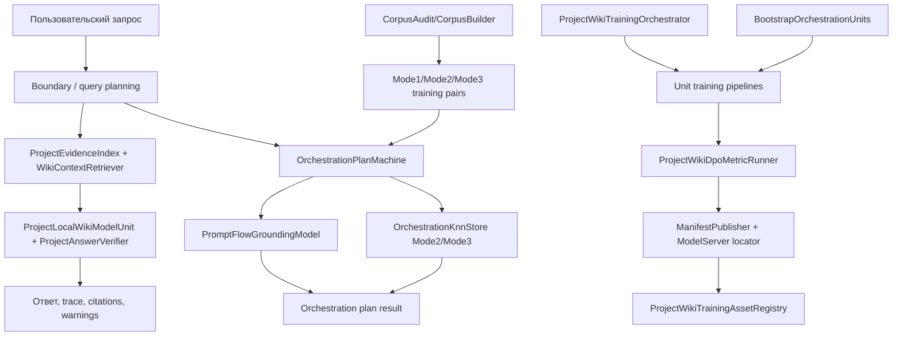

# 42.ProjectWikiDomain

Documentation status: D42 documented - parent review passed.

## 1. Человеческая карта для Лубы

`42.ProjectWikiDomain` - это домен локальной проектной wiki и orchestration planning. Внутри есть несколько разных типов логики, и их нельзя смешивать:

- runtime wiki-ответа: `ProjectWikiQueryPlanningFlow` планирует поиск, `ProjectEvidenceIndex` и `WikiContextRetriever` достают evidence, `ProjectLocalWikiModelUnit` собирает ответ, `ProjectAnswerVerifier` проверяет citations;
- runtime orchestration machine: `OrchestrationPlanMachine` использует обученное состояние `PromptFlowGroundingModel` и `OrchestrationKnnStore`;
- training/publishing pipeline: генераторы, runners, `ProjectWikiDpoMetricRunner`, manifest publishers и registry готовят trainable-unit artifacts;
- bootstrap/support: `BootstrapOrchestrationUnits`, `HumanIntentBoundaryClassifier`, corpus audit и fixture helpers являются deterministic infrastructure.

Главная honesty-boundary: `PromptFlowGroundingModel` и `OrchestrationKnnStore` являются trainable/learned grounding assets, когда их состояние используется runtime-машиной. `FlowReferenceDetector` - только corpus/audit/fixture/eval helper, не runtime grounding. Старые `PromptFlowIndex`, `_flowIndex`, `FlowIndexRef`, `RetrievalSource`, `KnownFlowRetrieval` не должны описываться как текущая runtime-модель.

## 2. UML и движение данных



| Связь | Пример входа | Что происходит | Ожидаемый результат | Что нельзя засчитывать как доказательство |
|---|---|---|---|---|
| Запрос -> boundary | `33* files, 34 not now` | `HumanIntentBoundaryClassifier` выделяет allowed/forbidden scope. | `FLOW-33` разрешён, `FLOW-34` запрещён. | Это не обученный classifier. |
| Запрос -> query planning | "Where does DiscountCode travel?" | `ProjectWikiQueryPlanningFlow` строит steps перед retrieval. | Entity-impact план с DTO/mapper/persistence/workflow checks. | План не доказывает полноту evidence. |
| План -> evidence index | `campaign display name` | Direct hit + BM25 по evidence index. | Hits с source `direct`/`bm25`. | BM25 не semantic proof. |
| Retrieval -> answer | evidence hits найдены | Answer unit строит ответ, verifier проверяет citations. | Ответ с trace и confidence. | Шаблонный ответ не trained LLM. |
| Prompt -> machine | `flow 33` после обучения | Learned grounding ищет trained pair. | `LearnedFlowGrounding`. | Fresh machine не должна проходить эту ветку. |
| Prompt -> fallback | migration/review/testing prompt | Policy guard не даёт learned flow-specific plan. | `Mode2Generalization`. | Fallback не доказывает flow learning. |
| Corpus -> training | Mode1/2/3 pairs | Mode1 учит `PromptFlowGroundingModel`, Mode2/3 попадают в KNN stores. | Checkpoint state с weights/stores/ids. | Corpus report сам не runtime evidence. |
| Orchestrator -> pipeline | "Train code trace builder..." | Router выбирает unit pipeline. | Batch, metric, possible manifest. | Manifest не product quality. |
| Bootstrap -> pipeline | bootstrap logical unit request | Deterministic wrappers возвращают results. | Support signal. | Bootstrap не trained orchestration. |

### 2.1. Симуляции связей простыми словами

Эти примеры нужны не для запуска кода, а чтобы было понятно, какие данные реально переходят по стрелкам UML и какой результат ожидается на каждой ветке.

| Связь/ветка | Пример входа | Что передаётся дальше | Ожидаемый результат | Что НЕ доказывает |
|---|---|---|---|---|
| Host/API request -> PromptToTask/ProjectWiki/Orchestration path | Пользователь спрашивает: "Document how Campaign.GetCampaignName works and where it is located." | В проектной wiki-ветке это становится `ProjectWikiQuestionRequest`; в orchestration-ветке похожий prompt идёт в `OrchestrationPlanMachine`. | Для wiki ожидается answer trace с evidence ids; для orchestration ожидается route mode и plan text. | Сам host/API request не доказывает, что была обученная модель или production plugin runtime. |
| `ProjectLocalWikiOrchestrator` -> `ProjectEvidenceIndex` | Вопрос: "Which method returns the campaign display name?" | `ProjectWikiQueryPlanningFlow` строит retrieval query, затем `ProjectEvidenceIndex.Search` ищет direct/BM25 evidence. | Возвращается evidence hit вроде `ask:Campaign.GetCampaignName`. | BM25/direct hit не доказывает semantic reasoning. |
| `ProjectEvidenceIndex`/`WikiContextRetriever` -> `ProjectAnswerVerifier` | Evidence найден, `AllowSemantic=false`. | Retriever отдаёт `Mode3LexicalEvidence`; answer unit собирает ответ; verifier проверяет, что citations принадлежат этому project id. | `PROJECT_WIKI_ANSWER_READY`, citation accuracy может быть `1`. | Это не доказывает semantic retrieval или trained LLM, только source-grounded lexical path. |
| `OrchestrationPlanMachine` -> `PromptFlowGroundingModel` | После training приходит `flow 33`. | Machine передаёт prompt и `HumanIntentContract` в learned grounding. | Если confidence >= 0.75 и flow не запрещён, результат `LearnedFlowGrounding` с `FLOW-33`. | Один fixture не доказывает generalization на все user prompts. |
| `OrchestrationPlanMachine` -> `OrchestrationKnnStore` | Prompt "translate flow 33 from python/react native to node/react". | Policy guard не разрешает learned flow-specific path, поэтому machine ищет ближайшую Mode2 пару. | `Mode2Generalization`, а не learned flow-specific plan. | Mode2 fallback не доказывает flow-specific learned grounding. |
| AI result/correction -> DPO metric/training/publisher/adaptive evidence | Training pipeline получил 50 chosen/rejected rows и 50 held-out rows. | Runner считает unit metrics, `ProjectWikiDpoMetricRunner` проверяет DPO rows, publisher может создать manifest только после gate. | Возможны DPO metric report и `generated_capability_manifest.json`. | JSON/report/manifest/copy/registry entry не являются model readiness без load/use/continue evidence. |
| `OrchestrationCorpusAudit` -> `OrchestrationCorpusBuilder` | Source dir содержит flow docs и grok/explanation files. | Audit собирает corpus sources; builder делает Mode1/Mode2/Mode3 pairs и leakage gates. | Build report должен показать counts и отсутствие exact prompt overlap. | Audit/build report не runtime grounding и не silent exclude/report-0 trick. |

### 2.2. Honesty-boundary для deterministic CrossStack seed

`CrossStackBusinessFlowGraphDpoGenerator` строит deterministic cold-start seed:
полную матрицу доменов и rejected-типов для проверки формы обучения. Такой
batch помечается `SourceKind=DeterministicSeed`; его
`WrongAnnotationRate` является историческим self-score генератора, а не
acceptance. Вместе с batch генератор кладёт internal provenance proof,
привязанный к source kind, split role, batch id и SHA-256 exact ordered rows.
Публичный `SourceKind` после этого остаётся только описательным ярлыком:
переписать его через `with { SourceKind = RealRepositoryCorpus }` недостаточно,
потому что validator сверяет proof и raw fingerprint.

Canonical training и held-out batches по-прежнему выбирают по 10 доменов и
дают 50 строк каждый. Для проверки честности самого генератора есть private
test seam: он принимает 11 явных доменов и тем же seed-to-batch кодом строит
55 строк. Поэтому old-boundary regression вроде `Take(50)` становится видимой:
тест сверяет полный набор domain x rejected-type cells, отсутствие дублей и
точный row count за границей 50. Этот seam не меняет production domain
selection и не является публичным arbitrary-domain API.

Смысловая публикация `Trusted` для `CrossStackBusinessFlowGraphUnit` теперь
требует opaque `CrossStackBusinessFlowGraphPublicationAuthority` без public
constructor/factory. Authority может быть создана только после повторной
независимой проверки exact train и held-out batches: разные split role/id,
batch ids, row fingerprints, source provenance, expected/actual matrix cells,
версия validator и identity training/DPO metric results попадают в proof.
`CrossStackFlowPairBatchValidator` отдельно пересчитывает matrix completeness,
expected/actual matrix-cell hashes и wrong-annotation rate из raw rows; эти
fingerprints вместе с identities training run и DPO metric run входят в
publication proof. `ValidatePublicationCandidate` fail-closed отклоняет `null`
authority, а minting использует отдельную pre-authority проверку exact inputs.
Даже хороший deterministic seed после этого остаётся
baseline. Текущего importer-а настоящего `RealRepositoryCorpus` нет, поэтому
live semantic authority minter для этого unit отсутствует; public publisher
route без opaque authority отказной, trusted positive path нельзя фабриковать
тестом.

Baseline side effects разрешены намеренно и ограниченно: pipeline может писать
raw train/held-out rows, independent validation report, DPO metrics,
diagnostics и checkpoint artifacts, но рядом обязан быть machine-readable
`BaselineOnlyNotPromotable` disposition с source/fingerprints/versioned
allowlist. Batch-root allowlist включает только batch JSON/report files и
вложенный baseline-only `dpo-runs/**`; metric-run allowlist включает metric
JSONL/diagnostics/summary/checkpoints и reservation sidecars
`checkpoints/.dpo_step_*.lock`. Эти baseline files пишутся атомарно через
temp-file в той же директории и replace, поэтому successful run не оставляет
`.tmp` artifacts.
Эти файлы являются training/evaluation baseline artifacts, а не
semantic authority. `DeterministicSeed`, `Unknown`, forged/replayed authority и
unaccepted candidates отсекаются publisher-ом до записи policy/tokenizer/
`generated_capability_manifest.json`, upload и registry register.

### 2.2.1. CrossStack repository-owned DPO seam

Новый public route для `CrossStackBusinessFlowGraphTrainingPipeline` не
переименовывает deterministic seed в настоящий corpus. Он принимает явные
repository-owned contexts для train и held-out split, а каждый context указывает
на canonical address:
`training-data/dpo/cross-stack-business-flow-graph/ilearning-unit/<version>/`.
Train и held-out обязаны быть разными sealed datasets: разный version/address,
разный split role/id, разные request identity hashes и разные reopened
fingerprints. Если они указывают на один manifest, один split, один request
identity или совпадающий payload, pipeline отказывает до validation, metric,
training и publication path.

Disk-first поведение такое же, как у shared resolver-а. Exact hit открывает
`manifest.json` и ordered `pairs/*.dpo-pair.json` с диска, не вызывает creator и
работает так же после fresh adapter instance/restart. Clean miss допускает
только injected/admitted creator, вызывает его один раз, seal-ит dataset и затем
обязательно переоткрывает bytes; downstream строит `CrossStackBusinessFlowGraphDpoBatch`
только из reopened payload, а не из in-memory creator rows. Corrupt manifest,
request-identity mismatch, partial directory, malformed carrier или split
mismatch fail-closed до creator. Cancellation до creator не пишет rows вне
точного dataset root/lease контракта shared resolver-а.

Carrier хранит достаточно domain fields, чтобы восстановить CrossStack pair:
pair id, source/target systems, business flow, chosen path, rejected path,
negative type, expectation, graph facts, explanation, split metadata и source
provenance. Existing deterministic generator остаётся baseline/eval-only и
по-прежнему нужен для shape tests; этот slice не запускает Qwen/Ollama,
teacher, training, real DPO authoring или weights publication.
Repository-owned CrossStack admission принимает только rows, где обе
trainable стороны — `OpenTeacher` с тем же content-bound passport; paid
reference остаётся hash-only input в request identity, а не стороной пары.

### 2.3. Карантин уже записанных dpo-runs

Старые каталоги
`43.LearningLocalWikiData/artifacts/runner-metrics/**/dpo-runs/**` не удалены:
они остаются доказательством того, какие посевные пары и отложенные пары
порождал контур Project Wiki. Но их смысл понижен до исторической базы:
детерминированный посев без полного паспорта авторства сторон не является
semantic authority и не становится обучающим материалом для новой двери
тренера.

Живой реестр карантина:
`training-data/legacy-dpo-artifact-quarantine/2026-08-30/seed-dpo-run-directories.jsonl`.
В нем 439 каталогов с `dpo-pairs.jsonl`, 43 550 непустых строк и 7 соседних
`heldout-dpo-pairs.jsonl` с 350 строками. У каждой записи статус
`BASELINE_ONLY_COLD_START_FOREST`, `training_allowed=false` и
`semantic_publication_allowed=false`. Проверка пересчитывает SHA-256 и строки
по живым файлам: новый или измененный посевный файл без записи карантина
считается ошибкой, а не новым разрешением на обучение.

Пересборка в trainable-состояние требует нового прогона через
`DpoTrainerPairAdmission`, явное `side authorship` и лицензионный gate
источников. Прежний `dpo-runs` каталог не повышается задним числом.

## 3. Алгоритмы без кода на русском

### A. `OrchestrationPlanMachine.GeneratePlanAsync(string prompt, CancellationToken ct = default)`

Где логика: `42.ProjectWikiDomain/OrchestrationPlanMachine.cs`. Вход: prompt и cancellation token. Выход: `OperationResult<OrchestrationGenerationResult>`.

Текущее поведение: cancellation даёт `CANCELLED`; boundary classifier строит contract; skill-load prompt возвращает passthrough; approval phrasing добавляет `PLAN_ONLY_PENDING_APPROVAL`; explanation prompt идёт в Mode3; learned route проходит только если `PromptFlowGroundingModel.TryGround` вернул confidence >= 0.75 и policy guard разрешает; иначе используется Mode2 KNN fallback.

```csharp
        var grounding = _promptFlowGroundingModel.TryGround(prompt, contract);
        if (grounding is not null &&
            grounding.Confidence >= 0.75 &&
            AllowsLearnedGrounding(grounding, contract))
        {
            var learned = _promptFlowGroundingModel.FindLearnedPair(prompt, contract, grounding);
            if (learned is not null)
            {
                var text = _routeComposer.RenderLearnedFlowPlan(learned, grounding, contract, prompt);
                return Task.FromResult(OperationResult<OrchestrationGenerationResult>.Ok(new OrchestrationGenerationResult(
                    text,
                    GenerationRouteMode.LearnedFlowGrounding,
                    BoundarySource.Classifier,
                    true,
                    contract.Kind,
                    grounding,
                    warnings)));
            }
        }

        if (contract.AllowedFlowScope.Any())
            warnings.Add("learned_grounding_low_confidence_fallback_to_mode2");

        var nearestPlan = _mode2Knn.FindNearest(prompt, PairMode.Mode2Generalization);
        var planText = _routeComposer.RenderMode2Plan(nearestPlan, contract, prompt);
        return Task.FromResult(OperationResult<OrchestrationGenerationResult>.Ok(new OrchestrationGenerationResult(
            planText,
```

Источник: `42.ProjectWikiDomain/OrchestrationPlanMachine.cs:86-113`. Цитата доказывает actual learned route и fallback, но не full product quality.

### B. `OrchestrationPlanMachine.TrainOrchestrationBatchAsync(OrchestrationTrainingBatch batch, CancellationToken ct = default)`

Вход DTO: `OrchestrationTrainingBatch`. Выход DTO: `OperationResult<OrchestrationTrainingBatchResult>`. Метод пропускает уже trained pair ids; Mode1 обучает `PromptFlowGroundingModel`; Mode2 кладёт пары в `_mode2Knn`; Mode3 - в `_humanExplanationKnn`.

```csharp
        foreach (var pair in batch.Pairs)
        {
            if (_trainedPairIds.Contains(pair.PairId))
                continue;

            if (pair.Mode == PairMode.Mode1LearnedFlowGrounding)
            {
                _promptFlowGroundingModel.Train(pair);
                _mode1PromotedPairIds.Add(pair.PairId);
                mode1++;
            }
            else if (pair.Mode == PairMode.Mode2Generalization)
            {
                _mode2Knn.Add(pair);
                _mode2PromotedPairIds.Add(pair.PairId);
                mode2++;
            }
            else if (pair.Mode == PairMode.Mode3HumanExplanation)
            {
                _humanExplanationKnn.Add(pair);
                _mode3PromotedPairIds.Add(pair.PairId);
                mode3++;
            }

            _trainedPairIds.Add(pair.PairId);
```

Источник: `42.ProjectWikiDomain/OrchestrationPlanMachine.cs:173-198`.

### C. `PromptFlowGroundingModel.TryGround(string prompt, HumanIntentContract contract)`

Вход: prompt + human boundary contract. Выход: `FlowGroundingResult?`. Это learned grounding asset: без KNN/weights он возвращает null; с trained state считает token weights, nearest Mode1 pair и confidence.

```csharp
    public FlowGroundingResult? TryGround(string prompt, HumanIntentContract contract)
    {
        if (_knn.Count == 0 || _weights.Count == 0)
            return null;

        var queryText = BuildQueryText(prompt, contract);
        var tokens = OrchestrationKnnStore.Tokenize(queryText).ToHashSet(StringComparer.OrdinalIgnoreCase);
        var best = _weights
            .Select(pair => new
            {
                FlowRef = pair.Key,
                Score = ScoreTokens(tokens, pair.Value.FlowRefWeights),
                Weights = pair.Value
            })
            .OrderByDescending(item => item.Score)
            .ThenBy(item => item.FlowRef, StringComparer.Ordinal)
            .FirstOrDefault();

        if (best is null || best.Score <= 0.0)
            return null;

        var nearest = _knn.FindNearestWithScore(queryText, PairMode.Mode1LearnedFlowGrounding);
        if (nearest is null || nearest.Score <= 0.0)
            return null;

        var confidence = Math.Min(1.0, 0.70 + best.Score * 0.10 + (nearest?.Score ?? 0.0) * 0.20);
        if (confidence < 0.50)
            return null;
```

Источник: `42.ProjectWikiDomain/PromptFlowGroundingModel.cs:21-48`.

### D. `OrchestrationKnnStore.FindNearestWithScore(string prompt, PairMode? mode = null)`

Вход: prompt и optional `PairMode`. Выход: `OrchestrationNearestPair?`. Это KNN memory над training pairs: tokenization + Jaccard + tie-break по `PairId`.

```csharp
    public OrchestrationNearestPair? FindNearestWithScore(string prompt, PairMode? mode = null)
    {
        var promptTokens = Tokenize(prompt).ToHashSet(StringComparer.OrdinalIgnoreCase);
        return _pairs
            .Where(pair => mode is null || pair.Mode == mode)
            .Select(pair => new OrchestrationNearestPair(
                pair,
                Jaccard(promptTokens, Tokenize(pair.Prompt).ToHashSet(StringComparer.OrdinalIgnoreCase))))
            .OrderByDescending(item => item.Score)
            .ThenBy(item => item.Pair.PairId, StringComparer.Ordinal)
            .FirstOrDefault();
    }
```

Источник: `42.ProjectWikiDomain/OrchestrationKnnStore.cs:32-43`.

### E. Checkpoint lifecycle: `ExportCheckpoint(...)` / `ImportCheckpoint(...)`

Checkpoint сохраняет learned grounding KNN/weights, Mode2/Mode3 stores и trained/promoted ids. Это сильнее JSON-only report, но всё ещё требует load/use/eval для readiness claim.

```csharp
    public OrchestrationPlanMachineCheckpoint ExportCheckpoint(OrchestrationLoopCheckpoint? loop = null)
        => new(
            2,
            MachineId,
            DomainTag,
            _currentVersion,
            DateTimeOffset.UtcNow,
            _promptFlowGroundingModel.ExportPairs(),
            _promptFlowGroundingModel.ExportWeights(),
            _mode2Knn.ExportPairs(),
            ExportPatternMap(_mode2Knn),
            _humanExplanationKnn.ExportPairs(),
            ExportPatternMap(_humanExplanationKnn),
            _trainedPairIds.Order(StringComparer.Ordinal).ToArray(),
            _mode1PromotedPairIds.Order(StringComparer.Ordinal).ToArray(),
            _mode2PromotedPairIds.Order(StringComparer.Ordinal).ToArray(),
            _mode3PromotedPairIds.Order(StringComparer.Ordinal).ToArray(),
            loop);

    public OperationResult<bool> ImportCheckpoint(OrchestrationPlanMachineCheckpoint checkpoint)
```

Источник: `42.ProjectWikiDomain/OrchestrationPlanMachine.cs:306-325`.

### F. `HumanIntentBoundaryClassifier.Classify(string prompt)`

Это deterministic policy guard. Он извлекает requested/forbidden flow scope, phase scope и approval gate phrases. Он не является trainable classifier.

```csharp
        var requestedSpans = DetectRequestedFlowSpans(text);
        var forbidden = DetectForbiddenFlowScope(text);
        var allowed = requestedSpans
            .Select(FormatFlowScope)
            .Where(value => value is not null)
            .Cast<string>()
            .Except(forbidden, StringComparer.Ordinal)
            .Distinct(StringComparer.Ordinal)
            .ToArray();
        var phases = DetectPhaseScope(text);
        var constraints = new List<string>();
        var requiresExplicitApprovalGate = ContainsAny(
            normalized,
            "until i approve",
            "until approved",
            "wait for approval",
            "pending approval",
            "requires approval",
            "require approval",
            "do not continue until",
            "don't continue until");
```

Источник: `42.ProjectWikiDomain/HumanIntentBoundaryClassifier.cs:19-39`.

### G. `OrchestrationCorpusBuilder`, `OrchestrationCorpusAudit` и `FlowReferenceDetector`

Представь редактора учебника: `OrchestrationCorpusAudit` сначала смотрит, какие flow-документы и объяснения вообще есть в папках, а `OrchestrationCorpusBuilder` превращает этот материал в учебные пары Mode1/Mode2/Mode3 и проверяет, не просочился ли один и тот же prompt между train и held-out. Это corpus/audit/training-data helper слой, не runtime generation path.

`FlowReferenceDetector` разрешён здесь только как corpus/audit/fixture/eval helper: он помогает найти упоминания flow в файлах/fixture строках, но не участвует в runtime `GeneratePlanAsync`. Exact prompt leakage или overlap - это сигнал audit failure, который должен падать/портить gate; его нельзя тихо исключить и показать report-0 как будто проблемы не было. `OrchestrationPilotLoopRunner` затем берёт пары, тренирует `OrchestrationPlanMachine`, пишет checkpoint/report и проверяет fixtures/resume.

```csharp
        var report = new OrchestrationCorpusBuildReport(
            sourceDir,
            outputPath,
            pairs.Count,
            pairs.Count(pair => pair.Mode == PairMode.Mode1LearnedFlowGrounding && !pair.IsHeldOut),
            pairs.Count(pair => pair.Mode == PairMode.Mode1LearnedFlowGrounding && pair.IsHeldOut),
            pairs.Count(pair => pair.Mode == PairMode.Mode2Generalization && !pair.IsHeldOut),
            pairs.Count(pair => pair.Mode == PairMode.Mode2Generalization && pair.IsHeldOut),
            pairs.Count(pair => pair.Mode == PairMode.Mode3HumanExplanation && !pair.IsHeldOut),
            pairs.Count(pair => pair.Mode == PairMode.Mode3HumanExplanation && pair.IsHeldOut),
            pairs.Count(pair => pair.Mode == PairMode.Mode3HumanExplanation),
            NoExactPromptOverlap(pairs, PairMode.Mode1LearnedFlowGrounding),
            NoExactPromptOverlap(pairs, PairMode.Mode2Generalization),
            NoExactPromptOverlap(pairs, PairMode.Mode3HumanExplanation),
            !mode3TrainBundles.Overlaps(mode3EvalBundles),
            !mode3TrainRefs.Overlaps(mode3EvalRefs),
            false);
```

Источник: `42.ProjectWikiDomain/OrchestrationCorpusBuilder.cs:61-77`.

```csharp
    public void NoRuntimeFlowReferenceDetectorUsage()
    {
        Assert.DoesNotContain(nameof(FlowReferenceDetector), ReadProjectFile("42.ProjectWikiDomain", "OrchestrationPlanMachine.cs"));
        Assert.DoesNotContain(nameof(FlowReferenceDetector), ReadProjectFile("42.ProjectWikiDomain", "TrainedRouteComposerUnit.cs"));
        Assert.DoesNotContain(nameof(FlowReferenceDetector), ReadProjectFile("42.ProjectWikiDomain", "HumanIntentBoundaryClassifier.cs"));
    }
```

Источник: `Tests/OrchestrationPlanTests.cs:326-331`.

### H. `ProjectLocalWikiOrchestrator.AskWithTraceAsync(ProjectWikiQuestionRequest request, CancellationToken ct = default)`

Вход: `ProjectWikiQuestionRequest`. Выход: `OperationResult<ProjectWikiAnswerTraceResult>`. Алгоритм делает query plan -> retrieval -> answer -> verification -> trace. Это runtime composition, не trained LLM.

```csharp
        var planned = await _queryPlanningFlow.PlanAsync(BuildUserQuestion(request), ct);
        if (!planned.IsSuccess)
            return planned.MapError<ProjectWikiAnswerTraceResult>();

        var context = await _retriever.RetrieveAsync(request, planned.Value!, ct);
        if (!context.IsSuccess)
            return context.MapError<ProjectWikiAnswerTraceResult>();

        var answer = await _modelUnit.AnswerAsync(request, context.Value!, ct);
        if (!answer.IsSuccess)
            return answer.MapError<ProjectWikiAnswerTraceResult>();

        var answerValue = answer.Value!;
        var enrichedWarnings = answerValue.Warnings
            .Concat(planned.Value!.Warnings)
            .Concat(["query_plan_applied"])
            .Distinct(StringComparer.Ordinal)
            .ToArray();
        answerValue = answerValue with { Warnings = enrichedWarnings };

        var verified = _verifier.Verify(answerValue, _evidenceIndex, request.ProjectId);
        if (verified.IsPassed)
        {
            var passedTrace = BuildTrace(request, planned.Value!, context.Value!, answerValue, verified, stopwatch, cpuStart, memoryStart, "PASS");
            return OperationResult<ProjectWikiAnswerTraceResult>.Ok(new ProjectWikiAnswerTraceResult(answerValue, planned.Value!, passedTrace));
        }
```

Источник: `42.ProjectWikiDomain/ProjectLocalWikiOrchestrator.cs:58-82`.

### I. Evidence/retrieval path

`ProjectEvidenceIndex.Search(string query, int topK = 5)` ищет direct evidence и BM25, затем dedupe. `WikiContextRetriever.RetrieveAsync(...)` применяет context routing: missing/wrong/stale branches дают пустой lexical context; semantic-unavailable branch честно падает в Mode3 lexical.

```csharp
    public AgentInfrastructure.OperationResult<IReadOnlyList<ProjectWikiEvidenceHit>> Search(string query, int topK = 5)
    {
        if (string.IsNullOrWhiteSpace(query))
            return AgentInfrastructure.OperationResult<IReadOnlyList<ProjectWikiEvidenceHit>>.Ok([]);

        var searched = _search.Search(query, Math.Max(1, topK));
        if (!searched.IsSuccess)
            return AgentInfrastructure.OperationResult<IReadOnlyList<ProjectWikiEvidenceHit>>.Fail(searched.Error, "BM25_SEARCH_FAILED");

        var directHits = FindDirectEvidenceHits(query);
        var bm25Hits = searched.Value!
            .Where(result => _recordsById.ContainsKey(result.ExternalId))
            .Select(result => new ProjectWikiEvidenceHit(
                _recordsById[result.ExternalId],
                result.Score,
                "bm25"))
            .ToArray();
```

Источник: `42.ProjectWikiDomain/ProjectEvidenceIndex.cs:104-120`.

```csharp
        if (routingDecision?.Value?.RouteKind is ProjectWikiContextRouteKind.MissingEvidenceAbstention or
            ProjectWikiContextRouteKind.WrongProjectRejection or
            ProjectWikiContextRouteKind.StaleDocumentationRejection)
        {
            return OperationResult<ProjectWikiRetrievedContext>.Ok(new ProjectWikiRetrievedContext(
                ProjectWikiRetrievalMode.Mode3LexicalEvidence,
                [],
                null,
                false,
                queryPlanWarnings
                    .Concat(routingDecision.Value.Warnings)
                    .Concat(["context_routing_forced_no_answer"])
                    .Distinct(StringComparer.Ordinal)
                    .ToArray()));
        }
```

Источник: `42.ProjectWikiDomain/WikiContextRetriever.cs:55-68`.

### J. Training orchestrator и trainable-unit pipeline pattern

`ProjectWikiTrainingOrchestrator.RunAsync(string prompt, string artifactRoot, string batchId = "", string serverBaseUrl = "https://models.local", string learningDataRoot = "", CancellationToken ct = default)` валидирует artifact root, optional registry continuation gate, затем маршрутизирует prompt в конкретный unit pipeline: request routing, query planning, context routing, answer composer, entity impact, answer verifier, code trace, documentation generator, stack/version, system boundary, trace aggregator.

```csharp
        var routed = _router.Route(prompt);
        if (!routed.IsSuccess)
            return routed.MapError<ProjectWikiTrainingOrchestratorResult>();

        var decision = routed.Value!;
        return decision.RouteKind switch
        {
            ProjectWikiRequestRouteKind.ProjectWikiRequestRouterTraining => FromRequestRouting(
                decision,
                await _requestRouting.RunOneBatchAsync(artifactRoot, SelectBatchId(batchId, "project-wiki-request-routing-batch-001"), serverBaseUrl, ct)),
            ProjectWikiRequestRouteKind.StackVersionTraining => FromStackAndVersion(
                decision,
                await _stackAndVersion.RunOneBatchAsync(artifactRoot, SelectBatchId(batchId, "stack-version-classifier-batch-001"), serverBaseUrl, ct)),
            ProjectWikiRequestRouteKind.SystemBoundaryMapperTraining => FromSystemBoundaryMapper(
                decision,
                await _systemBoundaryMapper.RunOneBatchAsync(artifactRoot, SelectBatchId(batchId, "system-boundary-mapper-batch-001"), serverBaseUrl, ct)),
            ProjectWikiRequestRouteKind.CrossStackBusinessFlowGraphTraining => FromCrossStackBusinessFlowGraph(
                decision,
                await _crossStackBusinessFlowGraph.RunOneBatchAsync(artifactRoot, SelectBatchId(batchId, "cross-stack-business-flow-graph-batch-001"), serverBaseUrl, ct)),
            ProjectWikiRequestRouteKind.CodeTraceTraining => FromCodeTrace(
                decision,
                await _codeTrace.RunOneBatchAsync(artifactRoot, SelectBatchId(batchId, "code-trace-builder-batch-001"), serverBaseUrl, ct)),
```

Источник: `42.ProjectWikiDomain/ProjectWikiTrainingOrchestrator.cs:133-154`.

Representative pipeline на примере code trace:

```csharp
        var train = await _generator.BuildBatchAsync(batchId, heldOut: false, ct);
        if (!train.IsSuccess)
            return train.MapError<CodeTraceBuilderTrainingPipelineResult>();
        var trainBatch = train.Value!;

        var heldOut = await _generator.BuildBatchAsync($"{batchId}-heldout", heldOut: true, ct);
        if (!heldOut.IsSuccess)
            return heldOut.MapError<CodeTraceBuilderTrainingPipelineResult>();
        var heldOutBatch = heldOut.Value!;

        var run = await _runner.TrainAndEvaluateAsync(trainBatch.Pairs, heldOutBatch.Pairs, ct);
        if (!run.IsSuccess)
            return run.MapError<CodeTraceBuilderTrainingPipelineResult>();
```

Источник: `42.ProjectWikiDomain/CodeTraceBuilderTrainingPipeline.cs:53-65`.

### K. `ProjectWikiDpoMetricRunner.TrainAndEvaluateAsync(...)`

Вход: `unitId`, `batchId`, 50 training rows, 50 held-out rows, `artifactRoot`. Выход: `OperationResult<ProjectWikiDpoMetricRunResult>`. Метод требует ровно 50/50 rows и валидирует rows перед DPO metric path.

```csharp
        if (trainingRows.Count != 50)
            return OperationResult<ProjectWikiDpoMetricRunResult>.Fail("DPO metric training batch must contain exactly 50 rows.", "DPO_TRAINING_BATCH_SIZE_NOT_50");

        if (heldOutRows.Count != 50)
            return OperationResult<ProjectWikiDpoMetricRunResult>.Fail("DPO metric held-out batch must contain exactly 50 rows.", "DPO_HELDOUT_BATCH_SIZE_NOT_50");

        var validation = ValidateRows(trainingRows.Concat(heldOutRows));
        if (!validation.IsSuccess)
```

Источник: `42.ProjectWikiDomain/ProjectWikiDpoMetricRunner.cs:68-75`.

#### K.1. Допуск ProjectWiki DPO-пары в training bridge

Срез Prompt 10 для Wiki закрыл legacy deterministic product bridge:
обычный `ProjectWikiDpoMetricRunner.TrainAndEvaluateAsync(...)` строит training
`DpoBatch` через `ToTrainingBatch(...)` и кладёт рядом admission, выданный
`DpoTrainerPairCustoms.CreateAdmitted(...)` по raw
`ProjectWikiDpoMetricPair.Prompt` / `Chosen` / `Rejected`. Tokenization prefix
`Answer:` нужен только для model-visible ids/masks и не входит в fingerprint.
Held-out tokenization и pair diagnostics используют evaluation variant, поэтому
их `DpoBatch.Admission = null`.

Issuer legacy допуска ровно `ProjectWikiDpoMetricRunner`; обе стороны в этом
старом bridge — `DpoPairSideAuthorKind.DeterministicGenerator`. Это решение
ограничено deterministic Wiki converters из списка ниже. Оно не является
fallback для repository-owned данных и не должно принимать User/Local/Open/Paid
side без отдельного route-specific bridge.

| # | Pipeline converter | Проверенный источник chosen/rejected |
|---|---|---|
| 1 | `CodeTraceBuilderTrainingPipeline.ToDpoMetricPair` | `CodeTraceBuilderDpoGenerator` deterministic C# seeds + deterministic metric signals. |
| 2 | `CrossStackBusinessFlowGraphTrainingPipeline.ToMetricRows` | `CrossStackBusinessFlowGraphDpoGenerator` deterministic system-boundary seeds + graph unit output. |
| 3 | `DocumentationGeneratorTrainingPipeline.ToDpoMetricPair` | `DocumentationGeneratorDpoGenerator` deterministic documentation units + generated/signal text. |
| 4 | `EntityImpactMapperTrainingPipeline.ToDpoMetricPair` | `EntityImpactMapperDpoGenerator` deterministic entity/evidence seeds + metric signals. |
| 5 | `NegativeDpoGeneratorTrainingPipeline.ToMetricPair` legacy path | `NegativeDpoGeneratorBatchBuilder` deterministic documentation units + negative DTO bundle output; live repository-owned NegativeDpo route использует отдельный admission path из K.3. |
| 6 | `ProjectAnswerVerifierTrainingPipeline.ToDpoMetricPair` | `ProjectAnswerVerifierDpoGenerator` deterministic verifier seeds + metric signals. |
| 7 | `ProjectWikiAnswerComposerTrainingPipeline.ToDpoMetricPair` | `ProjectWikiAnswerComposerDpoGenerator` deterministic evidence records and missing-evidence templates. |
| 8 | `ProjectWikiQueryPlanningTrainingPipeline.ToMetricPair` | `ProjectWikiQueryPlanningDpoGenerator` deterministic question seeds and query-plan templates. |
| 9 | `ProjectWikiRequestRoutingTrainingPipeline.ToDpoMetricPair` | `ProjectWikiRequestRoutingDpoGenerator` deterministic prompt seeds + router decision output. |
| 10 | `WikiContextRoutingTrainingPipeline.ToDpoMetricPair` | `WikiContextRoutingDpoGenerator` deterministic context-routing seeds and route templates. |
| 11 | `WikiTraceAggregatorTrainingPipeline.ToDpoMetricPair` | `WikiTraceAggregatorDpoGenerator` deterministic query/unit trace seeds and aggregation signals. |

> Пометка 31.10.2026 (исполнитель), преобразователь сводки следов, строка 11
> таблицы выше. Источник сторон пары не менялся: это по-прежнему
> детерминированный создатель пар. Изменилось то, какие поля пары доходят до
> строки измерения. Раньше преобразователь читал у пары только номер и вид
> дефекта, поэтому все уроки с одинаковым видом дефекта превращались в
> побайтово одну и ту же строку: на измеренной партии 50 уроков обучения давали
> всего 5 различимых строк — по одной на вид дефекта. Теперь исходный след пары
> идёт в запрос, правильная сводка — в принятый ответ, неправильная сводка — в
> отклонённый ответ. Исходный след стоит в начале запроса, потому что разбор на
> токены оставляет от запроса только первые `max(8, длина контекста / 4)` слов
> (48 слов при продуктовой длине контекста 192); при дописывании в конец
> содержание урока выпало бы за эту границу. Шаблонная пометка неправильного
> ответа `[WRONG: <вид дефекта>]` сохранена и стоит раньше дописанной сводки,
> потому что вид дефекта восстанавливается по первому её вхождению, а на этом
> держатся перемешивание партии по видам дефекта и запись вида дефекта в
> диагностики. Форма склейки взята у рабочего образца соседа в этом же проекте
> (преобразователь графа сквозного бизнес-потока, метод построения строк
> измерения). Ограничение: при уменьшенной длине контекста 16, которую
> используют быстрые проверки, бюджет запроса равен 8 словам и меньше
> неизменяемого вступления следа, поэтому различимость уроков глазами модели
> эта правка восстанавливает на продуктовой длине контекста, а не на
> уменьшенной.

#### K.2. JSONL-файлы метрик обучения на предпочтениях (DPO) читаются строго по строкам

`ProjectWikiDpoMetricRunner` сохраняет исходные пары и `dpo-pair-diagnostics.jsonl`
как JSONL: одна запись — одна физическая строка. Обычные JSON-артефакты модуля измерения
остаются отформатированными для чтения человеком, но JSONL-путь использует копию
тех же настроек сериализации с выключенными отступами. Это сохраняет правила
имён JSON-полей и преобразователи JSON-значений, не меняет исходные
`JsonSerializerOptions` и не ломает построчное чтение в обучающих конвейерах.

Если текст пары содержит перевод строки, он остаётся в значении JSON как экранированные
символы, а не становится новой физической строкой файла. Иначе конвейер обработки,
который читает `dpo-pair-diagnostics.jsonl` через `File.ReadAllLinesAsync` и
разбирает каждую строку отдельно, получает незавершённый объект и падает на
собственном артефакте.

Честный статус: это не full suite и не включение trainer enforcement. После
этого среза product bridges with admission = `3/5`; remaining =
CapabilityTraining + DesignConversion; protected trainer entrances remain
`0/3`.

#### K.3. NegativeDpoGenerator training теперь открывает repository-owned DPO dataset до runner

Живой путь `ProjectWikiTrainingOrchestrator ->
NegativeDpoGeneratorTrainingPipeline` для Negative DPO больше не берёт
training rows из in-memory draft как будто это repository-owned data. Для
этого route caller обязан передать явный
`NegativeDpoGeneratorRepositoryOwnedDpoDatasetContext`: canonical repository
root, dataset version, `RepositoryOwnedDpoDatasetAddress`, точный
`RepositoryOwnedDpoDatasetRequestIdentity` и bounded creator delegate, который
разрешён только на clean miss.

Canonical storage address для этого unit:
`training-data/dpo/dpo-dataset-creation/negative-dpo-generator/<version>/`.
На exact hit pipeline сначала открывает sealed manifest и ordered pair files
через `RepositoryOwnedDpoDatasetResolver.OpenExistingOrCreateAndSealAsync`;
creator delegate не вызывается, held-out batch строится отдельно, а downstream
runner/metric получают training rows, reconstructed только из reopened disk
bytes. На clean miss resolver вызывает creator ровно один раз под своей
repository-owned reservation. Bridge проверяет, что creator вернул ровно 50
rows до sealer call; 49/51 rows закрывают путь без manifest, runner, metric и
publication. После успешного gate shared
`RepositoryOwnedDpoDatasetManifestSealer` canonicalizes ordered manifest rows by
pair id, запечатывает пары и resolver обязательно переоткрывает manifest/pair
files. Поэтому `ReopenedProjectPairsSha256` означает hash именно downstream
training batch в reopened/canonical order, а не order исходного creator array.

Corrupt manifest, request identity mismatch, legacy/malformed dataset или
видимый partial dataset закрывают путь до creator, runner, DPO metric и
publication. Creator failure/cancellation также не принимают partial dataset:
незапечатанный exact dataset root убирается shared resolver-ом, а downstream не
получает rows. Старый публичный
`NegativeDpoGeneratorTrainingPipeline.RunOneBatchAsync(...)` оставлен только
как source-compatible отказной route без repository context; in-memory training
доступен отдельно и честно назван
`RunLegacyInMemoryBatchAsync(...)` для старых тестов.

ProjectWiki rich pair не имеет отдельных полей для pair id и negative type,
поэтому bridge использует strict JSON prompt carrier
`negative-dpo-generator-repository-owned-pair-carrier-v1`. Carrier round-trips
`pair_id`, `documentation_unit_id`, исходный prompt `a`, `negative_type` и
`evidence_ids`; chosen/rejected остаются обычными сторонами `DpoPair`.
Каждая trainable сторона маркируется существующим `DpoPairSideAuthorship`, без
эвристики по тексту. Так как shared sealer принимает repository-owned dataset
только с `ExternalTeacherOutput`, совпадающим с request identity, этот bridge не
принимает deterministic/deterministic rows вместе с fake Qwen provenance:
минимум одна сторона должна быть `OpenTeacher`, её passport берётся из той же
supplied provenance, а `PaidExternalModel` запрещён на обеих сторонах. Честный
deterministic fixture может быть chosen side; rejected side в repository-owned
наборе этого пути является open-teacher side с matching passport. Paid-model
answer text не записывается в chosen/rejected и не становится стороной пары; в
request identity допускаются только hash-фингерпринты paid-reference input.

`ProjectWikiTrainingOrchestratorResult` для live NegativeDpo route несёт
optional repository-owned evidence: resolution source, manifest relative path,
manifest hash и reopened project-pair hash. Это нужно, чтобы caller видел,
какой sealed dataset фактически кормил runner/metric, без повторного доверия к
in-memory draft.

Для DPO metric runner этот route тоже отдельный. Pipeline передаёт в
`TrainAndEvaluateRepositoryOwnedNegativeDpoAsync(...)` одновременно human metric
rows и reopened `ContinuousLearning.DpoPair` из sealed dataset. Runner до
tokenization/artifact writes проверяет: ровно 50 training rows, ordinal
correspondence между strict carrier -> `ProjectDocumentationDpoPair` ->
`ToMetricPair(...)` и переданными metric rows, отсутствие `PaidExternalModel`,
минимум одну `OpenTeacher` сторону на каждой training pair и совпадение
content-bound OpenTeacher passport с pair provenance. Lease берётся через
существующий `AcquireTrainingLease(DpoPairTrainingContentAuthority.Project(...),
provenance)`, а не через deterministic helper. Legacy deterministic converters
остаются на старом `TrainAndEvaluateAsync(...)`.

Модельный state для этого же live route теперь имеет отдельный явный
repository-owned context. Canonical address модели строится только через
`RepositoryOwnedTrainingArtifactLayout`:
`training-artifacts/models/dpo-dataset-creation/negative-dpo-generator/<model-id>/<model-version>/checkpoints/<six-digit-step>/`.
Перед первой DPO-мутацией runner открывает latest compatible parent через
`RepositoryOwnedModelCheckpointLoader`: совпасть должны runtime/config,
topology, tokenizer, trainer, schema, compatibility key и exact sealed DPO
manifest path/hash. Corrupt, incompatible или ambiguous parent — это не
«пустое дерево» и не повод начать с нуля; путь падает до `StepMany` и до
accepted child checkpoint.

Если checkpoint tree действительно отсутствует, first cold start разрешён
только typed model context-ом с bounded human reason. Без такого разрешения
route закрывается до `StepMany`, runner reports и canonical model write. При
успешном шаге child checkpoint публикуется как N+1 через shared
`RepositoryOwnedModelCheckpointManifestSealer`: manifest связывает exact parent
manifest path/step/weights sha+length и exact DPO manifest path/hash. После
seal runner сразу переоткрывает manifest/weights bytes и сверяет hash/length
перед success-result. Повторный запуск в том же repo/model/version выбирает
этот child как latest parent и продолжает N+1 -> N+2, parent не
перезаписывается.

Важная граница хранения: `DpoTrainer` не получает canonical checkpoint
directory. Он пишет свои `policy_step_*`, `metrics_step_*` и reservation sidecar
только в scratch-папку конкретного metric run под `artifactRoot/dpo-runs/...`.
Canonical папка
`training-artifacts/models/.../checkpoints/<six-digit-step>/` появляется только
в финальном shared seal и содержит accepted `weights.bin` + `manifest.json`.
Поэтому отмена после одной или нескольких `StepMany`-мутаций может оставить
scratch-доказательства прогона, но не может оставить accepted child model в
репозитории.

Failure/cancel/publication-gate failure не создаёт accepted child: без sealed
`weights.bin` + `manifest.json` в canonical checkpoint directory результата
модельного continuation нет. Для repository-owned route финальный
`project-wiki-dpo-metric-summary.json` не пишется после seal: это сознательно,
чтобы после accepted checkpoint не осталось ни одной fallible/cancellable
операции, способной превратить успешную публикацию в ложный failure. Финальное
доказательство — canonical model evidence в результате orchestrator-а и sealed
manifest/weights на диске. `training-artifacts/` остаётся целиком Git-visible;
lock/tmp/log/bin/obj/TestResults и model weights под этим деревом не должны
попадать под ignore. Если будущему runtime нужен disposable cache, он обязан
жить вне `training-artifacts/`.

Честный статус этого среза: здесь не запускались реальный Qwen/Ollama, сеть,
production training, fresh clone или публикация настоящих продуктовых весов.
Focused tests используют маленькие fake/test weights и tiny deterministic
fixtures только для mutation-sensitive проверки lifecycle; эти bytes не
являются заявлением о реально обученной модели NegativeDpoGenerator.

### L. Manifest publication

`CodeTraceBuilderManifestPublisher.PublishAsync(...)` требует passed training result, пишет local policy/tokenizer/manifest и затем использует model-server repository/locator. Это asset publication pattern, не proof of production remote inference.

```csharp
        var trainingRunId = $"code-trace-builder-{DateTimeOffset.UtcNow:yyyyMMddHHmmss}";
        var runRoot = Path.Combine(artifactRoot, CodeTraceBuilderUnit.UnitId, trainingRunId);
        Directory.CreateDirectory(runRoot);
        var policyPath = Path.Combine(runRoot, "policy.bin");
        var tokenizerPath = Path.Combine(runRoot, "tokenizer.json");
        var manifestPath = Path.Combine(runRoot, "generated_capability_manifest.json");
        await File.WriteAllTextAsync(policyPath, JsonSerializer.Serialize(new
        {
            unit_id = CodeTraceBuilderUnit.UnitId,
            kind = "code_trace_builder_policy_state",
            training_result = trainingResult,
            created_at_utc = DateTimeOffset.UtcNow
        }, JsonOptions), ct);
```

Источник: `42.ProjectWikiDomain/CodeTraceBuilderManifestPublisher.cs:48-60`.

### M. `BootstrapOrchestrationUnits`

Bootstrap units реализуют `ILogicalUnit` wrappers вокруг старой deterministic logic. Они полезны как support/start point for training, но не являются trained orchestration.

```csharp
        // Build the intent using the same Regex logic as the original BuildIntent method.
        var intent = BuildIntent(request.Input);

        // Wrap the result in the LogicalUnitResult envelope required by ILogicalUnit.
        var result = new LogicalUnitResult<TaskOrchestrationIntent>(
            UnitId: request.UnitId,
            UnitRole: "intent-builder",
            DomainTag: request.DomainTag,
            Output: intent,
            Confidence: 1.0, // Bootstrap units are deterministic — confidence is always 1.
```

Источник: `42.ProjectWikiDomain/BootstrapOrchestrationUnits.cs:32-41`.

## 4. Иерархия и статус

| Уровень | Что есть в D42 | Честный статус |
|---|---|---|
| `ILearningMachine<TDomain>` | `OrchestrationPlanMachine : ILearningMachine<OrchestrationPlanDomain>` | Реальная trainable machine с checkpoint export/import и runtime generation. |
| `ILogicalOrchestrator` | `OrchestrationPlanOrchestrator`, `ProjectLocalWikiOrchestrator` | Оркестраторы оборачивают machine/wiki path, но сами не доказывают качество модели. |
| `ILogicalFlow` | `ProjectWikiQueryPlanningFlow` и related adapters | Deterministic/planned flow infrastructure. |
| `ILogicalUnit` | project wiki units и bootstrap units | Часть units trainable-adjacent через pipeline; bootstrap units deterministic support. |
| Product asset lifecycle | DPO runner + publishers + registry | Есть pattern generator -> runner -> metric -> publisher/manifest; readiness требует load/use/continue evidence. |

## 5. Тесты и QA mapping

Тесты прочитаны, но в этой documentation subphase не запускались.

| Тестовый файл | Что покрывает | Чего не доказывает |
|---|---|---|
| `Tests/OrchestrationPlanTests.cs` | Fresh vs trained machine, learned grounding, Mode2/Mode3 routing, checkpoint export/import/resume, no runtime `FlowReferenceDetector`, removed flow contracts. | Не доказывает качество всех реальных human prompts вне fixtures. |
| `Tests/ProjectWikiDomainTests.cs` | Evidence index, lexical fallback, query planning, training runners/pipelines, manifest publishing patterns, project wiki orchestrator metrics. | Local/temp artifacts не равны production deployment; тесты сейчас не запускались. |

```csharp
    public async Task FreshUntrainedMachine_DoesNotGroundFlow33()
    {
        var result = await new OrchestrationPlanMachine().GeneratePlanAsync("flow 33");
        Assert.NotEqual(GenerationRouteMode.LearnedFlowGrounding, result.Value!.RouteMode);
        Assert.Null(result.Value.FlowGrounding);
        Assert.DoesNotContain("LEARNED_FLOW_GROUNDING_PLAN", result.Value.PlanText);
    }

    [Fact]
    public async Task TrainedMachine_FixtureFlow33ProducesLearnedStructure()
    {
        var result = await (await TrainedMachineAsync()).GeneratePlanAsync("flow 33");
        Assert.Contains("LEARNED_FLOW_GROUNDING_PLAN", result.Value!.PlanText);
        Assert.Equal("FLOW-33", result.Value.FlowGrounding!.FlowRef);
```

Источник: `Tests/OrchestrationPlanTests.cs:400-413`.

```csharp
        var result = await orchestrator.Value!.RunAsync(new LogicalOrchestratorRequest(
            "run-project-wiki",
            ProjectLocalWikiOrchestrator.ScenarioId,
            "Document how Campaign.GetCampaignName works and where it is located.",
            new LogicalExecutionFlags(),
            new Dictionary<string, object>
            {
                ["allow_semantic"] = false,
                ["top_k"] = 2
            }));

        Assert.True(result.IsSuccess, result.ErrorMessage);
        Assert.Equal("PROJECT_WIKI_ANSWER_READY", result.Value!.OverallVerdict);
        Assert.Equal(ProjectLocalWikiOrchestrator.FlowId, result.Value.SelectedFlowId);
        Assert.Equal("askapediaweb", result.Value.FlowResult.Metrics["project_id"]);
        Assert.Equal("Mode3LexicalEvidence", result.Value.FlowResult.Metrics["retrieval_mode"]);
        Assert.Equal("1", result.Value.FlowResult.Metrics["citation_accuracy"]);
```

Источник: `Tests/ProjectWikiDomainTests.cs:1812-1828`.

## 6. Anti-false-done

- JSON report, manifest, static checker, smoke report, fixture-only probe, deterministic bootstrap или corpus audit нельзя принимать как завершённый trained unit.
- `FlowReferenceDetector` нельзя описывать как runtime grounding.
- `PromptFlowIndex`, `_flowIndex`, `FlowIndexRef`, `RetrievalSource`, `KnownFlowRetrieval` не являются текущей runtime logic.
- `BootstrapOrchestrationUnits` - deterministic bootstrap/support, не trained orchestration.
- `ProjectWikiDpoMetricRunner` и metric files полезны, но product readiness требует downstream load/use/continue evidence.
- BM25/direct evidence search - source-grounded retrieval, не semantic authority.
- Manifest/locator/checkpoint - части asset lifecycle, но readiness требует свежей загрузки и использования в целевом path.

## 7. Итоговый статус D42

`42.ProjectWikiDomain` содержит реальную trainable `OrchestrationPlanMachine` с checkpoint state, learned flow grounding (`PromptFlowGroundingModel`) и KNN memory (`OrchestrationKnnStore`). Также есть project wiki runtime path и много trainable-unit pipeline patterns. Значительная часть проекта остаётся deterministic helpers, corpus/audit utilities, bootstrap wrappers, local reports и template/composition logic. Их нельзя называть готовой обученной семантической системой без отдельного runtime/load/use/evaluation evidence.

## 8. Запись от 2026-11-02 — ложная тревога по смешиванию масштабов в свёртке по парам, закрыта доказательством

**Что проверялось.** Записанное подозрение: в свёртке показателей по парам
(`42.ProjectWikiDomain/ProjectWikiDpoMetricRunner.cs`, строки 662–666)
складываются величины разных масштабов — взвешенное с невзвешенным, и получается
число, которого никто не считал. Боевой код по итогу **не изменён ни на байт**.

**Ответ: подозрение неверно. Смешивания нет.** Доказательство цепочкой замеров,
а не согласием.

1. **Одна партия пары есть ровно одна пара.** Тензоры партии объявлены формой
   `TensorShape(1, contextLen)` (строки построения партии в бегунке), и это
   прямо подтверждено комментарием объявления `DpoBatch`: «Token IDs: [1, T]».
2. **Групповой шаг тренера делит на число партий**, то есть на число пар
   мини-партии (`11.DPO/DpoTrainer.cs`, `StepMany`: `Loss = lossSum / count`,
   где `count = batches.Count`). Значит поле сводки несёт **среднее по парам**,
   а не сумму.
3. **Вес пары в потерю не входит вовсе.** Цель
   (`ObjectiveTerms(DpoBatch batch, float margin)`) зависит только от запаса и
   версии материала; у самой `DpoBatch` поля веса **нет ни одного** (свип по
   слову дал ноль). Поэтому «взвешенного» слагаемого в этой сумме не существует.
4. **Отсюда арифметика свёртки точна**: сумма произведений среднего партии на
   число её пар, делённая на общее число пар, тождественно равна простому
   среднему по всем парам. Измерено на достижимой форме до пятнадцатого знака.
5. **Ранний возврат тренера на одной партии согласован**: одиночный шаг
   возвращает те же величины (потеря как есть, точность как единица или ноль,
   запас как есть), то есть ровно то, что дала бы групповая формула при одной
   паре.

**Взвешивание по числу пар — это защита ОТ смешивания, а не его источник.** На
неровных мини-партиях именно оно делает результат точным: невзвешенное среднее
средних на наборе из 47 пар отклоняется на пять сотых. Автор сделал это
правильно.

**Достижимость защитных ветвей измерена: они мёртвые.** Обучающая партия обязана
содержать ровно 50 строк (`SnapshotExactlyFiftyRows`, отказ
`DPO_TRAINING_BATCH_SIZE_NOT_50`), отбора при токенизации нет, размер
мини-партии равен 5. Значит ровно 10 мини-партий по 5 пар и ни одной короткой.
Отсюда: `Math.Max(1, …)` в знаменателе не срабатывает никогда; защита пустых
сводок не срабатывает никогда; ранний возврат тренера на одной партии с этого
бегунка недостижим. Ни одна из трёх не может подменить измерение числом — то
есть болезни «ноль вместо отсутствия», вылеченной в обучающем модуле, здесь нет
даже в зачатке.

**Сумма процессорного времени: обратная операция, остаток измерен.** Строка 666
умножает долю загрузки на число ядер, а вычисление доли внутри на то же число
делит. Это обратная операция: в вещественной арифметике тождественно, в
арифметике двойной точности — до округления, и остаток измерен числом (на
проверенных наборах, включая разброс величин в шесть порядков, он оказался
**ровно нулевым**). Слово «точная» в выводе не употребляется: побайтового
равенства у плавающей арифметики нет. **Единственная настоящая необратимость** —
обрезание снизу нулём: отрицательная разница счётчика процессорного времени
теряется безвозвратно, и восстановленная сумма в таком прогоне будет занижена.
Это названо, а не умолчано.

**Отдельная находка, НЕ закрытая этой записью: имя поля врёт о его смысле.**
Поля `FinalLoss`, `FinalAccuracy`, `FinalRewardMargin` записи
`ProjectWikiDpoMetricRunResult` называются «конечными», но содержат **среднее по
всем шагам всех эпох**, а не конечное состояние обучения. Это та же болезнь, что
ноль вместо отсутствия: читатель обманывается не отсутствием числа, а его
именем.

**Направление лжи названо.** Среднее по всем шагам выглядит **хуже** конечного
состояния, если обучение улучшается (ранние необученные шаги тянут среднее
вниз), и **лучше** конечного, если обучение разваливается (хорошее начало тянет
среднее вверх). Второе направление опасное: прогон, закончившийся ниже порога,
может пройти порог по среднему.

**Круг читателей измерен, и он не пуст — числа доходят до решений.** Порог
публикации манифеста
(`CrossStackBusinessFlowGraphManifestPublisher.cs:84`: отказ при
`FinalAccuracy < 0.75 || HeldOutAccuracy < 0.75 || FinalRewardMargin <= 0`); два
порога конвейера обучения
(`CrossStackBusinessFlowGraphTrainingPipeline.cs:197–198` и `336–337`:
`FinalAccuracy >= 0.75 && FinalRewardMargin > 0`); отпечаток целостности партии
(`CrossStackBusinessFlowGraphBatchIntegrity.cs:134–136`); и отчёт оркестратора
обучения. Значит вред здесь **прямой и срочнее**, чем в разобранном ранее случае
отчёта обучения, где читателей не было вовсе. Исторический след этого уже
записан в плане происхождения кодового следа: у одного плеча среднее
`finalAccuracy` соответствовало 23 из 50, тогда как конечная диагностика пар
давала 22 из 50 — среднее **выше** конечного состояния, то есть ровно опасное
направление.

Правка не делается этой записью: имя поля читают четыре боевых места, и смена
смысла порога — продуктовое решение, а не починка диагностики. Вынесено
отдельной строкой работ.

> Пометка 02.11.2026 (исполнитель): находка выше ЗАКРЫТА правкой кода. Текст
> находки оставлен как есть и читается как исторический: он описывает состояние
> до этой правки. Текущий вердикт — ниже.
>
> **Что теперь делает код.** Публикуемые конечные поля несут одно измерение
> КОНЕЧНОГО обученного состояния: после выхода из цикла обучения обучающий
> набор из пятидесяти строк замеряется один раз той же оценкой, которой уже
> замеряется отложенная выборка, и результат идёт прямо в конечные поля.
> Средние по всей траектории обучения не исчезли — они переехали в три новых
> отдельных поля средних по траектории и остались доступны как диагностика хода
> обучения. Имена трёх публичных конечных полей не менялись, пороги не
> менялись: ноль целых семьдесят пять сотых и «строго больше нуля» перенесены
> без изменения.
>
> **Где это сделано.** Расчёт разделён в одном названном месте внутри
> расчётчика метрик обучения предпочтений (метод построения публикуемых метрик
> в файле `42.ProjectWikiDomain/ProjectWikiDpoMetricRunner.cs`); замер конечной
> контрольной точки добавлен рядом с уже существующим замером отложенной
> выборки; новые поля средних объявлены в записи результата
> (`42.ProjectWikiDomain/ProjectWikiDomainModels.cs`).
>
> **Асимметрия, которой не было в находке.** Тройка по отложенной выборке и до
> правки была конечным измерением: её замер стоит ПОСЛЕ цикла обучения. Неверна
> была только тройка по обучающему набору, поэтому правка коснулась трёх полей,
> а не шести.
>
> **Вторая, более опасная дыра, найденная при этой правке и тоже закрытая.**
> Три пороговых выражения (одно в публикаторе манифеста и два в конвейере
> обучения) обрабатывали НЕЗАМЕРЕННОЕ значение по-разному, и ни одно не было
> право во всех случаях. Это измерено прогоном приёмки, а не предположено.
>
> Публикатор манифеста отказывал по условию «меньше порога». И для не-числа, и
> для бесконечности такое сравнение ложно, поэтому отказа не происходило НИ В
> ОДНОМ из проверенных случаев, и дальше шли запись весов, запись манифеста,
> выгрузка и регистрация. Дырявым был именно тот гейт, который в собственном
> комментарии называет себя защитой на последней двери, и дыра стояла ПОСЛЕ
> проверки полномочия и вердикта, но ДО первого файла.
>
> Конвейер обучения разрешал по обратному условию «не меньше порога» и вёл себя
> по-разному: на не-числе сравнение ложно и он отказывал ПРАВИЛЬНО, а на
> бесконечности оно ИСТИННО, потому что бесконечность больше любого порога, — и
> он тоже пропускал публикацию. То есть в случае бесконечности неправы были ОБА
> прежних места, а не одно. Первая редакция этой заметки утверждала, что
> конвейер отказывал правильно на любом незамеренном значении; это было неточно,
> и неточность поймал прогон приёмки — поэтому формулировка исправлена здесь по
> факту. Теперь правило записано один раз
> (`42.ProjectWikiDomain/ProjectWikiDpoPublicationMetricGate.cs`), оба места
> читают его, и незамеренное значение отказывает одинаково и с отдельным
> понятным кодом отказа, отличимым от «не дотянул до порога». Исторический код
> отказа по порогу сохранён дословно.
>
> **Что стало позже: правило спрашивают четырнадцать дверей, а не два места.**
> Абзац выше оставлен как история и не переписан; здесь добавлен текущий факт.
> Правило измеренности поднято до общедоступного правила самой двери публикации
> (`42.ProjectWikiDomain/ProjectWikiDpoPublicationMetricGate.cs`), и его
> спрашивают четырнадцать дверей приёмки в четырёх файлах: конвейер трасс кода
> (`CodeTraceBuilderTrainingPipeline.cs`, шесть дверей), конвейер отрицательных
> примеров (`NegativeDpoGeneratorTrainingPipeline.cs`, пять), конвейер
> планирования запросов (`ProjectWikiQueryPlanningTrainingPipeline.cs`, три) и
> сама дверь публикации. Каждая спрашивает измеренность ДО сравнения с порогом,
> причина «число не измерено» всюду отличима от «ниже порога», а значения
> порогов и строгость сравнений не менялись ни в одном месте.
>
> **Первая граница: что именно проходило молча.** Молча проходили «не-число» и
> плюс бесконечность. Минус бесконечность прежние сравнения ловили и сами,
> потому что «минус бесконечность меньше порога» — истина; но называли её «ниже
> порога» и тем посылали человека улучшать модель вместо починки измерения.
> Вклад правки для этого случая — своя человеческая причина, а не сам отказ.
>
> **Вторая граница: конечная бессмыслица остаётся непойманной.** Правило
> отвергает ровно «не-число» и обе бесконечности. Диапазон не проверяется нигде,
> поэтому конечное значение порядка 1e308 — в том числе у точности на отложенной
> выборке, которая по смыслу обязана лежать между нулём и единицей, — считается
> измеренным и проходит порог. Это записано отдельной строкой в реестре
> требуемых изменений
> (`docs/plans/replanning-possible-diffs/required-changes.md`) как решение
> владельца: проверка диапазона меняет смысл приёмки.
>
> **Чем это доказано и чем нет.** Чувствительность доказана оракулом порчи:
> проверка отказа двери приёмки на неизмеренном числе
> (`Tests/ExperimentFixes/PublicationGateMeasuredRuleRejectsNonFiniteMetricsTests.cs`)
> даёт 25 проходов с целым правилом и 12 падений, когда из правила нарочно
> убрана проверка бесконечности; выводы прогонов сохранены рядом
> (`Tests/ExperimentFixes/run-nonfinite-doors-gate-*.txt`). То, что все
> четырнадцать дверей спрашивают правило до сравнения с порогом, прогоном НЕ
> доказано: чтобы дойти до этих дверей, нужен полный учебный прогон конвейера,
> который в тот кусок работы не входил, — этот слой доказан дифом и
> компилятором.
>
> **Следствие первое: отпечаток личности прогона у НОВЫХ прогонов изменится.**
> Отпечаток целостности партии берёт три этих числа в хэш
> (`42.ProjectWikiDomain/CrossStackBusinessFlowGraphBatchIntegrity.cs`,
> строки 134–136). Числа стали другими, значит хэш новых прогонов станет
> другим. Это ожидаемо и не является поломкой: отпечаток считается на лету из
> записи результата, и производитель с проверяющим используют одну и ту же
> функцию, поэтому расхождения между ними не возникает. Уже опубликованные
> хэши — история: они не пересчитываются, не переписываются и не «исправляются».
> Новые поля средних по траектории в хэш сознательно НЕ добавлены: они
> вычисляются из сводок по шагам обучения, а сводки хэш уже покрывает, поэтому
> добавление было бы избыточным.
>
> **Следствие второе: у двенадцати мест отчёта оркестратора обучения меняется
> СМЫСЛ без изменения кода.** Отчёт оркестратора
> (`42.ProjectWikiDomain/ProjectWikiTrainingOrchestrator.cs`) двенадцать раз
> перебрасывает эти три числа в поля своего результата (потеря, точность и
> запас предпочтения по обучению). Ни одна из этих строк не правилась, но
> величина в них теперь другая: раньше печаталось среднее по траектории,
> теперь — измерение конечного состояния. Смена смысла без смены кода опаснее
> для читателя, чем смена кода, поэтому названа здесь прямо.
>
> **Граница утверждения.** Приёмочные проверки доказывают логику решения и
> смысл полей: какое число попадает в публикуемые поля и какое решение
> принимает общая дверь публикации в трёх случаях — деградировавшая траектория
> (публикация отклонена), выросшая траектория (публикация разрешена),
> незамеренное значение (отказ с отличимой причиной). Сквозная цепочка внутри
> публикатора манифеста приёмкой НЕ проверяется и установлена чтением кода:
> проверка полномочия и источника стоит на строках 73–81, то есть раньше
> метрического порога на строке 84, и отклоняет любую партию, которую тест
> способен построить. Ослаблять эту защиту ради достижимости теста не стали.
> Качество обученной модели этой правкой не доказывается и не заявляется:
> исправлено ЧТО измеряется, а не насколько хороша модель.

**Чем это НЕ доказано.** Обучение не запускалось, настоящие числа прогона не
снимались: доказана **арифметика** свёртки, а не качество обученной модели.
Родная приёмка платформы не исполнялась: `NOT_EXECUTED`, а не `PASS`. Приёмочной
проверки этот кусок не добавляет, и это не упущение: правки нет, а проверка,
которая проходила бы и до и после, приёмкой не является. Проверяемая программа
(`Tests/ExperimentFixes/oracle-wiki-metric-pair-weighted-sum.ps1`, 35 сверок,
выход 0) доказывает арифметику и **свою чувствительность**: две внесённые порчи
она ловит, а условие, при котором одна из них неотличима, названо и измерено
отдельной панелью.
