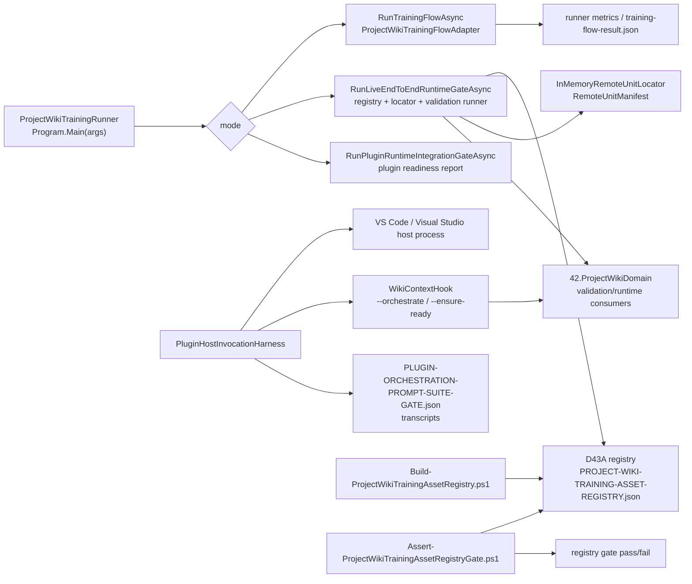

# 43.LearningLocalWikiData/tools

Documentation status: D43A-tools documented - parent review passed.

Этот документ для Лубы описывает не сами обученные wiki-модели, а инструменты вокруг данных D43-A: CLI runner, wiki hook, host invocation harness и PowerShell-скрипты реестра. Они читают registry, validation suites, reports, artifacts и вызывают код `42.ProjectWikiDomain`, но сами не являются `ILearningMachine`, не обучают модель «магически» и не доказывают готовность runtime без фактического запуска соответствующего gate.

Граница с D43-A: `docs/projects/43-learning-local-wiki-data.md` описывает данные, registry, validation suites, reports и artifact evidence. Этот документ описывает tool implementation: как команды читают эти данные, какие отчеты пишут и где их evidence недостаточно.

## 1. UML / движение данных



### Симуляции связей UML

| Связь | Пример входа | Что пересекает связь | Ожидаемый результат | Что это НЕ доказывает |
|---|---|---|---|---|
| `ProjectWikiTrainingRunner` -> `RunTrainingFlowAsync` | `--mode training-flow --artifact-root ... --batch-id ...` | prompt, artifact root, batch id, server base URL, learning data root | создается `LogicalFlowRequest<string>`, выполняется `ProjectWikiTrainingFlowAdapter`, пишется `project-wiki-training-flow-result.json` | JSON result не доказывает качество модели или fresh-load checkpoint |
| `RunLiveEndToEndRuntimeGateAsync` -> registry | `--mode live-end-to-end-runtime-gate` | путь к D43A root и registry entries | registry загружается и проверяется через `ValidateTrainingMayContinue` | registry presence не доказывает, что checkpoint реально пригоден в продукте |
| registry -> locator | accepted entry с manifest/checkpoint/locator/remote id | `RemoteUnitManifest` и remote unit id | in-memory locator получает запись, затем lookup проверяет locate branch | in-memory locator не является production model server |
| runtime gate -> `42.ProjectWikiDomain` | список repo roots и `maxEvidence` | project roots в `ProjectWikiRealProjectValidationRunner` | формируется runtime validation report с metrics | report не заменяет интерактивный plugin host scenario |
| `WikiContextHook` -> `ProjectWikiPluginOrchestrationAdapter` | env `XIIGEN_ORCHESTRATION_REQUEST` или `HOOK_PROMPT` | `ProjectWikiPluginOrchestrationRequest` | hook печатает JSON результата или error JSON | `--ensure-ready` означает только доступность hook, не orchestration quality |
| `PluginHostInvocationHarness` -> IDE host | validation matrix rows, expected prompts, hook path | request JSON, env vars, transcript path | harness пытается запустить VS Code / Visual Studio и собрать transcripts | этот документ не запускал harness; static source evidence не равно host runtime pass |
| `Build-ProjectWikiTrainingAssetRegistry.ps1` -> registry | files under `43.LearningLocalWikiData/artifacts` | train/heldout/report/checkpoint/manifest classification | генерируются registry/audit/migration/next-action artifacts | PowerShell inventory не является runtime model logic |
| `Assert-ProjectWikiTrainingAssetRegistryGate.ps1` -> gate | registry/schema/audit/migration/block/next-action files | parsed JSON status counts and continuation flags | exit 0 с `PROJECT_WIKI_TRAINING_ASSET_REGISTRY_GATE_B_PASSED` или exit 1 | gate pass не доказывает trained model readiness без load/use/continue evidence |

## 2. Алгоритмы без кода

### Алгоритм A: `ProjectWikiTrainingRunner.Program.Main(string[] args)`

Где логика: `43.LearningLocalWikiData/tools/ProjectWikiTrainingRunner/Program.cs`.

Вход: `string[] args` с парами `--key value`. Внутренний DTO: `Dictionary<string,string>` из `ParseArgs`. Выход: process exit code `int`.

Текущее поведение:
1. `ParseArgs(args)` превращает `--mode value`, `--repo-root value`, `--learning-data-root value` в словарь.
2. `mode` выбирает ветку: live runtime gate, domain generation, upgrade/rollback gate, plugin runtime integration gate.
3. Если mode неизвестен или не указан, запускается training-flow branch.
4. Это dispatch, а не модель: он только выбирает runner/helper.

Короткая цитата:

```csharp
var options = ParseArgs(args);
var mode = ReadOption(options, "mode", "training-flow");
var repoRoot = ReadOption(options, "repo-root", Directory.GetCurrentDirectory());
var learningDataRoot = ReadOption(options, "learning-data-root", Path.Combine(repoRoot, "43.LearningLocalWikiData"));
if (string.Equals(mode, "live-end-to-end-runtime-gate", StringComparison.OrdinalIgnoreCase))
    return await RunLiveEndToEndRuntimeGateAsync(options, repoRoot, learningDataRoot);
```

Источник: `43.LearningLocalWikiData/tools/ProjectWikiTrainingRunner/Program.cs:22-27`.

Почему важно: это доказывает реальный CLI dispatch. Не доказывает, что какая-либо ветка была запущена в этой documentation subphase.

### Алгоритм B: `RunTrainingFlowAsync(IReadOnlyDictionary<string,string> options, string repoRoot, string learningDataRoot)`

Вход: parsed options, repo root, D43A root. Выход: exit code `0` при `executed.IsSuccess`, иначе `1`; побочный артефакт `project-wiki-training-flow-result.json`.

Текущее поведение:
1. Читает `artifact-root`, `batch-id`, `server-base-url`, `prompt`.
2. Создает `ProjectWikiTrainingFlowAdapter`.
3. Собирает `LogicalFlowRequest<string>` с metadata: artifact root, batch id, server URL, learning data root, routed phase/subphase.
4. Выполняет flow и пишет JSON result.
5. Ошибка flow печатается в stderr и возвращает exit 1.

Короткая цитата:

```csharp
var flow = new ProjectWikiTrainingFlowAdapter();
var request = new LogicalFlowRequest<string>(
    $"project-wiki-training-{DateTimeOffset.UtcNow:yyyyMMddHHmmss}",
    ProjectWikiTrainingFlowAdapter.FlowId,
    ProjectWikiTrainingFlowAdapter.ScenarioId,
    prompt,
```

Источник: `43.LearningLocalWikiData/tools/ProjectWikiTrainingRunner/Program.cs:49-54`.

Почему важно: входом является prompt + metadata, а не скрытый checkpoint. Выходной JSON полезен как runner trace, но сам не является readiness evidence.

### Алгоритм C: registry load / runtime gate / locator load

Методы: `RunLiveEndToEndRuntimeGateAsync(...)`, `LoadUnitsThroughRegistryAndLocatorAsync(ProjectWikiTrainingAssetRegistry registry, string repoRoot, string learningDataRoot, string serverBaseUrl)`, `SelectPublishableEntry(ProjectWikiTrainingAssetRegistry registry, string unitName)`.

Вход: registry entries, repo root, D43A root, server base URL. Выход: `UnitRuntimeLoadResult[]`, gate report, exit code.

Текущее поведение:
1. Runtime gate загружает registry из `learningDataRoot`.
2. Проверяет `ValidateTrainingMayContinue`.
3. Для canonical units выбирает только accepted entry с manifest/checkpoint/locator/remote id.
4. Открывает checkpoint stream только как файл и размер; проверяет manifest file exists.
5. Строит `RemoteUnitManifest`, регистрирует в `InMemoryRemoteUnitLocator`, затем делает locate.
6. Это проверка локальной доступности assets и locator wiring, не production remote inference.

Короткая цитата:

```csharp
var registryValidation = registryResult.Value!.ValidateTrainingMayContinue();
if (!registryValidation.IsSuccess)
    failedChecks.Add(registryValidation.ErrorCode ?? "registry_validation_failed");

var unitLoadResults = await LoadUnitsThroughRegistryAndLocatorAsync(
    registryResult.Value,
```

Источник: `43.LearningLocalWikiData/tools/ProjectWikiTrainingRunner/Program.cs:104-109`.

Короткая цитата про publishable filter:

```csharp
=> registry.Entries
    .Where(entry => string.Equals(entry.UnitName, unitName, StringComparison.Ordinal))
    .Where(entry => string.Equals(entry.Status, "accepted", StringComparison.Ordinal))
    .Where(entry => !string.IsNullOrWhiteSpace(entry.ManifestRef))
    .Where(entry => !string.IsNullOrWhiteSpace(entry.CheckpointRef))
```

Источник: `43.LearningLocalWikiData/tools/ProjectWikiTrainingRunner/Program.cs:542-546`.

Что не доказывает: accepted registry row плюс in-memory locate не доказывают held-out generalization, product quality, real remote server, fresh-load into real plugin host или continue-training success.

### Алгоритм D: `WikiContextHook` request/response

Файл: `43.LearningLocalWikiData/tools/WikiContextHook/Program.cs`.

Вход: CLI args `--orchestrate` или `--ensure-ready`; env `XIIGEN_ORCHESTRATION_REQUEST`, `HOOK_PROMPT`, `XIIGEN_PROJECT_ROOT`, `XIIGEN_LINKED_REPO_PATHS`, `XIIGEN_PLUGIN_ENTRYPOINT`. Выход: JSON в stdout и exit code.

Текущее поведение:
1. `--orchestrate` строит `ProjectWikiPluginOrchestrationRequest`.
2. Вызывает `ProjectWikiPluginOrchestrationAdapter.OrchestrateAsync`.
3. При ошибке печатает structured JSON error и возвращает `2`.
4. `--ensure-ready` возвращает availability JSON, без оркестрации.
5. Unsupported invocation возвращает `BLOCKED_WITH_GAPS`.

Короткая цитата:

```csharp
if (args.Contains("--orchestrate", StringComparer.OrdinalIgnoreCase))
{
    var request = BuildRequest();
    var adapter = new ProjectWikiPluginOrchestrationAdapter();
    var result = await adapter.OrchestrateAsync(request);
```

Источник: `43.LearningLocalWikiData/tools/WikiContextHook/Program.cs:9-13`.

Короткая цитата по env request:

```csharp
var fromJson = Environment.GetEnvironmentVariable("XIIGEN_ORCHESTRATION_REQUEST");
if (!string.IsNullOrWhiteSpace(fromJson))
{
    var parsed = JsonSerializer.Deserialize<ProjectWikiPluginOrchestrationRequest>(fromJson, options);
```

Источник: `43.LearningLocalWikiData/tools/WikiContextHook/Program.cs:47-50`.

Что не доказывает: hook JSON не является доказательством, что VS Code command или Visual Studio command реально был вызван пользователем.

### Алгоритм E: `PluginHostInvocationHarness`

Файл: `43.LearningLocalWikiData/tools/PluginHostInvocationHarness/Program.cs`.

Вход: validation expected-results JSON, scenario matrix JSON, локальные пути к hook executable, VS Code и Visual Studio. Выход: transcript files и `PLUGIN-ORCHESTRATION-PROMPT-SUITE-GATE.json`.

Текущее поведение:
1. Читает expected rows и project matrix.
2. Для каждой project group строит request JSON для VS Code и Visual Studio.
3. Запускает host process, передает hook path и request/report paths через env vars.
4. Ждет transcript file или timeout guard.
5. Нормализует rows: status, selected units, query plan, missing evidence, metrics.
6. Формирует report с `validation_only=false`, но evidence существует только после фактического запуска harness.

Короткая цитата путей:

```csharp
var expectedPath = Path.Combine(root, "43.LearningLocalWikiData", "validation", "ORCHESTRATOR-PROMPT-PLUGIN-EXPECTED-RESULTS-v1.json");
var matrixPath = Path.Combine(root, "43.LearningLocalWikiData", "validation", "PLUGIN-PROJECT-DOC-RAG-SCENARIO-MATRIX-v1.json");
var reportPath = Path.Combine(root, "43.LearningLocalWikiData", "reports", "PLUGIN-ORCHESTRATION-PROMPT-SUITE-GATE.json");
```

Источник: `43.LearningLocalWikiData/tools/PluginHostInvocationHarness/Program.cs:6-8`.

Короткая цитата host env:

```csharp
process.StartInfo.Environment["XIIGEN_PLUGIN_HOST_PROBE"] = host;
process.StartInfo.Environment["XIIGEN_PLUGIN_HOST_PROBE_REQUESTS_PATH"] = requestsPath;
process.StartInfo.Environment["XIIGEN_PLUGIN_HOST_PROBE_REPORT_PATH"] = transcriptPath;
process.StartInfo.Environment["XIIGEN_WIKI_CONTEXT_HOOK"] = hookPath;
```

Источник: `43.LearningLocalWikiData/tools/PluginHostInvocationHarness/Program.cs:151-154`.

Что не доказывает: если harness не запускался, наличие кода harness или старого report не доказывает full interactive plugin runtime. Даже после запуска report нужно читать по scope: host command invoked, transcript present, no mock output, CPU/RAM/elapsed present.

### Алгоритм F: `Build-ProjectWikiTrainingAssetRegistry.ps1`

Файл: `43.LearningLocalWikiData/tools/Build-ProjectWikiTrainingAssetRegistry.ps1`.

Вход: optional `-Root`, по умолчанию parent of script folder, то есть `43.LearningLocalWikiData`. Выход: registry/audit/migration/block/next-action JSON files.

Текущее поведение:
1. Находит artifact files under `artifacts`.
2. Классифицирует `.jsonl` train/heldout, reports, checkpoints, manifests.
3. Группирует по batch id.
4. Выводит status: accepted/rejected/experimental_no_authority/blocked.
5. Для DPO-trainable units требует runner-emitted DPO metrics.
6. Пишет registry fields: `manifest_ref`, `checkpoint_ref`, `locator_key`, `remote_unit_id`, `artifact_checksum`, metrics.

Короткая цитата root:

```powershell
param(
    [string]$Root = (Resolve-Path (Join-Path $PSScriptRoot "..")).Path
)
```

Источник: `43.LearningLocalWikiData/tools/Build-ProjectWikiTrainingAssetRegistry.ps1:1-3`.

Короткая цитата classification:

```powershell
$allFiles = @(Get-ChildItem -LiteralPath $artifactRoot -Recurse -File -ErrorAction SilentlyContinue)
$jsonFiles = @($allFiles | Where-Object { $_.Extension -eq ".json" })
$jsonlFiles = @($allFiles | Where-Object { $_.Extension -eq ".jsonl" })
$reportFiles = @($allFiles | Where-Object { $_.Name -match "report|result|summary|metrics|evaluation" -and $_.Extension -in @(".json", ".md", ".txt") })
```

Источник: `43.LearningLocalWikiData/tools/Build-ProjectWikiTrainingAssetRegistry.ps1:243-246`.

Короткая цитата DPO metric guard:

```powershell
if ($status -eq "accepted" -and (Requires-DpoMetrics -UnitName $unitName) -and
    ($dpoAccuracyMetric -eq "UNKNOWN" -or $dpoRewardMarginMetric -eq "UNKNOWN" -or $dpoLossMetric -eq "UNKNOWN")) {
    $status = "experimental_no_authority"
```

Источник: `43.LearningLocalWikiData/tools/Build-ProjectWikiTrainingAssetRegistry.ps1:338-341`.

Что не доказывает: script-generated registry помогает inventory, но PowerShell script не открывает модель в runtime и не измеряет product quality.

### Алгоритм G: `Assert-ProjectWikiTrainingAssetRegistryGate.ps1`

Файл: `43.LearningLocalWikiData/tools/Assert-ProjectWikiTrainingAssetRegistryGate.ps1`.

Вход: optional `-Root`; required files under registry/reports. Выход: exit `0` и строка `PROJECT_WIKI_TRAINING_ASSET_REGISTRY_GATE_B_PASSED` либо exit `1` с errors.

Текущее поведение:
1. Проверяет наличие registry, schema, audit, migration, block, next-action files.
2. Читает JSON и проверяет allowed statuses.
3. Запрещает continuation block, invalid statuses, rejected continuation, missing audit flags.
4. Проверяет, что migration/next-action не стартовали training и не создали batches.
5. Сверяет status counts.

Короткая цитата required files:

```powershell
$registryPath = Join-Path $Root "registry\PROJECT-WIKI-TRAINING-ASSET-REGISTRY.json"
$schemaPath = Join-Path $Root "registry\PROJECT-WIKI-TRAINING-ASSET-REGISTRY.schema.json"
$auditPath = Join-Path $Root "registry\ARTIFACT-INTEGRITY-AUDIT.json"
$migrationPath = Join-Path $Root "reports\PROJECT-WIKI-TRAINING-ASSET-MIGRATION-REPORT.json"
```

Источник: `43.LearningLocalWikiData/tools/Assert-ProjectWikiTrainingAssetRegistryGate.ps1:7-10`.

Короткая цитата pass/fail:

```powershell
if ($errors.Count -gt 0) {
    $errors | ForEach-Object { Write-Error $_ }
    exit 1
}

Write-Output "PROJECT_WIKI_TRAINING_ASSET_REGISTRY_GATE_B_PASSED"
```

Источник: `43.LearningLocalWikiData/tools/Assert-ProjectWikiTrainingAssetRegistryGate.ps1:153-158`.

Что не доказывает: gate pass подтверждает registry consistency, но не является model readiness, не подтверждает fresh-load, plugin host runtime или continue-training success.

## 3. Статус и границы

| Компонент | Реальный статус | Что можно утверждать | Что нельзя утверждать |
|---|---|---|---|
| `ProjectWikiTrainingRunner` | CLI runner/gate coordinator | умеет dispatch modes, писать reports, вызывать D43/42 consumers | не является моделью и не доказывает качество без выполненного runner evidence |
| `WikiContextHook` | CLI hook для plugin orchestration request | формирует request и вызывает adapter | `--ensure-ready` не является orchestration pass |
| `PluginHostInvocationHarness` | host invocation harness/source-backed probe runner | может запускать VS Code/Visual Studio processes и собирать transcripts | static code или старый JSON не равны full interactive host evidence |
| `Build-ProjectWikiTrainingAssetRegistry.ps1` | inventory/registry builder | классифицирует artifacts и пишет registry/audit/migration/next-action | PowerShell не runtime model logic |
| `Assert-ProjectWikiTrainingAssetRegistryGate.ps1` | registry gate checker | проверяет JSON consistency и continuation flags | pass не доказывает trained model readiness |

Ключевая граница: CLI is not the model. JSON/report/registry/copy/PowerShell is not model readiness. На русском: CLI, JSON-отчет, registry запись, copy artifact или PowerShell gate не являются готовой моделью и не заменяют runtime load/use/continue evidence.

`validation_only`, static reports, JSON, PowerShell scripts и harness source не доказывают trained model readiness или полный interactive plugin runtime. Для таких claims нужен выполненный host/runtime gate с host invocation evidence, transcripts, metrics and no mock/readiness-only rows.

## 4. QA / test mapping

Тесты, build, runtime smoke и host harness в этой documentation subphase не запускались.

| Evidence source | Что покрывает | Честный пробел |
|---|---|---|
| `ProjectWikiTrainingRunner/Program.cs` source read | CLI mode dispatch, training-flow report, registry/locator runtime gate branch | source read не доказывает, что gate report свежий |
| `WikiContextHook/Program.cs` source read | request shape, env fallback, `--ensure-ready`, unsupported branch | нет runtime invocation в этой фазе |
| `PluginHostInvocationHarness/Program.cs` source read | expected/matrix/report paths, transcript root, host env, pass normalization | harness не запускался; нет свежих transcripts |
| `Build-ProjectWikiTrainingAssetRegistry.ps1` source read | artifact scan, status classification, DPO metric guard, registry fields | script не был выполнен в этой фазе |
| `Assert-ProjectWikiTrainingAssetRegistryGate.ps1` source read | registry gate assertions and exit behavior | gate не запускался в этой фазе |

## 5. Anti-false-done

- JSON/report/registry/copy не являются model readiness.
- PowerShell scripts не являются runtime model logic.
- Static validation suite или `validation_only=true` artifact не является executed plugin/runtime evidence.
- `--ensure-ready` у hook показывает доступность hook-команды, а не качество orchestration.
- In-memory locator evidence полезен для manifest/locator wiring, но не является production remote server.
- Host invocation harness source не заменяет фактический запуск host entrypoint; нужен report с invoked rows, transcripts, metrics и отсутствием mock/readiness-only shortcuts.
- Training-flow result JSON не является доказательством held-out generalization или continue-training.

## 6. Проверочный чеклист D43A-tools

| Требование | Статус |
|---|---|
| Русское human-readable объяснение | PASS |
| Mermaid UML importable to draw.io | PASS |
| Симуляции по связям | PASS |
| Алгоритмы с class/function/parameters/input/output | PASS |
| Short exact code quotes with file/line refs | PASS |
| QA mapping, tests not run | PASS |
| Tool boundary and anti-false-done | PASS |
| D43-A vs D43-A-tools boundary | PASS |
