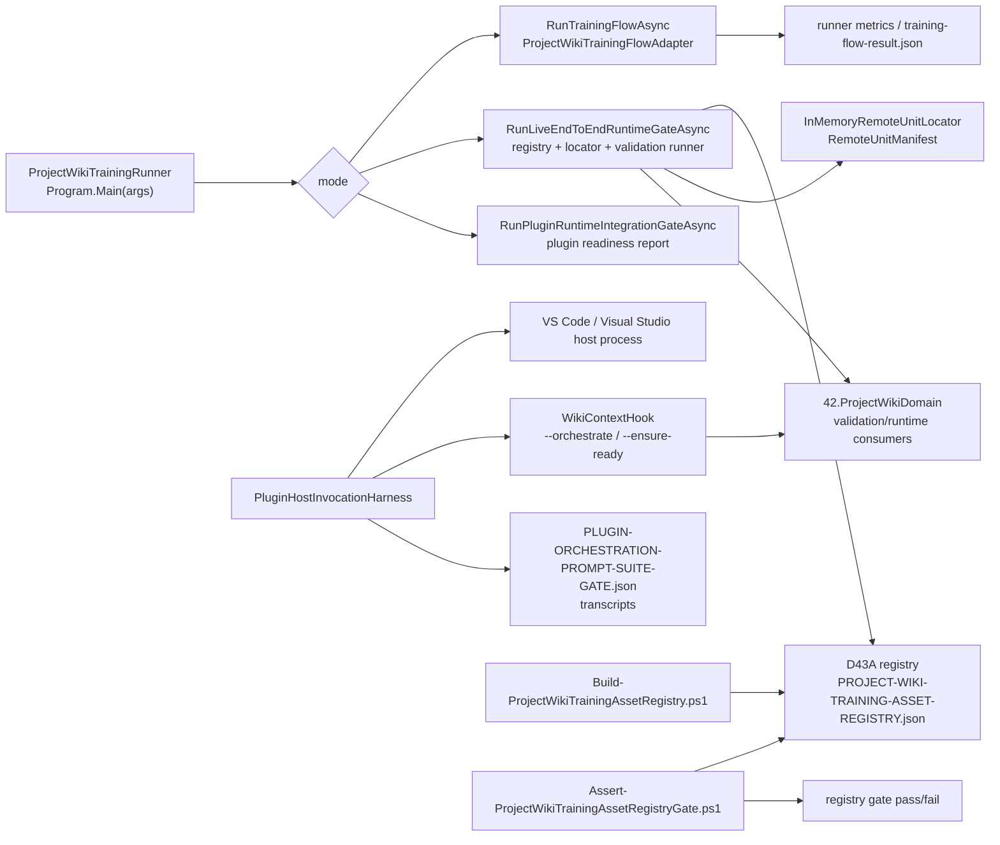

# 43.LearningLocalWikiData/tools

Documentation status: D43A-tools documented - parent review passed.

This document for Luba describes not the trained wiki models themselves, but the tools around the D43-A data: the CLI runner, the wiki hook, the host invocation harness, and the PowerShell registry scripts. They read the registry, validation suites, reports, artifacts and call `42.ProjectWikiDomain` code, but they are not themselves an `ILearningMachine`, do not train a model "magically", and do not prove runtime readiness without an actual run of the corresponding gate.

The boundary with D43-A: `docs/projects/43-learning-local-wiki-data.md` describes the data, registry, validation suites, reports, and artifact evidence. This document describes the tool implementation: how the commands read this data, which reports they write, and where their evidence is insufficient.

## 1. UML / data movement



### Simulations of the UML connections

| Connection | Example input | What crosses the connection | Expected result | What this does NOT prove |
|---|---|---|---|---|
| `ProjectWikiTrainingRunner` -> `RunTrainingFlowAsync` | `--mode training-flow --artifact-root ... --batch-id ...` | prompt, artifact root, batch id, server base URL, learning data root | a `LogicalFlowRequest<string>` is created, `ProjectWikiTrainingFlowAdapter` is executed, `project-wiki-training-flow-result.json` is written | the JSON result does not prove model quality or a fresh-load checkpoint |
| `RunLiveEndToEndRuntimeGateAsync` -> registry | `--mode live-end-to-end-runtime-gate` | the path to the D43A root and the registry entries | the registry is loaded and checked via `ValidateTrainingMayContinue` | registry presence does not prove that the checkpoint is actually usable in the product |
| registry -> locator | an accepted entry with manifest/checkpoint/locator/remote id | `RemoteUnitManifest` and a remote unit id | the in-memory locator receives the record, then lookup checks the locate branch | the in-memory locator is not a production model server |
| runtime gate -> `42.ProjectWikiDomain` | a list of repo roots and `maxEvidence` | project roots into `ProjectWikiRealProjectValidationRunner` | a runtime validation report with metrics is formed | the report does not replace an interactive plugin host scenario |
| `WikiContextHook` -> `ProjectWikiPluginOrchestrationAdapter` | env `XIIGEN_ORCHESTRATION_REQUEST` or `HOOK_PROMPT` | a `ProjectWikiPluginOrchestrationRequest` | the hook prints the result JSON or an error JSON | `--ensure-ready` only means the hook is available, not orchestration quality |
| `PluginHostInvocationHarness` -> IDE host | validation matrix rows, expected prompts, hook path | request JSON, env vars, transcript path | the harness tries to launch VS Code / Visual Studio and collect transcripts | this document did not run the harness; static source evidence is not equal to a host runtime pass |
| `Build-ProjectWikiTrainingAssetRegistry.ps1` -> registry | files under `43.LearningLocalWikiData/artifacts` | train/heldout/report/checkpoint/manifest classification | registry/audit/migration/next-action artifacts are generated | PowerShell inventory is not runtime model logic |
| `Assert-ProjectWikiTrainingAssetRegistryGate.ps1` -> gate | registry/schema/audit/migration/block/next-action files | parsed JSON status counts and continuation flags | exit 0 with `PROJECT_WIKI_TRAINING_ASSET_REGISTRY_GATE_B_PASSED` or exit 1 | a gate pass does not prove trained model readiness without load/use/continue evidence |

## 2. No-code algorithms

### Algorithm A: `ProjectWikiTrainingRunner.Program.Main(string[] args)`

Where the logic is: `43.LearningLocalWikiData/tools/ProjectWikiTrainingRunner/Program.cs`.

Input: `string[] args` with `--key value` pairs. Internal DTO: `Dictionary<string,string>` from `ParseArgs`. Output: the process exit code `int`.

Current behavior:
1. `ParseArgs(args)` turns `--mode value`, `--repo-root value`, `--learning-data-root value` into a dictionary.
2. `mode` selects a branch: live runtime gate, domain generation, upgrade/rollback gate, plugin runtime integration gate.
3. If the mode is unknown or not specified, the training-flow branch runs.
4. This is a dispatch, not a model: it only selects a runner/helper.

Short quote:

```csharp
var options = ParseArgs(args);
var mode = ReadOption(options, "mode", "training-flow");
var repoRoot = ReadOption(options, "repo-root", Directory.GetCurrentDirectory());
var learningDataRoot = ReadOption(options, "learning-data-root", Path.Combine(repoRoot, "43.LearningLocalWikiData"));
if (string.Equals(mode, "live-end-to-end-runtime-gate", StringComparison.OrdinalIgnoreCase))
    return await RunLiveEndToEndRuntimeGateAsync(options, repoRoot, learningDataRoot);
```

Source: `43.LearningLocalWikiData/tools/ProjectWikiTrainingRunner/Program.cs:22-27`.

Why it matters: this proves the real CLI dispatch. It does not prove that any branch was run in this documentation subphase.

### Algorithm B: `RunTrainingFlowAsync(IReadOnlyDictionary<string,string> options, string repoRoot, string learningDataRoot)`

Input: parsed options, repo root, D43A root. Output: exit code `0` on `executed.IsSuccess`, otherwise `1`; side artifact `project-wiki-training-flow-result.json`.

Current behavior:
1. Reads `artifact-root`, `batch-id`, `server-base-url`, `prompt`.
2. Creates a `ProjectWikiTrainingFlowAdapter`.
3. Assembles a `LogicalFlowRequest<string>` with metadata: artifact root, batch id, server URL, learning data root, routed phase/subphase.
4. Executes the flow and writes the JSON result.
5. A flow error is printed to stderr and returns exit 1.

Short quote:

```csharp
var flow = new ProjectWikiTrainingFlowAdapter();
var request = new LogicalFlowRequest<string>(
    $"project-wiki-training-{DateTimeOffset.UtcNow:yyyyMMddHHmmss}",
    ProjectWikiTrainingFlowAdapter.FlowId,
    ProjectWikiTrainingFlowAdapter.ScenarioId,
    prompt,
```

Source: `43.LearningLocalWikiData/tools/ProjectWikiTrainingRunner/Program.cs:49-54`.

Why it matters: the input is a prompt + metadata, not a hidden checkpoint. The output JSON is useful as a runner trace, but is not readiness evidence by itself.

### Algorithm C: registry load / runtime gate / locator load

Methods: `RunLiveEndToEndRuntimeGateAsync(...)`, `LoadUnitsThroughRegistryAndLocatorAsync(ProjectWikiTrainingAssetRegistry registry, string repoRoot, string learningDataRoot, string serverBaseUrl)`, `SelectPublishableEntry(ProjectWikiTrainingAssetRegistry registry, string unitName)`.

Input: registry entries, repo root, D43A root, server base URL. Output: `UnitRuntimeLoadResult[]`, a gate report, an exit code.

Current behavior:
1. The runtime gate loads the registry from `learningDataRoot`.
2. Checks `ValidateTrainingMayContinue`.
3. For canonical units it selects only an accepted entry with manifest/checkpoint/locator/remote id.
4. Opens the checkpoint stream only as a file and size; checks that the manifest file exists.
5. Builds a `RemoteUnitManifest`, registers it in `InMemoryRemoteUnitLocator`, then does a locate.
6. This is a check of the local availability of assets and locator wiring, not production remote inference.

Short quote:

```csharp
var registryValidation = registryResult.Value!.ValidateTrainingMayContinue();
if (!registryValidation.IsSuccess)
    failedChecks.Add(registryValidation.ErrorCode ?? "registry_validation_failed");

var unitLoadResults = await LoadUnitsThroughRegistryAndLocatorAsync(
    registryResult.Value,
```

Source: `43.LearningLocalWikiData/tools/ProjectWikiTrainingRunner/Program.cs:104-109`.

Short quote about the publishable filter:

```csharp
=> registry.Entries
    .Where(entry => string.Equals(entry.UnitName, unitName, StringComparison.Ordinal))
    .Where(entry => string.Equals(entry.Status, "accepted", StringComparison.Ordinal))
    .Where(entry => !string.IsNullOrWhiteSpace(entry.ManifestRef))
    .Where(entry => !string.IsNullOrWhiteSpace(entry.CheckpointRef))
```

Source: `43.LearningLocalWikiData/tools/ProjectWikiTrainingRunner/Program.cs:542-546`.

What it does not prove: an accepted registry row plus an in-memory locate do not prove held-out generalization, product quality, a real remote server, a fresh-load into a real plugin host, or continue-training success.

### Algorithm D: `WikiContextHook` request/response

File: `43.LearningLocalWikiData/tools/WikiContextHook/Program.cs`.

Input: CLI args `--orchestrate` or `--ensure-ready`; env `XIIGEN_ORCHESTRATION_REQUEST`, `HOOK_PROMPT`, `XIIGEN_PROJECT_ROOT`, `XIIGEN_LINKED_REPO_PATHS`, `XIIGEN_PLUGIN_ENTRYPOINT`. Output: JSON to stdout and an exit code.

Current behavior:
1. `--orchestrate` builds a `ProjectWikiPluginOrchestrationRequest`.
2. Calls `ProjectWikiPluginOrchestrationAdapter.OrchestrateAsync`.
3. On an error it prints a structured JSON error and returns `2`.
4. `--ensure-ready` returns an availability JSON, without orchestration.
5. An unsupported invocation returns `BLOCKED_WITH_GAPS`.

Short quote:

```csharp
if (args.Contains("--orchestrate", StringComparer.OrdinalIgnoreCase))
{
    var request = BuildRequest();
    var adapter = new ProjectWikiPluginOrchestrationAdapter();
    var result = await adapter.OrchestrateAsync(request);
```

Source: `43.LearningLocalWikiData/tools/WikiContextHook/Program.cs:9-13`.

Short quote about the env request:

```csharp
var fromJson = Environment.GetEnvironmentVariable("XIIGEN_ORCHESTRATION_REQUEST");
if (!string.IsNullOrWhiteSpace(fromJson))
{
    var parsed = JsonSerializer.Deserialize<ProjectWikiPluginOrchestrationRequest>(fromJson, options);
```

Source: `43.LearningLocalWikiData/tools/WikiContextHook/Program.cs:47-50`.

What it does not prove: the hook JSON is not proof that a VS Code command or a Visual Studio command was actually invoked by the user.

### Algorithm E: `PluginHostInvocationHarness`

File: `43.LearningLocalWikiData/tools/PluginHostInvocationHarness/Program.cs`.

Input: a validation expected-results JSON, a scenario matrix JSON, local paths to the hook executable, VS Code, and Visual Studio. Output: transcript files and `PLUGIN-ORCHESTRATION-PROMPT-SUITE-GATE.json`.

Current behavior:
1. Reads the expected rows and the project matrix.
2. For each project group it builds a request JSON for VS Code and Visual Studio.
3. Launches the host process, passes the hook path and request/report paths via env vars.
4. Waits for the transcript file or a timeout guard.
5. Normalizes the rows: status, selected units, query plan, missing evidence, metrics.
6. Forms a report with `validation_only=false`, but the evidence exists only after the harness is actually run.

Short quote of the paths:

```csharp
var expectedPath = Path.Combine(root, "43.LearningLocalWikiData", "validation", "ORCHESTRATOR-PROMPT-PLUGIN-EXPECTED-RESULTS-v1.json");
var matrixPath = Path.Combine(root, "43.LearningLocalWikiData", "validation", "PLUGIN-PROJECT-DOC-RAG-SCENARIO-MATRIX-v1.json");
var reportPath = Path.Combine(root, "43.LearningLocalWikiData", "reports", "PLUGIN-ORCHESTRATION-PROMPT-SUITE-GATE.json");
```

Source: `43.LearningLocalWikiData/tools/PluginHostInvocationHarness/Program.cs:6-8`.

Short quote of the host env:

```csharp
process.StartInfo.Environment["XIIGEN_PLUGIN_HOST_PROBE"] = host;
process.StartInfo.Environment["XIIGEN_PLUGIN_HOST_PROBE_REQUESTS_PATH"] = requestsPath;
process.StartInfo.Environment["XIIGEN_PLUGIN_HOST_PROBE_REPORT_PATH"] = transcriptPath;
process.StartInfo.Environment["XIIGEN_WIKI_CONTEXT_HOOK"] = hookPath;
```

Source: `43.LearningLocalWikiData/tools/PluginHostInvocationHarness/Program.cs:151-154`.

What it does not prove: if the harness was not run, the presence of harness code or an old report does not prove full interactive plugin runtime. Even after a run, the report must be read by scope: host command invoked, transcript present, no mock output, CPU/RAM/elapsed present.

### Algorithm F: `Build-ProjectWikiTrainingAssetRegistry.ps1`

File: `43.LearningLocalWikiData/tools/Build-ProjectWikiTrainingAssetRegistry.ps1`.

Input: optional `-Root`, by default the parent of the script folder, that is `43.LearningLocalWikiData`. Output: registry/audit/migration/block/next-action JSON files.

Current behavior:
1. Finds artifact files under `artifacts`.
2. Classifies `.jsonl` train/heldout, reports, checkpoints, manifests.
3. Groups by batch id.
4. Derives status: accepted/rejected/experimental_no_authority/blocked.
5. For DPO-trainable units it requires runner-emitted DPO metrics.
6. Writes registry fields: `manifest_ref`, `checkpoint_ref`, `locator_key`, `remote_unit_id`, `artifact_checksum`, metrics.

Short quote of the root:

```powershell
param(
    [string]$Root = (Resolve-Path (Join-Path $PSScriptRoot "..")).Path
)
```

Source: `43.LearningLocalWikiData/tools/Build-ProjectWikiTrainingAssetRegistry.ps1:1-3`.

Short quote of the classification:

```powershell
$allFiles = @(Get-ChildItem -LiteralPath $artifactRoot -Recurse -File -ErrorAction SilentlyContinue)
$jsonFiles = @($allFiles | Where-Object { $_.Extension -eq ".json" })
$jsonlFiles = @($allFiles | Where-Object { $_.Extension -eq ".jsonl" })
$reportFiles = @($allFiles | Where-Object { $_.Name -match "report|result|summary|metrics|evaluation" -and $_.Extension -in @(".json", ".md", ".txt") })
```

Source: `43.LearningLocalWikiData/tools/Build-ProjectWikiTrainingAssetRegistry.ps1:243-246`.

Short quote of the DPO metric guard:

```powershell
if ($status -eq "accepted" -and (Requires-DpoMetrics -UnitName $unitName) -and
    ($dpoAccuracyMetric -eq "UNKNOWN" -or $dpoRewardMarginMetric -eq "UNKNOWN" -or $dpoLossMetric -eq "UNKNOWN")) {
    $status = "experimental_no_authority"
```

Source: `43.LearningLocalWikiData/tools/Build-ProjectWikiTrainingAssetRegistry.ps1:338-341`.

What it does not prove: the script-generated registry helps inventory, but the PowerShell script does not open a model at runtime and does not measure product quality.

### Algorithm G: `Assert-ProjectWikiTrainingAssetRegistryGate.ps1`

File: `43.LearningLocalWikiData/tools/Assert-ProjectWikiTrainingAssetRegistryGate.ps1`.

Input: optional `-Root`; required files under registry/reports. Output: exit `0` and the line `PROJECT_WIKI_TRAINING_ASSET_REGISTRY_GATE_B_PASSED` or exit `1` with errors.

Current behavior:
1. Checks the presence of the registry, schema, audit, migration, block, next-action files.
2. Reads the JSON and checks the allowed statuses.
3. Forbids a continuation block, invalid statuses, rejected continuation, missing audit flags.
4. Checks that migration/next-action did not start training and did not create batches.
5. Reconciles the status counts.

Short quote of the required files:

```powershell
$registryPath = Join-Path $Root "registry\PROJECT-WIKI-TRAINING-ASSET-REGISTRY.json"
$schemaPath = Join-Path $Root "registry\PROJECT-WIKI-TRAINING-ASSET-REGISTRY.schema.json"
$auditPath = Join-Path $Root "registry\ARTIFACT-INTEGRITY-AUDIT.json"
$migrationPath = Join-Path $Root "reports\PROJECT-WIKI-TRAINING-ASSET-MIGRATION-REPORT.json"
```

Source: `43.LearningLocalWikiData/tools/Assert-ProjectWikiTrainingAssetRegistryGate.ps1:7-10`.

Short quote of the pass/fail:

```powershell
if ($errors.Count -gt 0) {
    $errors | ForEach-Object { Write-Error $_ }
    exit 1
}

Write-Output "PROJECT_WIKI_TRAINING_ASSET_REGISTRY_GATE_B_PASSED"
```

Source: `43.LearningLocalWikiData/tools/Assert-ProjectWikiTrainingAssetRegistryGate.ps1:153-158`.

What it does not prove: a gate pass confirms registry consistency, but is not model readiness, and does not confirm fresh-load, plugin host runtime, or continue-training success.

## 3. Status and boundaries

| Component | Real status | What can be asserted | What must not be asserted |
|---|---|---|---|
| `ProjectWikiTrainingRunner` | CLI runner/gate coordinator | can dispatch modes, write reports, call D43/42 consumers | is not a model and does not prove quality without executed runner evidence |
| `WikiContextHook` | CLI hook for a plugin orchestration request | forms the request and calls the adapter | `--ensure-ready` is not an orchestration pass |
| `PluginHostInvocationHarness` | host invocation harness/source-backed probe runner | can launch VS Code/Visual Studio processes and collect transcripts | static code or an old JSON is not equal to full interactive host evidence |
| `Build-ProjectWikiTrainingAssetRegistry.ps1` | inventory/registry builder | classifies artifacts and writes registry/audit/migration/next-action | PowerShell is not runtime model logic |
| `Assert-ProjectWikiTrainingAssetRegistryGate.ps1` | registry gate checker | checks JSON consistency and continuation flags | a pass does not prove trained model readiness |

The key boundary: CLI is not the model. JSON/report/registry/copy/PowerShell is not model readiness. In plain terms: a CLI, a JSON report, a registry entry, a copied artifact, or a PowerShell gate are not a finished model and do not replace runtime load/use/continue evidence.

`validation_only`, static reports, JSON, PowerShell scripts, and harness source do not prove trained model readiness or full interactive plugin runtime. For such claims you need an executed host/runtime gate with host invocation evidence, transcripts, metrics, and no mock/readiness-only rows.

## 4. QA / test mapping

Tests, build, runtime smoke, and the host harness were not run in this documentation subphase.

| Evidence source | What it covers | Honest gap |
|---|---|---|
| `ProjectWikiTrainingRunner/Program.cs` source read | CLI mode dispatch, training-flow report, registry/locator runtime gate branch | a source read does not prove that the gate report is fresh |
| `WikiContextHook/Program.cs` source read | request shape, env fallback, `--ensure-ready`, unsupported branch | no runtime invocation in this phase |
| `PluginHostInvocationHarness/Program.cs` source read | expected/matrix/report paths, transcript root, host env, pass normalization | the harness was not run; no fresh transcripts |
| `Build-ProjectWikiTrainingAssetRegistry.ps1` source read | artifact scan, status classification, DPO metric guard, registry fields | the script was not executed in this phase |
| `Assert-ProjectWikiTrainingAssetRegistryGate.ps1` source read | registry gate assertions and exit behavior | the gate was not run in this phase |

## 5. Anti-false-done

- JSON/report/registry/copy is not model readiness.
- PowerShell scripts are not runtime model logic.
- A static validation suite or a `validation_only=true` artifact is not executed plugin/runtime evidence.
- The hook's `--ensure-ready` shows the availability of the hook command, not orchestration quality.
- In-memory locator evidence is useful for manifest/locator wiring, but is not a production remote server.
- The host invocation harness source does not replace an actual run of the host entrypoint; a report with invoked rows, transcripts, metrics, and no mock/readiness-only shortcuts is needed.
- The training-flow result JSON is not proof of held-out generalization or continue-training.

## 6. Verification checklist for D43A-tools

| Requirement | Status |
|---|---|
| Operator-language human-readable explanation | PASS |
| Mermaid UML importable to draw.io | PASS |
| Simulations by connection | PASS |
| Algorithms with class/function/parameters/input/output | PASS |
| Short exact code quotes with file/line refs | PASS |
| QA mapping, tests not run | PASS |
| Tool boundary and anti-false-done | PASS |
| D43-A vs D43-A-tools boundary | PASS |
