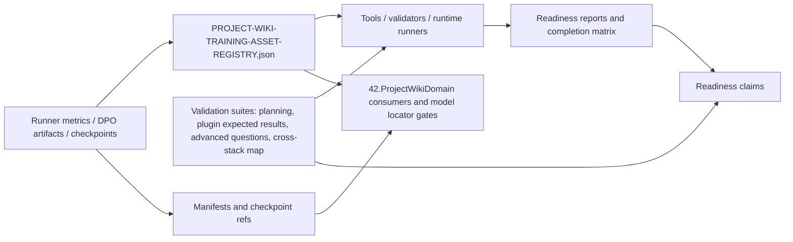

# 43.LearningLocalWikiData

Documentation status: D43A documented - parent review passed.

## 0. Коротко для Лубы

Это документация про папку данных для локальной проектной wiki: здесь живут реестр, отчеты, validation suites, runner metrics, manifest/checkpoint-ссылки и матрицы доказательств. Это не сама модель и не CLI/tool implementation. D43-A documents data/artifacts/registry/reports; подробные алгоритмы tool implementation, CLI, harness runners и командной обвязки относятся к будущему документу `D43-A-tools`. В этом документе tools упоминаются только как потребители этих файлов.

Важная граница: validation suites/contracts with `validation_only=true` are not execution/runtime evidence; they are expected-result/test-case contracts and must not be accepted as model/plugin readiness. По-человечески: файл с ожидаемыми сценариями похож на чек-лист перед экзаменом, а не на сам сданный экзамен. Готовность модели или плагина начинается только там, где consumer/runner реально загружает, открывает, вызывает и записывает runtime/load/use/continue evidence.

## 1. Человеческое объяснение

`43.LearningLocalWikiData` - это не production-библиотека и не место, где выполняется модель. Это папка проектных артефактов: registry, validation suites, runner metrics, checkpoint/manifest references, readiness reports и матрицы доказательств для project-local wiki. Логика выполнения остается в `42.ProjectWikiDomain` и связанных tools/runner проектах; D43A хранит данные, статусы и ссылки, по которым такие потребители решают, можно ли доверять конкретному обучающему запуску или готовности.

Главная граница для Лубы: JSON/report/registry/checkpoint presence помогает увидеть, что было записано и классифицировано, но сам по себе не доказывает runtime/load/use/continue evidence. Полная готовность trainable unit требует, чтобы consumer реально открыл checkpoint/manifest, загрузил unit, нашел его через locator, выполнил runtime/use probe и, если заявляется продолжение обучения, подтвердил continue path.

## 2. UML потока данных



Легенда: стрелка означает передачу ссылки, поля или сценария проверки. Она не означает, что D43A сама запускает модель или плагин.

## 3. Симуляции связей

| Связь | Пример входа | Что передается | Ожидаемый результат | Что нельзя считать доказательством |
|---|---|---|---|---|
| Runner metrics -> registry | DPO run для `NegativeDpoGenerator` с `trainingRowCount=50`, `heldOutRowCount=50`, `finalAccuracy=0.572` | `runner_report_path`, `metrics`, `checkpoint_ref`, `status` | Registry классифицирует запуск как accepted/rejected/experimental/blocked и сохраняет next action | Нельзя говорить, что модель готова к продукту: metric summary без load/use/held-out gate и registry acceptance недостаточен |
| Registry -> continuation gate | Entry со `status=rejected` и `checkpoint_allowed_as_continuation=false` | Флаг continuation и `allowed_next_action` | Consumer не должен брать checkpoint как источник продолжения | Нельзя использовать rejected checkpoint как "почти готовый" актив |
| Validation suite -> tools/runtime runner | `ORCHESTRATOR-PROMPT-PLUGIN-EXPECTED-RESULTS-v1.json` с `validation_only=true`, `execution_complete=false` | Ожидаемые plugin entrypoints, units, evidence requirements | Tool/runner знает, какие сценарии надо исполнять | Нельзя выдавать validation suite за runtime plugin invocation |
| Manifest/checkpoint refs -> model locator/load/use gates | `generated_capability_manifest.json` с `policyCheckpointPath`, `tokenizerPath`, `trainingStepCount` | Пути и параметры модели | Runtime consumer может попытаться открыть и зарегистрировать unit | Наличие manifest/checkpoint path не доказывает, что checkpoint открыт, loadable и используется |
| Plugin runtime report -> readiness claim | `PLUGIN-RUNTIME-INTEGRATION-GATE.json` с `validation_only=false`, runtime symbols и CPU/RAM/elapsed | Runtime evidence report | Это более сильное доказательство, чем static build-only report | Даже такой report может быть stale; он должен совпадать с актуальным commit/state и не заменяет продуктовую проверку всех заявленных сценариев |
| Completion matrix -> final readiness | `PROJECT-WIKI-COMPLETION-COVERAGE-MATRIX.json` с rows HOLE-* | Mapping literal requirement -> artifact -> passed | Показывает, какие требования были закрыты артефактами | Matrix не заменяет сами runtime artifacts и не должна использоваться, если источник stale или validation_only |

## 4. Алгоритмы без кода

### Алгоритм A: смысл training asset registry

Где лежит логика данных: `43.LearningLocalWikiData/registry/PROJECT-WIKI-TRAINING-ASSET-REGISTRY.json` и схема `43.LearningLocalWikiData/registry/PROJECT-WIKI-TRAINING-ASSET-REGISTRY.schema.json`.

Вход: runner metrics, DPO reports, checkpoint refs, manifests, source authority и integrity данные из `43.LearningLocalWikiData/artifacts/*`.

Выход: registry entry с полями `batch_id`, `unit_name`, `status`, `metrics`, `checkpoint_ref`, `manifest_ref`, `locator_key`, `remote_unit_id`, `checkpoint_allowed_as_continuation`, `allowed_next_action`, `warnings`.

Текущий ход:
1. Registry хранит общий счетчик статусов: accepted/rejected/experimental_no_authority/blocked.
2. Для каждой batch/run записи фиксируются train/heldout rows, path to runner report, metrics, checkpoint/manifest/locator refs и integrity.
3. Если статус `accepted` и `checkpoint_allowed_as_continuation=true`, запись может быть кандидатом для continuation consumer.
4. Если запись rejected/experimental/blocked или в warnings есть отсутствие manifest/heldout evidence, ее нельзя выдавать за готовый продуктовый unit.

Чего алгоритм не делает: registry не открывает checkpoint, не запускает inference, не доказывает held-out generalization и не является `ILearningMachine`.

### Алгоритм B: смысл validation suites

Где лежит логика данных: `validation/ORCHESTRATOR-PROMPT-PLANNING-SUITE-v1.json`, `validation/ORCHESTRATOR-PROMPT-PLUGIN-EXPECTED-RESULTS-v1.json`, `validation/ADVANCED-WIKI-QUESTION-SUITE-v1.json`, `validation/CROSS-STACK-SYSTEM-MAP.json` и их schemas.

Вход: human/project prompt classes, plugin expected entrypoints, advanced wiki question classes, cross-stack project map evidence.

Выход: test-case/data contracts: prompt variations, required units, expected phase plan, expected wiki query series, pass assertions, cross-stack systems and known unknowns.

Текущий ход:
1. Suite задает сценарии, которые runner/tool должен выполнить или проверить.
2. `validation_only=true` означает, что файл описывает контракт проверки, а не факт исполнения.
3. `execution_complete=false` в plugin expected results явно говорит, что expected-results файл еще не host invocation.
4. Cross-stack map хранит evidence и unknowns, не угадывая связи без доказательств.

Чего алгоритм не делает: validation suite не выбирает runtime unit, не обучает модель, не исполняет plugin host и не заменяет real-project prompt runtime evidence.

### Алгоритм C: смысл readiness/gate reports

Где лежит логика данных: `reports/PROJECT-WIKI-*-GATE.json`, `reports/PROJECT-WIKI-COMPLETION-COVERAGE-MATRIX.json`, `reports/PROJECT-WIKI-END-TO-END-READINESS-GATE.json`, `reports/PLUGIN-RUNTIME-INTEGRATION-GATE.json`.

Вход: ссылки на registry, validation suite gates, runtime gates, import/export gates, plugin integration gates, commit/state evidence.

Выход: report с `passed`, `validation_only`, `metric_type`, CPU/RAM/elapsed и source_of_truth.

Текущий ход:
1. Stronger reports явно ставят `validation_only=false` и `metric_type=runner_emitted_runtime_metric`.
2. Reports собирают ссылки на дочерние gates и называют failed checks.
3. Completion matrix связывает literal requirement с artifact/evidence.
4. Final readiness claim допустим только когда report не опирается на static-only evidence для runtime claim.

Чего алгоритм не делает: report не перепроверяет автоматически свежесть всех внешних путей и не заменяет opening/loading checkpoints в consumer code.

### Алгоритм D: runner metrics и checkpoint/manifest refs

Где лежит логика данных: representative files under `artifacts/runner-metrics/*`, например `project-wiki-dpo-metric-summary.json` и `generated_capability_manifest.json`.

Вход: DPO pairs, training rows, held-out rows, checkpoint root, CPU/RAM/time metrics, manifest fields.

Выход: numeric runner metrics, checkpoint paths, tokenizer path, model shape, LoRA settings, trainingStepCount, sourceDatasetSha256.

Текущий ход:
1. Runner metric summary фиксирует run id, unit id, source path, checkpoint root, train/heldout row counts and loss/accuracy/reward margin.
2. Manifest фиксирует unit identity, role, trust state, checkpoint/tokenizer paths and shape parameters.
3. Registry/import-export gates используют эти файлы как pointers and evidence sources.

Чего алгоритм не делает: checkpoint path не означает, что модель была свежо загружена, найдена через locator и использована в runtime answer. Для этого нужны reports/consumers outside D43A.

### Алгоритм E: boundary to tools and runtime consumers

Где сидит логика: D43A хранит files; consuming logic belongs to `42.ProjectWikiDomain` and later `43.LearningLocalWikiData/tools/*` documentation.

Вход: registry/report/validation file path.

Выход: consumer decision: can use, must reject, must review, or can only plan next training.

Текущий ход:
1. Consumer читает JSON and report fields.
2. Consumer должен отличать `validation_only=true` from runtime execution.
3. Consumer должен проверять status, checkpoint continuation flag, manifest/locator refs and actual runtime/load evidence.

Чего алгоритм не делает: D43A itself does not perform runtime validation, training, import/export or plugin host invocation.

## 5. Короткие точные цитаты

`43.LearningLocalWikiData/README.md:3-7`

```text
This subproject stores project-local wiki learning batches, runner outputs,
resource reports, held-out evaluation artifacts, checkpoint references,
manifests, and the training asset registry used by `42.ProjectWikiDomain`.

It is data, not runtime logic.
```

Почему важно: это прямой источник границы проекта. D43A хранит learning data/artifacts; runtime logic находится в соседних проектах.

`43.LearningLocalWikiData/registry/PROJECT-WIKI-TRAINING-ASSET-REGISTRY.schema.json:32-54`

```json
"required": [
  "batch_id",
  "unit_name",
  "unit_version",
  "status",
  "train_rows",
  "heldout_rows",
  "train_path",
  "heldout_path",
  "runner_report_path",
  "metrics",
  "checkpoint_ref",
  "manifest_ref",
  "locator_key",
  "remote_unit_id",
  "checkpoint_allowed_as_continuation",
  "allowed_next_action",
  "source_authority",
  "import_export_status",
  "locator_status",
  "artifact_integrity",
  "artifact_checksum",
  "warnings"
]
```

Почему важно: schema требует не только checkpoint, но и manifest/locator/status/continuation fields. Это защищает от false-done по одному файлу.

`43.LearningLocalWikiData/registry/PROJECT-WIKI-TRAINING-ASSET-REGISTRY.json:5-11`

```json
"training_continuation_blocked_until_registry_validated":  false,
"status_counts":  {
                      "accepted":  19,
                      "rejected":  182,
                      "experimental_no_authority":  193,
                      "blocked":  26
                  },
```

Почему важно: registry уже классифицирует много запусков как не accepted. Большинство записей нельзя автоматически использовать как готовый model asset.

`43.LearningLocalWikiData/validation/ORCHESTRATOR-PROMPT-PLUGIN-EXPECTED-RESULTS-v1.json:7-10`

```json
"source_planning_suite":  "43.LearningLocalWikiData\\validation\\ORCHESTRATOR-PROMPT-PLANNING-SUITE-v1.json",
"project_doc_rag_scenario_matrix":  "43.LearningLocalWikiData\\validation\\PLUGIN-PROJECT-DOC-RAG-SCENARIO-MATRIX-v1.json",
"validation_only":  true,
"execution_complete":  false,
```

Почему важно: expected-results suite is not runtime evidence. It is a contract for future/other probes.

`43.LearningLocalWikiData/reports/PLUGIN-RUNTIME-INTEGRATION-GATE.json:3-5`

```json
"report_scope": "plugin_runtime_integration_gate",
"validation_only": false,
"metric_type": "runner_emitted_runtime_metric",
```

Почему важно: report explicitly claims runtime metric scope, unlike validation-only suites. Это stronger evidence, но все равно должно быть связано с актуальным state/commit and source_of_truth.

`43.LearningLocalWikiData/reports/PROJECT-WIKI-IMPORT-EXPORT-GATE.json:42-54`

```json
"accepted_publishable_missing_manifest_ref":  0,
"accepted_publishable_missing_locator_key":  0,
"accepted_publishable_missing_remote_unit_id":  0,
"accepted_publishable_missing_checkpoint_ref":  0,
"accepted_publishable_missing_upgrade_policy":  0,
"accepted_publishable_missing_rollback_ref":  0,
"accepted_publishable_missing_compatibility_report_ref":  0,
"invalid_import_export_status_entries":  0,
"all_accepted_checkpoints_resolve_through_registry":  true,
"all_units_locatable_through_remote_unit_id":  true,
"all_canonical_trainable_units_have_upgrade_policy":  true,
"all_upgraded_units_have_compatibility_report_ref_and_rollback_ref":  true,
"passed":  true,
```

Почему важно: import/export gate is registry/report evidence for asset references. It still does not mean D43A itself loaded every model; that proof must come from runtime consumers/gates.

`43.LearningLocalWikiData/artifacts/runner-metrics/2026-05-19-negative-dpo-generator-batch-010-reference-copy-runner/dpo-runs/negative-dpo-generator-unit/negative-dpo-generator-batch-010-reference-copy-negative-dpo-generator-unit-20260519114900/project-wiki-dpo-metric-summary.json:8-19`

```json
"trainingRowCount": 50,
"heldOutRowCount": 50,
"finalLoss": 0.6930316758155822,
"finalAccuracy": 0.572000013589859,
"finalRewardMargin": 0.00023121643677995963,
"heldOutLoss": 0.6929551959037781,
"heldOutAccuracy": 0.5799999833106995,
"heldOutRewardMargin": 0.0003848438209388405,
"averageCpuPercent": 12.489376036426675,
"totalCpuTimeMs": 125109.375,
"peakWorkingSetMb": 85.01953125,
"totalElapsedMs": 165868.8942,
```

Почему важно: runner metrics дают numeric training evidence, но не автоматически продуктовую готовность или generalization для всех prompts.

`43.LearningLocalWikiData/artifacts/runner-metrics/2026-05-20-code-trace-builder-batch-001/code-trace-builder-unit/code-trace-builder-20260520210644/generated_capability_manifest.json:25-46`

```json
"policyCheckpointPath": "C:\\Users\\lubao\\Documents\\xiigen\\llm mvp\\orchestrator extension\\runner-metrics\\2026-05-20-code-trace-builder-batch-001\\code-trace-builder-unit\\code-trace-builder-20260520210644\\policy.bin",
"tokenizerPath": "C:\\Users\\lubao\\Documents\\xiigen\\llm mvp\\orchestrator extension\\runner-metrics\\2026-05-20-code-trace-builder-batch-001\\code-trace-builder-unit\\code-trace-builder-20260520210644\\tokenizer.json",
"vocabSize": 4096,
"contextLen": 128,
"hiddenDim": 96,
"numLayers": 2,
"numHeads": 4,
"numKvHeads": 4,
"ffnHiddenDim": 128,
"loraRank": 2,
"loraAlpha": 4,
"loraDropout": 0.05,
"loraTargetModules": [
  "q_proj",
  "v_proj"
],
"createdAtUtc": "2026-05-20T21:06:44.2291842+00:00",
"unitFamilyId": "code-trace-builder",
"parentUnitId": null,
"parentPolicyCheckpointPath": null,
"parentTokenizerPath": null,
"trainingStepCount": 50,
```

Почему важно: manifest describes model asset shape and paths. It does not prove that the asset was opened today or executed in the product.

## 6. QA/test/evidence mapping

| Файл | Что проверяет как data contract | Что не проверяет |
|---|---|---|
| `validation/ORCHESTRATOR-PROMPT-PLANNING-SUITE-v1.json` | Scenario classes, prompt variations, required phase plan and query planning shape | Не исполняет orchestration runtime |
| `validation/ORCHESTRATOR-PROMPT-PLUGIN-EXPECTED-RESULTS-v1.json` | Expected VS Code/Visual Studio entrypoints and user-visible results | `validation_only=true`, `execution_complete=false`; not plugin invocation |
| `validation/ADVANCED-WIKI-QUESTION-SUITE-v1.json` | Advanced wiki question classes and pass thresholds | Not model answer quality without runner execution |
| `validation/CROSS-STACK-SYSTEM-MAP.json` | Cross-stack systems, evidence, unknowns recorded instead of guessed | Not runtime query answer and not training data by itself |
| `registry/PROJECT-WIKI-TRAINING-ASSET-REGISTRY.json` | Accepted/rejected/experimental/blocked asset classification | Not checkpoint load/use evidence alone |
| `reports/PROJECT-WIKI-IMPORT-EXPORT-GATE.json` | Registry-level import/export and locator reference completeness | Not actual model inference |
| `reports/PLUGIN-RUNTIME-INTEGRATION-GATE.json` | Runtime/library integration evidence for plugin artifacts | Not broad product quality for every prompt unless linked gates cover them |
| `reports/PROJECT-WIKI-COMPLETION-COVERAGE-MATRIX.json` | Requirement-to-evidence matrix | Not primary evidence if referenced reports are stale or validation-only |

Tests and runtime probes were not run in this documentation subphase. This doc maps existing files only.

## 7. Hierarchy and trainable status

`43.LearningLocalWikiData` is a data/evidence project. It is not a Level 5 `ILearningMachine`, not an `ILogicalUnit`, and not a runtime orchestrator. Trainable evidence appears as stored runner metrics, checkpoints, manifests and registry refs. The actual trainable/runtime boundary belongs to consumers such as `42.ProjectWikiDomain` and later tools that load, validate, publish or continue assets.

Status by family:

| Family | Current status |
|---|---|
| Registry | Implemented as JSON/schema artifact with accepted/rejected/experimental/blocked classification |
| Validation suites | Implemented as scenario/data contracts; many are explicitly `validation_only` |
| Runner metrics/checkpoints | Present as artifacts; some have numeric metrics and manifests |
| Readiness reports | Present; strength varies by `validation_only`, `metric_type`, and source_of_truth |
| Runtime/load/use evidence | Stored as reports when produced by external consumers/runners, not executed by D43A itself |
| Plugin evidence | Some runtime/library reports exist; static build-only reports are not enough for full plugin readiness |

## 8. Anti-false-done

- JSON/report/registry/checkpoint presence is not full trained-unit completion.
- `validation_only=true` evidence cannot be used as runtime proof.
- Static semantic helper audit, expected-results suite, schema pass or smoke report cannot replace host/runtime invocation.
- Checkpoint path without opened/loadable checkpoint, locator entry, fresh-load probe and use evidence is only a pointer.
- Accepted registry status is stronger than raw artifact presence, but still depends on linked manifests, locator refs, integrity and runtime consumer evidence.
- Rejected or experimental entries must not be silently used as continuation sources.
- Stale reports must not be reused for current readiness claims unless the current consumer/state explicitly reconciles them.
