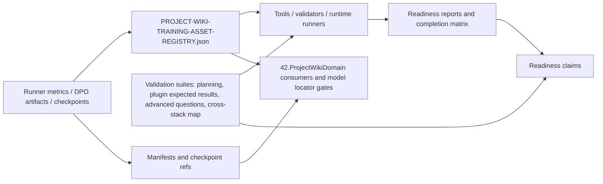

# 43.LearningLocalWikiData

Documentation status: D43A documented - parent review passed.

## 0. In brief for Luba

This is documentation about the data folder for the local project wiki: here live the registry, reports, validation suites, runner metrics, manifest/checkpoint references, and evidence matrices. This is not the model itself and not the CLI/tool implementation. D43-A documents data/artifacts/registry/reports; the detailed algorithms of the tool implementation, CLI, harness runners, and command wrappers belong to the future document `D43-A-tools`. In this document the tools are mentioned only as consumers of these files.

An important boundary: validation suites/contracts with `validation_only=true` are not execution/runtime evidence; they are expected-result/test-case contracts and must not be accepted as model/plugin readiness. In plain terms: a file with expected scenarios is like a checklist before an exam, not the passed exam itself. Model or plugin readiness begins only where a consumer/runner actually loads, opens, invokes, and records runtime/load/use/continue evidence.

## 1. Human explanation

`43.LearningLocalWikiData` is not a production library and not a place where a model runs. It is a folder of project artifacts: registry, validation suites, runner metrics, checkpoint/manifest references, readiness reports, and evidence matrices for the project-local wiki. The execution logic stays in `42.ProjectWikiDomain` and related tools/runner projects; D43A stores the data, statuses, and references by which such consumers decide whether a specific training run or readiness can be trusted.

The main boundary for Luba: the presence of JSON/report/registry/checkpoint helps to see what was written and classified, but by itself does not prove runtime/load/use/continue evidence. Full readiness of a trainable unit requires a consumer to actually open the checkpoint/manifest, load the unit, find it via the locator, run a runtime/use probe, and, if continued training is claimed, confirm the continue path.

## 2. UML of the data flow



Legend: an arrow means the passing of a reference, a field, or a verification scenario. It does not mean that D43A itself runs a model or a plugin.

## 3. Connection simulations

| Connection | Example input | What is passed | Expected result | What must not be taken as proof |
|---|---|---|---|---|
| Runner metrics -> registry | a DPO run for `NegativeDpoGenerator` with `trainingRowCount=50`, `heldOutRowCount=50`, `finalAccuracy=0.572` | `runner_report_path`, `metrics`, `checkpoint_ref`, `status` | The registry classifies the run as accepted/rejected/experimental/blocked and saves the next action | You must not say the model is ready for the product: a metric summary without a load/use/held-out gate and registry acceptance is insufficient |
| Registry -> continuation gate | an entry with `status=rejected` and `checkpoint_allowed_as_continuation=false` | the continuation flag and `allowed_next_action` | A consumer must not take the checkpoint as a source for continuation | A rejected checkpoint must not be used as an "almost ready" asset |
| Validation suite -> tools/runtime runner | `ORCHESTRATOR-PROMPT-PLUGIN-EXPECTED-RESULTS-v1.json` with `validation_only=true`, `execution_complete=false` | expected plugin entrypoints, units, evidence requirements | The tool/runner knows which scenarios to execute | A validation suite must not be passed off as a runtime plugin invocation |
| Manifest/checkpoint refs -> model locator/load/use gates | `generated_capability_manifest.json` with `policyCheckpointPath`, `tokenizerPath`, `trainingStepCount` | the model paths and parameters | A runtime consumer can try to open and register the unit | The presence of a manifest/checkpoint path does not prove that the checkpoint was opened, is loadable, and is used |
| Plugin runtime report -> readiness claim | `PLUGIN-RUNTIME-INTEGRATION-GATE.json` with `validation_only=false`, runtime symbols and CPU/RAM/elapsed | a runtime evidence report | This is stronger evidence than a static build-only report | Even such a report may be stale; it must match the current commit/state and does not replace a product check of all claimed scenarios |
| Completion matrix -> final readiness | `PROJECT-WIKI-COMPLETION-COVERAGE-MATRIX.json` with HOLE-* rows | Mapping literal requirement -> artifact -> passed | Shows which requirements were closed by artifacts | The matrix does not replace the runtime artifacts themselves and must not be used if the source is stale or validation_only |

## 4. No-code algorithms

### Algorithm A: the meaning of the training asset registry

Where the data logic lives: `43.LearningLocalWikiData/registry/PROJECT-WIKI-TRAINING-ASSET-REGISTRY.json` and the schema `43.LearningLocalWikiData/registry/PROJECT-WIKI-TRAINING-ASSET-REGISTRY.schema.json`.

Input: runner metrics, DPO reports, checkpoint refs, manifests, source authority, and integrity data from `43.LearningLocalWikiData/artifacts/*`.

Output: a registry entry with the fields `batch_id`, `unit_name`, `status`, `metrics`, `checkpoint_ref`, `manifest_ref`, `locator_key`, `remote_unit_id`, `checkpoint_allowed_as_continuation`, `allowed_next_action`, `warnings`.

Current behavior:
1. The registry keeps a common counter of statuses: accepted/rejected/experimental_no_authority/blocked.
2. For each batch/run entry, the train/heldout rows, path to the runner report, metrics, checkpoint/manifest/locator refs, and integrity are recorded.
3. If the status is `accepted` and `checkpoint_allowed_as_continuation=true`, the entry can be a candidate for a continuation consumer.
4. If the entry is rejected/experimental/blocked or the warnings note a missing manifest/heldout evidence, it must not be passed off as a ready product unit.

What the algorithm does not do: the registry does not open a checkpoint, does not run inference, does not prove held-out generalization, and is not an `ILearningMachine`.

### Algorithm B: the meaning of the validation suites

Where the data logic lives: `validation/ORCHESTRATOR-PROMPT-PLANNING-SUITE-v1.json`, `validation/ORCHESTRATOR-PROMPT-PLUGIN-EXPECTED-RESULTS-v1.json`, `validation/ADVANCED-WIKI-QUESTION-SUITE-v1.json`, `validation/CROSS-STACK-SYSTEM-MAP.json` and their schemas.

Input: human/project prompt classes, plugin expected entrypoints, advanced wiki question classes, cross-stack project map evidence.

Output: test-case/data contracts: prompt variations, required units, expected phase plan, expected wiki query series, pass assertions, cross-stack systems and known unknowns.

Current behavior:
1. The suite defines the scenarios that a runner/tool must execute or check.
2. `validation_only=true` means the file describes a verification contract, not the fact of execution.
3. `execution_complete=false` in the plugin expected results explicitly says the expected-results file is not yet a host invocation.
4. The cross-stack map stores evidence and unknowns, without guessing connections without proof.

What the algorithm does not do: a validation suite does not select a runtime unit, does not train a model, does not execute a plugin host, and does not replace real-project prompt runtime evidence.

### Algorithm C: the meaning of readiness/gate reports

Where the data logic lives: `reports/PROJECT-WIKI-*-GATE.json`, `reports/PROJECT-WIKI-COMPLETION-COVERAGE-MATRIX.json`, `reports/PROJECT-WIKI-END-TO-END-READINESS-GATE.json`, `reports/PLUGIN-RUNTIME-INTEGRATION-GATE.json`.

Input: references to the registry, validation suite gates, runtime gates, import/export gates, plugin integration gates, commit/state evidence.

Output: a report with `passed`, `validation_only`, `metric_type`, CPU/RAM/elapsed, and source_of_truth.

Current behavior:
1. Stronger reports explicitly set `validation_only=false` and `metric_type=runner_emitted_runtime_metric`.
2. Reports gather references to child gates and name the failed checks.
3. The completion matrix links a literal requirement to an artifact/evidence.
4. A final readiness claim is allowed only when the report does not rely on static-only evidence for a runtime claim.

What the algorithm does not do: a report does not automatically re-verify the freshness of all external paths and does not replace opening/loading checkpoints in consumer code.

### Algorithm D: runner metrics and checkpoint/manifest refs

Where the data logic lives: representative files under `artifacts/runner-metrics/*`, for example `project-wiki-dpo-metric-summary.json` and `generated_capability_manifest.json`.

Input: DPO pairs, training rows, held-out rows, checkpoint root, CPU/RAM/time metrics, manifest fields.

Output: numeric runner metrics, checkpoint paths, tokenizer path, model shape, LoRA settings, trainingStepCount, sourceDatasetSha256.

Current behavior:
1. The runner metric summary records the run id, unit id, source path, checkpoint root, train/heldout row counts, and loss/accuracy/reward margin.
2. The manifest records the unit identity, role, trust state, checkpoint/tokenizer paths, and shape parameters.
3. Registry/import-export gates use these files as pointers and evidence sources.

What the algorithm does not do: a checkpoint path does not mean the model was freshly loaded, found via the locator, and used in a runtime answer. For that, reports/consumers outside D43A are needed.

### Algorithm E: boundary to tools and runtime consumers

Where the logic sits: D43A stores files; the consuming logic belongs to `42.ProjectWikiDomain` and the later `43.LearningLocalWikiData/tools/*` documentation.

Input: a registry/report/validation file path.

Output: a consumer decision: can use, must reject, must review, or can only plan next training.

Current behavior:
1. The consumer reads the JSON and report fields.
2. The consumer must distinguish `validation_only=true` from runtime execution.
3. The consumer must check the status, checkpoint continuation flag, manifest/locator refs, and actual runtime/load evidence.

What the algorithm does not do: D43A itself does not perform runtime validation, training, import/export, or plugin host invocation.

## 5. Short exact quotations

`43.LearningLocalWikiData/README.md:3-7`

```text
This subproject stores project-local wiki learning batches, runner outputs,
resource reports, held-out evaluation artifacts, checkpoint references,
manifests, and the training asset registry used by `42.ProjectWikiDomain`.

It is data, not runtime logic.
```

Why it matters: this is a direct source of the project boundary. D43A stores learning data/artifacts; the runtime logic is in the neighboring projects.

`43.LearningLocalWikiData/registry/PROJECT-WIKI-TRAINING-ASSET-REGISTRY.schema.json:32-54`

```json
"required": [
  "batch_id",
  "unit_name",
  "unit_version",
  "status",
  "train_rows",
  "heldout_rows",
  "train_path",
  "heldout_path",
  "runner_report_path",
  "metrics",
  "checkpoint_ref",
  "manifest_ref",
  "locator_key",
  "remote_unit_id",
  "checkpoint_allowed_as_continuation",
  "allowed_next_action",
  "source_authority",
  "import_export_status",
  "locator_status",
  "artifact_integrity",
  "artifact_checksum",
  "warnings"
]
```

Why it matters: the schema requires not only a checkpoint, but also manifest/locator/status/continuation fields. This protects against a false-done based on a single file.

`43.LearningLocalWikiData/registry/PROJECT-WIKI-TRAINING-ASSET-REGISTRY.json:5-11`

```json
"training_continuation_blocked_until_registry_validated":  false,
"status_counts":  {
                      "accepted":  19,
                      "rejected":  182,
                      "experimental_no_authority":  193,
                      "blocked":  26
                  },
```

Why it matters: the registry already classifies many runs as not accepted. Most entries must not be automatically used as a ready model asset.

`43.LearningLocalWikiData/validation/ORCHESTRATOR-PROMPT-PLUGIN-EXPECTED-RESULTS-v1.json:7-10`

```json
"source_planning_suite":  "43.LearningLocalWikiData\\validation\\ORCHESTRATOR-PROMPT-PLANNING-SUITE-v1.json",
"project_doc_rag_scenario_matrix":  "43.LearningLocalWikiData\\validation\\PLUGIN-PROJECT-DOC-RAG-SCENARIO-MATRIX-v1.json",
"validation_only":  true,
"execution_complete":  false,
```

Why it matters: the expected-results suite is not runtime evidence. It is a contract for future/other probes.

`43.LearningLocalWikiData/reports/PLUGIN-RUNTIME-INTEGRATION-GATE.json:3-5`

```json
"report_scope": "plugin_runtime_integration_gate",
"validation_only": false,
"metric_type": "runner_emitted_runtime_metric",
```

Why it matters: the report explicitly claims runtime metric scope, unlike validation-only suites. This is stronger evidence, but it still must be tied to the current state/commit and source_of_truth.

`43.LearningLocalWikiData/reports/PROJECT-WIKI-IMPORT-EXPORT-GATE.json:42-54`

```json
"accepted_publishable_missing_manifest_ref":  0,
"accepted_publishable_missing_locator_key":  0,
"accepted_publishable_missing_remote_unit_id":  0,
"accepted_publishable_missing_checkpoint_ref":  0,
"accepted_publishable_missing_upgrade_policy":  0,
"accepted_publishable_missing_rollback_ref":  0,
"accepted_publishable_missing_compatibility_report_ref":  0,
"invalid_import_export_status_entries":  0,
"all_accepted_checkpoints_resolve_through_registry":  true,
"all_units_locatable_through_remote_unit_id":  true,
"all_canonical_trainable_units_have_upgrade_policy":  true,
"all_upgraded_units_have_compatibility_report_ref_and_rollback_ref":  true,
"passed":  true,
```

Why it matters: the import/export gate is registry/report evidence for asset references. It still does not mean D43A itself loaded every model; that proof must come from runtime consumers/gates.

`43.LearningLocalWikiData/artifacts/runner-metrics/2026-05-19-negative-dpo-generator-batch-010-reference-copy-runner/dpo-runs/negative-dpo-generator-unit/negative-dpo-generator-batch-010-reference-copy-negative-dpo-generator-unit-20260519114900/project-wiki-dpo-metric-summary.json:8-19`

```json
"trainingRowCount": 50,
"heldOutRowCount": 50,
"finalLoss": 0.6930316758155822,
"finalAccuracy": 0.572000013589859,
"finalRewardMargin": 0.00023121643677995963,
"heldOutLoss": 0.6929551959037781,
"heldOutAccuracy": 0.5799999833106995,
"heldOutRewardMargin": 0.0003848438209388405,
"averageCpuPercent": 12.489376036426675,
"totalCpuTimeMs": 125109.375,
"peakWorkingSetMb": 85.01953125,
"totalElapsedMs": 165868.8942,
```

Why it matters: the runner metrics give numeric training evidence, but not automatically product readiness or generalization for all prompts.

`43.LearningLocalWikiData/artifacts/runner-metrics/2026-05-20-code-trace-builder-batch-001/code-trace-builder-unit/code-trace-builder-20260520210644/generated_capability_manifest.json:25-46`

```json
"policyCheckpointPath": "%USERPROFILE%\\Documents\\xiigen\\llm mvp\\orchestrator extension\\runner-metrics\\2026-05-20-code-trace-builder-batch-001\\code-trace-builder-unit\\code-trace-builder-20260520210644\\policy.bin",
"tokenizerPath": "%USERPROFILE%\\Documents\\xiigen\\llm mvp\\orchestrator extension\\runner-metrics\\2026-05-20-code-trace-builder-batch-001\\code-trace-builder-unit\\code-trace-builder-20260520210644\\tokenizer.json",
"vocabSize": 4096,
"contextLen": 128,
"hiddenDim": 96,
"numLayers": 2,
"numHeads": 4,
"numKvHeads": 4,
"ffnHiddenDim": 128,
"loraRank": 2,
"loraAlpha": 4,
"loraDropout": 0.05,
"loraTargetModules": [
  "q_proj",
  "v_proj"
],
"createdAtUtc": "2026-05-20T21:06:44.2291842+00:00",
"unitFamilyId": "code-trace-builder",
"parentUnitId": null,
"parentPolicyCheckpointPath": null,
"parentTokenizerPath": null,
"trainingStepCount": 50,
```

Why it matters: the manifest describes the model asset shape and paths. It does not prove that the asset was opened today or executed in the product.

## 6. QA/test/evidence mapping

| File | What it checks as a data contract | What it does not check |
|---|---|---|
| `validation/ORCHESTRATOR-PROMPT-PLANNING-SUITE-v1.json` | Scenario classes, prompt variations, required phase plan and query planning shape | Does not execute the orchestration runtime |
| `validation/ORCHESTRATOR-PROMPT-PLUGIN-EXPECTED-RESULTS-v1.json` | Expected VS Code/Visual Studio entrypoints and user-visible results | `validation_only=true`, `execution_complete=false`; not plugin invocation |
| `validation/ADVANCED-WIKI-QUESTION-SUITE-v1.json` | Advanced wiki question classes and pass thresholds | Not model answer quality without runner execution |
| `validation/CROSS-STACK-SYSTEM-MAP.json` | Cross-stack systems, evidence, unknowns recorded instead of guessed | Not a runtime query answer and not training data by itself |
| `registry/PROJECT-WIKI-TRAINING-ASSET-REGISTRY.json` | Accepted/rejected/experimental/blocked asset classification | Not checkpoint load/use evidence alone |
| `reports/PROJECT-WIKI-IMPORT-EXPORT-GATE.json` | Registry-level import/export and locator reference completeness | Not actual model inference |
| `reports/PLUGIN-RUNTIME-INTEGRATION-GATE.json` | Runtime/library integration evidence for plugin artifacts | Not broad product quality for every prompt unless linked gates cover them |
| `reports/PROJECT-WIKI-COMPLETION-COVERAGE-MATRIX.json` | Requirement-to-evidence matrix | Not primary evidence if referenced reports are stale or validation-only |

Tests and runtime probes were not run in this documentation subphase. This doc maps existing files only.

## 7. Hierarchy and trainable status

`43.LearningLocalWikiData` is a data/evidence project. It is not a Level 5 `ILearningMachine`, not an `ILogicalUnit`, and not a runtime orchestrator. Trainable evidence appears as stored runner metrics, checkpoints, manifests and registry refs. The actual trainable/runtime boundary belongs to consumers such as `42.ProjectWikiDomain` and later tools that load, validate, publish or continue assets.

Status by family:

| Family | Current status |
|---|---|
| Registry | Implemented as JSON/schema artifact with accepted/rejected/experimental/blocked classification |
| Validation suites | Implemented as scenario/data contracts; many are explicitly `validation_only` |
| Runner metrics/checkpoints | Present as artifacts; some have numeric metrics and manifests |
| Readiness reports | Present; strength varies by `validation_only`, `metric_type`, and source_of_truth |
| Runtime/load/use evidence | Stored as reports when produced by external consumers/runners, not executed by D43A itself |
| Plugin evidence | Some runtime/library reports exist; static build-only reports are not enough for full plugin readiness |

## 8. Anti-false-done

- JSON/report/registry/checkpoint presence is not full trained-unit completion.
- `validation_only=true` evidence cannot be used as runtime proof.
- A static semantic helper audit, expected-results suite, schema pass, or smoke report cannot replace host/runtime invocation.
- A checkpoint path without an opened/loadable checkpoint, locator entry, fresh-load probe, and use evidence is only a pointer.
- An accepted registry status is stronger than raw artifact presence, but still depends on linked manifests, locator refs, integrity, and runtime consumer evidence.
- Rejected or experimental entries must not be silently used as continuation sources.
- Stale reports must not be reused for current readiness claims unless the current consumer/state explicitly reconciles them.
