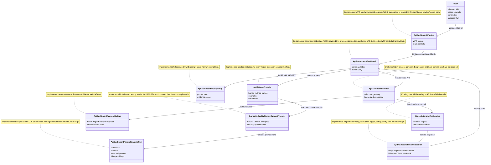

# 43.SmartSkillsDomain.Dashboard

Documentation status: WO-API-DASH-6 plus PromptToTask, OrchestrationReasoning, SkillSelection semantic-quality dashboard scenarios, P39 fixture catalog/API surface, P40 fixture runner authorization guard, and P41 source-disjoint pre-eval guard updated, verified against the dashboard source and the real WPF-only test project/file in this documentation/QA fix.

## 0. Short Map For Luba

`43.SmartSkillsDomain.Dashboard` is a Windows Presentation Foundation (WPF) desktop dashboard for trying the Xiigen extension API methods from inside `llm_mvp_core`. A user chooses a human-named API row, reads an example, enters text, presses Run, and sees the core response, warnings, errors, debug text, raw JSON, and safe history. The dashboard is intentionally thin: it builds `XiigenExtensionRequest`, calls `XiigenExtensionApiService` through `ApiDashboardRunner`, and displays `XiigenExtensionResponse`.

P39 adds a test-only semantic-quality fixture catalog on top of that same dashboard/API surface. The catalog reads the P36/P37 fixture rows, attaches 36 fixture examples to the three primary API methods, lets the user select an example, and sends fixture id, scenario id, held-out source family, and false proof flags through the normal dashboard request path. This proves fixture visibility and dashboard/API wiring only. It does not run model evaluation, does not train, has no checkpoint mutation, and does not prove semantic quality.

P40 adds a fixture runner guard for the same rows. `ApiDashboardFixtureRunner.GuardFixture` loads a named P36 fixture through the dashboard fixture catalog, reads the P37 runner authorization gap ledger, and returns a typed guard result. Without an explicit `ApiDashboardFixtureRunnerAuthorizationManifest`, the result is a safe refusal with `IsAuthorized=false`. With a manifest whose scope is `semantic-quality-fixture-eval`, whose fixture id matches the requested fixture or `*`, and whose eval flag is true while training, checkpoint mutation, and external AI flags stay false, the result changes only the authorization metadata. P40 still does not run model evaluation, does not train, does not mutate checkpoints, does not prove semantic quality, and does not prove host runtime.

P41 adds the source-disjoint guard that closes the source-family consistency gap before any future eval runner can use the P36 rows. `ApiDashboardSourceDisjointGuard.VerifyP36FixtureRows` reads `p36-source-disjoint-manifest.json` and `p36-eval-fixtures.jsonl`, counts fixtures by machine, checks duplicate fixture ids, compares actual fixture source families with manifest families, and reports any families that appear in both train and eval roles. The current P36 rows pass this parse-only precheck, but `CanProceedToEvalRunner=false` remains fixed because P41 does not authorize eval. It does not run model evaluation, does not train, does not mutate checkpoints, does not prove semantic quality, and does not prove host runtime.

P42 adds the dashboard overclaim firewall for preview, smoke, documentation, and report-facing wording. The firewall scans dashboard documentation, dashboard source strings, the P37 readiness gap ledger, and P42 artifact text for positive claims that dashboard or preview evidence proves semantic quality, trained-model readiness, Claude/Cursor/Codex host runtime, checkpoint rewrite, fresh-load, or continue-training. Negative and bounded wording is allowed, such as `not semantic quality proof` and `not host runtime proof`. Positive overclaims are rejected, such as `semantic quality proven by dashboard smoke` or `Claude host runtime proven by dashboard`. P42 proves only that these wording claims are guarded; it does not run model evaluation, does not train, does not mutate checkpoints, does not prove semantic quality, and does not prove host runtime.

WO-5 view-model/handler evidence was an intermediate dashboard check. WO-6 adds dashboard-scoped WPF window/control automation through `Tests.ApiDashboardWpf/Tests.ApiDashboardWpf.csproj` and `Tests.ApiDashboardWpf/ApiDashboardWindowInteractiveTests.cs` for this dashboard's own `ApiDashboardWindow` path. WO-API-DASH-7 adds QA UI/UX automation: the same WPF test project must prove human-readable labels, accessible names/help text, example/output explanations, visible error wording, safe raw/debug affordances, stable panel bounds, keyboard focus traversal, and no internal jargon on the primary path. That still does not prove that Claude, Cursor, or Codex host user interfaces invoked the API. It also does not prove external AI use, semantic quality, or trained-model readiness unless the core response carries separate trained evidence. External AI is not used by this dashboard path.

## 1. Importable UML



### UML Connection Simulations

| Connection | Example input | Expected result | What it does not prove |
|---|---|---|---|
| `User -> ApiDashboardWindow` | User opens the WPF dashboard and selects "Turn a user prompt into a structured task". | The selected row appears in the window. | It does not prove Claude, Cursor, or Codex host runtime. |
| `ApiDashboardWindow -> ApiDashboardViewModel` | The Run button binding invokes `RunCommand`. | WO-6 dashboard automation drives the named WPF control path into the view model command. WO-API-DASH-7 also checks the control's human name, help text, tooltip, and primary-path wording. | It is dashboard-scoped WPF evidence only, not Claude/Cursor/Codex host runtime. |
| `ApiDashboardViewModel -> ApiCatalogProvider` | Dashboard starts with no selection. | Catalog rows load from the core contract metadata. | Catalog presence alone does not prove API behavior. |
| `ApiCatalogProvider -> SemanticQualityFixtureCatalogProvider` | P36/P37 fixture files are present in the repository. | The three primary API rows receive 12 fixture examples each. | It does not execute model eval or prove semantic quality. |
| `SemanticQualityFixtureCatalogProvider -> ApiDashboardFixtureExampleRow` | `P36-SKILLSELECTION-01` fixture row. | The row becomes a human-readable fixture preview with example input, expected fields, and false proof flags. | It does not copy raw private text or train the model. |
| `ApiDashboardFixtureRunner -> SemanticQualityFixtureCatalogProvider` | Guard request for `P36-SKILLSELECTION-01`. | The guard loads the fixture and refuses eval unless explicit authorization metadata is present. | It does not call a model, eval runner, trainer, checkpoint importer, or host runtime. |
| `ApiDashboardSourceDisjointGuard -> P36 manifest and fixture rows` | Guard request for the current P36 rows. | The guard returns 36 fixtures, 12 per machine, no duplicate ids, no missing manifest families, no unexpected manifest families, and no train/eval source-family overlap. | It does not authorize eval or prove model quality. |
| `tools/api-dashboard-qa.ps1 -> dashboard docs/source/P42 artifacts` | QA script scans dashboard wording and P42 report-facing text. | Positive dashboard/preview/smoke overclaim wording is rejected unless the line is explicitly negative, rejected, or future-scoped. | It does not run eval, train, mutate checkpoints, prove semantic quality, or prove host runtime. |
| `ApiDashboardRunner -> ApiDashboardRequestBuilder` | Method `prompt-to-task`, text "Create task", debug off. | A `XiigenExtensionRequest` is built with dashboard host facts and false proof flags. | It does not call external AI or train a model. |
| `ApiDashboardRunner -> XiigenExtensionApiService` | Valid dashboard request. | Core response returns check-set results and warnings. | It proves dashboard-to-core only, not extension host runtime. |
| `ApiDashboardResultPresenter -> ApiDashboardViewModel` | Core response has warnings and debug trace. | Human result, warnings, errors, raw JSON, debug text, and boundary flags are displayed. | It does not upgrade partial core evidence into semantic quality. |
| `ApiDashboardViewModel -> ApiDashboardHistoryEntry` | User runs a prompt and prepares safe history text. | Prepared text contains method, status, prompt hash, and evidence scope. | It does not write a file, automate clipboard, or expose the raw private prompt. |

## 2. No-Code Algorithms

### 2.1 Build The API Catalog

Implementation: `ApiCatalogProvider.BuildCatalog(IReadOnlyDictionary<string, ApiDashboardCatalogMetadata> metadataByMethod)`.

Input: the real `XiigenExtensionApiContract.GetMethodContracts()` rows and dashboard-owned human metadata.

Output: one `ApiDashboardCatalogRow` per core method.

Steps:

1. Read the method list from the Xiigen extension contract.
2. Compare contract method ids with dashboard metadata ids.
3. Fail if metadata names an unknown method.
4. Fail if any contract method lacks dashboard metadata.
5. Validate that each row has a human name, description, example, input description, output preview, status, and safety note.
6. Copy allowed request and response fields into human-described field rows.
7. Add forbidden payloads and boundary rules to the safety note.
8. Set external-AI and runtime-host proof flags to false for every row.

Branches:

| Branch | Example | Expected result | QA |
|---|---|---|---|
| Complete metadata | Five contract methods, five metadata rows. | Catalog succeeds. | `ApiDashboardCatalogTests` and `tools/api-dashboard-qa.ps1`. |
| Missing metadata | Remove `debug-trace`. | Catalog fails before UI display. | `ApiCatalogProvider_BuildCatalog_RequiresHumanMetadataForEveryMethod`. |
| Unknown metadata | Add `not-a-real-xiigen-method`. | Catalog fails. | `ApiCatalogProvider_BuildCatalog_RejectsUnknownMetadataMethod`. |

### 2.2 Build A Dashboard Request

Implementation: `ApiDashboardRequestBuilder.BuildRequest(...)`.

Input: selected method id, user text, debug flag, optional host facts, skills, check-set inputs, provenance, and correlation id.

Output: `OperationResult<XiigenExtensionRequest>`.

Steps:

1. Trim and validate the selected method id against `XiigenExtensionApiContract`.
2. Trim and validate the text input.
3. Create or preserve a correlation id.
4. Copy host facts, then force dashboard safety defaults: no external AI, no host training, no host corpus parsing, no runtime extension proof, and no semantic quality proof.
5. Copy requested and available skills.
6. Copy check-set inputs and add dashboard proof-boundary flags.
7. Copy provenance and mark the source as `api-dashboard`.
8. Return the request envelope.

Branches:

| Branch | Example | Expected result | QA |
|---|---|---|---|
| Valid request | `skill-selection` plus available skills. | Request uses `ApiDashboard` host and safe proof flags. | `ApiDashboardRequestBuilderTests`. |
| Empty text | Whitespace input. | Validation error before any core call. | `ApiDashboardRequestBuilder_BuildRequest_RejectsEmptyInputBeforeCoreCall`. |
| Unsupported method | `not-a-real-method`. | Validation error before any core call. | `ApiDashboardRequestBuilder_BuildRequest_RejectsUnsupportedMethodBeforeCoreCall`. |

### 2.2A Build A Fixture Preview Request

Implementation: `ApiDashboardRequestBuilder.BuildRequest(ApiDashboardCatalogRow selectedRow, ApiDashboardFixtureExampleRow selectedFixture, bool debugEnabled, string? correlationId)`.

Input: one selected dashboard API row and one fixture example row that belongs to that API method.

Output: `XiigenExtensionRequest` with normal dashboard safety defaults plus fixture metadata.

Steps:

1. Check that a dashboard API row is selected.
2. Check that a fixture example is selected.
3. Check that the fixture method matches the selected API method.
4. Use the fixture example text as the request text.
5. Add fixture id, scenario id, machine, held-out source family, and evidence scope into host facts, check-set inputs, and provenance.
6. Force `training_allowed=false`, `eval_execution_allowed=false`, `semantic_quality_claimed=false`, and `runtime_extension_claimed=false`.
7. Return the same `XiigenExtensionRequest` type used by the normal dashboard path.

Branches:

| Branch | Example | Expected result | QA |
|---|---|---|---|
| Matching fixture | SkillSelection row plus `P36-SKILLSELECTION-01`. | Request contains fixture metadata and false proof flags. | `ApiDashboardRequestBuilder_BuildRequest_FromFixtureExampleAddsSafeFixtureBoundaryFields`. |
| Mismatched fixture | PromptToTask row plus SkillSelection fixture. | Request is rejected before core call. | `ApiDashboardRequestBuilder_BuildRequest_RejectsFixtureFromDifferentApiMethod`. |
| Custom user input | Fixture selected but input text changed by user. | View-model uses normal dashboard request, not fixture preview request. | `ApiDashboardViewModel_CustomTextWithFixtureSelectedUsesNormalDashboardRequest`. |

### 2.2B Guard A Fixture Runner Request

Implementation: `ApiDashboardFixtureRunner.GuardFixture(...)` and `ApiDashboardFixtureRunner.GuardFixtureWithAuthorizationManifestPath(...)`.

Input: one fixture id, and optionally an `ApiDashboardFixtureRunnerAuthorizationManifest` object or a path to a JSON authorization manifest.

Output: `ApiDashboardFixtureRunnerResult`.

Steps:

1. Trim and validate the requested fixture id.
2. Load P36 fixture examples through `SemanticQualityFixtureCatalogProvider.BuildFixtureExamples`.
3. Return a readable failure if the requested fixture id is absent.
4. Read the P37 readiness gap ledger and include the P37-GAP-02 runner guard note in metadata.
5. If no manifest is present, return a safe refusal with `IsAuthorized=false`.
6. If the manifest is malformed or does not explicitly allow fixture eval, return a safe refusal with the reason.
7. If the manifest explicitly allows eval for this fixture or all fixtures, set only authorization metadata to accepted.
8. In every branch, keep training, eval execution, checkpoint mutation, semantic-quality proof, host-runtime proof, and external-AI flags false.

Example authorization manifest:

```json
{
  "authorization_id": "auth-file-allow",
  "authorization_scope": "semantic-quality-fixture-eval",
  "fixture_id": "P36-SKILLSELECTION-12",
  "eval_execution_allowed": true,
  "training_allowed": false,
  "checkpoint_mutation_allowed": false,
  "external_ai_allowed": false
}
```

Branches:

| Branch | Example | Expected result | QA |
|---|---|---|---|
| No manifest | `P36-SKILLSELECTION-01` with no authorization. | Fixture loads, `IsAuthorized=false`, and all execution/proof flags are false. | `ApiDashboardFixtureRunner_GuardFixture_LoadsKnownP36FixtureAndRefusesWithoutAuthorization`. |
| Missing fixture | `P36-NOT-A-REAL-FIXTURE`. | Readable failure before any authorization decision. | `ApiDashboardFixtureRunner_GuardFixture_MissingFixtureReturnsReadableFailure`. |
| Malformed manifest | A path to invalid JSON. | Fixture loads, authorization is refused, and no eval/model action runs. | `ApiDashboardFixtureRunner_GuardFixtureWithAuthorizationManifestPath_MalformedAuthorizationRefuses`. |
| Non-allowing manifest | Manifest has `eval_execution_allowed=false`. | Authorization is refused with a human-readable reason. | `ApiDashboardFixtureRunner_GuardFixture_NonAllowingAuthorizationRefuses`. |
| Explicit allow manifest | Correct scope, fixture id, and eval flag. | `IsAuthorized=true`, next action says a separate eval slice is still required, and all execution/proof flags remain false. | `ApiDashboardFixtureRunner_GuardFixture_ExplicitAllowChangesOnlyAuthorizationMetadata`. |

### 2.2C Check Source Families Before A Future Eval Runner

Implementation: `ApiDashboardSourceDisjointGuard.VerifyP36FixtureRows(...)` and `ApiDashboardSourceDisjointGuard.VerifySourceDisjointRows(...)`.

Input: the P36 source-disjoint manifest and the P36 fixture rows.

Output: `ApiDashboardSourceDisjointGuardReport`.

Steps:

1. Read `p36-source-disjoint-manifest.json`.
2. Read every non-empty line from `p36-eval-fixtures.jsonl`.
3. Count fixture rows by machine.
4. Find duplicate fixture ids.
5. Compare the fixture rows' held-out source families with the manifest's source-family list.
6. Report fixture families that are missing from the manifest.
7. Report manifest families that do not appear in fixture rows.
8. Group rows by source family and detect any family that has both a train role and an eval or holdout role.
9. Copy the universal-only and raw-private-text boundary into typed booleans.
10. Copy the manifest proof flags for training, eval, checkpoint mutation, and semantic-quality claim.
11. Always return `CanProceedToEvalRunner=false`, because P41 is a precheck only and a later eval authorization layer must make any eval decision.

Example clean report for the current P36 rows:

```json
{
  "fixtureCount": 36,
  "countsByMachine": {
    "PromptToTask": 12,
    "OrchestrationReasoning": 12,
    "SkillSelection": 12
  },
  "duplicateFixtureIds": [],
  "missingManifestFamilies": [],
  "unexpectedManifestFamilies": [],
  "familiesBothTrainAndEval": [],
  "universalOnly": true,
  "rawPrivateTextCopied": false,
  "trainingRun": false,
  "evalRun": false,
  "checkpointMutated": false,
  "semanticQualityClaimed": false,
  "canProceedToEvalRunner": false
}
```

Branches:

| Branch | Example | Expected result | QA |
|---|---|---|---|
| Current P36 rows | Real P36 manifest plus 36 fixture rows. | The precheck passes, all proof flags are false, and eval remains unauthorized. | `ApiDashboardSourceDisjointGuard_VerifyP36FixtureRows_PassesCurrentP36ButDoesNotAuthorizeEval`. |
| Duplicate fixture id | Temp rows use the same fixture id twice. | `DuplicateFixtureIds` names the duplicate and the precheck does not pass. | `ApiDashboardSourceDisjointGuard_VerifySourceDisjointRows_DetectsDuplicateFixtureIds`. |
| Missing and extra family | Fixture rows contain `family_missing`; manifest contains `family_extra`. | Missing and unexpected family lists show the mismatch. | `ApiDashboardSourceDisjointGuard_VerifySourceDisjointRows_DetectsMissingAndUnexpectedFamilyMismatch`. |
| Train/eval overlap | Temp rows put one source family in train and eval roles. | `FamiliesBothTrainAndEval` names that family. | `ApiDashboardSourceDisjointGuard_VerifySourceDisjointRows_DetectsTrainEvalOverlap`. |
| Proof flags | Any clean temp row. | Training, eval, checkpoint, semantic-quality, raw-private-text, and eval-authorization flags stay false. | `ApiDashboardSourceDisjointGuard_VerifySourceDisjointRows_DoesNotTurnProofFlagsTrue`. |

### 2.2D Reject Dashboard Overclaim Wording

Implementation: `tools/api-dashboard-qa.ps1` and `Tests/ApiDashboardOverclaimFirewallTests.cs`.

Input: dashboard documentation, dashboard source strings, the P37 readiness gap ledger, P42 report-facing artifacts, and focused allow/reject wording examples.

Output: a pass/fail guard result with any overclaim line named by file and line number.

Steps:

1. Read the dashboard documentation and source strings that a report or user could see.
2. Read the P37 readiness gap ledger because it names the smoke-test and host-runtime boundaries.
3. Read P42 report-facing artifacts so this slice cannot introduce its own false wording.
4. Search each line for positive claim patterns around semantic quality, trained-model readiness, Claude/Cursor/Codex host runtime, checkpoint rewrite, fresh-load, and continue-training.
5. Allow the line when the same line explicitly says the claim is negative, rejected, future-scoped, missing, blocked, false, or not claimed.
6. Fail the guard when a positive claim remains after that context check.

Examples:

| Wording | Result | Why |
|---|---|---|
| `not semantic quality proof` | Allowed. | It clearly says dashboard evidence is not proof. |
| `not host runtime proof` | Allowed. | It clearly keeps host runtime outside the dashboard evidence. |
| `semantic quality proven by dashboard smoke` | Rejected. | It turns smoke evidence into a semantic-quality claim. |
| `Claude host runtime proven by dashboard` | Rejected. | It turns dashboard evidence into a Claude host-runtime claim. |

### 2.3 Run The Core Boundary

Implementation: `ApiDashboardRunner.Run(...)`.

Input: a catalog row or method id, user text, debug/raw JSON flags, and optional request fields.

Output: `ApiDashboardRunResult`.

Steps:

1. Ask the request builder to create the core request.
2. If request building fails, return a visible dashboard validation result without calling the core gateway.
3. If the request is valid, call `XiigenExtensionApiService.ProcessHostExtensionRequest`.
4. If the core operation result fails, return a visible dashboard error.
5. If core returns a response, pass it to `ApiDashboardResultPresenter`.
6. Copy the presenter result and evidence flags into `ApiDashboardRunResult`.
7. Preserve the evidence scope as dashboard-to-core only.

Branches:

| Branch | Example | Expected result | QA |
|---|---|---|---|
| Valid request and successful core response | Prompt-to-task text. | `CoreBoundaryCalled=true`, result visible. | `ApiDashboardRunner_Run_SuccessfulServiceResponseMapsToViewModel`. |
| Invalid input | Empty text. | Core call count remains zero. | `ApiDashboardRunner_Run_InvalidBuilderInputReturnsVisibleErrorWithoutCoreCall`. |
| Core operation failure | Injected gateway failure. | Error visible, no blank output. | `ApiDashboardRunner_Run_CoreOperationResultFailureMapsToVisibleError`. |

### 2.4 Present Results And History

Implementation: `ApiDashboardResultPresenter.BuildViewModel(...)` and `ApiDashboardViewModel.RunSelectedApi()`.

Input: `XiigenExtensionResponse`, debug flag, raw JSON flag, and current view-model state.

Output: human result, warnings, errors, raw JSON text when requested, debug text when safe, boundary flags, and safe history entries.

Steps:

1. Map response success, status, chat text, warnings, errors, skill ids, task refs, scenario refs, and check-set results.
2. Keep raw JSON hidden unless requested.
3. Show debug trace only when requested and marked safe by the core contract.
4. Make runtime and semantic boundary flags visible.
5. After a run, add a history entry with method, status, prompt hash, and evidence scope.
6. Export history without raw input text.

Branches:

| Branch | Example | Expected result | QA |
|---|---|---|---|
| Raw JSON off | Default view. | Raw JSON is empty. | `ApiDashboardResultPresenter_BuildViewModel_HidesRawJsonByDefault`. |
| Raw JSON on | Toggle raw JSON. | JSON appears after run. | `ApiDashboardViewModel_RawJsonToggleUsesSameRunCommandPath`. |
| Unsafe debug | Trace has raw private content. | Debug trace is suppressed. | `ApiDashboardResultPresenter_BuildViewModel_SuppressesUnsafeDebugTrace`. |
| Prepare safe history text | User runs orchestration and prepares history text for a future export adapter. | Prepared text contains prompt hash, not raw prompt. | `ApiDashboardViewModel_CopyAndExportAreShellCommandsOverSafeViewState`. |

## 3. Xiigen Extension API Methods Exposed In The Dashboard

| Method id | Human name | Example input | Main parameters | Output | Evidence boundary |
|---|---|---|---|---|---|
| `prompt-to-task` | Turn a user prompt into a structured task | "Please turn this extension request into a bounded implementation task with constraints and expected evidence." | `HostName`, `HostType`, `Method`, `UserPromptOrTaskText`, `HostFacts`, `CheckSetInputs`, `Provenance`, `CorrelationId` | Chat text, structured task refs, check-set results, warnings, errors | Core boundary only. It does not prove host runtime, external AI use, or semantic quality. |
| `orchestration-plan` | Find an orchestration plan for a structured task | "Given structured-task:demo-001, choose the orchestration scenario and evidence checks for this bounded work order." | Host facts, check-set inputs, provenance, correlation id, and `structured_task_ref` | Chat text, scenario refs, check-set results, warnings, errors | Plan refs are core output, not proof that a host UI ran the plan. |
| `skill-selection` | Select relevant skills for a task | "Available skills: plan-review, code-examination, test-integrity. Select what this dashboard work order should load." | Available skills, requested skills, host facts, provenance, correlation id, and `prompt_sha256` | Selected skills, check-set results, warnings, errors | Skill selection may be partial or require second pass; it is not trained readiness unless the core says so with separate evidence. |
| `feedback` | Record correction feedback for local learning | "Feedback refs: chosen_ref=answer-good-001, rejected_ref=answer-bad-001, prompt_sha256=<hash>, feedback_class=missing-gate." | Feedback class, chosen/rejected refs, prompt hash, response ref, correction ref, provenance, correlation id | Feedback acknowledgement, check-set results, warnings, errors | Non-primary feedback signal path. It must not mutate common models or include raw private correction text. |
| `debug-trace` | Show redacted xiigen input and output trace | "Debug trace request with redacted_input_payload and redacted_output_payload for the current correlation id." | Debug flag, correlation id, redacted input payload, redacted output payload | Redacted trace or suppressed trace message | Display evidence only. It is not semantic runtime proof and is suppressed when raw private content or secrets are marked. |

### P39 Fixture Catalog/API Surface

The fixture catalog is visible through the same three primary API rows:

| API row | Fixture examples attached | Example fixture | What the user sees | Evidence boundary |
|---|---:|---|---|---|
| Turn a user prompt into a structured task | 12 | `P36-PROMPTTOTASK-04` | A preview for universal-only extraction with expected structured task fields. | Fixture preview only; no model eval, no training, no semantic-quality proof. |
| Find an orchestration plan for a structured task | 12 | `P36-ORCHESTRATIONREASONING-01` | A preview for orchestration branches and required gates. | Fixture preview only; no plan runner, no checkpoint rewrite, no host runtime. |
| Select relevant skills for a task | 12 | `P36-SKILLSELECTION-01` | A preview for selected/rejected skill ids and candidate-position warning fields. | Fixture preview only; no final semantic selection proof. |

### PromptToTask Semantic-Quality Dashboard Scenario

This scenario is the dashboard/API automation row for the PromptToTask path. The automated WPF test selects the real dashboard PromptToTask row, drives the window controls, and uses a `RecordingGateway` fixture that returns a PromptToTask-shaped core response. It proves that the dashboard can expose and display this path honestly. It does not call `PromptToTaskMachine.Translate`, does not prove trained semantic quality, and does not prove Claude, Cursor, or Codex host runtime.

| Field | Scenario value |
|---|---|
| Scenario id | `dashboard-semantic-quality-prompt-to-task-1` |
| Human API name | Understand a request as a task. In the current dashboard catalog, select "Turn a user prompt into a structured task". |
| Technical API path | Dashboard method `prompt-to-task`, represented by the product contract target `PromptToTaskMachine.Translate`; the automated scenario uses the `ApiDashboardWindow -> ApiDashboardRunner -> RecordingGateway` fixture path, not live model inference. |
| Input field | User request. |
| Example input | "Write a plan for improving skill selection; do not implement." |
| Run action | Press "Run API" after selecting the PromptToTask row and entering the example input. |
| Expected visible result | The result text should show task type, goal, constraints, forbidden actions, required evidence, a structured task ref, and `implementation_authorized=false` in human-readable wording. |
| Negative case | Missing or untrained checkpoint state must be visible as a not-ready or degraded response. It must not claim semantic quality or trained-model proof. |
| raw/debug boundary | The raw/debug area may show the method id, redacted input ref, structured output fields, warning/status, and reason codes. It must not show the raw private prompt as training evidence. |
| History/export boundary | The safe history/export text should show the method, status, success value, prompt hash, and dashboard evidence scope for both the example and negative run. It must not copy the raw example prompt or the raw negative prompt. |
| Evidence scope | `dashboard_api_only_not_model_quality_not_host_runtime`. |

### OrchestrationReasoning Semantic-Quality Dashboard Scenario

This scenario is the dashboard/API automation row for the OrchestrationReasoning path. The automated WPF test selects the real dashboard orchestration row, drives the window controls, and uses a `RecordingGateway` fixture that returns an OrchestrationReasoning-shaped core response. It is dashboard/API fixture evidence that the dashboard can expose and display the task-to-plan path honestly. It does not call `OrchestrationReasoningMachine.Plan`, does not prove trained semantic quality, and does not prove Claude, Cursor, or Codex host runtime.

| Field | Scenario value |
|---|---|
| Scenario id | `dashboard-semantic-quality-orchestration-1` |
| Human API name | Plan the work steps from a task. In the current dashboard catalog, select "Find an orchestration plan for a structured task". |
| Technical API path | Dashboard method `orchestration-plan`, represented by the product contract target `OrchestrationReasoningMachine.Plan`; the automated scenario uses the `ApiDashboardWindow -> ApiDashboardRunner -> RecordingGateway` fixture path, not live model inference. |
| Input field | Structured task. |
| Example input | "Structured task: plan_review_or_plan_repair; gates: plan review, dashboard QA, documentation sync; implementation_authorized=false." |
| Run action | Press "Run API" after selecting the orchestration row and entering the structured-task example. |
| Expected visible result | The result text should show the selected orchestration family, scenario refs, required gates, review/sub-agent boundaries, and a warning that implementation is not authorized. |
| Negative case | Malformed OrchestrationReasoning task input with no structured task ref must be visible as a not-ready or degraded response. It must not invent a plan or claim semantic quality. |
| raw/debug boundary | The raw/debug area may show the method id, redacted task ref, selected scenario fields, rejected scenario reasons, warning/status, and reason codes. It must not show raw private task text as training evidence. |
| History/export boundary | The safe history/export text should show the method, status, success value, prompt hash, and dashboard evidence scope for both the example and malformed run. It must not copy the raw example task or the raw malformed input. |
| Evidence scope | `dashboard_api_only_not_model_quality_not_host_runtime`. |

### SkillSelection Semantic-Quality Dashboard Scenario

This scenario is the dashboard/API automation row for the SkillSelection path. The automated WPF test selects the real dashboard skill-selection row, drives the window controls, and uses a `RecordingGateway` fixture that returns a SkillSelection-shaped core response. It is dashboard/API fixture evidence that the dashboard can expose and display the task/plan-to-skills path honestly. It does not call `SkillSelectionMachine.SelectSkills`, does not prove trained semantic quality, and does not prove Claude, Cursor, or Codex host runtime.

| Field | Scenario value |
|---|---|
| Scenario id | `dashboard-semantic-quality-skill-selection-1` |
| Human API name | Choose the right skills for the task. In the current dashboard catalog, select "Select relevant skills for a task". |
| Technical API path | Dashboard method `skill-selection`, represented by the product contract target `SkillSelectionMachine.SelectSkills`; the automated scenario uses the `ApiDashboardWindow -> ApiDashboardRunner -> RecordingGateway` fixture path, not live model inference. |
| Input field | Task and orchestration plan. |
| Example input | "Task: plan-review dashboard QA; orchestration plan: review gates and docs sync; available skills: ui-testing, test-integrity, implementation-integrity, output-readability-gate, documentation-sync, git-automation." |
| Run action | Press "Run API" after selecting the SkillSelection row and entering the task/plan example. |
| Expected visible result | The result text should show chosen skills, rejected tempting skills with reasons, a candidate-position scaffold warning, and no claim that candidate order is final authority. |
| Negative case | Missing SkillSelection inventory for task and orchestration plan must be visible as a not-ready or degraded response. It must not silently fall back to candidate position as semantic proof. |
| raw/debug boundary | The raw/debug area may show the method id, redacted task/plan ref, selected and rejected skill ids, scaffold evidence, warning/status, and reason codes. It must not show raw private task/plan text as training evidence. |
| History/export boundary | The safe history/export text should show the method, status, success value, prompt hash, and dashboard evidence scope for both the example and missing-inventory run. It must not copy the raw example task/plan or the raw missing-inventory input. |
| Evidence scope | `dashboard_api_only_not_model_quality_not_host_runtime`. |

How to use the dashboard:

1. Build the WPF target: `dotnet build 43.SmartSkillsDomain.Dashboard/43.SmartSkillsDomain.Dashboard.csproj -f net9.0-windows --nologo`.
2. Open the dashboard project from a Windows desktop environment.
3. Pick an API row from the left list.
4. Press "Use example" or type your own text.
5. Press "Run".
6. Read the result, warnings, errors, boundary flags, and raw JSON/debug panels when toggled.
7. Treat the result as dashboard-to-core evidence only.

How to test it:

1. Run focused tests: `dotnet test Tests/LlmFromScratch.Tests.csproj --filter "ApiDashboard|XiigenExtensionApi" --nologo`.
2. Run the WPF build command above.
3. Run the dashboard QA script: `powershell.exe -NoProfile -ExecutionPolicy Bypass -File tools\api-dashboard-qa.ps1`.
4. Remember that WO-5 view-model/handler automation was intermediate evidence. WO-6 now claims dashboard-scoped WPF window/control automation only when `Tests.ApiDashboardWpf/Tests.ApiDashboardWpf.csproj` and `Tests.ApiDashboardWpf/ApiDashboardWindowInteractiveTests.cs` are present and checked; it is still not Claude/Cursor/Codex host runtime, external AI, semantic quality, or trained-model proof.

## 4. Important Code References

### Catalog Completeness

`43.SmartSkillsDomain.Dashboard/ApiDashboardCatalog.cs:37`

```csharp
public static OperationResult<IReadOnlyList<ApiDashboardCatalogRow>> BuildCatalog()
```

Why it matters: the catalog is generated from the real Xiigen API contract plus dashboard metadata. This is why the dashboard API list can drift-fail when the core contract changes.

`43.SmartSkillsDomain.Dashboard/ApiDashboardCatalog.cs`

```csharp
public static class SemanticQualityFixtureCatalogProvider
```

Why it matters: this provider reads P36/P37 fixture rows and converts them into dashboard example rows. It is not a model runner. Its job is only to expose test-only fixture previews through the dashboard catalog.

`43.SmartSkillsDomain.Dashboard/ApiDashboardCatalog.cs:82`

```csharp
ClaimsExternalAi: false,
ClaimsRuntimeExtensionProof: false));
```

Why it matters: every catalog row has explicit false proof flags. The API list must not imply external AI or host runtime evidence.

### Safe Request Defaults

`43.SmartSkillsDomain.Dashboard/ApiDashboardRequestBuilder.cs:95`

```csharp
private static IReadOnlyDictionary<string, string> BuildHostFacts(
```

Why it matters: this method copies host facts and then overwrites unsafe claims with dashboard-owned safety defaults.

`43.SmartSkillsDomain.Dashboard/ApiDashboardRequestBuilder.cs:105`

```csharp
facts["external_ai"] = "false";
facts["runtime_extension_claimed"] = "false";
facts["semantic_quality_claimed"] = "false";
```

What it proves: the dashboard request path does not pass through external AI and does not claim runtime or semantic proof.

### Runner Evidence Scope

`43.SmartSkillsDomain.Dashboard/ApiDashboardRunner.cs:45`

```csharp
public const string DashboardEvidenceScope = "dashboard-to-core invocation only; not extension host runtime proof";
```

Why it matters: every run result carries the exact evidence boundary.

`43.SmartSkillsDomain.Dashboard/ApiDashboardRunner.cs:225`

```csharp
ExternalAiUsed: IsExplicitTrue(response.CheckSetResults, "external_ai"),
ScriptParityUsed: IsExplicitTrue(response.CheckSetResults, "script_parity_used"),
HostRuntimeProofClaimed: IsExplicitTrue(response.CheckSetResults, "host_runtime_claimed"),
```

What it proves: the runner reads proof flags from core evidence instead of inventing readiness.

### Source-Disjoint Pre-Eval Guard

`43.SmartSkillsDomain.Dashboard/ApiDashboardSourceDisjointGuard.cs`

```csharp
public OperationResult<ApiDashboardSourceDisjointGuardReport> VerifyP36FixtureRows(
```

Why it matters: this method is the dashboard/core-support guard for P37-GAP-03. It checks the manifest and fixture rows before a future eval runner can consume those rows.

`43.SmartSkillsDomain.Dashboard/ApiDashboardSourceDisjointGuard.cs`

```csharp
CanProceedToEvalRunner: false,
```

Why it matters: even a clean source-disjoint precheck does not authorize eval. A later authorization layer still has to accept the rows before any eval runner can run.

### View-Model Command Path

`43.SmartSkillsDomain.Dashboard/ApiDashboardViewModel.cs:206`

```csharp
public void RunSelectedApi()
```

Why it matters: the WPF Run button binds to this command path. WO-5 tests drove the view-model command path as intermediate evidence, and WO-6 adds dashboard-scoped WPF window/control automation over the bound controls. Neither level is Claude/Cursor/Codex host runtime proof.

`43.SmartSkillsDomain.Dashboard/ApiDashboardViewModel.cs:255`

```csharp
public void ExportHistoryShell()
```

Why it matters: history export writes method, status, success, prompt hash, and evidence scope. It intentionally avoids raw prompt text.

### Core API Boundary

`43.SmartSkillsDomain/XiigenExtensionApiContracts.cs:51`

```csharp
public const string PromptToTaskMethod = "prompt-to-task";
```

Why it matters: the dashboard API catalog is pinned to the core method ids, not a dashboard-only copy.

`43.SmartSkillsDomain/XiigenExtensionApiService.cs:54`

```csharp
public OperationResult<XiigenExtensionResponse> ProcessHostExtensionRequest(
```

Why it matters: this is the real core boundary that the dashboard runner invokes.

`43.SmartSkillsDomain/XiigenExtensionApiService.cs:112`

```csharp
var warnings = BuildWarnings(promptToTask, orchestration, skillDecision, semanticQualityClaimed);
var checkSetResults = BuildCheckSetResults(promptToTask, orchestration, skillDecision, semanticQualityClaimed);
```

What it proves: the core service returns warnings and check-set evidence. It does not turn dashboard success into host runtime proof.

## 5. QA And Evidence Mapping

| Evidence | Command or file | What it proves | What it does not prove |
|---|---|---|---|
| Focused tests | `dotnet test Tests/LlmFromScratch.Tests.csproj --filter "ApiDashboard|XiigenExtensionApi" --nologo` | Catalog, request builder, presenter, runner, and view-model command behavior. | Claude/Cursor/Codex host runtime, external AI, semantic quality, trained-model proof, or the separate WPF-only test-project run. |
| WPF build | `dotnet build 43.SmartSkillsDomain.Dashboard/43.SmartSkillsDomain.Dashboard.csproj -f net9.0-windows --nologo` | WPF app files compile. | That a user clicked through the live WPF window. |
| WO-6 WPF window/control evidence | `Tests.ApiDashboardWpf/Tests.ApiDashboardWpf.csproj` and `Tests.ApiDashboardWpf/ApiDashboardWindowInteractiveTests.cs` | Dashboard-scoped automation covers selecting an API, loading an example, entering input, running, and observing result/boundary/raw/debug/history/error controls. | It is not host runtime automation for Claude, Cursor, or Codex. |
| WO-API-DASH-7 QA UI/UX automation | `ApiDashboardWindow_UxAutomationExposesHumanReadableSurfaceAndStableLayout` and `ApiDashboardWindow_UxAutomationTraversesKeyboardFocusStops` in `Tests.ApiDashboardWpf/ApiDashboardWindowInteractiveTests.cs` | The WPF surface exposes human-readable API names, accessible names/help text, tooltips, example/input/output/safety explanations, visible error text, safe raw/debug wording, stable panel bounds, keyboard focus traversal, and no internal method ids on the primary path. | It is not a visual design review for every screen size, not clipboard/file export automation, and not host runtime automation for Claude, Cursor, or Codex. |
| PromptToTask semantic-quality dashboard scenario | `ApiDashboardWindow_PromptToTaskSemanticQualityScenario_DrivesControlsAndShowsHonestDashboardEvidence` in `Tests.ApiDashboardWpf/ApiDashboardWindowInteractiveTests.cs` | The WPF dashboard can select the PromptToTask human API row, send the plan-only example through controls, show structured task fields and `implementation_authorized=false`, show raw/debug refs only in debug areas, and show an honest not-ready/degraded branch from a `RecordingGateway` fixture. | It is not live `PromptToTaskMachine.Translate` execution, model semantic quality, trained-model proof, host runtime, production training, or external AI evidence. |
| OrchestrationReasoning semantic-quality dashboard scenario | `ApiDashboardWindow_OrchestrationReasoningSemanticQualityScenario_DrivesControlsAndShowsHonestDashboardEvidence` in `Tests.ApiDashboardWpf/ApiDashboardWindowInteractiveTests.cs` | The WPF dashboard can select the OrchestrationReasoning human API row, send the structured-task example through controls, show selected orchestration family, scenario refs, required gates, implementation-not-authorized warnings, raw/debug refs only in debug areas, and an honest malformed/untrained branch from a `RecordingGateway` fixture. | It is not live `OrchestrationReasoningMachine.Plan` execution, model semantic quality, trained-model proof, host runtime, production training, or external AI evidence. |
| SkillSelection semantic-quality dashboard scenario | `ApiDashboardWindow_SkillSelectionSemanticQualityScenario_DrivesControlsAndShowsHonestDashboardEvidence` in `Tests.ApiDashboardWpf/ApiDashboardWindowInteractiveTests.cs` | The WPF dashboard can select the SkillSelection human API row, send the task/plan example through controls, show chosen skills, rejected tempting skills with reasons, candidate-position scaffold warning, raw/debug refs only in debug areas, and an honest missing-inventory/untrained branch from a `RecordingGateway` fixture. | It is not live `SkillSelectionMachine.SelectSkills` execution, model semantic quality, trained-model proof, host runtime, production training, or external AI evidence. |
| P39 fixture catalog/API surface | `SemanticQualityFixtureCatalogProvider_BuildFixtureExamples_LoadsP36FixtureRowsForThreeApiMethods`, `ApiDashboardViewModel_SelectedFixtureExamplePopulatesInputAndRunsFixtureRequest`, and `ApiDashboardWindow_FixtureCatalogSelectionRunsDashboardPreviewRequestWithoutModelClaims` | The dashboard catalog exposes 36 P36/P37 fixture examples, attaches 12 examples to each primary API row, lets the user select a fixture, fills the input box, and sends fixture metadata through the normal dashboard request path. | It is not model eval, not training, not checkpoint mutation, not semantic-quality proof, and not Claude/Cursor/Codex host runtime. |
| P40 fixture runner authorization guard | `ApiDashboardFixtureRunnerTests.cs` and `ApiDashboardFixtureRunner.cs` | The dashboard guard can load a known P36 fixture, refuse missing or absent authorization, parse object/path authorization, and accept explicit authorization metadata without executing eval. | It is not model eval, not training, not checkpoint mutation, not semantic-quality proof, and not Claude/Cursor/Codex host runtime. |
| P41 source-disjoint pre-eval guard | `ApiDashboardSourceDisjointGuardTests.cs` and `ApiDashboardSourceDisjointGuard.cs` | The dashboard guard can compare the P36 manifest with P36 fixture rows, detect duplicate fixture ids, detect missing manifest families, detect unexpected manifest families, detect families that appear in both train and eval roles, and keep proof flags false. | It does not authorize eval, does not run model evaluation, does not train, does not mutate checkpoints, does not prove semantic quality, and does not prove Claude/Cursor/Codex host runtime. |
| P42 dashboard overclaim firewall | `ApiDashboardOverclaimFirewallTests.cs` and `tools/api-dashboard-qa.ps1` | The guard allows negative wording such as `not semantic quality proof` and rejects positive wording such as `semantic quality proven by dashboard smoke` or `Claude host runtime proven by dashboard`. | It does not run model evaluation, does not train, does not mutate checkpoints, does not prove semantic quality, and does not prove Claude/Cursor/Codex host runtime. |
| Dashboard QA script | `powershell -ExecutionPolicy Bypass -File tools/api-dashboard-qa.ps1` | Project boundary, catalog metadata, WPF files, view-model tests, the real WO-6 WPF-only test project/file, QA UI/UX automation evidence, Q8 PromptToTask, OrchestrationReasoning, and SkillSelection privacy/history/debug assertions, no test-only source link, no overclaimed proof flags, and the P42 wording firewall. | Core semantic quality, trained-model readiness, external AI, or extension host runtime. |
| Prepared history text | `ApiDashboardViewModel.ExportHistoryShell()` | Prompt hash and evidence scope are prepared in dashboard state for a future export adapter. | Raw prompt export, file export automation, or privacy-sensitive trace evidence. |

Documentation status: updated/pass after WO-API-DASH-6 documentation/QA verification, PromptToTask, OrchestrationReasoning, SkillSelection semantic-quality dashboard scenario documentation, P39 fixture catalog/API surface documentation, P40 fixture runner authorization guard documentation, and P41 source-disjoint pre-eval guard documentation.
Last verified against source: 2026-06-16.
Known gaps: Claude/Cursor/Codex host runtime evidence, external AI evidence, semantic quality evidence, and trained-model readiness remain outside this dashboard slice.

## 6. How this dashboard supports extension runtime/token/quality/learnability docs

This appendix was added for `DOCS-QA-DOCUMENTATION-UPDATE-APPLY-01`. The dashboard helps a person understand the API and obtain dashboard-to-core supporting evidence. It does not prove live Claude/Cursor/Codex runtime, token savings, quality improvement, DPO training, checkpoint promotion, target promotion, locator update, or final readiness.

### Total / Done / Now / Remaining

| Field | Status |
|---|---|
| Total | Separate packets are needed for 6 tracks: host runtime, token 9 pairs, quality 9 rows, DPO/lifecycle 9 rows, docs/QA, and 10 final reviews. |
| Done | The dashboard/API surface is already documented as the WPF dashboard-to-core path; the extension-line usage map was added and the docs QA review checks it as documentation coverage only. |
| Now | Dashboard examples can support docs QA only. Full UI/chat readiness is not closed; token pairs 0/9; quality rows 0/9; trainable DPO rows 0/9; lifecycle rows 0/9; final reviews 0/10. |
| Remaining | The next independent missing-evidence track must gather live host runtime/token/quality/learnability evidence; dashboard examples are not host runtime or model-quality proof. |

### Dashboard/API explorer workflow

1. Select a human API row from the list.
2. Read the description and example.
3. Enter a prompt/task/plan into the input parameter text box.
4. Enable debug or raw JSON only when it is needed for evidence.
5. Press Run.
6. Read the returned result, warnings, errors, debug trace, raw JSON, and safe history.
7. Keep the scope label: `dashboard-to-core invocation only; not extension host runtime proof`.

### API examples for prompt-to-task, orchestration-plan and skill-selection

| Human API name | Technical method id | Input parameter text box | Returned result | Warning/error/debug/raw JSON fields | Evidence scope and limitation |
|---|---|---|---|---|---|
| Understand a prompt as a task | `prompt-to-task` | User prompt, for example: "Write a plan for improving skill selection; do not implement." | Structured task refs, status, chat display text, check-set results. | Warnings/errors, optional `XiigenDebugTrace`, raw JSON when toggled, correlation id. | Dashboard/API path only. Does not prove Claude/Cursor/Codex runtime, token savings, or semantic quality. |
| Build an orchestration plan | `orchestration-plan` | Structured task text, constraints, gates. | Scenario refs, plan family, warnings and check-set fields. | Debug trace may show method, redacted task ref, selected scenario fields and reason codes. | Dashboard/API path only. Does not prove host UI/chat or quality improvement. |
| Select skills | `skill-selection` | Task, orchestration plan, available/requested skills. | Selected skills, rejected skills, evidence features, warnings. | Debug/raw panels may show redacted task/plan refs, selected/rejected ids and scaffold evidence. | Dashboard/API path only. Does not prove training, learnability, or trained model readiness. |

### Short code anchors

`43.SmartSkillsDomain.Dashboard/ApiDashboardRunner.cs`:

```csharp
public const string DashboardEvidenceScope =
    "dashboard-to-core invocation only; not extension host runtime proof";
```

This anchor matters because the dashboard marks its own narrow scope. It must not be upgraded to live host runtime.

`43.SmartSkillsDomain.Dashboard/ApiDashboardRequestBuilder.cs`:

```csharp
facts["runtime_extension_claimed"] = "false";
facts["semantic_quality_claimed"] = "false";
```

This anchor matters because the dashboard request builder must not send proof flags as true without a separate evidence packet.

### Evidence scope and limitations for dashboard/API

Dashboard/API evidence can show that a named method is invoked through the dashboard surface, the request builder passes the fields, the presenter displays result/warnings/errors/debug/raw JSON, and history stays safe. It does not show that Claude Desktop, Cursor Extension Host, or Codex Desktop chat actually loaded the adapter and showed the answer to the user. For that, a separate host runtime packet with a same-run visible answer/error, redacted input/output, correlation id, and freshness is needed.

See also:

- `docs/API-DASHBOARD-QA-HOWTO-ru.md`
- `docs/EVIDENCE-SCOPES-HOWTO-ru.md`
- `docs/XIIGEN-DEBUG-TRACE-HOWTO-ru.md`

## 7. Phase 13 QA/no-overclaim command

Phase 13/14: QA automation, documentation, and no-overclaim evidence.

What the phase addresses: it makes dashboard/API/smoke evidence understandable and automated, and also prevents turning a dashboard/API pass into a claim of final product readiness.

Run from the repository root:

```powershell
powershell.exe -NoProfile -ExecutionPolicy Bypass -File .\tools\phase13-qa-docs-no-overclaim.ps1 -Json
```

What it proves:

- Dashboard/API QA still passes through `tools/api-dashboard-qa.ps1`.
- The existing Claude/Cursor/Codex host packets still contain the narrow host/scenario boundary, correlation/debug/negative-path markers, and no-overclaim flags.
- Dashboard/API, debug trace, and evidence-scope docs remain understandable to a person.
- This proves only dashboard/API behavior; it does not prove live Claude/Cursor/Codex extension runtime.

What it does not prove:

- It does not prove final product readiness.
- It does not prove full host UI readiness.
- It does not prove full semantic quality.
- It does not prove full learnability/training success.
- It does not promote checkpoints and does not update locators.
- It does not replace the Phase 14 final reviews.

The report is written to `artifacts/extension-runtime-token-quality-learnability/phase-13-qa-docs-no-overclaim/`.
