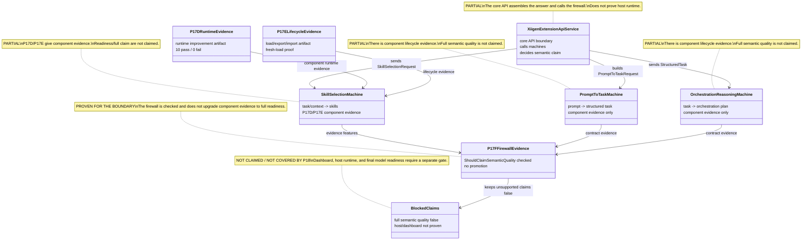
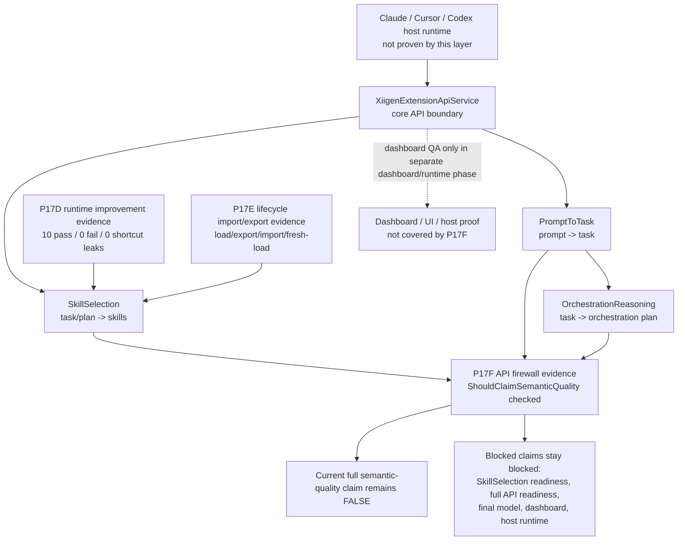
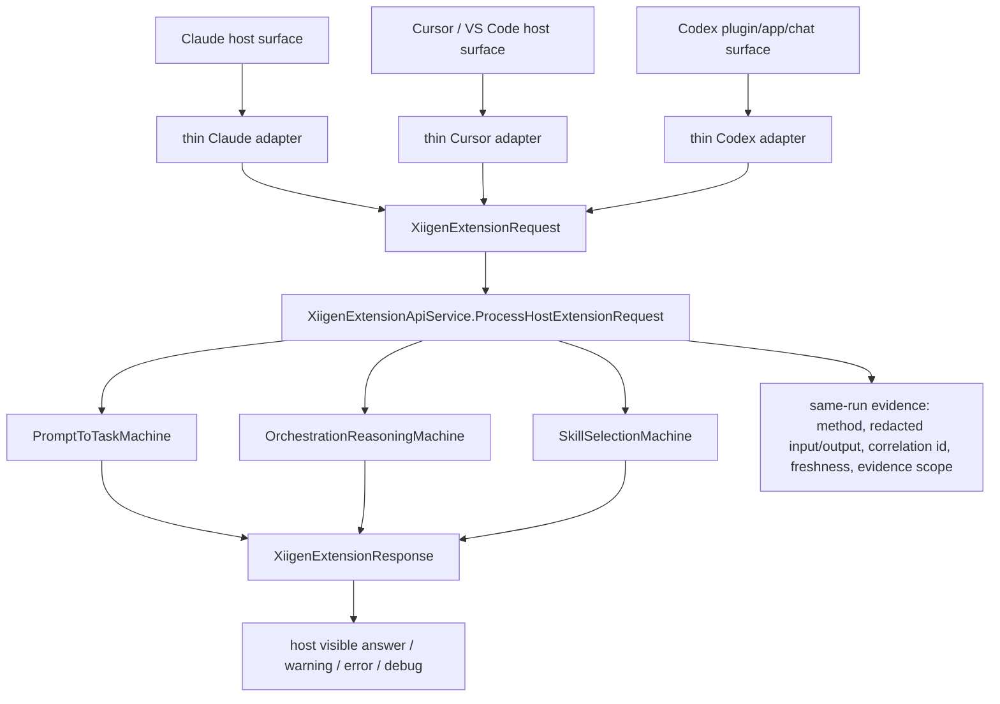

# 43.SmartSkillsDomain

Documentation status: P18 human documentation refresh after P17D, P17E, and P17F.

## 1. In brief for Luba

`43.SmartSkillsDomain` is the "smart skills" domain layer. It accepts a request from the API/host layer, translates the user prompt into a structured task, builds an orchestration plan, selects skills, and returns an answer with warnings, evidence, and an optional debug trace.

Current state after P17D/P17E/P17F:

| Area | What is now actually supported | What still cannot be claimed |
|---|---|---|
| `SkillSelection` runtime evidence | P17D showed component runtime improvement: 10 non-diagnostics rows passed, 0 failed, 36 controls, 0 shortcut leaks. Candidate-position rows remained diagnostics-only. | You cannot say that `SkillSelection` is fully ready or that semantic quality is proven. |
| `SkillSelection` lifecycle evidence | P17E passed the project lifecycle path: `LoadCheckpointAsync`, `ExportAsync`, `ImportAsync`, fresh machine load, held-out non-regression decision. | You cannot say the checkpoint was promoted into the common/final runtime path. The locator is still artifact-local. |
| API firewall | P17F checked the real `XiigenExtensionApiService.ShouldClaimSemanticQuality`: the positive-control can return `true`, but the current component evidence P17D/P17E correctly keeps the full claim `false`. | You cannot say full API readiness, trained/final model readiness, dashboard readiness, or Claude/Cursor/Codex host runtime readiness. |

The main idea: P17D/P17E/P17F made `SkillSelection` stronger as a component and checked the no-overclaim firewall. They did not turn it into full semantic-quality readiness of the whole system.

P18 is only a documentation and state update: runtime behavior, production code, model checkpoints, and training data were not changed in this phase.

## 2. Simple UML diagram of the current evidence flow

Import into draw.io: the Mermaid diagram can be inserted via Arrange -> Insert -> Advanced -> Mermaid.

### 2.1. Roles and boundaries



| Role | What it does in plain language | Current status |
|---|---|---|
| `XiigenExtensionApiService` | Accepts a core API request, calls the three machines, and decides whether a semantic-quality claim can be written. | ⚠️ Partial: the firewall is checked, host runtime is not proven. |
| `PromptToTaskMachine` | Translates the user prompt into a structured task. | ⚠️ Partial: there is component lifecycle evidence, but not a full semantic claim. |
| `OrchestrationReasoningMachine` | Translates the task into an orchestration plan. | ⚠️ Partial: there is component lifecycle evidence, but not a full semantic claim. |
| `SkillSelectionMachine` | Selects skills by task/context/evidence. | ⚠️ Partial: P17D/P17E accepted as component evidence only. |
| `P17DRuntimeEvidence` | Shows that the candidate works better on component runtime rows without shortcut leaks. | Evidence artifact, not production promotion. |
| `P17ELifecycleEvidence` | Shows load/export/import/fresh-load for the candidate. | Evidence artifact, not a final/common runtime path. |
| `P17FFirewallEvidence` | Checks `ShouldClaimSemanticQuality` and keeps the full claim false. | Boundary evidence, not readiness. |
| `BlockedClaims` | A list of claims that cannot be claimed now. | Not claimed / not covered by P18. |

### 2.2. Evidence flow



### Simulations by connection

| Connection | Example input | Expected result |
|---|---|---|
| Host -> Api | Claude/Cursor/Codex sends a prompt through the host entrypoint. | P18 does not prove this path. A separate host runtime gate is needed. |
| Api -> PromptToTask | The core gets a user prompt and builds a `PromptToTaskRequest`. | The component may return a structured task or honest no-claim/not-ready evidence. |
| PromptToTask -> OrchestrationReasoning | The structured task is passed to the planner. | The plan is built only within the scope of component evidence; this is not full API proof. |
| Api -> SkillSelection | The core passes task/context/available skills. | `SkillSelectionMachine.DecideFromTrainedState` selects skills or returns diagnostics/no-claim evidence. |
| P17D -> SkillSelection | P17D candidate checkpoint + runtime rows. | Runtime improvement accepted as component evidence only. |
| P17E -> SkillSelection | The P17D candidate passes export/import/fresh-load. | Lifecycle path accepted as component evidence only; the final/common path is not updated. |
| PromptToTask -> P17F | `PromptToTaskMachine` passes contract evidence. | The firewall uses this only as one of three required signals; one component evidence is not enough. |
| OrchestrationReasoning -> P17F | `OrchestrationReasoningMachine` passes contract evidence. | The firewall requires a positive signal and no no-claim evidence; P18 does not recompute this. |
| SkillSelection -> P17F | Evidence features from `SkillSelection`. | The firewall does not let a full claim through if there is a no-claim/candidate-position/second-pass gap. |
| P17F -> ClaimFalse | P17D/P17E facts without a full positive signal from all components. | `ShouldClaimSemanticQuality` stays `false`. This is the correct behavior. |
| P17F -> BlockedClaims | Firewall report + blocked reasons ledger. | Claims stay false: semantic quality, SkillSelection readiness, full API readiness, final model, dashboard, host runtime. |
| Api -> Dashboard | Possible display of the API result in the dashboard. | P17F did not change the dashboard surface and did not prove UI/UX runtime. |

## 3. No-code algorithm: how P17D/P17E/P17F reach the firewall

Imagine three folders of evidence and a strict checker at the entrance to the sign "semantic quality ready".

1. P17D brings proof that the current `SkillSelection` candidate got better on a limited runtime set: the useful runtime rows pass, shortcut leakage is not found, and the candidate-position diagnostic is not counted as quality.
2. P17E brings proof that this candidate can be run through the project lifecycle: load the checkpoint, export, import into a fresh machine, load again, and get the expected decision on a held-out non-regression row.
3. P17F brings proof that the API firewall does not confuse these component facts with full readiness. It calls the real boundary function `ShouldClaimSemanticQuality`.
4. The firewall looks not at "we have good artifacts", but at a stricter condition: all three components must give positive semantic-quality evidence, there must be no no-claim evidence, candidate-position scaffold, missing trained state, or second pass.
5. Right now this condition is not met, so the full claim stays `false`.

What this means for the next work: for the claim to get stronger, a separate promotion/runtime gate is needed. It must move the artifact candidate into an allowed runtime/common path, then re-check SkillSelection, PromptToTask, OrchestrationReasoning, API, dashboard/host surface where that surface is claimed.

## 4. What is supported now

| Evidence | Where it is | Honest wording |
|---|---|---|
| P17D parent review | `artifacts/smart-skills-semantic-quality-completion/p17d-skillselection-checkpoint-rebuild-rerun/p17d-parent-review.md` | `SkillSelection` has component runtime improvement evidence. |
| P17E parent review | `artifacts/smart-skills-semantic-quality-completion/p17e-skillselection-lifecycle-import-export/p17e-parent-review.md` | The `SkillSelection` candidate passes the load/export/import/fresh-load lifecycle as component evidence. |
| P17F parent review | `artifacts/smart-skills-semantic-quality-completion/p17f-skillselection-api-firewall-promotion-gate/p17f-parent-review.md` | The API firewall was updated and does not upgrade component evidence to full readiness. |
| P17F commit | `b815b38876ffe7d0ea51346f41f22773c5872322` | The P17F evidence was committed and pushed to `origin/codex/chat-gpt-5.5`. |

## 5. What remains blocked

- Full semantic quality claim.
- `SkillSelection` readiness claim.
- Full API readiness claim.
- Trained/final model readiness claim.
- Dashboard readiness.
- Claude/Cursor/Codex host runtime readiness.

Dashboard/host runtime is not proven by this layer, because P17D/P17E/P17F check the component/core API boundary. They do not run a real Claude extension, Cursor Extension Host, Codex plugin/app runtime, and do not check the UI/UX dashboard surface.

## 6. Short code refs and why they matter

### API boundary

File: `43.SmartSkillsDomain\XiigenExtensionApiService.cs:72-136`

```csharp
public OperationResult<XiigenExtensionResponse> ProcessHostExtensionRequest(
    XiigenExtensionRequest request)
...
var semanticQualityClaimed =
    ShouldClaimSemanticQuality(promptToTask, orchestration, skillDecision);
...
var chatDisplayText = semanticQualityClaimed
    ? "Core xiigen boundary executed with loaded common asset evidence; semantic quality remains gated."
    : "Core xiigen boundary executed. Semantic quality is not claimed.";
```

Why it matters: this is the main core API entry. It can assemble an answer for the host, but by itself does not prove host runtime. P17F checks the firewall inside this core boundary.

### The firewall that prevents overclaim

File: `43.SmartSkillsDomain\XiigenExtensionApiService.cs:560-575`

```csharp
private bool ShouldClaimSemanticQuality(
    PromptToTaskResponse promptToTask,
    OrchestrationReasoningResponse orchestration,
    SkillSelectionDecision skillDecision)
    // Learned status names are runtime state labels only. Semantic quality requires
    // explicit future positive evidence from every component and no no-claim evidence.
    => _commonAssetLoadState.AllLoaded
        && !skillDecision.RequiresSecondPass
        && !skillDecision.EvidenceFeatures.Contains("NO_TRAINED_STATE_AVAILABLE", StringComparer.Ordinal)
        && !skillDecision.EvidenceFeatures.Contains(SkillSelectionMachine.CandidatePositionScaffoldEvidence, StringComparer.Ordinal)
        && HasPositiveSemanticQualityEvidence(promptToTask.ContractEvidence)
        && HasPositiveSemanticQualityEvidence(orchestration.ContractEvidence)
        && HasPositiveSemanticQualityEvidence(skillDecision.EvidenceFeatures)
        && !HasSemanticNoClaimEvidence(promptToTask.ContractEvidence)
        && !HasSemanticNoClaimEvidence(orchestration.ContractEvidence)
        && !HasSemanticNoClaimEvidence(skillDecision.EvidenceFeatures);
```

Why it matters: this code requires positive evidence from `PromptToTask`, `OrchestrationReasoning`, and `SkillSelection` simultaneously. P17D/P17E give component evidence for `SkillSelection`, but do not give the full set of positive semantic-quality evidence for the whole chain.

### SkillSelection runtime decision

File: `43.SmartSkillsDomain\SkillSelectionMachine.cs:103-109`

```csharp
public OperationResult<SkillSelectionDecision> DecideFromTrainedState(SkillSelectionRequest request)
{
    var semanticDecision = TryDecideWithSemanticUnitsOnly(request);
    if (semanticDecision is not null)
        return OperationResult<SkillSelectionDecision>.Ok(semanticDecision);

    if (_candidatePositionWeights.Count == 0 || request.AvailableSkillIds.Count == 0)
```

Why it matters: P17D checks exactly this runtime decision path. At the same time, the candidate-position part cannot be counted as semantic quality and remains only diagnostics/leakage guard evidence.

### SkillSelection lifecycle path

Files and lines:

- `43.SmartSkillsDomain\SkillSelectionMachine.cs:334-346`
- `43.SmartSkillsDomain\SkillSelectionMachine.cs:349-360`
- `43.SmartSkillsDomain\SkillSelectionMachine.cs:443-455`

```csharp
public Task<OperationResult<LearningMachineExport>> ExportAsync(CancellationToken ct = default)
...
public async Task<OperationResult<bool>> ImportAsync(LearningMachineExport export, CancellationToken ct = default)
...
public static async Task<OperationResult<SkillSelectionMachineLoadResult>> LoadCheckpointAsync(
    string checkpointPath,
    CancellationToken ct = default)
```

Why it matters: P17E checks that the candidate passes the existing lifecycle path. But P17E did not change the common/final model paths and did not prove that the runtime production configuration now uses this candidate.

## 7. Current status table

| Component | File | Status | What actually works now |
|---|---|---|---|
| `PromptToTaskMachine` | `43.SmartSkillsDomain/PromptToTaskMachine.cs` | ⚠️ Partial | There is component lifecycle evidence from P11/P12. Full semantic quality is not claimed. |
| `OrchestrationReasoningMachine` | `43.SmartSkillsDomain/OrchestrationReasoningMachine.cs` | ⚠️ Partial | There is component lifecycle evidence from P11/P12. Full semantic quality is not claimed. |
| `SkillSelectionMachine` | `43.SmartSkillsDomain/SkillSelectionMachine.cs` | ⚠️ Partial | P17D runtime improvement and P17E lifecycle import/export accepted as component evidence. Readiness/full semantic claim is not claimed. |
| `XiigenExtensionApiService` | `43.SmartSkillsDomain/XiigenExtensionApiService.cs` | ⚠️ Partial | P17F checked `ShouldClaimSemanticQuality`: the firewall keeps false for the current component-only facts and can return true only for an all-positive control. |
| Dashboard/host runtime | dashboard/extension host projects | Not claimed / not covered by P18 | P17D/P17E/P17F did not run the dashboard, Claude, Cursor, or Codex runtime. |

## 8. How a future developer should verify this state

1. Open the state: `docs\plans\SMART-SKILLS-SEMANTIC-QUALITY-COMPLETION-PLAN-v1-STATE.json`.
2. Check the blocks `p17d_skillselection_checkpoint_rebuild_rerun`, `p17e_skillselection_lifecycle_import_export`, `p17f_skillselection_api_firewall_promotion_gate`.
3. Check the P17D/P17E/P17F parent review files.
4. Check that the P17F commit equals `b815b38876ffe7d0ea51346f41f22773c5872322` and `HEAD == origin/codex/chat-gpt-5.5` at the time of P18.
5. Do not translate the words "component evidence accepted" into "full readiness". These are different levels of proof.

## 9. Historical note P11-P13

P11/P12/P13 previously closed only the `PromptToTask` and `OrchestrationReasoning` lifecycle/no-claim boundary. P17D/P17E/P17F added a more recent layer for `SkillSelection`, but with the same principle: component evidence is not equal to full semantic-quality readiness.

P7A parent review previously rejected the eval-informed repair for `PromptToTask`, because the production mapping was fitted to reserved/eval/holdout combinations. This risk remains important: future repair/data phases must not turn eval evidence into training authority or a runtime shortcut.

## 10. XIIGen extension runtime/API boundary

This section was added for the `DOCS-QA-DOCUMENTATION-UPDATE-APPLY-01` line. It explains how Claude, Cursor, and Codex should connect to `llm_mvp_core`, and immediately fixes the boundary: this is documentation coverage. It does not prove live Claude/Cursor/Codex runtime, token savings, semantic quality, learnability, target promotion, locator update, or final readiness.

### Total / Done / Now / Remaining

| Field | Human-readable status |
|---|---|
| Total | 6 large tracks remain: runtime Claude/Cursor/Codex, token before/after for 9 pairs, quality scoring for 9 rows, learnability/DPO/lifecycle for 9 rows, docs/QA, and 10 fresh final readiness reviews. |
| Done | The preparatory docs update packet was created and now this documentation applies it as a docs-only layer. |
| Now | Full UI/chat readiness is not closed; token complete pairs 0/9; quality rows ready for actual scoring 0/9; trainable DPO rows 0/9; actual lifecycle rows 0/9; final readiness reviews 0/10; claim locks stay false. |
| Remaining | After the docs edit, a docs QA review is needed, then independent evidence tracks. Only real runtime/token/quality/learnability packets can close their tracks. |

### UML: host surface -> thin adapter -> core API



The meaning of the diagram is simple: the host adapter must not contain hidden model or semantic logic. It builds a `XiigenExtensionRequest`, calls the core boundary, and displays the `XiigenExtensionResponse`. All the substantive logic stays in `llm_mvp_core`.

### No-code algorithm: request, response, debug/error/correlation evidence

1. The host gets a prompt or command from the user through a real host surface.
2. The thin adapter selects the method id: `prompt-to-task`, `orchestration-plan`, `skill-selection`, or `debug-trace`.
3. The adapter builds a `XiigenExtensionRequest`: host name/type, method, user text, debug flag, correlation id, target locator, provenance, available/requested skills or check-set inputs.
4. The adapter calls `XiigenExtensionApiService.ProcessHostExtensionRequest`.
5. The core calls the needed machines and returns a `XiigenExtensionResponse`.
6. The host shows a human-visible answer, warnings, errors, an optional debug trace, and raw/redacted evidence.
7. The evidence packet records the method, redacted input/output, correlation id, timestamp/freshness, host surface, and scope label.
8. If there is a controlled error, the adapter shows the error and the debug boundary, rather than replacing it with a successful answer.

What this algorithm proves only after a live packet: the named host path reached the core boundary and returned a visible result. What it does not prove: token savings, quality improvement, DPO training, model learning, target promotion, locator update, or final readiness.

### Short code anchors and no-overclaim boundary

`43.SmartSkillsDomain/XiigenExtensionApiContracts.cs`:

```csharp
public sealed record XiigenExtensionRequest(
public sealed record XiigenExtensionResponse(
public const string PromptToTaskMethod = "prompt-to-task";
```

Why it matters: the contract names the request/response envelope and stable method ids. This is an anchor for thin adapters. The contract itself does not prove that Claude/Cursor/Codex are already running in a live UI/chat.

`43.SmartSkillsDomain/XiigenExtensionApiService.cs`:

```csharp
public OperationResult<XiigenExtensionResponse> ProcessHostExtensionRequest(
var semanticQualityClaimed = ShouldClaimSemanticQuality(promptToTask, orchestration, skillDecision);
var debugTrace = BuildDebugTrace(request, promptSha256, responseWithoutTrace);
```

Why it matters: the core service assembles the answer, warnings/check-set results, and debug trace. This is supporting API evidence. It does not replace live host proof and does not open a semantic-quality claim without separate scoring/controls.

### Boundary wording for future reports

Safe wording: "Host adapter path documented. Live runtime proof still requires same-run host-visible answer/error/debug/correlation evidence for the named host."

Forbidden wording: "Dashboard/API or docs proved that the Claude/Cursor/Codex runtime is ready." Such a conclusion must stay false until there is a separate host runtime packet.
