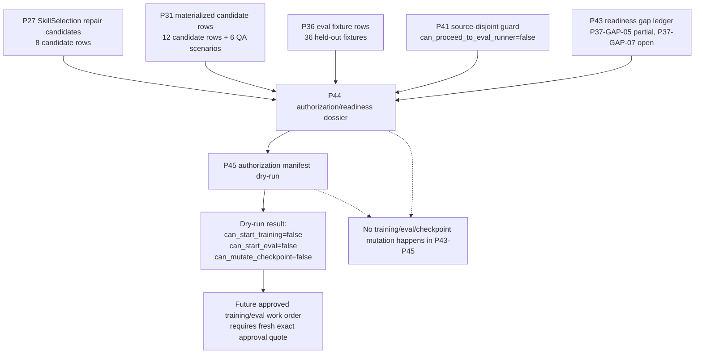

# 43.SmartSkillsDomain Semantic-Quality Authorization Boundary

Status: P46 documentation slice after P43/P44/P45.

This document explains why the current P43-P45 artifacts do not run training/eval and do not prove semantic quality, but create a clear boundary for future authorization.

## 1. In brief for Luba

Right now the system is in an honest state:

- the fixture/dashboard/guard layers can show and check evidence;
- the readiness ledger can explain which gaps are closed, which are partially closed, and which are open;
- the authorization dossier can name the exact dataset/checkpoint/approval fields that are needed before training/eval;
- the dry-run manifest can prove the opposite: without approval and preflight gates, training/eval must not be run.

This is not a "ready trained model". This is a protective layer before training, so that the model cannot pass off candidate rows, dashboard smoke, or a JSON report as semantic quality.

## 2. UML: the authorization flow



### Simulations by connection

| Connection | Example input | Expected result | What it does NOT prove |
|---|---|---|---|
| P27 -> P44 | `p27-dataset-card.json`, 8 rows. | P44 records them as candidate dataset only. | Does not allow training. |
| P31 -> P44 | `p31-materialized-dpo-candidates.jsonl`, 12 rows. | P44 records the row count and the role of candidate material only. | Does not turn the rows into an accepted training set. |
| P36 -> P44 | `p36-eval-fixtures.jsonl`, 36 rows. | P44 records held-out fixture material. | Does not run eval. |
| P41 -> P44 | The guard says `can_proceed_to_eval_runner=false`. | P44 preserves the eval runner prohibition. | Is not an eval metric. |
| P43 -> P44 | The gap ledger says P37-GAP-07 is still open. | P44 requires an authorization dossier. | Does not close training authorization. |
| P44 -> P45 | The dossier requires exact approval/dataset/checkpoint/rollback. | P45 creates the manifest shape and dry-run validation. | Does not run mutation. |
| P45 -> Deny | `exact_luba_approval_quote=NONE`. | The dry-run returns `can_start_training=false`, `can_start_eval=false`, `can_mutate_checkpoint=false`. | Does not prove semantic quality. |

## 3. No-code algorithm

### 3.1. P44: assemble the dossier before training/eval

1. Take the candidate/evidence artifacts P27, P31, P36, P41, and P43.
2. For each one, specify the role: candidate dataset, QA scenario, eval fixture, guard evidence, or readiness ledger.
3. Check that none of them is authorization by itself.
4. Record the required fields of the future permission:
   - fresh exact approval quote;
   - exact candidate dataset path + checksum;
   - exact held-out dataset path + checksum;
   - source/license ledger;
   - target checkpoint locator;
   - rollback checkpoint locator;
   - metrics and ablation plan.
5. Keep `training_authorized_now=false` and `eval_authorized_now=false`.

### 3.2. P45: check the manifest shape without running

1. Compute the SHA256 for the candidate rows, dataset card, dashboard scenarios, eval fixtures, source-disjoint guard, and the P44 dossier.
2. Create a manifest with these exact paths and hashes.
3. Check that approval is absent: `exact_luba_approval_quote=NONE`.
4. Check that all execution flags are false.
5. Return a dry-run denial:
   - `can_start_training=false`;
   - `can_start_eval=false`;
   - `can_mutate_checkpoint=false`.
6. Save a validation report that explains why the run is forbidden.

## 4. Where this is

| Artifact | Purpose |
|---|---|
| `artifacts/smart-skills-semantic-quality-completion/p43-readiness-gap-closure/p43-readiness-gap-closure-report.md` | Human-readable ledger of the P37 gaps. |
| `artifacts/smart-skills-semantic-quality-completion/p44-non-training-authorization-readiness/p44-authorization-readiness-dossier.md` | Human-readable dossier: what is needed before training/eval. |
| `artifacts/smart-skills-semantic-quality-completion/p44-non-training-authorization-readiness/p44-authorization-readiness-dossier.json` | Machine-readable version of the P44 dossier. |
| `artifacts/smart-skills-semantic-quality-completion/p45-authorization-manifest-dry-run/p45-authorization-manifest.json` | Manifest shape with exact paths/checksums, but without approval. |
| `artifacts/smart-skills-semantic-quality-completion/p45-authorization-manifest-dry-run/p45-dry-run-validation-report.json` | Dry-run denial report. |

## 5. Important code/evidence references

P45 did not add production code. It relies on the existing artifact contracts:

```json
"training_authorized_now": false,
"eval_authorized_now": false,
"checkpoint_mutation_authorized_now": false,
"exact_luba_approval_quote": "NONE"
```

File: `artifacts/smart-skills-semantic-quality-completion/p45-authorization-manifest-dry-run/p45-authorization-manifest.json`

Why it matters: this is a direct machine-readable prohibition. Even if the manifest shape exists, it does not allow training/eval.

```json
"can_start_training": false,
"can_start_eval": false,
"can_mutate_checkpoint": false
```

File: `artifacts/smart-skills-semantic-quality-completion/p45-authorization-manifest-dry-run/p45-dry-run-validation-report.json`

Why it matters: the dry-run validator is not a "green light"; it deliberately returns a denial while approval and gates are absent.

## 6. QA mapping

| Check | What it checks |
|---|---|
| JSON parse P44/P45 artifacts | The artifacts are machine-readable and can be loaded by a future runner/validator. |
| Review-cycle rows >= 8 | Scope, approval, dataset checksum, held-out checksum, source/license, checkpoint, dry-run denial, no-claim were checked. |
| UTF-8/mojibake scan | The human-readable P43/P44/P45 artifacts do not contain marker corruption. |
| Forbidden positive claim scan | The artifacts do not write that semantic quality/model readiness/host runtime/training/eval/checkpoint are already proven. |
| `git diff --check` | No whitespace errors before commit. |

## 7. Honest boundary

P43-P45 close only the accounting/preflight layer.

They do not close:

- semantic quality;
- trained-model readiness;
- Claude/Cursor/Codex host runtime;
- training run;
- eval run;
- checkpoint mutation;
- common model update.

The next phase can only be preflight/authorization work, until there is a fresh explicit phrase from Luba that allows training/eval/checkpoint mutation for an exact dataset/checkpoint.

## 8. Quality and DPO admission for the extension line

This section was added for `DOCS-QA-DOCUMENTATION-UPDATE-APPLY-01`. It links the old authorization boundary with the current extension runtime/token/quality/learnability line. This is a documentation explanation, not eval, training, DPO generation, or checkpoint/model mutation.

### Total / Done / Now / Remaining

| Field | Status |
|---|---|
| Total | For quality, 9 row-specific scoring rows are needed with complete baseline/adaptive pairs, adjudication refs, source-disjoint held-out refs, and ablation/no-leakage/no-memorization controls. For DPO/lifecycle, 9 actual lifecycle rows are needed. |
| Done | Docs/status/evidence-scope packets and this docs-only admission appendix were prepared. |
| Now | Full UI/chat readiness is not closed. Token complete pairs 0/9. Quality rows ready for actual scoring: 0/9. Trainable DPO rows: 0/9. Actual lifecycle rows: 0/9. Final readiness reviews 0/10. Claim locks false. |
| Remaining | Separate bounded work orders must gather the exact refs and pass authorization before any scoring/training/continue-training/fresh-load/rollback; docs QA does not count as product readiness. |

### No-code algorithm: pair integrity before scoring

1. For each host/method pair, find the exact baseline output ref and the exact adaptive output ref.
2. Check that the prompt hash, host, method, tokenizer/accounting version, debug setting, and scenario id match.
3. Add reviewer/adjudication refs: who compared the outputs, by which rubric, where the notes are recorded.
4. Add source-disjoint held-out refs: the eval sources must not overlap with the training/candidate material.
5. Add ablation/no-leakage/no-memorization controls.
6. Only after this can the row move into a scoring work order.
7. If even one item is missing, the row remains prep/gap evidence and does not open a quality claim.

### DPO candidate vs actual training boundary

A DPO candidate can contain chosen/rejected/provenance refs, source/license/privacy/redaction classification, and a route decision. But a candidate row is not equal to training data until approved. Right now trainable DPO rows are 0/9, so the learnability claim is closed.

Raw external AI/vendor output remains evidence-only/private/adaptive/quarantine until a separate source/license/privacy approval packet permits a specific route. A saved checkpoint by itself is not enough: the lifecycle requires backup/export/import/restore/load-without-retrain/continue-training/fresh-load/held-out/ablation/rollback evidence.

### Acceptance wording for future docs QA

Safe wording: "Quality/DPO admission boundary documented. Actual scoring rows 0/9 and trainable DPO rows 0/9 keep claims closed."

Unsafe wording: "DPO candidates or dashboard rows prove semantic quality/learnability." Such a phrase must be rejected as an overclaim.
