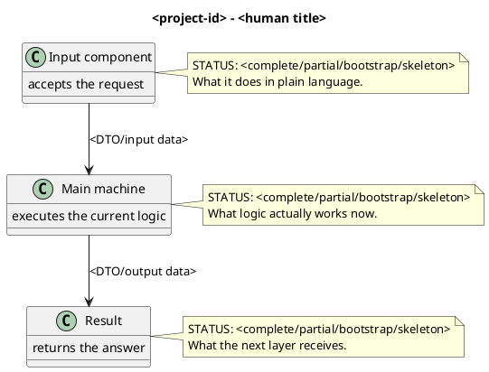

# Project Documentation Template

Status: common D0 standard. This file defines the mandatory format for future `docs/projects/*.md` and the extension `docs/PROJECT-DOC.md`. It is not documentation of a specific project.

## 0. Quick map for Luba

Write 3-7 sentences in the operator's language (plain language; Russian for the original author):

- what this project or repository is;
- which user or system flow passes through it;
- what data comes in and out;
- what already works;
- what is skeleton, bootstrap, partial, legacy, or planned.

You must not replace this with a list of classes. Luba should understand the role of the project without reading code.

## 1. Simple UML for draw.io

The diagram is mandatory. Use PlantUML or Mermaid, importable into draw.io. Preferred format:



After the diagram, a legend is mandatory:

| Node | What it does | Status | Where it lives |
|---|---|---|---|
| `<ClassOrComponent>` | Human explanation | `Complete/Partial/Bootstrap/Skeleton/Legacy/Planned` | `relative/path` |

### 1.1 Simulations for each UML connection

Every arrow of the diagram is required to have an example input, a branch/simulation, and an expected result.

| Connection | Example input | Branch simulation | Expected result | What must not be taken as the result |
|---|---|---|---|---|
| `A -> B` | `Prompt="add doc"` | `A` builds the request and passes it to `B` | `B` gets a typed DTO, not a raw guess | JSON/report does not replace a real call |

Rule: if an arrow exists in the UML but there is no simulation row, the document is not accepted.

## 2. No-code algorithms, in the operator's language

For each important algorithm, fill in a separate block.

### 2.N <human name of the algorithm>

Analogy: explain the algorithm with an everyday example.

Passport of the current implementation:

| Field | Value |
|---|---|
| Class | `<ExactClass>` |
| Method/function | `<ExactMethod>(<parameters>)` |
| File and line | `relative/path/File.cs:line` |
| Input parameters/DTO | `<RequestDto>`: fields and example values |
| Output DTO/result | `<ResponseDto>`: fields and example values |
| Status | `Complete/Partial/Bootstrap/Skeleton/Legacy/Planned` |

Steps of the current algorithm:

1. What comes in on the input, with an example value.
2. Which fields or internal state are read.
3. Which branch is chosen and why.
4. What is created or changed.
5. What is returned outward.

Branches and simulations:

| Branch | Example input | Why it is chosen | Expected result | Check/QA |
|---|---|---|---|---|
| `<branch>` | `<concrete value>` | `<condition>` | `<output>` | `<test/e2e/manual gap>` |

What the algorithm does NOT do:

- it does not use regex/BM25/KNN/dictionary as a hidden trainable semantic authority;
- it does not pass off skeleton/bootstrap/JSON/report as real code or a trained model;
- it does not accept host-side ranking as a final semantic decision if the core should decide itself;
- it does not claim checkpoint/model readiness without manifest, locator, fresh-load, and continue-training evidence.

## 3. Where the logic sits in the code

You need to explain where the logic is and why exactly these files matter.

| Logic | File | Why this place matters | What it proves | What it does not prove |
|---|---|---|---|---|
| `<algorithm>` | `relative/path/File.cs:line` | `<why>` | `<current behavior>` | `<missing evidence>` |

## 4. Short important code quotations

Quotations must be short. Before quoting, the file must be read. Every quotation is required to have an exact reference and a WHY/HOW/WHAT explanation.

Example:

> **Why it matters:** this line shows an honest skeleton status: the machine saves safe fields but does not do semantic inference.
>
> **What comes in:** a `PromptToTaskRequest` with a hash and constraints.
>
> **What comes out:** a response with status `not_ready`.
>
> **What it does not prove:** the presence of a trained model or inference quality.

```csharp
// relative/path/File.cs:42
TaskType = "not_ready_no_semantic_task";
```

Mandatory rules:

- a reference in the format `relative/path/File.ext:line` or `relative/path/File.ext:line-line`;
- do not reference future code;
- do not quote long blocks;
- if the code calls another method, explain what happens inside or give a separate quotation;
- if the logic is skeleton/bootstrap/partial, write it directly next to the quotation.

## 5. Test, e2e, and QA mapping

Every UML connection and every algorithm branch must have a check or an honest gap.

| Behavior | Verification level | Current evidence | Status | Next work order if gap |
|---|---|---|---|---|
| `<branch/connection>` | `unit/integration/e2e/host/QA/negative/untrained/trained/regression` | `<test/report/manual gap>` | `covered/gap/not applicable` | `<DOC-WO-XX or code WO>` |

If real code or an algorithm is required, a row must not be closed only with JSON, PowerShell, a smoke report, or a static validator.

## 6. Anti-false-done checks

Before accepting the document, check:

| Gate | Must be visible |
|---|---|
| Human-readable | The operator-language explanation is understandable without reading code as the first step |
| UML | PlantUML/Mermaid imports into draw.io |
| UML simulations | Every arrow has an example input and an expected result |
| Algorithms | Every algorithm has a class, method/function, parameters, output, and current steps |
| Code refs | Short quotes have exact line refs and a WHY/HOW/WHAT explanation |
| Status honesty | Skeleton/bootstrap/partial/legacy are named directly |
| No JSON-only done | JSON/PowerShell/report/smoke evidence does not replace real code |
| No hidden deterministic shortcut | BM25/KNN/regex/dictionary are not hidden as a trainable unit |
| Trainable claim | There is a checkpoint, manifest, locator, fresh-load, continue-training, and metrics if the claim = trained |
| Testability | Every branch is tied to unit/integration/e2e/QA/negative/untrained/trained/regression or an honest gap |

## 7. Status table

| Component | File | Status | What actually works now |
|---|---|---|---|
| `<Class>` | `relative/path/File.cs` | `✅ Complete / ⚠️ Partial / 🔶 Skeleton / ✅ Bootstrap / ✅ Hardcoded / Legacy / Planned` | Specific methods, return values, and gaps |

## 8. Hierarchy, if there is ILearningMachine/ILogical*

If the document concerns `ILearningMachine`, `ILogicalOrchestrator`, `ILogicalFlow`, `ILogicalUnit`, or a host/plugin path, the section is mandatory.

```text
Level 5: ILearningMachine<TDomain>
  Accepts: LearningBatch<TDomain> / LearningEvaluationSet<TDomain>
  Returns: LearningBatchResult / LearningEvaluationResult / LearningMachineExport
  Role: trains, evaluates, exports, and imports a trainable domain.

Level 4: ILogicalOrchestrator
  Accepts: LogicalOrchestratorRequest
  Returns: LogicalOrchestratorResult
  Role: selects and runs a flow.

Level 3: ILogicalFlow<TInput>
  Accepts: LogicalFlowRequest<TInput>
  Returns: LogicalFlowResult
  Role: drives a scenario end-to-end.

Level 2: ILogicalUnit<TInput,TOutput>
  Accepts: LogicalUnitRequest<TInput>
  Returns: LogicalUnitResult<TOutput>
  Role: executes one step of the chain.

Level 1: ILearningMachinePair<TPersonal,TGlobal>
  Accepts: personal/global machine legs
  Returns: sync/pull OperationResult<bool>
  Role: separates user adaptive and common/global state.
```

Add a sequence/flow diagram for the host path and label the data type on each arrow.

## 9. Sources and drift check

Before the final document status, cross-check:

- `docs/SUBPROJECT-MAP.md`;
- `docs/ARCHITECTURE.md`;
- `docs/COMPONENT-INTERFACES.md`;
- the source files that are quoted;
- tests/QA evidence, if a coverage claim is made.

The final line of the document:

```text
Documentation status: <draft/pass/repair-required>
Last verified against source: <date>
Known gaps: <short list or none>
```
