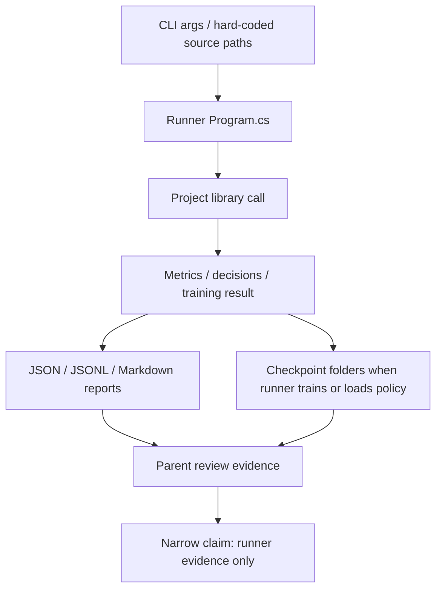

# experiments-v2 runner group

Documentation status: DExpRunners documented - parent review passed.

## Краткая карта для Лубы

Группа `experiments-v2/*/runner/*` - это набор консольных runner-ов вокруг экспериментов, обучения, held-out проверок и сравнительных отчетов. Они читают JSONL, аргументы командной строки или hard-coded локальные пути, вызывают библиотеки проекта и пишут summary JSON, JSONL, Markdown, checkpoint-папки или stdout.

Это не единый продуктовый runtime, не UI и не самостоятельная `ILearningMachine`. Даже runner, который делает DPO-шаги или грузит checkpoint, дает только evidence по конкретному запуску. JSON, отчет, progress-файл, DPO-пары, checkpoint или рекомендация batch-size сами по себе не доказывают готовую обученную семантическую модель, свежую загрузку в продукте или качество на реальном пользовательском сценарии.

## UML и поток данных



Легенда: runner - консольная обертка; library call - реальная логика в `26.TrainableRouter`, `35.ExperimentsV2`, `18.CapabilityTraining`, `21.AgentInfrastructure`, `11.DPO`, `03.TransformerModel`; report - артефакт evidence; checkpoint - файл модели только там, где исходник явно сохраняет или загружает его.

## Симуляции связей

| Связь | Пример входа | Что происходит | Ожидаемый результат | Что нельзя утверждать |
|---|---|---|---|---|
| CLI args -> Program.cs | `--train train.jsonl --heldout eval.jsonl` | `CodeDocBatchRunner` читает параметры и передает пути в `CodeDocumentationBatchFileRunner.RunAsync`. | Появляется PASS/FAIL summary и DPO-ready пары для маршрутизации документации. | Это не LoRA/DPO checkpoint продукта без отдельного model runner. |
| Program.cs -> библиотека KNN | E13B corpus rows типа `Y + Z = X` | Runner строит `LogicalKnnTrainingExample` и вызывает `KnnLogicalUnit<string,string>.Train`. | JSON/MD показывают baseline и enhanced accuracy на синтетическом корпусе. | Это не доказательство общей алгебраической логики или runtime продукта. |
| Program.cs -> DpoTrainer | JSONL с prompt/chosen/rejected | Runner нормализует пары, делает batch-и, вызывает `trainer.StepMany`, периодически пишет policy checkpoint. | Есть progress, batch-summary, DPO summary и checkpoint-файлы. | DPO metric и checkpoint не равны продуктовой готовности без manifest/locator/fresh-load/use/continue gates. |
| Held-out evaluator -> policy checkpoint | `--heldout rows.jsonl --checkpoint policy.bin` | Runner проверяет существование файлов, загружает policy checkpoint и сравнивает expected/rejected log-probs. | Summary получает accuracy, hallucination rate, citation/contract checks. | Это не гарантирует реальное качество Project Wiki без соответствия данных, версии модели и runtime загрузки. |
| Teaching runner -> registries | Xiigen session JSONL row | Runner создает topology/flow/unit registries, route-и, branches и вызывает `DefaultLogicalCapabilityTrainer`. | Появляются flow/unit descriptors и teaching summary по строкам или batch-ам. | Registry binding не доказывает общую семантику или завершенный lifecycle обученного unit. |
| Comparison runner -> reports | `--rows 200 --sizes 20,50,100,200` | Runner фиксирует corpus, гоняет разные batch-size, пишет stage, subphase, resource и cross-run comparison reports. | Parent получает evidence о стоимости, покрытии и ресурсах. | Рекомендация batch-size не является release approval и не доказывает trained runtime. |

## Алгоритмы без кода

### CodeDocBatchRunner Program.cs

Файл: `experiments-v2/CODE-DOC-BATCH-RUNNER/runner/CodeDocBatchRunner/Program.cs`.

Основная CLI-логика находится в `experiments-v2/CODE-DOC-BATCH-RUNNER/runner/CodeDocBatchRunner/CodeDocumentationBatchRunnerCli.cs`; `Program.cs` только передает `args` в этот helper.

Метод/точка входа: top-level `Program`, параметры CLI `--train`, `--heldout`, `--result-root`, `--run-id`. Repository-owned DPO режим добавляет ровно три обязательных флага: `--repository-root`, `--documentation-domain`, `--dataset-version`.

Вход: путь к train JSONL, путь к held-out JSONL, папка результатов, а для repository-owned режима - canonical repository root, allow-listed documentation domain и dataset version. Выход: `code-doc-batch-run-summary.json`, `code-doc-routing-dpo-pairs.jsonl`, `code-doc-heldout-cases.jsonl`, `LOOK-LIKE-RUN-REPORT.md`, stdout/stderr и exit code.

Пример repository-owned запуска:

```powershell
dotnet run --project .\experiments-v2\CODE-DOC-BATCH-RUNNER\runner\CodeDocBatchRunner\CodeDocBatchRunner.csproj -- `
  --train .\training-data\code-doc\train.jsonl `
  --heldout .\training-data\code-doc\heldout.jsonl `
  --repository-root C:\Projects\llm_mvp_core `
  --documentation-domain C#/.NET `
  --dataset-version v1 `
  --result-root .\experiments-v2\CODE-DOC-BATCH-RUNNER\results `
  --run-id code-doc-dpo-v1
```

Шаги: проверить обязательные JSONL пути; проверить repository root, domain и version до записи файлов результатов; resolve domain только через allow-list `ResolveSupportedDomainProfile`; создать production authoring context с ленивой factory для local teacher client; передать `CodeDocumentationRepositoryOwnedDpoRunOptions` в `CodeDocumentationBatchFileRunner.RunAsync`; если FAIL - записать failure summary, markdown и exit code 1; если PASS - записать метрики accuracy, CPU/RAM/elapsed, held-out cases, legacy evaluation-only пары и repository-owned receipt.

Repository root никогда не угадывается из cwd или соседних папок. Поддерживаемые human input домены: `C#/.NET`, `Angular`, `SQL`; внутри они нормализуются к canonical slug-ам `csharp-code-documentation`, `angular-code-documentation`, `sql-code-documentation`. Неверные root/domain/version падают до teacher client и до файлов результатов.

Production authoring context сохраняет `CreateClient` внутри `Func`: sealed manifest hit под `training-data/dpo/<domain>/ilearning-unit/<version>/` переиспользует диск и не создает Qwen/Ollama client. Только чистый miss в repository-owned resolver вызывает factory и может идти в authoring. Успешный summary сериализует receipt: `source`, `manifest_sha256`, `repository_relative_manifest_path`, `pair_count`, `request_identity_sha256`, ordered pair hashes и pair file paths.

Важно для терминов: `RepositoryOwnedDpoPairs` - rich repository training pairs и training source для DPO. Legacy `DpoPairs`/`code-doc-routing-dpo-pairs.jsonl` - evaluation-only routing artifact из batch/held-out решений; это не repository-owned training dataset.

Не делает: не обучает LoRA модель, не проверяет product runtime, не доказывает качество документационного маршрутизатора вне переданных файлов.

`experiments-v2/CODE-DOC-BATCH-RUNNER/runner/CodeDocBatchRunner/Program.cs`

```csharp
using CodeDocBatchRunner;

Environment.ExitCode = await CodeDocumentationBatchRunnerCli.RunAsync(args);
```

Почему важно: quote показывает, что production entrypoint больше не обходит helper seam. В helper-е production dependency вызывает `new CodeDocumentationBatchFileRunner().RunAsync(trainPath, heldOutPath, cancellationToken, repositoryOwnedDpo)`, поэтому repository-owned options доходят до batch runner.

### E13BExpressionPrefixCompletionRunner Program.cs

Файл: `experiments-v2/E13B-EXPRESSION-PREFIX-COMPLETION/runner/E13BExpressionPrefixCompletionRunner/Program.cs`.

Точка входа: top-level `Program`, без обязательных CLI параметров; runId и resultRoot формируются внутри.

Вход: встроенный corpus из `BuildCorpus()`. Выход: JSON и Markdown в папке results, stdout с accuracy и cosine metrics.

Шаги: построить `LogicalKnnTrainingExample<string,string>` из partial/completion; обучить `KnnLogicalUnit<string,string>` с `vectorDimensions=64`, `k=3`, `confidenceFloor=0.65`; сравнить majority baseline и enhanced prediction; посчитать success по lift/gap/coverage/knowledge-edge.

Не делает: не учит языковую модель и не доказывает обобщение за пределами маленького синтетического корпуса.

`experiments-v2/E13B-EXPRESSION-PREFIX-COMPLETION/runner/E13BExpressionPrefixCompletionRunner/Program.cs:26-31`

```csharp
var stopwatch = Stopwatch.StartNew();
var trained = KnnLogicalUnit<string, string>.Train(
    "unit-e13b-expression-prefix-completion",
    "expression_completion",
    "expression_completion",
    examples,
```

Почему важно: quote показывает именно KNN training call, а не transformer/model training.

### E13BHeldOutValidationRunner Program.cs

Файл: `experiments-v2/E13B-EXPRESSION-PREFIX-COMPLETION/runner/E13BHeldOutValidationRunner/Program.cs`.

Точка входа: top-level `Program`, входных CLI параметров нет. Выход: `e13b-heldout-validation.json`, `e13b-heldout-validation.md`, stdout с held-out метриками.

Шаги: вызвать `new E13BHeldOutValidation().RunAsync()`; на FAIL бросить исключение; на PASS записать JSON/Markdown и распечатать rates.

Не делает: не запускает dotnet test и не является runtime gate для продукта.

`experiments-v2/E13B-EXPRESSION-PREFIX-COMPLETION/runner/E13BHeldOutValidationRunner/Program.cs:11-24`

```csharp
var validation = await new E13BHeldOutValidation().RunAsync();
if (!validation.IsSuccess)
    throw new InvalidOperationException(validation.ErrorMessage);

var result = validation.Value!;
var jsonPath = Path.Combine(resultRoot, "e13b-heldout-validation.json");
var markdownPath = Path.Combine(resultRoot, "e13b-heldout-validation.md");

await File.WriteAllTextAsync(
    jsonPath,
    JsonSerializer.Serialize(result, new JsonSerializerOptions { WriteIndented = true }),
    Encoding.UTF8);

await File.WriteAllTextAsync(markdownPath, RenderMarkdown(result), Encoding.UTF8);
```

### InternalTrainReadyDpoRunner Program.cs

Файл: `experiments-v2/INTERNAL-TRAIN-READY-V191/runner/InternalTrainReadyDpoRunner/Program.cs`.

Точка входа: top-level `Program`, параметры `--source`, `--result-root`, `--run-id`, `--batch-size`, `--context`, `--max-rows`, `--save-every`.

Вход: JSONL с DPO-парами. Выход: normalized DPO JSONL, `progress.jsonl`, `batch-summary.jsonl`, `internal-train-ready-dpo-summary.json/md`, checkpoint files under `checkpoints`.

Шаги: посчитать SHA источника; загрузить пары; пропустить пустые/неполные rows; сконструировать маленький `LlmModel` policy/reference; превратить пары в `DpoBatch`; вызвать `trainer.StepMany`; периодически сохранить checkpoint; записать loss/reward/accuracy/resource metrics.

Не делает: не публикует модель в locator, не проверяет fresh-load/use/continue в продукте, не гарантирует качество данных rejected.

`experiments-v2/INTERNAL-TRAIN-READY-V191/runner/InternalTrainReadyDpoRunner/Program.cs:28-44`

```csharp
var sourceSha = Sha256File(sourcePath);
var pairs = LoadPairs(sourcePath, maxRows).ToArray();
if (pairs.Length == 0)
    throw new InvalidOperationException($"No trainable pairs loaded from {sourcePath}");

var transformedPath = Path.Combine(runRoot, "dpo-pairs-normalized.jsonl");
await File.WriteAllLinesAsync(
    transformedPath,
    pairs.Select(pair => JsonSerializer.Serialize(new DpoPair
    {
        Prompt = pair.Prompt,
        Chosen = pair.Chosen,
        Rejected = pair.Rejected
    })),
    Encoding.UTF8);

var cfg = new ModelConfig
```

`experiments-v2/INTERNAL-TRAIN-READY-V191/runner/InternalTrainReadyDpoRunner/Program.cs:83-97`

```csharp
for (var batchIndex = 0; batchIndex < batches.Length; batchIndex++)
{
    process.Refresh();
    var batch = batches[batchIndex];
    var cpuBefore = process.TotalProcessorTime;
    var memoryBefore = process.WorkingSet64;
    var diskBefore = DirectorySize(checkpointRoot);
    var batchStopwatch = Stopwatch.StartNew();
    var dpoBatches = batch.Select(pair => ToBatch(pair, cfg.VocabSize, contextLen)).ToArray();
    var metrics = trainer.StepMany(dpoBatches, batchIndex + 1);
    batchStopwatch.Stop();
    process.Refresh();

    if ((batchIndex + 1) % saveEvery == 0 || batchIndex == batches.Length - 1)
        policy.SaveCheckpoint(Path.Combine(checkpointRoot, $"policy_step_{batchIndex + 1:D6}.bin"));
```

### ProjectWikiBaseHeldoutEvaluator Program.cs

Файл: `experiments-v2/PROJECT-WIKI-BASE-HELDOUT-EVAL/runner/ProjectWikiBaseHeldoutEvaluator/Program.cs`.

Точка входа: top-level `Program`, параметры `--heldout`, `--checkpoint`, `--result-root`, `--run-id`, `--context`.

Вход: held-out candidate JSONL и policy checkpoint path. Выход: summary JSON/MD, results JSONL, stdout. Branch-и: если heldout или checkpoint отсутствуют, runner бросает исключение; если строки пустые, тоже FAIL; иначе загружает policy checkpoint и сравнивает expected/rejected answer scores.

Не делает: не доказывает runtime Project Wiki answerer, потому что здесь выполняется локальный evaluator с конкретным checkpoint и контрактными строками.

`experiments-v2/PROJECT-WIKI-BASE-HELDOUT-EVAL/runner/ProjectWikiBaseHeldoutEvaluator/Program.cs:13-20`

```csharp
var runId = ReadArg(args, "--run-id", $"run-{DateTime.Now:yyyy-MM-dd-HHmmss}");
var contextLen = ReadIntArg(args, "--context", 96);

if (string.IsNullOrWhiteSpace(heldoutPath) || !File.Exists(heldoutPath))
    throw new InvalidOperationException($"Held-out candidate file not found: {heldoutPath}");

if (string.IsNullOrWhiteSpace(checkpointPath) || !File.Exists(checkpointPath))
    throw new InvalidOperationException($"Policy checkpoint not found: {checkpointPath}");
```

`experiments-v2/PROJECT-WIKI-BASE-HELDOUT-EVAL/runner/ProjectWikiBaseHeldoutEvaluator/Program.cs:88-98`

```csharp
summary = summary with
{
    Passed = summary.GenericDocumentationQaAccuracy >= 0.90 &&
             summary.CitationFormatAccuracy >= 0.98 &&
             summary.MissingEvidenceAbstentionAccuracy >= 0.95 &&
             summary.HallucinationRate == 0.0 &&
             summary.AnswerContractAccuracy >= 0.98
};

var jsonOptions = new JsonSerializerOptions { WriteIndented = true };
await File.WriteAllTextAsync(Path.Combine(runRoot, "base-wiki-heldout-evaluation-summary.json"), JsonSerializer.Serialize(summary, jsonOptions), Encoding.UTF8);
```

### Teaching20RowsCurrentRunner Program.cs

Файл: `experiments-v2/TEACHING-20-ROWS-CURRENT/runner/Teaching20RowsCurrentRunner/Program.cs`.

Точка входа: top-level `Program`, первый positional arg задает rowLimit, иначе 20. Вход: hard-coded Xiigen session rows JSONL. Выход: checkpoint folder, `progress.txt`, `teaching-...-summary.json/md`.

Шаги: прочитать первые `rowLimit` строки; seed topology/flows; для каждой строки классифицировать domain, route через compiler/router, построить knowledge-edge branches, вызвать `DefaultLogicalCapabilityTrainer.TrainAndRegisterAsync`, проверить flow bindings, записать row summary.

Не делает: hard-coded source path и текущая in-memory registry не являются универсальным host/runtime доказательством.

`experiments-v2/TEACHING-20-ROWS-CURRENT/runner/Teaching20RowsCurrentRunner/Program.cs:60-68`

```csharp
    var process = Process.GetCurrentProcess();
    process.Refresh();
    var cpuBefore = process.TotalProcessorTime;
    var memoryBefore = process.WorkingSet64;
    var allocationBefore = GC.GetTotalAllocatedBytes(precise: true);
    var diskBefore = DirectorySize(checkpointRoot);
    var stopwatch = Stopwatch.StartNew();

    var route = await RouteRowAsync(request, compiler, multiRouter, flags);
```

### XiigenSessionBatchedTeachingRunner Program.cs

Файл: `experiments-v2/TEACHING-XIIGEN-SESSIONS-BATCHED/runner/XiigenSessionBatchedTeachingRunner/Program.cs`.

Точка входа: top-level `Program`, без явных CLI параметров. Вход: hard-coded Xiigen rows JSONL. Выход: batch summary JSONL, progress, final summary JSON/MD, checkpoints.

Шаги: read all rows; seed topology/flow/unit registries; build domain-sized batches; build branches from target subphases; train/register via `DefaultLogicalCapabilityTrainer`; verify flow bindings per subphase; summarize resource and registry counts.

Не делает: не заменяет acceptance gate для полного продукта; batch summary является evidence по конкретному corpus и registry instance.

`experiments-v2/TEACHING-XIIGEN-SESSIONS-BATCHED/runner/XiigenSessionBatchedTeachingRunner/Program.cs:24-34`

```csharp
var topology = new InMemoryLogicalTopologyRegistry();
var flows = new InMemoryLogicalFlowRegistry();
var units = new InMemoryLogicalUnitRegistry();
var seed = DevelopmentLifecycleTopologySeeder.Seed(topology, flows);
if (!seed.IsSuccess)
    throw new InvalidOperationException(seed.ErrorMessage);

var trainer = new DefaultLogicalCapabilityTrainer(checkpointRoot);
var batches = BuildBatches(allRows).ToArray();
var batchSummaries = new List<BatchSummary>();
var batchJsonl = Path.Combine(resultRoot, "batch-summary.jsonl");
```

`experiments-v2/TEACHING-XIIGEN-SESSIONS-BATCHED/runner/XiigenSessionBatchedTeachingRunner/Program.cs:249-256`

```csharp
static VerificationSummary VerifyBatchFlows(
    InMemoryLogicalFlowRegistry flows,
    InMemoryLogicalUnitRegistry units,
    IReadOnlyList<SessionLearningRow> rows,
    string batchId)
{
    var failures = new List<string>();
    var count = 0;
```

### XiigenDocsBatchComparisonRunner Program.cs

Файл: `experiments-v2/XIIGEN-DOCS-BATCH-COMPARISON/runner/XiigenDocsBatchComparisonRunner/Program.cs`.

Точка входа: top-level `Program`, параметры `--source`, `--rows`, `--sizes`, `--trust-row-domain`. Вход: session rows JSONL. Выход: fixed corpus files, rejected rows, per-batch reports, stage summaries, cross-run comparison JSON/MD.

Шаги: загрузить фиксированный corpus; записать accepted/rejected row files; для каждого batch-size выполнить batch teaching, stage timing, DPO/registry/verification summaries, regression window; затем написать cross-run comparison и recommendation.

Не делает: рекомендация batch-size и stage cost table не являются производственным approval. Это сравнительное evidence tooling.

`experiments-v2/XIIGEN-DOCS-BATCH-COMPARISON/runner/XiigenDocsBatchComparisonRunner/Program.cs:16-34`

```csharp
var requestedRows = ReadIntArg(args, "--rows", 200);
var batchSizes = ReadSizesArg(args, "--sizes", [20, 200, 50, 100]);
var trustRowDomain = ReadBoolArg(args, "--trust-row-domain");
Directory.CreateDirectory(comparisonRoot);

var jsonOptions = new JsonSerializerOptions { WriteIndented = true, PropertyNameCaseInsensitive = true };
var jsonLineOptions = new JsonSerializerOptions { PropertyNameCaseInsensitive = true };

var corpusStopwatch = Stopwatch.StartNew();
var corpus = LoadFixedCorpus(sourceRowsPath, requestedRows);
corpusStopwatch.Stop();
if (corpus.AcceptedRows.Count < requestedRows)
    throw new InvalidOperationException($"Fixed corpus requires {requestedRows} accepted rows, but only {corpus.AcceptedRows.Count} were available.");

var fixedRowsPath = Path.Combine(comparisonRoot, "rows-200-fixed.jsonl");
var rejectedRowsPath = Path.Combine(comparisonRoot, "rejected-rows.jsonl");
await File.WriteAllLinesAsync(fixedRowsPath, corpus.AcceptedRows.Select(row => row.RawJson), Encoding.UTF8);
await File.WriteAllLinesAsync(rejectedRowsPath, corpus.RejectedRows.Select(row => JsonSerializer.Serialize(row, jsonLineOptions)), Encoding.UTF8);
WriteSetPreparationReport(Path.Combine(comparisonRoot, "set-preparation-report.md"), sourceRowsPath, fixedRowsPath, corpus, corpusStopwatch.Elapsed);
```

`experiments-v2/XIIGEN-DOCS-BATCH-COMPARISON/runner/XiigenDocsBatchComparisonRunner/Program.cs:883-887`

```csharp
    writer.WriteLine("| Stage | Batch 20 | Batch 50 | Batch 100 | Batch 200 |");
    writer.WriteLine("|---|---:|---:|---:|---:|");
    var stageNames = reports.SelectMany(report => report.StageSummaries.Select(stage => stage.StageName)).Distinct(StringComparer.Ordinal).OrderBy(name => name, StringComparer.Ordinal).ToArray();
    foreach (var stageName in stageNames)
    {
```

## Runner status table

| Runner | Текущий статус | Что реально доказывает | Что не доказывает |
|---|---|---|---|
| CodeDocBatchRunner | Active evidence runner + repository-owned DPO CLI wiring | Проверяет train/heldout batch через `CodeDocumentationBatchFileRunner`; при явных `--repository-root`, `--documentation-domain`, `--dataset-version` передает repository-owned DPO options, пишет rich training-pair receipt и отдельно помечает legacy routing pairs как evaluation-only. | Не обучает продуктовую модель и не создает LoRA/DPO checkpoint без отдельного model runner. |
| E13BExpressionPrefixCompletionRunner | Experiment/KNN runner | KNN retrieval на встроенном expression corpus. | Не доказывает общую семантику или `ILearningMachine` lifecycle. |
| E13BHeldOutValidationRunner | Held-out validation runner | Запускает `E13BHeldOutValidation` и пишет held-out report. | Не является dotnet test gate. |
| InternalTrainReadyDpoRunner | DPO training runner | Делает DPO steps и policy checkpoints для конкретного JSONL. | Не доказывает manifest/locator/fresh-load/use/continue. |
| ProjectWikiBaseHeldoutEvaluator | Checkpoint evaluator | Загружает checkpoint и считает preference/contract metrics. | Не доказывает runtime ProjectWikiDomain. |
| Teaching20RowsCurrentRunner | Teaching evidence runner | Прогоняет ограниченные rows через routing/trainer/verification. | Hard-coded corpus и in-memory registries не равны production host. |
| XiigenSessionBatchedTeachingRunner | Batched teaching runner | Группирует rows по domain, тренирует/register-ит batches, проверяет flow bindings. | Batch report не является full acceptance. |
| XiigenDocsBatchComparisonRunner | Comparison/resource runner | Сравнивает batch sizes, пишет stage/resource/cross-run reports. | Recommendation не является release approval. |

## QA и тестовое покрытие

Для текущего CodeDocBatchRunner CLI wiring добавлены focused unit tests вокруг helper seam: success path доказывает передачу `CodeDocumentationRepositoryOwnedDpoRunOptions` и поля summary, invalid root/domain/version доказывают fail-before-factory/write/run. Отдельный real Qwen/Ollama запуск, authoring miss и training/checkpoint run этой страницей не заявляются.

Проверка, которую можно честно заявлять по этой странице: source/read sanity, exact quote comparison, focused CLI tests, `git diff --check` после изменения и merge-tree check перед публикацией. Все runtime метрики в самих runner-ах остаются потенциальными выходами конкретного запуска, а не доказательством готовой trained semantic model.

## Anti-false-done и anti-determinism

- Runner report, JSON, JSONL, Markdown, stdout, `progress.txt`, checkpoint folder или DPO metric не являются доказательством готовой trained semantic model.
- KNN, token hashing, log-prob comparison, route classifier, in-memory registry и deterministic batch grouping надо описывать как helper/evidence logic, пока нет source-backed lifecycle: export/import/manifest/locator/fresh-load/use/continue.
- `Passed=true`, `ACCEPT_BATCH`, `ResourceStatus=PASS` или recommended batch size в runner output являются узкими runner verdicts, а не product-owner approval.
- Hard-coded local paths показывают текущую рабочую привязку runner-а, но не переносимость или host/plugin runtime.
- DExpRunners документирует runner group; он не заменяет документацию `35.ExperimentsV2`, `18.CapabilityTraining`, `21.AgentInfrastructure`, `26.TrainableRouter` или доменных проектов, на которые runner-ы ссылаются.
