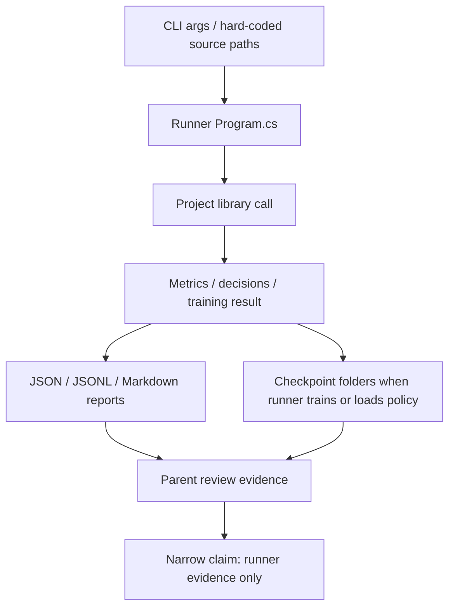

# experiments-v2 runner group

Documentation status: DExpRunners documented - parent review passed.

## Quick map for Luba

The `experiments-v2/*/runner/*` group is a set of console runners around experiments, training, held-out checks, and comparison reports. They read JSONL, command-line arguments, or hard-coded local paths, call the project libraries, and write summary JSON, JSONL, Markdown, checkpoint folders, or stdout.

This is not a single product runtime, not a UI, and not a standalone `ILearningMachine`. Even a runner that does DPO steps or loads a checkpoint provides only evidence for a specific run. JSON, a report, a progress file, DPO pairs, a checkpoint, or a batch-size recommendation by themselves do not prove a ready trained semantic model, a fresh load in the product, or quality on a real user scenario.

## UML and data flow



Legend: a runner is a console wrapper; a library call is the real logic in `26.TrainableRouter`, `35.ExperimentsV2`, `18.CapabilityTraining`, `21.AgentInfrastructure`, `11.DPO`, `03.TransformerModel`; a report is an evidence artifact; a checkpoint is a model file only where the source explicitly saves or loads it.

## Connection simulations

| Connection | Example input | What happens | Expected result | What must not be asserted |
|---|---|---|---|---|
| CLI args -> Program.cs | `--train train.jsonl --heldout eval.jsonl` | `CodeDocBatchRunner` reads the parameters and passes the paths to `CodeDocumentationBatchFileRunner.RunAsync`. | A PASS/FAIL summary and DPO-ready pairs for documentation routing appear. | This is not a product LoRA/DPO checkpoint without a separate model runner. |
| Program.cs -> KNN library | E13B corpus rows like `Y + Z = X` | The runner builds `LogicalKnnTrainingExample` and calls `KnnLogicalUnit<string,string>.Train`. | JSON/MD show baseline and enhanced accuracy on a synthetic corpus. | This is not proof of general algebraic logic or a product runtime. |
| Program.cs -> DpoTrainer | JSONL with prompt/chosen/rejected | The runner normalizes the pairs, makes batches, calls `trainer.StepMany`, periodically writes a policy checkpoint. | There is progress, batch-summary, DPO summary, and checkpoint files. | The DPO metric and checkpoint are not equal to product readiness without manifest/locator/fresh-load/use/continue gates. |
| Held-out evaluator -> policy checkpoint | `--heldout rows.jsonl --checkpoint policy.bin` | The runner checks that the files exist, loads the policy checkpoint, and compares expected/rejected log-probs. | The summary gets accuracy, hallucination rate, citation/contract checks. | This does not guarantee real Project Wiki quality without matching data, model version, and runtime load. |
| Teaching runner -> registries | A Xiigen session JSONL row | The runner creates topology/flow/unit registries, routes, branches, and calls `DefaultLogicalCapabilityTrainer`. | Flow/unit descriptors and a teaching summary per row or batch appear. | Registry binding does not prove general semantics or a finished lifecycle of a trained unit. |
| Comparison runner -> reports | `--rows 200 --sizes 20,50,100,200` | The runner fixes the corpus, runs different batch sizes, writes stage, subphase, resource, and cross-run comparison reports. | The parent gets evidence about cost, coverage, and resources. | A batch-size recommendation is not a release approval and does not prove a trained runtime. |

## No-code algorithms

### CodeDocBatchRunner Program.cs

File: `experiments-v2/CODE-DOC-BATCH-RUNNER/runner/CodeDocBatchRunner/Program.cs`.

Method/entry point: top-level `Program`, CLI parameters `--train`, `--heldout`, `--result-root`, `--run-id`.

Input: path to the train JSONL, path to the held-out JSONL, results folder. Output: `code-doc-batch-run-summary.json`, `code-doc-routing-dpo-pairs.jsonl`, `code-doc-heldout-cases.jsonl`, `LOOK-LIKE-RUN-REPORT.md`, stdout/stderr, and an exit code.

Steps: create runRoot; call `CodeDocumentationBatchFileRunner().RunAsync(trainPath, heldOutPath)`; on FAIL - write a failure summary, markdown, and exit code 1; on PASS - write accuracy metrics, CPU/RAM/elapsed, DPO pairs, and held-out cases.

Does not do: it does not train a LoRA model, does not check product runtime, does not prove the quality of the documentation router outside the passed files.

`experiments-v2/CODE-DOC-BATCH-RUNNER/runner/CodeDocBatchRunner/Program.cs:13-31`

```csharp
var json = new JsonSerializerOptions { WriteIndented = true };
var startedAt = DateTimeOffset.Now;
var result = await new CodeDocumentationBatchFileRunner().RunAsync(trainPath, heldOutPath);
var completedAt = DateTimeOffset.Now;

if (!result.IsSuccess)
{
    var failure = new
    {
        run_id = runId,
        status = "FAIL",
        train_path = trainPath,
        heldout_path = heldOutPath,
        error_code = result.ErrorCode,
        error_message = result.ErrorMessage,
        started_at = startedAt,
        completed_at = completedAt
    };
    await File.WriteAllTextAsync(Path.Combine(runRoot, "code-doc-batch-run-summary.json"), JsonSerializer.Serialize(failure, json), Encoding.UTF8);
```

Why it matters: the quote shows the real library call and the FAIL branch. This proves the format of the runner evidence, but not a successful execution in this documentation phase.

### E13BExpressionPrefixCompletionRunner Program.cs

File: `experiments-v2/E13B-EXPRESSION-PREFIX-COMPLETION/runner/E13BExpressionPrefixCompletionRunner/Program.cs`.

Entry point: top-level `Program`, no required CLI parameters; runId and resultRoot are formed internally.

Input: a built-in corpus from `BuildCorpus()`. Output: JSON and Markdown in the results folder, stdout with accuracy and cosine metrics.

Steps: build `LogicalKnnTrainingExample<string,string>` from partial/completion; train `KnnLogicalUnit<string,string>` with `vectorDimensions=64`, `k=3`, `confidenceFloor=0.65`; compare the majority baseline and enhanced prediction; compute success by lift/gap/coverage/knowledge-edge.

Does not do: it does not train a language model and does not prove generalization beyond the small synthetic corpus.

`experiments-v2/E13B-EXPRESSION-PREFIX-COMPLETION/runner/E13BExpressionPrefixCompletionRunner/Program.cs:26-31`

```csharp
var stopwatch = Stopwatch.StartNew();
var trained = KnnLogicalUnit<string, string>.Train(
    "unit-e13b-expression-prefix-completion",
    "expression_completion",
    "expression_completion",
    examples,
```

Why it matters: the quote shows exactly the KNN training call, not transformer/model training.

### E13BHeldOutValidationRunner Program.cs

File: `experiments-v2/E13B-EXPRESSION-PREFIX-COMPLETION/runner/E13BHeldOutValidationRunner/Program.cs`.

Entry point: top-level `Program`, no input CLI parameters. Output: `e13b-heldout-validation.json`, `e13b-heldout-validation.md`, stdout with held-out metrics.

Steps: call `new E13BHeldOutValidation().RunAsync()`; on FAIL throw an exception; on PASS write JSON/Markdown and print the rates.

Does not do: it does not run dotnet test and is not a runtime gate for the product.

`experiments-v2/E13B-EXPRESSION-PREFIX-COMPLETION/runner/E13BHeldOutValidationRunner/Program.cs:11-24`

```csharp
var validation = await new E13BHeldOutValidation().RunAsync();
if (!validation.IsSuccess)
    throw new InvalidOperationException(validation.ErrorMessage);

var result = validation.Value!;
var jsonPath = Path.Combine(resultRoot, "e13b-heldout-validation.json");
var markdownPath = Path.Combine(resultRoot, "e13b-heldout-validation.md");

await File.WriteAllTextAsync(
    jsonPath,
    JsonSerializer.Serialize(result, new JsonSerializerOptions { WriteIndented = true }),
    Encoding.UTF8);

await File.WriteAllTextAsync(markdownPath, RenderMarkdown(result), Encoding.UTF8);
```

### InternalTrainReadyDpoRunner Program.cs

File: `experiments-v2/INTERNAL-TRAIN-READY-V191/runner/InternalTrainReadyDpoRunner/Program.cs`.

Entry point: top-level `Program`, parameters `--source`, `--result-root`, `--run-id`, `--batch-size`, `--context`, `--max-rows`, `--save-every`.

Input: JSONL with DPO pairs. Output: normalized DPO JSONL, `progress.jsonl`, `batch-summary.jsonl`, `internal-train-ready-dpo-summary.json/md`, checkpoint files under `checkpoints`.

Steps: compute the source SHA; load the pairs; skip empty/incomplete rows; construct a small `LlmModel` policy/reference; turn the pairs into a `DpoBatch`; call `trainer.StepMany`; periodically save a checkpoint; write loss/reward/accuracy/resource metrics.

Does not do: it does not publish the model to a locator, does not check fresh-load/use/continue in the product, does not guarantee the quality of the rejected data.

`experiments-v2/INTERNAL-TRAIN-READY-V191/runner/InternalTrainReadyDpoRunner/Program.cs:28-44`

```csharp
var sourceSha = Sha256File(sourcePath);
var pairs = LoadPairs(sourcePath, maxRows).ToArray();
if (pairs.Length == 0)
    throw new InvalidOperationException($"No trainable pairs loaded from {sourcePath}");

var transformedPath = Path.Combine(runRoot, "dpo-pairs-normalized.jsonl");
await File.WriteAllLinesAsync(
    transformedPath,
    pairs.Select(pair => JsonSerializer.Serialize(new DpoPair
    {
        Prompt = pair.Prompt,
        Chosen = pair.Chosen,
        Rejected = pair.Rejected
    })),
    Encoding.UTF8);

var cfg = new ModelConfig
```

`experiments-v2/INTERNAL-TRAIN-READY-V191/runner/InternalTrainReadyDpoRunner/Program.cs:83-97`

```csharp
for (var batchIndex = 0; batchIndex < batches.Length; batchIndex++)
{
    process.Refresh();
    var batch = batches[batchIndex];
    var cpuBefore = process.TotalProcessorTime;
    var memoryBefore = process.WorkingSet64;
    var diskBefore = DirectorySize(checkpointRoot);
    var batchStopwatch = Stopwatch.StartNew();
    var dpoBatches = batch.Select(pair => ToBatch(pair, cfg.VocabSize, contextLen)).ToArray();
    var metrics = trainer.StepMany(dpoBatches, batchIndex + 1);
    batchStopwatch.Stop();
    process.Refresh();

    if ((batchIndex + 1) % saveEvery == 0 || batchIndex == batches.Length - 1)
        policy.SaveCheckpoint(Path.Combine(checkpointRoot, $"policy_step_{batchIndex + 1:D6}.bin"));
```

### ProjectWikiBaseHeldoutEvaluator Program.cs

File: `experiments-v2/PROJECT-WIKI-BASE-HELDOUT-EVAL/runner/ProjectWikiBaseHeldoutEvaluator/Program.cs`.

Entry point: top-level `Program`, parameters `--heldout`, `--checkpoint`, `--result-root`, `--run-id`, `--context`.

Input: a held-out candidate JSONL and a policy checkpoint path. Output: summary JSON/MD, results JSONL, stdout. Branches: if heldout or checkpoint is missing, the runner throws an exception; if the rows are empty, it is also FAIL; otherwise it loads the policy checkpoint and compares expected/rejected answer scores.

Does not do: it does not prove a runtime Project Wiki answerer, because here a local evaluator with a specific checkpoint and contract rows is executed.

`experiments-v2/PROJECT-WIKI-BASE-HELDOUT-EVAL/runner/ProjectWikiBaseHeldoutEvaluator/Program.cs:13-20`

```csharp
var runId = ReadArg(args, "--run-id", $"run-{DateTime.Now:yyyy-MM-dd-HHmmss}");
var contextLen = ReadIntArg(args, "--context", 96);

if (string.IsNullOrWhiteSpace(heldoutPath) || !File.Exists(heldoutPath))
    throw new InvalidOperationException($"Held-out candidate file not found: {heldoutPath}");

if (string.IsNullOrWhiteSpace(checkpointPath) || !File.Exists(checkpointPath))
    throw new InvalidOperationException($"Policy checkpoint not found: {checkpointPath}");
```

`experiments-v2/PROJECT-WIKI-BASE-HELDOUT-EVAL/runner/ProjectWikiBaseHeldoutEvaluator/Program.cs:88-98`

```csharp
summary = summary with
{
    Passed = summary.GenericDocumentationQaAccuracy >= 0.90 &&
             summary.CitationFormatAccuracy >= 0.98 &&
             summary.MissingEvidenceAbstentionAccuracy >= 0.95 &&
             summary.HallucinationRate == 0.0 &&
             summary.AnswerContractAccuracy >= 0.98
};

var jsonOptions = new JsonSerializerOptions { WriteIndented = true };
await File.WriteAllTextAsync(Path.Combine(runRoot, "base-wiki-heldout-evaluation-summary.json"), JsonSerializer.Serialize(summary, jsonOptions), Encoding.UTF8);
```

### Teaching20RowsCurrentRunner Program.cs

File: `experiments-v2/TEACHING-20-ROWS-CURRENT/runner/Teaching20RowsCurrentRunner/Program.cs`.

Entry point: top-level `Program`, the first positional arg sets rowLimit, otherwise 20. Input: a hard-coded Xiigen session rows JSONL. Output: checkpoint folder, `progress.txt`, `teaching-...-summary.json/md`.

Steps: read the first `rowLimit` rows; seed topology/flows; for each row classify the domain, route through the compiler/router, build knowledge-edge branches, call `DefaultLogicalCapabilityTrainer.TrainAndRegisterAsync`, check flow bindings, write a row summary.

Does not do: the hard-coded source path and the current in-memory registry are not universal host/runtime proof.

`experiments-v2/TEACHING-20-ROWS-CURRENT/runner/Teaching20RowsCurrentRunner/Program.cs:60-68`

```csharp
    var process = Process.GetCurrentProcess();
    process.Refresh();
    var cpuBefore = process.TotalProcessorTime;
    var memoryBefore = process.WorkingSet64;
    var allocationBefore = GC.GetTotalAllocatedBytes(precise: true);
    var diskBefore = DirectorySize(checkpointRoot);
    var stopwatch = Stopwatch.StartNew();

    var route = await RouteRowAsync(request, compiler, multiRouter, flags);
```

### XiigenSessionBatchedTeachingRunner Program.cs

File: `experiments-v2/TEACHING-XIIGEN-SESSIONS-BATCHED/runner/XiigenSessionBatchedTeachingRunner/Program.cs`.

Entry point: top-level `Program`, no explicit CLI parameters. Input: a hard-coded Xiigen rows JSONL. Output: batch summary JSONL, progress, final summary JSON/MD, checkpoints.

Steps: read all rows; seed topology/flow/unit registries; build domain-sized batches; build branches from target subphases; train/register via `DefaultLogicalCapabilityTrainer`; verify flow bindings per subphase; summarize resource and registry counts.

Does not do: it does not replace an acceptance gate for the full product; the batch summary is evidence for a specific corpus and registry instance.

`experiments-v2/TEACHING-XIIGEN-SESSIONS-BATCHED/runner/XiigenSessionBatchedTeachingRunner/Program.cs:24-34`

```csharp
var topology = new InMemoryLogicalTopologyRegistry();
var flows = new InMemoryLogicalFlowRegistry();
var units = new InMemoryLogicalUnitRegistry();
var seed = DevelopmentLifecycleTopologySeeder.Seed(topology, flows);
if (!seed.IsSuccess)
    throw new InvalidOperationException(seed.ErrorMessage);

var trainer = new DefaultLogicalCapabilityTrainer(checkpointRoot);
var batches = BuildBatches(allRows).ToArray();
var batchSummaries = new List<BatchSummary>();
var batchJsonl = Path.Combine(resultRoot, "batch-summary.jsonl");
```

`experiments-v2/TEACHING-XIIGEN-SESSIONS-BATCHED/runner/XiigenSessionBatchedTeachingRunner/Program.cs:249-256`

```csharp
static VerificationSummary VerifyBatchFlows(
    InMemoryLogicalFlowRegistry flows,
    InMemoryLogicalUnitRegistry units,
    IReadOnlyList<SessionLearningRow> rows,
    string batchId)
{
    var failures = new List<string>();
    var count = 0;
```

### XiigenDocsBatchComparisonRunner Program.cs

File: `experiments-v2/XIIGEN-DOCS-BATCH-COMPARISON/runner/XiigenDocsBatchComparisonRunner/Program.cs`.

Entry point: top-level `Program`, parameters `--source`, `--rows`, `--sizes`, `--trust-row-domain`. Input: session rows JSONL. Output: fixed corpus files, rejected rows, per-batch reports, stage summaries, cross-run comparison JSON/MD.

Steps: load the fixed corpus; write accepted/rejected row files; for each batch-size run batch teaching, stage timing, DPO/registry/verification summaries, regression window; then write the cross-run comparison and recommendation.

Does not do: the batch-size recommendation and stage cost table are not a production approval. This is comparison evidence tooling.

`experiments-v2/XIIGEN-DOCS-BATCH-COMPARISON/runner/XiigenDocsBatchComparisonRunner/Program.cs:16-34`

```csharp
var requestedRows = ReadIntArg(args, "--rows", 200);
var batchSizes = ReadSizesArg(args, "--sizes", [20, 200, 50, 100]);
var trustRowDomain = ReadBoolArg(args, "--trust-row-domain");
Directory.CreateDirectory(comparisonRoot);

var jsonOptions = new JsonSerializerOptions { WriteIndented = true, PropertyNameCaseInsensitive = true };
var jsonLineOptions = new JsonSerializerOptions { PropertyNameCaseInsensitive = true };

var corpusStopwatch = Stopwatch.StartNew();
var corpus = LoadFixedCorpus(sourceRowsPath, requestedRows);
corpusStopwatch.Stop();
if (corpus.AcceptedRows.Count < requestedRows)
    throw new InvalidOperationException($"Fixed corpus requires {requestedRows} accepted rows, but only {corpus.AcceptedRows.Count} were available.");

var fixedRowsPath = Path.Combine(comparisonRoot, "rows-200-fixed.jsonl");
var rejectedRowsPath = Path.Combine(comparisonRoot, "rejected-rows.jsonl");
await File.WriteAllLinesAsync(fixedRowsPath, corpus.AcceptedRows.Select(row => row.RawJson), Encoding.UTF8);
await File.WriteAllLinesAsync(rejectedRowsPath, corpus.RejectedRows.Select(row => JsonSerializer.Serialize(row, jsonLineOptions)), Encoding.UTF8);
WriteSetPreparationReport(Path.Combine(comparisonRoot, "set-preparation-report.md"), sourceRowsPath, fixedRowsPath, corpus, corpusStopwatch.Elapsed);
```

`experiments-v2/XIIGEN-DOCS-BATCH-COMPARISON/runner/XiigenDocsBatchComparisonRunner/Program.cs:883-887`

```csharp
    writer.WriteLine("| Stage | Batch 20 | Batch 50 | Batch 100 | Batch 200 |");
    writer.WriteLine("|---|---:|---:|---:|---:|");
    var stageNames = reports.SelectMany(report => report.StageSummaries.Select(stage => stage.StageName)).Distinct(StringComparer.Ordinal).OrderBy(name => name, StringComparer.Ordinal).ToArray();
    foreach (var stageName in stageNames)
    {
```

## Runner status table

| Runner | Current status | What it actually proves | What it does not prove |
|---|---|---|---|
| CodeDocBatchRunner | Active evidence runner | Checks a train/heldout batch via `CodeDocumentationBatchFileRunner`; writes DPO-ready pairs. | Does not train a product model. |
| E13BExpressionPrefixCompletionRunner | Experiment/KNN runner | KNN retrieval on a built-in expression corpus. | Does not prove general semantics or an `ILearningMachine` lifecycle. |
| E13BHeldOutValidationRunner | Held-out validation runner | Runs `E13BHeldOutValidation` and writes a held-out report. | Is not a dotnet test gate. |
| InternalTrainReadyDpoRunner | DPO training runner | Does DPO steps and policy checkpoints for a specific JSONL. | Does not prove manifest/locator/fresh-load/use/continue. |
| ProjectWikiBaseHeldoutEvaluator | Checkpoint evaluator | Loads a checkpoint and computes preference/contract metrics. | Does not prove runtime ProjectWikiDomain. |
| Teaching20RowsCurrentRunner | Teaching evidence runner | Runs limited rows through routing/trainer/verification. | Hard-coded corpus and in-memory registries are not equal to a production host. |
| XiigenSessionBatchedTeachingRunner | Batched teaching runner | Groups rows by domain, trains/registers batches, checks flow bindings. | The batch report is not full acceptance. |
| XiigenDocsBatchComparisonRunner | Comparison/resource runner | Compares batch sizes, writes stage/resource/cross-run reports. | The recommendation is not a release approval. |

## QA and test coverage

In this documentation phase, the tests were not run: there is no `dotnet test`, build, runtime smoke, training rerun, or runner execution. From the already-read `docs/projects/35-experiments-v2.md` and `docs/projects/tests.md`, it is visible that the common tests cover parts of `35.ExperimentsV2` and the infrastructure contracts, but direct e2e coverage of each runner from `experiments-v2/*/runner/*` is not confirmed in this subphase.

The check that can be honestly claimed now: source/read sanity, exact quote comparison, matrix JSON parse, `git diff --check`, and the presence of the DExpRunners draft row. All the runtime metrics in the runners themselves are potential outputs of a future run, not the result of this documentation work.

## Anti-false-done and anti-determinism

- A runner report, JSON, JSONL, Markdown, stdout, `progress.txt`, checkpoint folder, or DPO metric is not proof of a ready trained semantic model.
- KNN, token hashing, log-prob comparison, route classifier, in-memory registry, and deterministic batch grouping must be described as helper/evidence logic while there is no source-backed lifecycle: export/import/manifest/locator/fresh-load/use/continue.
- `Passed=true`, `ACCEPT_BATCH`, `ResourceStatus=PASS`, or a recommended batch size in the runner output are narrow runner verdicts, not product-owner approval.
- Hard-coded local paths show the current working binding of the runner, but not portability or host/plugin runtime.
- DExpRunners documents the runner group; it does not replace the documentation of `35.ExperimentsV2`, `18.CapabilityTraining`, `21.AgentInfrastructure`, `26.TrainableRouter`, or the domain projects that the runners reference.
