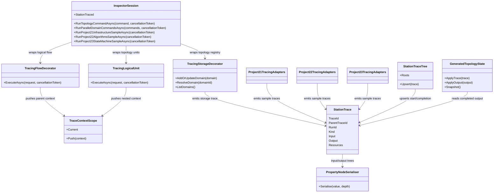

# LlmInspector.Core

Documentation status: DInspector-A documented - parent review passed.

## Краткая карта

`LlmInspector.Core` - это библиотека инспектора для сбора объяснимых трасс выполнения. Она не является UI-приложением, не является `ILearningMachine`, не обучает модель и не доказывает готовность продукта, плагина или host runtime. Ее реальная роль: взять уже существующие вызовы из `21.AgentInfrastructure`, `22.AgentAlgorithms`, `23.OssEquivalents` и топологического пути, обернуть их декораторами, записать start/completion события, сериализовать входы и выходы в дерево `PropertyNode`, построить дерево станций и частично восстановить сгенерированную топологию из завершенных trace output.

Главная честная граница: trace, station card, property tree, resource snapshot и adapter wrapper - это доказательство наблюдаемости и формы данных. Это не доказательство качества модели, не checkpoint, не manifest, не fresh-load, не continue-training и не реальное расширение IDE.

## UML



## Симуляции связей

| Связь | Пример входа | Что происходит | Ожидаемый результат | Что это НЕ доказывает |
|---|---|---|---|---|
| `InspectorSession -> TracingFlowDecorator` | `AddDomainCommand("technical_design")` | Сессия создает root trace, кладет `TraceContextScope`, вызывает traced `TopologyMutationFlow`. | Появляются события orchestrator и flow с одним `RunId`. | Не доказывает, что есть обученная маршрутизация или продуктовая оркестрация. |
| `TracingFlowDecorator -> TracingLogicalUnit` | `LogicalFlowRequest<LogicalTopologyCommand>` | Flow исполняет реальный unit; контекст flow становится родителем unit trace. | Unit trace получает `ParentTraceId` flow и глубину на один уровень ниже. | Не доказывает semantic reasoning; это сохранение иерархии вызовов. |
| `TracingLogicalUnit -> TracingStorageDecorator` | `AddDomainTopologyMutationUnit` вызывает registry | Unit wrapper испускает start/completion, а storage wrapper отдельно трассирует registry call. | В дереве видна цепочка orchestrator -> flow -> unit -> storage. | Не доказывает persisted registry asset lifecycle; текущий storage in-memory. |
| `StationTrace -> PropertyNodeSerialiser` | `OperationResult<LogicalDomainEntry>` | Рефлексия превращает public properties и массивы в `PropertyNode` дерево. | UI/документ может показать `IsSuccess`, `Domain.DomainId`, `Revision`. | Не доказывает корректность бизнес-логики; только форму сериализованного envelope. |
| `StationTraceTree.Upsert` | start trace и completion trace с одинаковым `TraceId` | Первый trace создает card, второй обновляет существующую card. | Нет дубликата station card; completion добавляет output/error/resources. | Не доказывает, что исходный runtime завершился успешно, если output/error говорят обратное. |
| `GeneratedTopologyState.ApplyTrace` | completed storage trace с domain output | In-flight trace игнорируется; completed output разбирается и добавляет node. | Snapshot получает `domain:<id>` или буферизует phase/subphase/transition до появления parent endpoint. | Не доказывает, что topology обучена; это deterministic projection из trace output. |
| `Project22TracingAdapters -> StationTrace` | `KnnSkillFilter.FilterAsync(candidates, "fix crash", 5, 0.40)` | Adapter строит inspectable input, вызывает реальный filter, добавляет completion trace. | Видны параметры, station role и result envelope. | KNN/keyword score не становится обученной семантической моделью. |
| `Project23TracingAdapters -> StationTrace` | state machine initial state + start/terminal names | Wrapper трассирует state machine как flow и state nodes как units. | Inspector показывает state-machine path и approval guard. | Это не реальный host/plugin invocation и не разрешение на внешний AI. |

## Алгоритмы без кода

### `InspectorSession.RunTopologyCommandAsync(LogicalTopologyCommand command, CancellationToken cancellationToken = default)`

Вход: топологическая команда из `AgentInfrastructure.Logical`. Выход: `OperationResult<LogicalFlowResult>`. Алгоритм создает новый `RunId`, испускает root orchestrator start trace, кладет `TraceContextScope` с root parent, строит `LogicalFlowRequest`, вызывает traced flow ровно один раз, затем испускает completion trace и возвращает результат без изменения. Ветви: ошибка flow возвращается в том же `OperationResult`; wrapper только записывает `ErrorCode/ErrorMessage` в trace. Ограничение: это inspectable path, не обученный orchestrator.

`LlmInspector.Core/Inspector/InspectorSession.cs:111-140`

```csharp
    // Run one topology command through the inspectable orchestrator-to-storage chain.
    public async Task<OperationResult<LogicalFlowResult>> RunTopologyCommandAsync(
        LogicalTopologyCommand command,
        CancellationToken cancellationToken = default)
    {
        // Create a new run id because each command execution is one inspector run.
        var runId = Guid.NewGuid().ToString("N");

        // Create the root orchestrator start trace.
        var start = CreateOrchestratorStartTrace(runId, command);

        // Emit the root start event before any flow is selected.
        EmitTrace(start);

        // Push the orchestrator as the parent for the selected flow.
        using (TraceContextScope.Push(new TraceContext(runId, start.TraceId, 1, 0)))
        {
            // Build the flow request from the user topology command.
            var request = BuildTopologyFlowRequest(runId, command);

            // Execute the traced flow exactly once.
            var result = await _topologyMutationFlow.ExecuteAsync(request, cancellationToken);

            // Emit the root completion event with the flow result envelope.
            EmitTrace(CompleteOrchestratorTrace(start, result));

            // Return the flow result unchanged to the caller.
            return result;
        }
    }
```

Цитата важна тем, что показывает: session не заменяет поведение flow, а добавляет parent trace и возвращает исходный result.

### `TracingLogicalUnit<TInput,TOutput>.ExecuteAsync(LogicalUnitRequest<TInput> request, CancellationToken cancellationToken = default)`

Вход: `LogicalUnitRequest<TInput>`. Выход: `OperationResult<LogicalUnitResult<TOutput>>`. Алгоритм создает start trace из текущего parent context, испускает его, кладет новый context для вложенных storage/unit вызовов, вызывает `_inner.ExecuteAsync`, испускает completion trace с сериализованным результатом и возвращает исходный result. Ветви: при ошибке inner wrapper не чинит ее, а только переносит error envelope в trace.

`LlmInspector.Core/Inspector/TracingLogicalUnit.cs:34-57`

```csharp
    // Execute the unit and emit one start event plus one completion event with the same trace id.
    public async Task<OperationResult<LogicalUnitResult<TOutput>>> ExecuteAsync(
        LogicalUnitRequest<TInput> request,
        CancellationToken cancellationToken = default)
    {
        // Create the start trace from the current parent context.
        var start = CreateStartTrace(request);

        // Emit the start event before the wrapped unit runs.
        _emitTrace(start);

        // Push this unit as the parent context for storage or nested units called inside it.
        using (TraceContextScope.Push(new TraceContext(start.RunId, start.TraceId, start.Depth + 1, start.WaveIndex)))
        {
            // Execute the wrapped unit exactly once.
            var result = await _inner.ExecuteAsync(request, cancellationToken);

            // Emit the completion event with the unit result in the inspectable output tree.
            _emitTrace(CompleteTrace(start, result));

            // Return the wrapped result unchanged.
            return result;
        }
    }
```

### `TracingStorageDecorator.Trace<TOutput>(string stationName, string stationRole, object? inputValue, Func<OperationResult<TOutput>> operation)`

Вход: имя станции, роль, входное значение и синхронная операция registry. Выход: исходный `OperationResult<TOutput>`. Алгоритм создает start trace, вызывает реальную storage operation ровно один раз, испускает completion trace и возвращает result. Это наблюдаемость над `ILogicalTopologyRegistry`, а не доказательство persistent storage или asset lifecycle.

`LlmInspector.Core/Inspector/TracingStorageDecorator.cs:73-94`

```csharp
    // Trace wraps one storage operation with matching start and completion events.
    private OperationResult<TOutput> Trace<TOutput>(
        string stationName,
        string stationRole,
        object? inputValue,
        Func<OperationResult<TOutput>> operation)
    {
        // Create the start trace from the inherited unit context.
        var start = CreateStartTrace(stationName, stationRole, inputValue);

        // Emit the storage start before the wrapped registry operation runs.
        _emitTrace(start);

        // Execute the wrapped storage operation exactly once.
        var result = operation();

        // Emit the completion trace with the full operation result.
        _emitTrace(CompleteTrace(start, result));

        // Return the wrapped result unchanged.
        return result;
    }
```

### `PropertyNodeSerialiser.Serialise(object? value, int depth = 0)`

Вход: любой runtime object или null. Выход: `IReadOnlyList<PropertyNode>`. Шаги: null становится leaf; глубина больше `MaxDepth` останавливается marker leaf; scalar становится leaf; enumerable становится индексированными children; public instance properties читаются reflection. Ветви защищают UI от бесконечного дерева и от разбиения string как enumerable. Ограничение: reflection-дерево показывает форму данных, но не валидирует бизнес-смысл.

`LlmInspector.Core/Inspector/PropertyNodeSerialiser.cs:13-37`

```csharp
    // Serialise converts any runtime object into the root property-node list shown by the inspector.
    public static IReadOnlyList<PropertyNode> Serialise(object? value, int depth = 0)
    {
        // Route null values to a leaf so the inspector can show absence explicitly.
        if (value is null)
            return [Leaf("value", "(null)", null)];

        // Stop at the depth cap so nested framework objects cannot overwhelm the UI.
        if (depth > MaxDepth)
            return [Leaf("value", "(max depth)", null)];

        // Return scalar values as one leaf because they have no meaningful inspectable children.
        if (TrySerialiseScalar("value", value, out var scalarNode))
            return [scalarNode];

        // Return enumerable values as indexed children so arrays remain easy to inspect.
        if (TrySerialiseEnumerable(value, depth, out var enumerableNode))
            return enumerableNode.Children;

        // Read public instance properties because records and envelopes expose their shape there.
        var properties = value.GetType().GetProperties(BindingFlags.Public | BindingFlags.Instance);

        // Fall back to a leaf when reflection finds no readable public properties.
        if (properties.Length == 0)
            return [Leaf("value", value.ToString() ?? string.Empty, value.GetType().Name)];
```

### `StationTraceTree.Upsert(StationTrace trace)`

Вход: одно start или completion событие. Выход: изменение `Roots`, card tree и internal indexes. Алгоритм: если `TraceId` уже есть, update existing card и не создает дубль; если trace новый, создает card, индексирует его, добавляет root без parent, иначе прикрепляет к найденному parent или кладет в pending до появления parent. Ограничение: дерево отвечает за визуальную структуру, не за истинность данных.

`LlmInspector.Core/Inspector/StationTraceTree.cs:18-53`

```csharp
    public void Upsert(StationTrace trace)
    {
        // Update the existing card when this is a completion event for a known trace id.
        if (_byTraceId.TryGetValue(trace.TraceId, out var existing))
        {
            // Apply the latest trace state to the existing card.
            existing.Update(trace);

            // Stop because completion must not add a duplicate card.
            return;
        }

        // Create a new card for the first event seen for this trace id.
        var card = new StationCardViewModel(trace);

        // Index the card immediately so later completion events can find it.
        _byTraceId[trace.TraceId] = card;

        // Attach root cards directly to the tree roots collection.
        if (trace.ParentTraceId is null)
        {
            // Add the root station card to the root collection.
            Roots.Add(card);
        }
        // Attach child cards when the parent is already known.
        else if (_byTraceId.TryGetValue(trace.ParentTraceId, out var parent))
        {
            // Add the child under the parent wave group.
            parent.AddChild(card);
        }
        // Defer child cards when their parent event arrives later.
        else
        {
            // Store the card until its parent is available.
            _pending.Add(card);
        }
```

### `GeneratedTopologyState.ApplyTrace(StationTrace trace)` и `ApplyOutput(IReadOnlyList<PropertyNode> output)`

Вход: completed trace или output tree. Выход: `bool`, изменилось ли состояние, и snapshot через `Snapshot()`. Ветви: in-flight trace (`CompletedAt is null`) игнорируется; trace без output игнорируется; completed output ищет domain/phase/subphase/transition entries. Phase/subphase/transition могут буферизоваться до появления parent/endpoint. Это deterministic projection из trace output, не learned topology.

`LlmInspector.Core/Inspector/GeneratedTopologyState.cs:71-84`

```csharp
    // ApplyTrace reads one completed station trace and updates generated topology state.
    public bool ApplyTrace(StationTrace trace)
    {
        // Ignore in-flight traces because they do not have generated output yet.
        if (trace.CompletedAt is null)
            return false;

        // Ignore traces without output because there is nothing to inspect.
        if (trace.Output is null)
            return false;

        // Apply the completed output tree.
        return ApplyOutput(trace.Output);
    }
```

### `TracingKnnSkillFilter.FilterAsync(IReadOnlyList<TextChunk> skillCandidates, string taskDescription, int topK = 5, double confidenceThreshold = 0.40)`

Вход: список candidate chunks, описание задачи, `topK`, порог. Выход: `OperationResult<IReadOnlyList<TextChunk>>` от реального `ISkillFilter`. Adapter строит inspectable DTO, создает start trace, вызывает `_inner.FilterAsync`, испускает completion trace и возвращает result. Ограничение: это не обученная semantic authority; в inspector sample search provider детерминированный.

`LlmInspector.Core/Inspector/Project22TracingAdapters.cs:95-120`

```csharp
    // FilterAsync emits traces around one KnnSkillFilter.FilterAsync call.
    public async Task<OperationResult<IReadOnlyList<TextChunk>>> FilterAsync(
        IReadOnlyList<TextChunk> skillCandidates,
        string taskDescription,
        int topK = 5,
        double confidenceThreshold = 0.40)
    {
        // Build the inspectable input object.
        var input = new SkillFilterInspectionInput(skillCandidates, taskDescription, topK, confidenceThreshold);

        // Create the start trace from the current flow context.
        var start = Project22TraceFactory.CreateStartTrace("KnnSkillFilter.FilterAsync", "project22_knn_skill_filter", StationKind.Unit, input);

        // Emit the start trace before calling the wrapped filter.
        _emitTrace(start);

        // Call the real project 22 KNN skill filter.
        var result = await _inner.FilterAsync(skillCandidates, taskDescription, topK, confidenceThreshold);

        // Emit the completion trace with the real filter result.
        _emitTrace(Project22TraceFactory.CompleteTrace(start, result));

        // Return the wrapped result unchanged.
        return result;
    }
}
```

### `TracingAgentStateMachine.RunAsync(Dictionary<string, object> initialState, string startingStateName, string terminalStateName, CancellationToken cancellationToken = default)`

Вход: state dictionary и имена стартового/терминального состояния. Выход: `OperationResult<Dictionary<string, object>>`. Adapter трассирует state machine как flow, кладет context, вызывает реальную state machine, испускает completion trace. Ограничение: это inspectable sample для `23.OssEquivalents`, не настоящий plugin host runtime.

`LlmInspector.Core/Inspector/Project23TracingAdapters.cs:47-75`

```csharp
    // RunAsync emits traces around one AgentStateMachine.RunAsync call.
    public async Task<OperationResult<Dictionary<string, object>>> RunAsync(
        Dictionary<string, object> initialState,
        string startingStateName,
        string terminalStateName,
        CancellationToken cancellationToken = default)
    {
        // Build the inspectable input object.
        var input = new AgentStateMachineInspectionInput(initialState, startingStateName, terminalStateName);

        // Create the start trace from the current orchestrator context.
        var start = Project23TraceFactory.CreateStartTrace("AgentStateMachine.RunAsync", "project23_state_machine_flow", StationKind.Flow, input);

        // Emit the state-machine start trace before execution.
        _emitTrace(start);

        // Push the state machine as the parent for node and guard traces.
        using (TraceContextScope.Push(new TraceContext(start.RunId, start.TraceId, start.Depth + 1, start.WaveIndex)))
        {
            // Execute the wrapped state machine exactly once.
            var result = await _inner.RunAsync(initialState, startingStateName, terminalStateName, cancellationToken);

            // Emit the completion trace with the real state-machine result.
            _emitTrace(Project23TraceFactory.CompleteTrace(start, result));

            // Return the wrapped result unchanged.
            return result;
        }
    }
```

### `TraceContextScope.Push(TraceContext context)`

`TraceContextScope` использует `AsyncLocal<TraceContext?>`: вложенные awaits в той же ветке видят parent trace, но sibling branch, начатая раньше, не наследует поздний context. Это нужно для правильного `ParentTraceId`, `Depth`, `WaveIndex` и безопасного возврата prior context после `Dispose`. Это инфраструктура трассировки, не authority model.

### `InspectorSession.RunParallelDomainCommandsAsync(IReadOnlyList<AddDomainCommand> commands, CancellationToken cancellationToken = default)`

Алгоритм создает root orchestrator и отдельный parallel flow trace, затем запускает несколько `AddDomainCommand` через один flow context. Каждая unit ветка получает общий parent flow и общий `WaveIndex`, чтобы UI мог показать siblings в одной wave group. Это доказывает только группировку трасс, не параллельную продуктовую производительность.

## QA/test mapping

Тесты были прочитаны и сопоставлены, но не запускались в этой документационной фазе.

| Тестовый файл | Что покрывает | Что не доказывает |
|---|---|---|
| `Tests/LlmInspectorTracingTests.cs` | Orchestrator/flow/unit/storage цепочку, project 21/22/23 sample stations, resource snapshots, arbiter badge. | Не доказывает UI app, plugin runtime, trained model quality. |
| `Tests/LlmInspectorTraceTreeTests.cs` | `StationTraceTree.Upsert`, parent-child depth chain, completion update без дублей, station badge mapping. | Не доказывает correctness всех source projects. |
| `Tests/LlmInspectorGeneratedTopologyStateTests.cs` | Domain/phase/subphase/transition projection и pending buffers. | Не доказывает learned topology или persisted lifecycle. |
| `Tests/LlmInspectorDataLayerTests.cs` | `PropertyNodeSerialiser` для topology entries и shared trace identity. | Не доказывает, что все возможные runtime objects сериализуются идеально. |
| `Tests/LlmInspectorParallelWaveTests.cs` | Две domain-команды как siblings одной wave. | Не доказывает throughput/latency/runtime performance. |
| `Tests/LlmInspectorTraceContextTests.cs` | `AsyncLocal` context isolation и nested restore. | Не доказывает межпроцессную трассировку или distributed tracing. |

`Tests/LlmInspectorTracingTests.cs:30-40`

```csharp
        // Run the command through orchestrator, flow, unit, and storage boundaries.
        var result = await session.RunTopologyCommandAsync(command);

        // The topology mutation itself must succeed.
        Assert.True(result.IsSuccess, result.ErrorMessage);

        // Four station cards should exist after start and completion events are upserted by trace id.
        Assert.Equal(4, traces.Select(trace => trace.TraceId).Distinct(StringComparer.Ordinal).Count());

        // The raw event stream should contain one start and one completion event for each station.
        Assert.Equal(8, traces.Count);
```

`Tests/LlmInspectorParallelWaveTests.cs:20-39`

```csharp
        // Run two add-domain commands through one parallel flow wave.
        var result = await session.RunParallelDomainCommandsAsync(
            [CreateCommand("technical_design", "Technical Design"), CreateCommand("implementation", "Implementation")]);

        // The parallel topology mutation flow must succeed.
        Assert.True(result.IsSuccess, result.ErrorMessage);

        // Extract unit start traces to prove the same parent and same wave.
        var unitStarts = traces
            .Where(trace => trace.CompletedAt is null && trace.Kind == StationKind.Unit)
            .ToArray();

        // The run should emit two unit start traces.
        Assert.Equal(2, unitStarts.Length);

        // Both unit starts should have the same flow parent trace id.
        Assert.Single(unitStarts.Select(trace => trace.ParentTraceId).Distinct(StringComparer.Ordinal));

        // Both unit starts should belong to the same wave for side-by-side rendering.
        Assert.All(unitStarts, trace => Assert.Equal(0, trace.WaveIndex));
```

## Status and boundaries

| Компонент | Реальный статус | Честная граница |
|---|---|---|
| `InspectorSession` | Runnable inspector session over selected sample paths. | Не UI app и не универсальный production runtime host. |
| `TracingFlowDecorator`, `TracingLogicalUnit`, `TracingStorageDecorator` | Deterministic decorators around real calls. | Не меняют поведение и не обучают модель. |
| `PropertyNodeSerialiser` | Reflection/collection/scalar serializer with depth cap. | Не semantic validator. |
| `StationTraceTree` | Tree/upsert state for station cards. | Не runtime success proof by itself. |
| `GeneratedTopologyState` | Deterministic topology projection from completed outputs. | Не trainable topology model. |
| Project 21/22/23 adapters | Sample trace adapters with deterministic local pieces where needed. | Не external AI approval, не plugin host evidence, не trained model readiness. |

## Anti-false-done

- Trace presence is not product readiness.
- Serialized `PropertyNode` is not semantic correctness.
- Station card, tree, resource snapshot, badge text and generated topology view are evidence infrastructure only.
- Wrapper/decorator success is not model asset lifecycle: no checkpoint, manifest, locator, export/import, fresh-load or continue-training evidence is produced by `LlmInspector.Core`.
- Project 21/22/23 samples are useful inspection paths, but they do not prove external AI is allowed, plugin host runtime exists, or user-facing IDE integration is complete.
- This document does not claim `LlmInspector.Core` is a trained model, `ILearningMachine`, semantic authority, or DInspector-B UI application.
