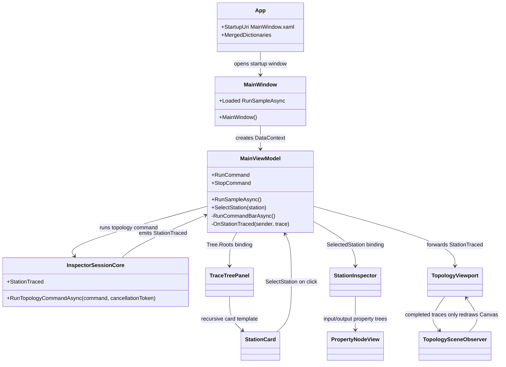

# LlmInspector

Documentation status: DInspector-B documented - parent review passed.

## Quick map

`LlmInspector` is a WPF application for viewing the traces that `LlmInspector.Core` collects. It opens a window with three zones: on the left a lightweight 2D topology scene, in the center a tree of station cards, on the right an inspector of the selected station with its input and output as a `PropertyNode` tree. The bottom panel builds simple topology commands and sends them through the `InspectorSession`.

Honest boundary: this is a UI shell over `LlmInspector.Core`, not an `ILearningMachine`, not trained logic, not proof of readiness of the product, plugin, or host runtime. A successful WPF render, a card tree, the RUN button, statuses, and XAML styles show observability and data shape, but not model quality, not checkpoint/manifest/locator, not fresh-load, and not IDE runtime integration.

## UML



## Connection simulations

| Connection | Example input | What happens | Expected result | What must not be asserted |
|---|---|---|---|---|
| `App -> MainWindow` | The user launches `LlmInspector.exe`. | WPF reads the `StartupUri` and merges the dictionaries of colors, typography, and controls. | A window with XAML markup and common styles opens. | This does not prove that all buttons work or a runtime host integration. |
| `MainWindow -> MainViewModel` | The window constructor finishes `InitializeComponent()`. | A `MainViewModel` is created, the `DataContext` is assigned, `RunSampleAsync` is hooked to `Loaded`. | The panels get a common view model; after loading, a small sample command starts. | The startup smoke is not a product e2e test. |
| `MainViewModel -> InspectorSession` | In the form `add domain` is selected, id `qa_automation`, RUN is pressed. | The ViewModel builds a typed command, creates a cancellation budget, and calls `RunTopologyCommandAsync`. | The core emits station traces; the status becomes `ok`, `error`, or `stopped`. | This is not training, not fresh-load, not a checkpoint, and not external AI integration. |
| `InspectorSession -> MainViewModel.OnStationTraced` | The core sent a start/completion trace. | The ViewModel counts the trace budget, calls `Tree.Upsert(trace)`, and forwards the `StationTraced` event. | The tree updates in the center, the viewport gets the same trace. | The card tree does not prove the truth of the business result. |
| `TraceTreePanel -> StationCard` | `Tree.Roots` contains a root orchestrator card. | The ItemsControl creates a recursive `StationCard`. | The user sees the chain of station cards. | The UI tree does not replace the tests of the source projects. |
| `StationCard -> MainViewModel.SelectStation` | The user clicks a nested card. | The handler stops the bubbling, takes the `StationCardViewModel`, and calls `SelectStation`. | The right panel gets a new `SelectedStation`. | Selecting a card does not re-execute the unit. |
| `StationInspector -> PropertyNodeView` | A completion station with input/output is selected. | XAML renders the station header and recursive property nodes. | The fields, values, and nested children are visible. | The property tree is not a semantic validator. |
| `TopologyViewport -> TopologySceneObserver` | A completion trace carries output with a `LogicalDomainEntry`. | The viewport ignores start traces, the observer applies the output to `GeneratedTopologyState` and redraws the Canvas. | A topology node appears in the left panel. | This is a deterministic projection, not a trainable topology model. |
| `Viewport buttons -> observer` | `OVERVIEW`, `OPEN ACTIVE`, `FIT` are pressed. | The buttons switch the detail mode or recompute the layout. | The Canvas is redrawn without a repeated core flow. | The buttons do not prove an interactive IDE plugin host. |

## No-code algorithms

### `App.xaml`: startup/resource load

Input: launching the WPF application. Output: `MainWindow` with attached resources. Algorithm: `Application` specifies `StartupUri="MainWindow.xaml"`, then merges three resource dictionaries: colors, typography, and control styles. This is a declarative XAML load, not a runtime UI check.

`LlmInspector/App.xaml:1-14`

```xml
<Application x:Class="LlmInspector.App"
             xmlns="http://schemas.microsoft.com/winfx/2006/xaml/presentation"
             xmlns:x="http://schemas.microsoft.com/winfx/2006/xaml"
             StartupUri="MainWindow.xaml">
    <Application.Resources>
        <ResourceDictionary>
            <ResourceDictionary.MergedDictionaries>
                <ResourceDictionary Source="Styles/Colors.xaml" />
                <ResourceDictionary Source="Styles/Typography.xaml" />
                <ResourceDictionary Source="Styles/Controls.xaml" />
            </ResourceDictionary.MergedDictionaries>
        </ResourceDictionary>
    </Application.Resources>
</Application>
```

### `MainWindow.MainWindow()`

Input: creating the WPF window. Output: a window with `DataContext = MainViewModel` and a startup sample hook. Algorithm: load the XAML, create the view model, assign the DataContext, after `Loaded` call `RunSampleAsync`.

`LlmInspector/MainWindow.xaml.cs:14-26`

```csharp
    public MainWindow()
    {
        InitializeComponent();

        // Create the view model that owns the inspector session and trace tree.
        var viewModel = new MainViewModel();

        // Bind the shell to the inspector view model.
        DataContext = viewModel;

        // Run the sample command after the window loads so the centre panel has live station data.
        Loaded += async (_, _) => await viewModel.RunSampleAsync();
    }
```

### `MainViewModel.MainViewModel()` and the bound surface

Input: creating the view model. Output: the RUN/STOP commands, the trace tree, the list of command types, the event stream for the viewport. Algorithm: create `InspectorCommand`s for run and stop, subscribe to `_session.StationTraced`, expose `Tree` for binding, expose `StationTraced` as a secondary event.

`LlmInspector/ViewModels/MainViewModel.cs:96-128`

```csharp
    // Create the view model and connect the session trace stream to the tree.
    public MainViewModel()
    {
        // Create the run command after fields have default values.
        _runCommand = new InspectorCommand(RunCommandBarAsync, () => !IsRunning);

        // Create the stop command after the run state exists.
        _stopCommand = new InspectorCommand(StopActiveRunAsync, () => IsRunning);

        // Subscribe once so every emitted trace updates the bound tree.
        _session.StationTraced += OnStationTraced;
    }

    // Tree is bound by the trace tree panel in the centre column.
    public StationTraceTree Tree { get; } = new();

    // CommandTypes lists the typed topology commands currently supported by the command bar.
    public IReadOnlyList<string> CommandTypes { get; } = ["add domain", "add phase", "add sub-phase", "add transition"];

    // PropertyChanged notifies the shell when bound values change.
    public event PropertyChangedEventHandler? PropertyChanged;

    // StationTraced forwards every raw trace event to secondary visual observers.
    public event EventHandler<StationTrace>? StationTraced;

    // RunCommand executes the command-bar mutation through the real inspector session.
    public ICommand RunCommand => _runCommand;

    // StopCommand cancels the currently active bounded run.
    public ICommand StopCommand => _stopCommand;

    // RunBudgetText shows the currently enforced bounded-run policy.
    public string RunBudgetText => $"budget {CommandRunTimeoutSeconds}s / {MaxTraceEventsPerRun} trace events";
```

### `MainViewModel.RunSampleAsync()`

Input: the window's `Loaded` event. Output: one bounded startup trace or the status `startup smoke stopped`. Algorithm: guard against a repeated run, create a deterministic `AddDomainCommand`, cancellation after 2 seconds, call `_session.RunTopologyCommandAsync`. This is a startup visual seed, not a full smoke gate.

`LlmInspector/ViewModels/MainViewModel.cs:338-371`

```csharp
    // RunSampleAsync executes one tiny topology command so startup stays bounded.
    public async Task RunSampleAsync()
    {
        // Do nothing when the sample has already been executed for this window.
        if (_sampleRunStarted)
            return;

        // Mark the sample as started before awaiting to avoid duplicate runs.
        _sampleRunStarted = true;

        // Build one deterministic add-domain command for the initial visual inspection.
        var command = new AddDomainCommand(
            new LogicalDomain(
                "technical_design",
                "Technical Design",
                "Owns technical design orchestration.",
                ["DECLARE"],
                ["STARTUP-SMOKE"]),
            "Startup smoke command.");

        try
        {
            // Create a short startup stopper so the inspector cannot hang during window opening.
            using var cancellation = new CancellationTokenSource(TimeSpan.FromSeconds(StartupRunTimeoutSeconds));

            // Execute one command only so the inspector opens without a heavy automatic trace run.
            _ = await _session.RunTopologyCommandAsync(command, cancellation.Token);
        }
        catch (OperationCanceledException)
        {
            // Keep the window open even if the startup smoke run exceeds its tiny budget.
            CommandStatus = "startup smoke stopped";
        }
    }
```

### `MainViewModel.RunCommandBarAsync()`

Input: the command bar fields and the RUN button. Output: trace events and `CommandStatus`. Algorithm: if a run is already in progress, exit; create a 3-second cancellation; reset the trace counter; set `IsRunning`; build a typed command; call the core session; select the status by trace budget, cancellation, success/error.

`LlmInspector/ViewModels/MainViewModel.cs:380-439`

```csharp
    // RunCommandBarAsync builds and executes one command from the footer fields.
    private async Task RunCommandBarAsync()
    {
        // Do nothing when another command is already running.
        if (IsRunning)
            return;

        // Create a bounded cancellation source for this one command-bar run.
        using var cancellation = new CancellationTokenSource(TimeSpan.FromSeconds(CommandRunTimeoutSeconds));

        // Store the active cancellation source so the Stop button can cancel it.
        _activeRunCancellation = cancellation;

        // Reset the trace counter for this bounded run.
        _activeRunTraceCount = 0;

        // Reset the trace-budget flag for this bounded run.
        _traceBudgetExceeded = false;

        // Mark the command as running before awaiting the session.
        IsRunning = true;

        // Display the real default flags applied by the current session path.
        AppliedFlagsText = BuildFlagSurface(new LogicalExecutionFlags());

        // Show that the command has started with its active budget.
        CommandStatus = "running " + SelectedCommandType + " (" + RunBudgetText + ")";

        try
        {
            // Build the typed topology command from the current form values.
            var command = BuildCommandFromForm();

            // Execute the typed command through the same traced runtime path as the sample.
            var result = await _session.RunTopologyCommandAsync(command, cancellation.Token);

            // Prefer the trace-budget status when that guard fired.
            if (_traceBudgetExceeded)
                CommandStatus = "stopped: trace budget";
            // Prefer the time/manual status when the cancellation source was requested.
            else if (cancellation.IsCancellationRequested)
                CommandStatus = "stopped: time or manual";
            // Store the visible command status after successful completion.
            else
                CommandStatus = result.IsSuccess ? "ok: " + result.Value!.OverallVerdict : "error: " + result.ErrorCode;
        }
        catch (OperationCanceledException)
        {
            // Show a bounded-run stop message when the session observes cancellation by throwing.
            CommandStatus = _traceBudgetExceeded ? "stopped: trace budget" : "stopped: time or manual";
        }
        finally
        {
            // Clear the active source so future Stop clicks do not touch a disposed source.
            _activeRunCancellation = null;

            // Mark the command as idle after the trace has been emitted or stopped.
            IsRunning = false;
        }
    }
```

### `MainViewModel.BuildCommandFromForm()`

Input: `SelectedCommandType` and the form fields. Output: one `LogicalTopologyCommand`. Algorithm: explicit branches for `add phase`, `add sub-phase`, `add transition`; an unknown value safely falls into `BuildAddDomainCommand`.

`LlmInspector/ViewModels/MainViewModel.cs:454-471`

```csharp
    // BuildCommandFromForm creates one typed topology command from the current footer fields.
    private LogicalTopologyCommand BuildCommandFromForm()
    {
        // Route to the add-phase builder when the selector asks for a phase.
        if (string.Equals(SelectedCommandType, "add phase", StringComparison.Ordinal))
            return BuildAddPhaseCommand();

        // Route to the add-sub-phase builder when the selector asks for a sub-phase.
        if (string.Equals(SelectedCommandType, "add sub-phase", StringComparison.Ordinal))
            return BuildAddSubPhaseCommand();

        // Route to the add-transition builder when the selector asks for a transition.
        if (string.Equals(SelectedCommandType, "add transition", StringComparison.Ordinal))
            return BuildAddTransitionCommand();

        // Default to add-domain so an unknown selector value still produces a safe topology mutation.
        return BuildAddDomainCommand();
    }
```

### `MainViewModel.OnStationTraced(object? sender, StationTrace trace)`

Input: a station trace from `LlmInspector.Core`. Output: an updated tree and an event for the viewport. Algorithm: during an explicit run it counts events, and when `MaxTraceEventsPerRun` is reached it cancels the active run, then always does `Tree.Upsert(trace)` and forwards the trace outward.

`LlmInspector/ViewModels/MainViewModel.cs:540-565`

```csharp
    // OnStationTraced applies each trace event to the bound tree.
    private void OnStationTraced(object? sender, StationTrace trace)
    {
        // Count traces only during explicit command-bar runs.
        if (IsRunning)
            _activeRunTraceCount++;

        // Stop the active run when the trace count exceeds the bounded-run guard.
        if (IsRunning && _activeRunTraceCount >= MaxTraceEventsPerRun)
        {
            // Record that the trace guard was the reason for stopping.
            _traceBudgetExceeded = true;

            // Request cancellation from the active run.
            _activeRunCancellation?.Cancel();

            // Surface the guard status immediately.
            CommandStatus = "stopping: trace budget";
        }

        // Upsert the trace so start and completion events share one card.
        Tree.Upsert(trace);

        // Forward the same trace to observers such as the topology viewport.
        StationTraced?.Invoke(this, trace);
    }
```

### `TraceTreePanel` and `StationCard`

Input: `Tree.Roots` from the view model. Output: the center of the window with recursive station cards. `TraceTreePanel.xaml` builds an `ItemsControl` over the root cards, and `StationCard.xaml.cs` selects a station in `MainViewModel` and does not let a nested click bubble to the parents.

`LlmInspector/Views/TraceTreePanel.xaml:6-17`

```xml
    <Border Style="{StaticResource EmptyPanel}">
        <ScrollViewer VerticalScrollBarVisibility="Auto"
                      HorizontalScrollBarVisibility="Disabled">
            <ItemsControl ItemsSource="{Binding Tree.Roots}">
                <ItemsControl.ItemTemplate>
                    <DataTemplate>
                        <views:StationCard />
                    </DataTemplate>
                </ItemsControl.ItemTemplate>
            </ItemsControl>
        </ScrollViewer>
    </Border>
```

`LlmInspector/Views/StationCard.xaml.cs:18-37`

```csharp
    // Card_Clicked selects this station for the right-side inspector panel.
    private void Card_Clicked(object sender, MouseButtonEventArgs e)
    {
        // Stop parent station cards from also handling this nested click.
        e.Handled = true;

        // Continue only when this control is bound to a station card.
        if (DataContext is not StationCardViewModel station)
            return;

        // Find the containing window so the click can reach the main view model.
        var window = Window.GetWindow(this);

        // Continue only when the window is bound to the inspector view model.
        if (window?.DataContext is not MainViewModel viewModel)
            return;

        // Select the clicked station in the main view model.
        viewModel.SelectStation(station);
    }
```

### `StationInspector` and `PropertyNodeView`

Input: `SelectedStation`. Output: the right panel with the station header, runtime/resource text, input tree, and output tree. `StationInspector.xaml` binds the station properties and renders each input/output node through the recursive `PropertyNodeView`. `PropertyNodeView` itself only projects `Name`, `Value`, and `Children`.

`LlmInspector/Views/StationInspector.xaml:43-70`

```xml
                <TextBlock Text="INPUT"
                           FontFamily="{StaticResource FontMono}"
                           FontSize="10"
                           Foreground="{StaticResource BrushTextTertiary}"
                           Margin="0,0,0,6" />
                <ItemsControl ItemsSource="{Binding Input}">
                    <ItemsControl.ItemTemplate>
                        <DataTemplate>
                            <views:PropertyNodeView />
                        </DataTemplate>
                    </ItemsControl.ItemTemplate>
                </ItemsControl>

                <Separator Margin="0,12,0,12"
                           Background="{StaticResource BrushBorder}" />

                <TextBlock Text="OUTPUT"
                           FontFamily="{StaticResource FontMono}"
                           FontSize="10"
                           Foreground="{StaticResource BrushTextTertiary}"
                           Margin="0,0,0,6" />
                <ItemsControl ItemsSource="{Binding Output}">
                    <ItemsControl.ItemTemplate>
                        <DataTemplate>
                            <views:PropertyNodeView />
                        </DataTemplate>
                    </ItemsControl.ItemTemplate>
                </ItemsControl>
```

`LlmInspector/Views/PropertyNodeView.xaml:12-34`

```xml
            <TextBlock Grid.Column="0"
                       Text="{Binding Name}"
                       FontFamily="{StaticResource FontMono}"
                       FontSize="10"
                       Foreground="{StaticResource BrushTextSecondary}"
                       TextTrimming="CharacterEllipsis" />

            <TextBlock Grid.Column="1"
                       Text="{Binding Value}"
                       FontFamily="{StaticResource FontMono}"
                       FontSize="10"
                       Foreground="{StaticResource BrushTextPrimary}"
                       TextWrapping="Wrap" />
        </Grid>

        <ItemsControl ItemsSource="{Binding Children}"
                      Margin="12,0,0,0">
            <ItemsControl.ItemTemplate>
                <DataTemplate>
                    <views:PropertyNodeView />
                </DataTemplate>
            </ItemsControl.ItemTemplate>
        </ItemsControl>
```

### `TopologyViewport` and `TopologySceneObserver`

Input: the raw station trace stream from `MainViewModel`. Output: Canvas shapes in the left panel. `TopologyViewport.AttachToViewModel()` subscribes to the view model, `OnStationTraced` lets only completed traces through, the observer applies them to `GeneratedTopologyState` and redraws the whole Canvas. The `OVERVIEW`, `OPEN ACTIVE`, `FIT` buttons switch detail visibility and layout without re-executing the core session.

`LlmInspector/Views/TopologyViewport.xaml.cs:71-105`

```csharp
    // AttachToViewModel subscribes to the active main view model exactly once.
    private void AttachToViewModel()
    {
        // Find the owning window.
        var window = Window.GetWindow(this);

        // Continue only when the window has the expected view model.
        if (window?.DataContext is not MainViewModel viewModel)
            return;

        // Do nothing when this control is already attached to the same view model.
        if (ReferenceEquals(_viewModel, viewModel))
            return;

        // Detach from any prior view model before switching.
        if (_viewModel is not null)
            _viewModel.StationTraced -= OnStationTraced;

        // Store the view model so it can be detached later.
        _viewModel = viewModel;

        // Subscribe to raw station traces for topology scene updates.
        _viewModel.StationTraced += OnStationTraced;
    }

    // OnStationTraced forwards completed traces to the scene observer.
    private void OnStationTraced(object? sender, StationTrace trace)
    {
        // Ignore start traces because topology nodes are generated from completed outputs.
        if (trace.CompletedAt is null)
            return;

        // Let the observer inspect the completed output for topology entries.
        _observer.OnTraceCompleted(trace);
    }
```

`LlmInspector/Inspector/TopologySceneObserver.cs:87-99`

```csharp
    // React to one completed station trace.
    public void OnTraceCompleted(StationTrace trace)
    {
        // Apply only completed generated output to the tested topology state.
        if (!_topology.ApplyTrace(trace))
            return;

        // Store the latest immutable snapshot for rendering.
        _snapshot = _topology.Snapshot();

        // Repaint the canvas from the tested generated topology state.
        RebuildScene();
    }
```

`LlmInspector/Views/TopologyViewport.xaml.cs:107-126`

```csharp
    // Overview_Click collapses generated topology to the domain-level overview.
    private void Overview_Click(object sender, RoutedEventArgs e)
    {
        // Ask the observer to hide generated phase, sub-phase, and transition details.
        _observer.ShowOverview();
    }

    // OpenActive_Click expands generated topology details that arrived from completed traces.
    private void OpenActive_Click(object sender, RoutedEventArgs e)
    {
        // Ask the observer to show generated phase, sub-phase, and transition details.
        _observer.ShowDetail();
    }

    // Fit_Click redraws the currently visible generated topology inside the viewport.
    private void Fit_Click(object sender, RoutedEventArgs e)
    {
        // Ask the observer to fit the lightweight scene inside the visible surface.
        _observer.FitScene();
    }
```

## QA/test mapping

The tests were found and cross-referenced, but not run in this documentation phase.

| Test file | What it confirms | Honest boundary |
|---|---|---|
| `Tests/LlmInspectorTracingTests.cs` | The core session emits orchestrator/flow/unit/storage traces and sample project 21/22/23 station roles. | This is core-level evidence, not WPF UI automation. |
| `Tests/LlmInspectorTraceTreeTests.cs` | `StationTraceTree` builds a parent/child chain, completion events update cards, station badge text maps kinds. | Does not check XAML rendering, click behavior in WPF, window layout. |
| `Tests/LlmInspectorGeneratedTopologyStateTests.cs` | Generated topology state attaches/buffers domain, phase, subphase, transition output. | Does not check Canvas rendering or user button clicks. |
| `Tests/LlmInspectorDataLayerTests.cs` | `PropertyNodeSerialiser` emits nested fields shown by the inspector. | Does not prove the semantic correctness of every possible object. |
| `Tests/LlmInspectorParallelWaveTests.cs` | Parallel wave grouping in core view models. | Does not prove WPF performance or full runtime concurrency. |
| `Tests/LlmInspectorTraceContextTests.cs` | Trace context isolation and restore. | Does not prove distributed tracing. |

There is no direct WPF UI automation/e2e test for `MainWindow`, `TraceTreePanel`, `TopologyViewport`, `StationInspector`, `StationCard`, or `PropertyNodeView` in the found inspector tests. This is a documentation gap: the code can be read and statically checked, but in this phase the UI was not run and not visually checked.

`Tests/LlmInspectorTraceTreeTests.cs:29-37`

```csharp
        // Feed all start and completion events through the upsert path.
        foreach (var trace in traces)
            tree.Upsert(trace);

        // The tree should have one root orchestrator.
        var root = Assert.Single(tree.Roots);

        // Completion events must update the root instead of adding a duplicate.
        Assert.False(root.IsRunning);
```

## Status and boundaries

| Component | Real status | Does not prove |
|---|---|---|
| `LlmInspector.csproj` | Windows WPF shell referencing `LlmInspector.Core` and `21.AgentInfrastructure`. | Not a separate model/runtime asset lifecycle. |
| `App.xaml`/styles | Declarative startup and visual resource load. | Not a UI scenario pass. |
| `MainWindow` | Three-panel shell plus command bar, bound to `MainViewModel`. | Not a plugin host or IDE integration. |
| `MainViewModel` | UI state, command construction, trace event handling, bounded cancellation. | Not training, not a semantic authority, not product readiness. |
| `TraceTreePanel`/`StationCard` | Recursive display and selection of station cards. | Not a re-execution of station logic. |
| `StationInspector`/`PropertyNodeView` | Display of the selected station's input/output property trees. | Not validation of business correctness. |
| `TopologyViewport`/`TopologySceneObserver` | Deterministic 2D Canvas projection from completed core traces. | Not a trainable graph model and not runtime topology learning. |

## Anti-false-done

- The WPF window, XAML layout, styles, and station cards are inspector UI infrastructure only.
- `LlmInspector` is not an `ILearningMachine`, not trained reasoning, not model readiness, and not product/plugin host runtime evidence.
- JSON/static docs/UI markup/Canvas rendering are not runtime completion by themselves.
- The startup sample and command-bar runs are bounded inspection flows, not end-to-end product gates.
- The `GeneratedTopologyState` projection and `TopologySceneObserver` drawing are deterministic helper logic; they must not be presented as semantic model training.
- The existing tests mostly cover `LlmInspector.Core` data/tracing behavior. They were read/mapped, not run, and they do not substitute for WPF UI automation.
