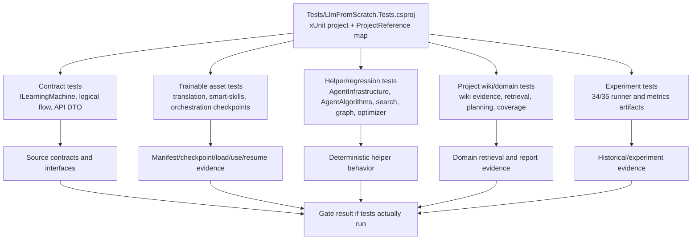

# Tests

Documentation status: DTests documented - parent review passed.

## Краткая карта

`Tests` - это xUnit-проект доказательной инфраструктуры. Он собирает проверки для контрактов, trainable asset lifecycle, доменных пайплайнов, deterministic helper-алгоритмов, экспериментальных раннеров и границ host/API. Этот документ не утверждает, что тесты были запущены в текущей документационной фазе: в DTests тесты только прочитаны и сопоставлены с тем, что они могут доказать.

Главная граница: наличие файла теста, статической проверки, JSON-отчета или smoke-артефакта не равно product readiness, model readiness, extension host runtime или завершению фазы. Доказательство появляется только тогда, когда активный gate действительно запускает нужный набор и сохраняет результат, соответствующий масштабу утверждения.

## UML



Легенда: стрелки показывают, какие виды исходного кода или артефактов тестовый проект может проверять. Они не означают, что проверка выполнена в DTests.

## Симуляции связей

| Связь | Пример входа | Что происходит | Ожидаемый результат | Что нельзя утверждать |
|---|---|---|---|---|
| `LlmFromScratch.Tests.csproj -> Contract tests` | `dotnet test` в полном gate, тест `LearningMachineContractsTests` | xUnit собирает проект и проверяет наличие типов `ILearningMachine`, `LearningBatch`, export/import контрактов | При реальном запуске gate может подтвердить форму контрактов | Нельзя утверждать, что конкретная модель обучена или работает в продукте |
| `Contract tests -> Source contracts` | `AllSevenContractTypesExistInCoreAssembly` | reflection читает assembly с `ILearningMachine<>` и ищет обязательные имена | Подтверждается наличие ожидаемых типов | Нельзя считать это asset lifecycle или semantic quality |
| `Trainable asset tests -> Manifest/checkpoint evidence` | `TranslationModelAsset_CheckpointContract_PreservesTrainedStateWithoutPrivatePaths` | тест обучает временную `TranslationMachine`, сохраняет checkpoint, загружает его и делает перевод | При запуске доказывает узкий save/load/use сценарий для synthetic fixture | Не доказывает held-out product quality или пригодность всех переводов |
| `Smart-skills tests -> SemanticQualityClaimed boundary` | `SkillSelectionMachine_ExportAsyncImportAsync_RoundTripsStoredCheckpointFiles` | тест смотрит manifest/checkpoint и проверяет `SemanticQualityClaimed=false` | Доказывает, что scaffold/partial state не заявляет semantic-quality completion | Не доказывает Claude/Cursor/Codex host runtime |
| `Project wiki tests -> Retrieval and coverage` | вопрос про `OrderController.BuildOrder` | generated wiki evidence загружается в retriever, ответ должен ссылаться на `BuildOrder` и lexical evidence | Проверяется локальная wiki/evidence цепочка на synthetic project | Не доказывает production plugin invocation или универсальную генерализацию |
| `Helper tests -> Deterministic behavior` | `PermissionGate_ExternalAiCall_RequiresApproval` | helper получает tool name и аргументы, возвращает `RequiresApproval` | Проверяется deterministic permission rule | Нельзя выдавать это за согласие Luba или external AI approval |
| `Experiment tests -> Runner evidence` | `DatasetLoader_WithCsFiles_ReturnsContents` | временный проект с `.cs` файлами передается в loader | Проверяется чтение synthetic files и исключения/ветки loader | Не доказывает product readiness, model checkpoint или promotion |
| `Gate result -> Completion claim` | сохраненный результат тестового запуска | gate должен записать факт запуска, passed/failed, scope, commit/ref | Только этот результат может поддержать claim о пройденном gate | Файл теста без запуска не является completion evidence |

## Алгоритмы без кода

### 1. Test project wiring

- Где живет: `Tests/LlmFromScratch.Tests.csproj`.
- Логика: MSBuild-проект с `TargetFramework=net9.0`, пакетами `xunit`, `Microsoft.NET.Test.Sdk`, `coverlet.collector` и множеством `ProjectReference`.
- Вход: команда тестового runner-а, если она разрешена активным gate.
- Выход: test assembly, который может запускать классы из `Tests/*.cs`.
- Ветви: если project reference не компилируется, test assembly не собирается; если build/test не запускался, DTests не получает runtime evidence.
- Не делает: сам `.csproj` не доказывает, что тесты прошли.

`Tests/LlmFromScratch.Tests.csproj:1-18`

```xml
<Project Sdk="Microsoft.NET.Sdk">

  <PropertyGroup>
    <TargetFramework>net9.0</TargetFramework>
    <ImplicitUsings>enable</ImplicitUsings>
    <Nullable>enable</Nullable>
    <IsPackable>false</IsPackable>
  </PropertyGroup>

  <ItemGroup>
    <PackageReference Include="coverlet.collector" Version="6.0.2" />
    <PackageReference Include="Microsoft.NET.Test.Sdk" Version="17.12.0" />
    <PackageReference Include="xunit" Version="2.9.2" />
    <PackageReference Include="xunit.runner.visualstudio" Version="2.8.2" />
  </ItemGroup>

  <ItemGroup>
    <Using Include="Xunit" />
```

Эта цитата доказывает только xUnit/test SDK wiring. Она не доказывает, что тесты запускались в DTests.

### 1a. Как тесты выбирают dotnet для дочернего процесса

Некоторые тесты проверяют настоящий межпроцессный контракт: родительский тест
держит ресурс, дочерний процесс пытается войти в тот же ресурс, затем родитель
проверяет блокировку и восстановление после выхода ребёнка. Такие проверки
должны запускать ребёнка через тот же семейный `dotnet` host, которым запущен
текущий gate, а не через случайную пользовательскую установку в профиле.

Практический смысл: если дочерний процесс стартует через другой patch-runtime,
он может упасть до входа в проверяемый код. Тогда тест доказывает только
проблему окружения, а не эксклюзивность lease, lock или publication contract.
Поэтому child-process helpers сначала уважают явно заданный host из окружения,
а при его отсутствии используют обычный `dotnet` из `PATH`.

### 1b. Как проверяется длина имени на разных платформах

Проверка handle-bound хранилища не переносит ограничение Linux на Windows.
Активный Windows-тест создаёт файл с именем из 86 китайских символов, находит
его через перечисление закреплённого каталога и читает исходные байты. Активный
Linux-тест передаёт то же имя в production-метод создания и ожидает отказ,
потому что UTF-8 представление занимает 258 байт и превышает Linux `NAME_MAX`
в 255 байт. Отдельная проверка парсера по-прежнему запрещает встроенный NUL на
обеих платформах.

### 1c. Как тесты владеют временным каталогом вывода

`TestOwnedOutputRoot` выдаёт тесту отдельный временный каталог вне репозитория и
после тела теста удаляет только этот каталог. На Windows helper сохраняет
сильную гарантию: каждый каталог обхода открывается через native handle без
следования reparse point и без `FileShare.Delete`, поэтому проверка
`Cleanup_NestedTraversalLease_BlocksRenameBeforeEnumeration` доказывает, что
каталог нельзя переименовать прямо во время cleanup.

На Linux и macOS нет такой же обязательной no-delete-share семантики, поэтому
helper использует другую, честно более узкую гарантию: каталог открывается через
native `open` с флагами `O_DIRECTORY`, `O_NOFOLLOW`, `O_CLOEXEC`, затем берётся
advisory `flock`. Это заставляет cleanup падать закрыто, если финальный компонент
пути стал символической ссылкой, и не даёт helper-у рекурсивно уйти во внешний
target. Unix-тест с внешним sentinel-файлом проверяет именно это: ссылка внутри
test-owned каталога удаляется как ссылка, а внешний каталог и его файл остаются
нетронутыми.

### 1d. Как тесты проверяют Linux/WSL durable storage для DesignConversion

Focused tests вокруг `DesignConversionHandleBoundDirectory` проверяют не общий
Unix-миф, а конкретную Linux/WSL гарантию production-кода. Положительный тест
создаёт файл через защищённую папку, читает его обратно, перечисляет через
удержанный mutation-lock, доказывает, что второй exclusive lease блокируется,
и удаляет файл через identity-bound delete. Отрицательные тесты проверяют три
важные аварийные ситуации: symbolic link вместо leaf-файла не открывается и не
трогает внешний target; уже открытая корневая папка остаётся привязанной к
старому directory fd даже после path swap; публикация с требованием “destination
должен отсутствовать” не перезаписывает внезапно появившийся чужой файл.

Отдельная Linux race-проверка покрывает более тонкий случай с уже существующим
state: публикация сначала переносит проверенный старый destination в
`.publication-backup`, затем тест обычным `File.Move` кладёт чужой файл на
освободившееся имя, после чего публикация обязана упасть с trust/collision
ошибкой. Проверка требует, чтобы чужой destination остался нетронутым, старый
state сохранился в backup, а наш temp исчез. Следующая проверка чтения обязана
увидеть этот backup как задачу для ручной сверки, а не как разрешение
автоматически восстановить старый state. Windows-проверки при этом остаются
сильнее: там внешний rename/delete должен быть заблокирован удержанным handle.

Группа `CandidatePayloadCustodyStore` отдельно проверяет Linux/WSL-хранение
служебных секретов материала кандидата. Положительный тест прогоняет точный круговой путь
UTF-8 через подготовку, `Commit` и `Resolve`, а тест `Reconcile` доказывает, что
сбой между подготовкой и `Commit` не превращается в потерю записи полномочий.
Отрицательные Linux-проверки создают символическую ссылку и каталог на месте
конечного имени в `stage` или `committed`, добавляют лишнюю жёсткую ссылку к
подготовленному конверту и устраивают столкновение на целевом имени прямо перед
межкаталожным `Commit`. Во всех этих случаях продуктовый код обязан не идти по
строковому пути, а работать через удержанные файловые дескрипторы каталогов;
чужая цель, каталог, жёсткая ссылка или целевой файл сохраняются, а операция
возвращает безопасный отказ хранилища. Windows-семантика здесь не подменена
Linux-тестом: старые Windows-проверки запрета переходов и ACL остаются на
`SecureLocalFileBoundary`, а новые проверки включаются только на Linux/WSL x64.
Широкий WSL-прогон также проходит через `.codex-test-temp` на Windows-диске; это
отдельно ловит v9fs-случай, где права и числовой владелец POSIX не являются
доказательством владения «только владельцу», но файловая личность, открытие без
следования ссылкам и счётчик жёстких ссылок всё равно проверяются. Перед фиксом
отдельная проба на `/mnt/c` показала, что `chmod` остаётся видимым как
`0777 uid=0`, `renameat2(RENAME_NOREPLACE)` возвращает `EINVAL`, зато `linkat`
между удержанными каталогами создаёт ссылку, столкновение возвращает `EEXIST`, а
после `unlinkat` исходного имени готовый файл снова имеет одну ссылку.

Текущий post-evaluation state-store slice добавляет проверку same-directory
v9fs publication. Тесты не требуют POSIX owner-only privacy на `/mnt/c`; они
проверяют retained directory handle, no-overwrite через `linkat`, identity и
link-count до/после `unlinkat`, durable directory flush, rejection чужого
destination, hardlinked temp и symlink/directory entries. Отдельный тест
покрывает Linux `NAME_MAX`: многобайтовое leaf-имя отклоняется как входная
validation до syscall, а Windows UTF-16 поведение этим не меняется. Ещё один
regression test проверяет name-only quota preflight: превышение persisted
state/backup лимита должно остановиться до открытия лишнего leaf handle и до
recovery.

Свежая evidence для этих WSL slices: точечная current isolated проверка Linux
UTF-8 validation прошла 1 из 1, а полный класс
`DesignConversionPostEvaluationStateStoreTests` прошёл 122 из 122 в WSL Ubuntu
24.04 на net9. После отдельного training-intake pair-store slice финальный
combined WSL run прошёл 11 из 11: resolver 7 из 7, host integration 3 из 3 и
exact `ConcurrentCorpusReplay_AllowsExactlyOneMachineMutation` 1 из 1 с
нативным state root под явным `XDG_STATE_HOME` и пустым legacy in-artifact pair
directory. Windows after-core run выполнил 4 из 11 найденных строк: 3 прошли, 1
exact concurrent corpus replay упал, 7 WSL-only строк были skipped. Regression
harness по пяти DPO/pair-store семействам дал 142 passed из 155 executed, а три
выбранных отказа совпали с base control. Поэтому этот раздел заявляет только
focused WSL result, а не full corpus/pair-store-family green.

Журнал локального продвижения добавляет отдельную пару тестов на границу
NTFS alternate data streams. Linux-тест проходит через публичную запись и
чтение журнала и доказывает, что после проверок обычного leaf-файла,
`device+inode` и link-count код не пытается загрузить `kernel32.dll`.
Windows-тест создаёт чужой alternate stream на файле журнала, требует
fail-closed отказ и отдельно проверяет, что основные байты файла не
переписаны.

Диагностика inventory тоже тестируется как пользовательский текст, а не как
дамп каталога: строка `Observed:` содержит общее число файлов, имена
отсутствующих удержанных файлов и несколько коротко обрезанных примеров без
сырого NUL или управляющих символов. Это нужно, чтобы ошибка помогала
разобраться человеку и не превращалась в тысячи имён из временного каталога.

Эти тесты не заявляют, что macOS поддержан. Если macOS-дескрипторы,
identity-структура и atomic no-overwrite primitive не реализованы отдельно,
production-код обязан падать закрыто и документация называет поддержку именно
Linux/WSL.

### 1e. Как тесты проверяют личность файла контрольной точки и блокировку DPO

Отдельная группа проверяет две разные гарантии. Первая — служебный файл
блокировки на Linux/WSL x64: он переживает освобождение, повторное открытие
возвращает тот же номер устройства и файлового объекта (`device+inode`), второй
независимый дескриптор с настоящей системной блокировкой `flock` блокируется во
время шага и успешно получает блокировку после освобождения. Тест не
использует `FileStream.Lock` внутри одного процесса как доказательство Linux
конкуренции. Символическая ссылка, жёсткая ссылка и каталог на месте служебного
файла отвергаются и сохраняются. Windows по-прежнему проверяет исчезновение
своего временного файла блокировки после закрытия дескриптора.

Вторая гарантия — сохранение владения файлами моста. Для Linux временные и
финальные файлы остаются
открытыми до успеха или cleanup. Перед `unlinkat` имя повторно открывается через
удержанный дескриптор родительского каталога и сравнивается с физической
личностью давно удерживаемого файла. Если
каталог переименован, Linux не притворяется Windows: операция падает закрыто,
а новый чужой каталог остаётся на диске. Новый regression-тест также проверяет
старый lease без удержанных потоков: на Linux оба файла остаются на диске как
долг очистки, потому что удаление по имени, hash и старому `device+inode` не
доказывает владение после закрытия дескрипторов. Структура `stat` проверена
только на x64; Linux arm64, macOS и неизвестная система обязаны безопасно отказать.

Фактические результаты этого слайса после защиты unretained cleanup: прежние
три красные Linux-проверки — 3 из 3; группа checkpoint identity — 6 из 6;
группа повышенного сигнала — 9 из 9; широкий Linux-набор вокруг DPO-блокировки,
удержанных файлов и durable storage — 36 из 36. Это не полный прогон всей
системы и не доказательство качества обученной модели.

### 2. Contract reflection pattern

- Класс/метод: `LearningMachineContractsTests.AllSevenContractTypesExistInCoreAssembly()`.
- Параметры: нет; Arrange получает assembly через `typeof(ILearningMachine<>).Assembly`.
- Act: собирает `typeNames`.
- Assert: проверяет обязательные contract record/interface names.
- Ветви: если тип отсутствует, assertion падает; если тип есть, это все еще только форма API.
- Не делает: не обучает модель, не проверяет checkpoint, не запускает runtime host.

`Tests/LearningMachineContractsTests.cs:20-36`

```csharp
    public void AllSevenContractTypesExistInCoreAssembly()
    {
        // Obtain the assembly that contains the ILearningMachine type.
        var coreAssembly = typeof(ILearningMachine<>).Assembly;

        // Collect all type names from the Core assembly for assertion.
        var typeNames = coreAssembly.GetTypes()
            .Select(t => t.Name)
            .ToHashSet();

        // Each assertion verifies one required contract name from TD3 spec.
        Assert.Contains("ILearningMachine`1",          typeNames); // ILearningMachine<TDomain>
        Assert.Contains("ILearningMachinePair`2",       typeNames); // ILearningMachinePair<TPersonal,TGlobal>
        Assert.Contains("LearningBatch`1",              typeNames); // LearningBatch<TDomain>
        Assert.Contains("LearningBatchResult",          typeNames); // plain record
        Assert.Contains("LearningEvaluationSet`1",      typeNames); // LearningEvaluationSet<TDomain>
        Assert.Contains("LearningEvaluationResult",     typeNames); // plain record
```

Цитата важна потому, что показывает reflection-based contract gate. Она не говорит, что какой-либо `ILearningMachine` является готовым продуктовым asset.

### 3. Translation asset lifecycle fixture

- Класс/метод: `TranslationModelAssetTests.TranslationModelAsset_CheckpointContract_PreservesTrainedStateWithoutPrivatePaths()`.
- Параметры: нет; Arrange создает temp root, `TranslationMachine`, synthetic `TranslationLearningBatch`.
- Act: `TrainStructuredBatchAsync`, `SaveCheckpointAsync`, `LoadCheckpointAsync`, затем `RunTranslationAsync`.
- Assert: checkpoint содержит trainable sections, не содержит private paths, fresh loaded machine отвечает на fixture.
- Ветви: train/save/load могут вернуть failed `OperationResult`; private path проверяется через `Assert.DoesNotContain`.
- Не делает: это synthetic fixture, не полная оценка качества переводов.

`Tests/TranslationModelAssetTests.cs:75-92`

```csharp
            var save = await machine.SaveCheckpointAsync(checkpointPath);
            Assert.True(save.IsSuccess, save.ErrorMessage);
            Assert.Equal("translation-v1-checkpoint.json", Path.GetFileName(checkpointPath));

            var json = await File.ReadAllTextAsync(checkpointPath);
            Assert.DoesNotContain("private-corpora", json, StringComparison.OrdinalIgnoreCase);
            Assert.DoesNotContain("C:\\Users\\", json, StringComparison.OrdinalIgnoreCase);
            Assert.Contains("\"knn_store\"", json);
            Assert.Contains("\"semantic_tokenizer\"", json);
            Assert.Contains("\"executors\"", json);
            Assert.Contains("\"quality_verifier\"", json);
            Assert.Contains("\"training_history\"", json);

            var checkpoint = JsonSerializer.Deserialize<TranslationMachineCheckpoint>(
                json,
                TranslationCheckpointJsonOptions.Standard);
            Assert.NotNull(checkpoint);
            Assert.True(checkpoint!.HasStructuredTraining);
```

Цитата показывает asset lifecycle evidence scope: checkpoint sections и private-path firewall. Это не held-out quality gate.

### 4. Orchestration plan grounding and anti-determinism

- Класс/метод: `OrchestrationPlanTests.OrchestrationPlan_Fixture_Flow33UsesLearnedGrounding()`.
- Параметры: нет; Arrange/Act вызывает temp loop report через `RunTempLoopAsync`.
- Assert: fixture `flow 33` должен пройти с `GenerationRouteMode.LearnedFlowGrounding`.
- Ветви: соседние тесты проверяют untrained fallback, export/import survival, ablation degradation, exact prompt leakage failure.
- Не делает: не делает `FlowReferenceDetector` runtime model; в тестах отдельно есть `NoRuntimeFlowReferenceDetectorUsage`.

`Tests/OrchestrationPlanTests.cs:180-184`

```csharp
    public async Task OrchestrationPlan_Fixture_Flow33UsesLearnedGrounding()
    {
        var report = await RunTempLoopAsync(requireResume: false);
        Assert.Contains(report.FixtureResults, row => row.Fixture == "flow 33" && row.Passed && row.RouteMode == GenerationRouteMode.LearnedFlowGrounding);
    }
```

Эта цитата доказывает намерение gate-а проверять learned grounding в fixture. Она не заменяет запуск самого gate-а в текущей фазе.

### 5. Smart-skills API and semantic-quality boundary

- Класс/метод: `SkillSelectionMachineTests.SkillSelectionMachine_ExportAsyncImportAsync_RoundTripsStoredCheckpointFiles()`.
- Параметры: нет; Arrange создает `SkillSelectionRequest`, chosen/rejected decisions, temp persistence directory.
- Act: train/export/import/load checkpoint.
- Assert: checkpoint/manifest существуют, raw prompt не попадает в checkpoint, `SemanticQualityClaimed` остается false.
- Ветви: separate tests проверяют scaffold-only candidate-position и held-out prompt sections.
- Не делает: не доказывает, что extension host реально вызвал Claude/Cursor/Codex UI.

`Tests/SkillSelectionMachineTests.cs:88-108`

```csharp
            Assert.DoesNotContain(request.Prompt, checkpointJson, StringComparison.Ordinal);
            Assert.Contains("trainedPromptKeys", checkpointJson, StringComparison.Ordinal);
            Assert.Contains("promptUnderstanding", checkpointJson, StringComparison.Ordinal);
            Assert.Contains("taskUnderstanding", checkpointJson, StringComparison.Ordinal);
            Assert.Contains("taskType", checkpointJson, StringComparison.Ordinal);
            Assert.Contains("routing", checkpointJson, StringComparison.Ordinal);
            Assert.Contains("skillCandidates", checkpointJson, StringComparison.Ordinal);
            Assert.Contains("skillSelection", checkpointJson, StringComparison.Ordinal);
            Assert.Contains("promptContext", checkpointJson, StringComparison.Ordinal);
            Assert.Contains("resultGap", checkpointJson, StringComparison.Ordinal);
            Assert.Contains("outputValidation", checkpointJson, StringComparison.Ordinal);
            Assert.Contains("taskCompletion", checkpointJson, StringComparison.Ordinal);
            Assert.Contains("intermediateChecks", checkpointJson, StringComparison.Ordinal);

            var manifest = JsonSerializer.Deserialize<SkillSelectionCheckpointManifest>(
                await File.ReadAllTextAsync(export.ManifestRef),
                new JsonSerializerOptions(JsonSerializerDefaults.Web));
            Assert.NotNull(manifest);
            Assert.Equal(export.CheckpointRef, manifest!.CheckpointRef);
            Assert.Equal(export.ManifestRef, manifest.ManifestRef);
            Assert.False(manifest.SemanticQualityClaimed);
```

Цитата показывает важную границу: persisted learned-state может существовать, но manifest явно не заявляет semantic-quality completion.

### 6. Extension API contracts as thin-client boundary

- Класс/метод: `XiigenExtensionApiContractsTests.XiigenExtensionApiContract_DefinesExactlyFiveMethodContracts()`.
- Параметры: нет; Arrange вызывает `XiigenExtensionApiContract.GetMethodContracts()`.
- Act/Assert: проверяет список methods, allowed/forbidden payloads, boundary rules.
- Ветви: debug trace tests suppress raw private/secret payloads; invalid request tests возвращают errors.
- Не делает: не доказывает реальный host runtime или external AI execution.

`Tests/XiigenExtensionApiContractsTests.cs:155-165`

```csharp
        Assert.All(contracts, contract =>
        {
            Assert.NotEmpty(contract.AllowedRequestFields);
            Assert.NotEmpty(contract.AllowedResponseFields);
            Assert.Contains("model_internals", contract.ForbiddenPayloads);
            Assert.Contains("raw_corpus_data", contract.ForbiddenPayloads);
            Assert.Contains("host_side_training_logic", contract.ForbiddenPayloads);
            Assert.Contains("external_ai_call", contract.ForbiddenPayloads);
            Assert.Contains("host_runtime_claim", contract.ForbiddenPayloads);
            Assert.Contains("no_model_internals_or_corpus_rows_in_response", contract.BoundaryRules);
        });
```

Это contract-level guard, а не IDE extension host evidence.

### 7. Deterministic helper and approval boundary tests

- Класс/метод: `AgentInfrastructureTests.InternalLlmGateway_CodeQDomain_LoadsCodeQuestionAdapter()`.
- Параметры: нет; Arrange использует fake registry и scripted LLM response.
- Act: `InternalLlmGateway.SendAsync(string prompt)`.
- Assert: routing selects `InternalModelDomain.CodeQ` и `code_q.lora`.
- Ветви: соседние тесты проверяют bug/generic fallback, registry miss, no external AI call, permission gate.
- Не делает: scripted fake response и adapter path не являются доказательством model quality.

`Tests/AgentInfrastructureTests.cs:240-251`

```csharp
    public async Task InternalLlmGateway_CodeQDomain_LoadsCodeQuestionAdapter()
    {
        var registry = FullRegistry();
        var llm = new ScriptedLlmClient([new LlmResponse("internal code question answer", null, null)]);
        var gateway = new InternalLlmGateway(llm, registry);

        var result = await gateway.SendAsync("What does BpeTokenizer.Encode return for an empty string?");

        Assert.True(result.IsSuccess, result.ErrorMessage);
        Assert.Equal(InternalModelDomain.CodeQ, result.Value!.Domain);
        Assert.Equal("code_q.lora", result.Value.AdapterPath);
        Assert.NotEmpty(result.Value.Response);
```

Эта проверка полезна для wiring, но не является approval на external AI и не подтверждает качество ответа модели.

### 8. Project wiki evidence path

- Класс/метод: `ProjectWikiDomainTests.DocumentationOrchestrator_GeneratesWikiDomainEvidenceRelationsAndQuestions()`.
- Параметры: нет; Arrange создает synthetic .NET project and wiki root.
- Act: `DocumentationOrchestrator.GenerateAsync(...)`, затем `AskAsync(ProjectWikiQuestionRequest)`.
- Assert: answer contains expected evidence id, text answer includes called function, retrieval mode lexical.
- Ветви: отдельные tests проверяют runner missing, existing generated wikis when present, validation runner.
- Не делает: не доказывает production host invocation или semantic retriever availability.

`Tests/ProjectWikiDomainTests.cs:59-74`

```csharp
            generated.Value.ProjectId,
            "What does OrderController.BuildOrder do and which functions does it call?",
            wikiRoot,
            generated.Value.DocumentationVersion,
            TopK: 5,
            AllowSemantic: false));

        Assert.True(answer.IsSuccess, answer.ErrorMessage);
        Assert.Contains(answer.Value!.EvidenceIds, id => id.Contains("BuildOrder", StringComparison.Ordinal));
        Assert.Contains("OrderService.CalculateTotal", answer.Value.Answer);
        Assert.Equal(ProjectWikiRetrievalMode.Mode3LexicalEvidence, answer.Value.RetrievalMode);

        var coverage = await new ProjectWikiCoverageVerifier().VerifyAsync(generated.Value.ProjectId, wikiRoot);
        Assert.True(coverage.IsSuccess, coverage.ErrorMessage);
        Assert.True(coverage.Value!.IsPassed, string.Join("; ", coverage.Value.Failures));
        Assert.Equal(1.0, coverage.Value.ExactEvidenceAccuracy);
```

Цитата показывает local wiki retrieval/coverage assertions, но не runtime plugin readiness.

### 9. Experiment infrastructure tests

- Класс/метод: `ExperimentsV2InfraTests.DatasetLoader_WithCsFiles_ReturnsContents()`.
- Параметры: нет; Arrange создает temp root and `.cs` files.
- Act: `DatasetLoader.Load(int tier, string projectRoot)`.
- Assert: loader возвращает file count, tier и combined text.
- Ветви: missing root, empty root, obj exclusion, tier3 folder selection.
- Не делает: не производит product-ready result; experiment outputs are evidence artifacts only.

`Tests/ExperimentsV2InfraTests.cs:35-50`

```csharp
    [Fact]
    public void DatasetLoader_WithCsFiles_ReturnsContents()
    {
        string tmpRoot   = Path.Combine(Path.GetTempPath(), "dl_cs_" + Guid.NewGuid());
        string tokenizer = Path.Combine(tmpRoot, "01.Tokenizer");
        Directory.CreateDirectory(tokenizer);
        File.WriteAllText(Path.Combine(tokenizer, "Foo.cs"), "public class Foo {}");
        File.WriteAllText(Path.Combine(tokenizer, "Bar.cs"), "public class Bar {}");
        try
        {
            var r = DatasetLoader.Load(1, tmpRoot);
            Assert.True(r.IsSuccess, r.ErrorMessage);
            Assert.Equal(2, r.Value!.FileCount);
            Assert.Equal(1, r.Value.Tier);
            Assert.Contains("Foo", r.Value.CombinedText);
        }
```

Эта цитата доказывает только synthetic dataset loader behavior.

## Карта QA / тестовых кластеров

| Кластер | Представительные файлы | Что может доказать при запуске | Что не доказывает |
|---|---|---|---|
| Learning contracts | `LearningMachineContractsTests.cs`, `LogicalFlowContractTests.cs` | форма интерфейсов, separation of execution/training, stub implementability | что есть готовая обученная модель |
| Translation/trainable assets | `TranslationDomainTests.cs`, `TranslationModelAssetTests.cs` | synthetic train/save/load/use, manifest/checkpoint schema, private path firewall | held-out product quality для всех данных |
| Orchestration/project wiki | `OrchestrationPlanTests.cs`, `ProjectWikiDomainTests.cs` | learned grounding fixtures, corpus audit, local wiki retrieval, coverage verifier | production plugin host invocation или universal semantic correctness |
| Smart-skills/extension contracts | `SkillSelectionMachineTests.cs`, `PromptToTask*Tests.cs`, `OrchestrationReasoning*Tests.cs`, `ResultGap*Tests.cs`, `XiigenExtensionApiContractsTests.cs` | checkpoint/manifest boundaries, skeleton/partial statuses, thin-client API contract | Claude/Cursor/Codex runtime integration |
| Agent helpers | `AgentInfrastructureTests.cs`, `AgentAlgorithmsTests.cs` | deterministic routing, permission, context, tool registry, decomposition behavior | trained semantic authority |
| Experiments | `ExperimentsTests.cs`, `ExperimentsV2Tests.cs`, `ExperimentsV2InfraTests.cs` | experiment runner/math/helper behavior on synthetic data | product readiness или promotion без active gate |
| Retrieval/search/graph/base stack | `VectorSearchTests.cs`, `SearchEngineTests.cs`, `GraphEngineTests.cs`, `TokenizerTests.cs`, `CompressionTests.cs` | algorithmic helper correctness and edge cases | trainable reasoning |
| DPO/LoRA/capability/model server | `Dpo*Tests.cs`, `LoraTests.cs`, `Capability*Tests.cs`, `DistributedModelArchitectureTests.cs` | infrastructure and manifest/proxy behavior | full model quality unless gate includes runtime/held-out evidence |

## Проверки пачечного утверждения кандидатов Design-to-Code

Этот кусок закрывает узкую проблему производительности и атомарности:
утверждение 200 runtime-кандидатов больше не должно переписывать локальный
authority-журнал сотни раз. Проверки не уменьшают исходный датасет длинного
сценария: остаются 100 source-пар и 200 кандидатов, но последние 196 утверждений
идут через публичный batch-путь.

| Проверка | Что доказывает | Где лежит свежий отчёт |
|---|---|---|
| Пять исходных целевых storage-регрессий пачечного утверждения и быстрого индексного чтения | Успешная пачка даёт одну перепись журнала; плохой запрос и дубликат не мутируют кандидатов; trusted index возвращает тот же смысл фильтра, что и полный scan | `TestResults/artifact-db-batch-approval-d8f9761/storage-focused/storage-focused.trx` |
| Точная совместимость отмены одиночного вызова | Уже отменённый вызов с пустыми аргументами возвращает прежний структурированный результат `CANCELLED` и безопасное сообщение, не выбрасывает исключение и не создаёт журнал. Результат — 1 из 1 за 8,016 секунды | `TestResults/artifact-db-batch-approval-d8f9761/final-cancellation-result/artifact-db-single-cancellation-final.trx` |
| Восемь итоговых storage-регрессий после восстановления совместимости | Отмена после commit не превращается в ложный отказ; одиночная отмена сохраняет прежний результат; предел 256 КиБ учитывает точные UTF-8 байты, `null` и Unicode без мутации; атомарность, дубликаты и быстрый индекс не изменились. Результат — 8 из 8 за 15,486 секунды | `TestResults/artifact-db-batch-approval-d8f9761/final-needsfix-focused/artifact-db-batch-final-needsfix.trx` |
| Длинный review-only improvement-loop на окончательном коде | 100 source-пар и 200 кандидатов проходят прежние assertions; пачка из 196 утверждений даёт одну authority-перепись и не висит. Результат — 1 из 1 за 65,902 секунды | `TestResults/artifact-db-batch-approval-d8f9761/long-needsfix-final/artifact-db-batch-long-needsfix.trx` |
| Предыдущий независимый повтор длинного сценария | Ещё один запуск тех же 100 source-пар и 200 кандидатов до точечной правки только отменённого одиночного входа завершился 1 из 1 за 67,482 секунды; горячий пачечный путь в последующей правке не менялся | `TestResults/artifact-db-batch-approval-d8f9761/long-256k-2/artifact-db-batch-long-256k-2.trx` |
| Source-isolated verifier на окончательных байтах кода | 6 из 6 сценариев за 17,872 секунды через реальный публичный API и реальный JSON state-store: 100 записей и 200 утверждений используют ровно один внешний снимок состояния и одну атомарную перепись; манифест отдельно и честно сообщает, что файловые чтения не инструментированы, а реализация ограничивает authority-журнал одним начальным scan и не более чем одним согласующим scan после commit; плохой запрос и дубликат не меняют журнал; граница 256 КиБ, Unicode и `null` проверяются до мутации; отмена до commit сохраняет старый hash, а после commit возвращает успех с отложенным ремонтом; слишком большая строка отвергается и при append, и при rewrite; уже отменённый одиночный вызов возвращает прежний структурированный результат `CANCELLED` | `TestResults/artifact-db-batch-approval-d8f9761/source-isolated-verifier/verifier-manifest.json`, `TestResults/artifact-db-batch-approval-d8f9761/source-isolated-verifier/verifier-run.log` |
| Отрицательная проверка защиты от повторных чтений | Временный возврат чтения состояния по одной записи заставил проверку упасть: вместо одного снимка было 100 чтений. После этого мутация удалена и финальный verifier снова прошёл 6 из 6 | `TestResults/artifact-db-batch-approval-d8f9761/source-isolated-verifier/mutation-per-item-read-red-manifest.json`, `TestResults/artifact-db-batch-approval-d8f9761/source-isolated-verifier/mutation-per-item-read-red.log` |
| WSL `/mnt/c` post-evaluation state-store current isolated | Same-directory v9fs fallback сохраняет no-overwrite через `linkat` + `unlinkat`, recovery принимает только exact same identity temp, Linux UTF-8 NAME_MAX остаётся input validation, а name-only quota preflight останавливает превышение до лишнего leaf open. Точечная validation прошла 1 из 1; полный класс state-store прошёл 122 из 122 | `artifacts/post-eval-state-store-v9fs/takeover/takeover-isolated-linux-leaf-name-after-classification-20260825T070624.trx`, `artifacts/post-eval-state-store-v9fs/takeover/takeover-isolated-post-eval-state-store-class-after-preflight-20260825T071615.trx` |
| WSL `/mnt/c` training-intake pair-store final combined | DesignConversion training-intake product DB переносит pair-store из artifact-root на native Linux state root только для WSL Windows-drive artifact root; manifest остаётся в artifact-root и содержит binding без pair records; legacy in-artifact pair directory должен быть пуст. Финальный combined run прошёл 11 из 11: resolver 7 из 7, host integration 3 из 3, exact concurrent corpus replay 1 из 1; широкий corpus/DPO suite green не заявлен | `artifacts/pair-store-wsl/worker/after-integration/final-combined-wsl/TestResults/pair-store-final-combined-wsl-20260825T093324Z.trx`, `artifacts/pair-store-wsl/worker/after-integration/final-combined-wsl/pair-store-final-combined-wsl-20260825T093324Z.native-state.txt` |
| Windows after-core training-intake pair-store warning | Windows не выполняет native WSL relocation branch и не был заблокирован App Control в current run. Из 11 найденных строк выполнены 4: resolver/host coverage прошёл 3, exact concurrent corpus replay упал 1, WSL-only строки skipped 7. Это unresolved concurrency debt, не full Windows green | `artifacts/pair-store-wsl/worker/windows/TestResults/pair-store-windows-targeted-20260825T090807Z.trx`, `artifacts/pair-store-wsl/worker/windows/diagnosis/TestResults/pair-store-windows-diagnosis-20260825T092253Z-corpus-concurrent-replay.trx` |
| WSL regression family warning | Source-isolated regression harness по пяти DPO/pair-store семействам выполнил 155 строк: 142 passed, 13 failed. Три точечных отказа воспроизвелись на base control commit (`4aecdeabc2ab660b3905a03374a72ea68b84b17d`), поэтому это не current-slice regression proof и не pair-store-family green | `artifacts/pair-store-wsl/worker/regression/pair-store-regression-20260825T084142Z.log`, `artifacts/pair-store-wsl/worker/regression/base-control/pair-store-base-control-20260825T090053Z-atomic-interrupted-group-temporary.trx` |

Честная граница: эти отчёты не являются полным прогоном всей системы, не
доказывают качество обученной модели и не заменяют отдельный train/fresh-load
/continue/evaluation lifecycle. Source-isolated verifier не запускает
WindowsDesktop-зависимые проекты, но в текущем Windows-запуске он использует
именно реальный `JsonDesignConversionPostEvaluationStateStore`, обёрнутый только
счётчиком вызовов `ListAsync`; in-memory замены в этом доказательстве нет.

В этой пачечной работе запускались только перечисленные выше узкие проверки и
сборки затронутых проектов. Полный прогон всей `Tests`-сборки, обучение,
fresh-load/continue/evaluation lifecycle и production host probe здесь не
запускались.

Первый финальный длинный запуск честно выявил, что первоначальный предел 64 КиБ
не вмещает обязательные 196 полноценных запросов: тест завершился отказом за
59 секунд до мутации. Датасет и проверки не сокращались; предел поднят до всё
ещё ограниченных 256 КиБ, после чего оба финальных повтора прошли. Красный отчёт
сохранён в `TestResults/artifact-db-batch-approval-d8f9761/long-final-1/`.

## Anti-false-done

- Test file existence is not evidence that a gate passed.
- Skipped, not-run, or merely compiled tests are not product readiness.
- Static assertions and reflection checks are useful contract evidence, but they do not prove runtime/model/plugin completion.
- JSON reports, smoke reports and progress files are evidence artifacts only. They must match the active gate scope and be fresh enough for the claim.
- A test that checks `CheckpointRef`, `ManifestRef`, or `SemanticQualityClaimed=false` can narrow the claim; it must not be inflated into semantic quality, product readiness, or host runtime evidence.

## Anti-determinism

Deterministic helper tests for regex, BM25, KNN, marker voting, route classifiers, permission gates, stack detectors, or experiment math prove helper behavior. They do not prove trainable reasoning unless the test explicitly covers training data, checkpoint/export/import, fresh-load/use, continue-training, and held-out/runtime validation. In this suite, several tests intentionally prevent deterministic shortcuts from being mislabeled as final authority, for example `SemanticQualityClaimed=false`, `NoRuntimeFlowReferenceDetectorUsage`, and API forbidden payload checks.

## Status

`Tests` is evidence infrastructure. It is broad and valuable, but DTests itself is documentation only. Current status: parent review passed; tests were read/mapped, not executed.
