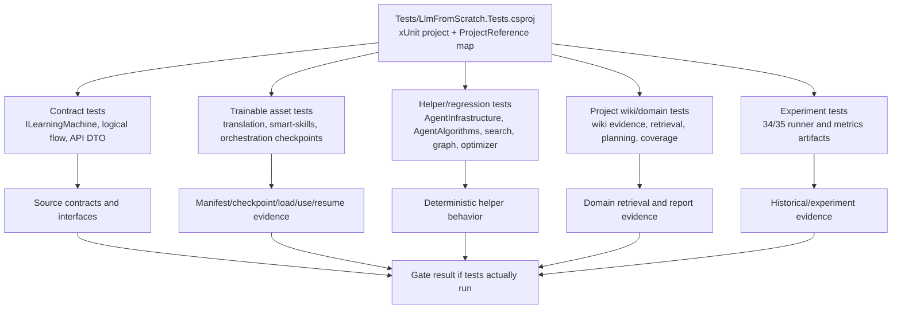

# Tests

Documentation status: DTests documented - parent review passed.

## Quick map

`Tests` is an xUnit project of evidence infrastructure. It gathers checks for contracts, the trainable asset lifecycle, domain pipelines, deterministic helper algorithms, experimental runners, and host/API boundaries. This document does not claim that the tests were run in the current documentation phase: in DTests the tests are only read and mapped to what they can prove.

The main boundary: the presence of a test file, a static check, a JSON report, or a smoke artifact is not equal to product readiness, model readiness, extension host runtime, or phase completion. Proof appears only when an active gate actually runs the needed set and saves a result that matches the scale of the claim.

## UML



Legend: the arrows show which kinds of source code or artifacts the test project can check. They do not mean that the check was performed in DTests.

## Connection simulations

| Connection | Example input | What happens | Expected result | What must not be asserted |
|---|---|---|---|---|
| `LlmFromScratch.Tests.csproj -> Contract tests` | `dotnet test` in the full gate, test `LearningMachineContractsTests` | xUnit builds the project and checks the presence of the types `ILearningMachine`, `LearningBatch`, export/import contracts | On a real run the gate can confirm the shape of the contracts | You must not assert that a specific model is trained or works in the product |
| `Contract tests -> Source contracts` | `AllSevenContractTypesExistInCoreAssembly` | reflection reads the assembly with `ILearningMachine<>` and looks for the required names | The presence of the expected types is confirmed | This must not be treated as an asset lifecycle or semantic quality |
| `Trainable asset tests -> Manifest/checkpoint evidence` | `TranslationModelAsset_CheckpointContract_PreservesTrainedStateWithoutPrivatePaths` | the test trains a temporary `TranslationMachine`, saves a checkpoint, loads it, and does a translation | On a run it proves a narrow save/load/use scenario for a synthetic fixture | Does not prove held-out product quality or the suitability of all translations |
| `Smart-skills tests -> SemanticQualityClaimed boundary` | `SkillSelectionMachine_ExportAsyncImportAsync_RoundTripsStoredCheckpointFiles` | the test looks at the manifest/checkpoint and checks `SemanticQualityClaimed=false` | Proves that a scaffold/partial state does not claim semantic-quality completion | Does not prove Claude/Cursor/Codex host runtime |
| `Project wiki tests -> Retrieval and coverage` | a question about `OrderController.BuildOrder` | the generated wiki evidence is loaded into the retriever, the answer must reference `BuildOrder` and lexical evidence | The local wiki/evidence chain on a synthetic project is checked | Does not prove production plugin invocation or universal generalization |
| `Helper tests -> Deterministic behavior` | `PermissionGate_ExternalAiCall_RequiresApproval` | the helper gets a tool name and arguments, returns `RequiresApproval` | The deterministic permission rule is checked | This must not be passed off as Luba's consent or external AI approval |
| `Experiment tests -> Runner evidence` | `DatasetLoader_WithCsFiles_ReturnsContents` | a temporary project with `.cs` files is passed to the loader | The reading of synthetic files and the loader's exceptions/branches are checked | Does not prove product readiness, a model checkpoint, or promotion |
| `Gate result -> Completion claim` | a saved result of a test run | the gate must record the fact of the run, passed/failed, scope, commit/ref | Only this result can support a claim about a passed gate | A test file without a run is not completion evidence |

## No-code algorithms

### 1. Test project wiring

- Where it lives: `Tests/LlmFromScratch.Tests.csproj`.
- Logic: an MSBuild project with `TargetFramework=net9.0`, the packages `xunit`, `Microsoft.NET.Test.Sdk`, `coverlet.collector`, and many `ProjectReference`s.
- Input: the test runner command, if it is allowed by the active gate.
- Output: a test assembly that can run the classes from `Tests/*.cs`.
- Branches: if a project reference does not compile, the test assembly is not built; if build/test was not run, DTests gets no runtime evidence.
- Does not do: the `.csproj` itself does not prove that the tests passed.

`Tests/LlmFromScratch.Tests.csproj:1-18`

```xml
<Project Sdk="Microsoft.NET.Sdk">

  <PropertyGroup>
    <TargetFramework>net9.0</TargetFramework>
    <ImplicitUsings>enable</ImplicitUsings>
    <Nullable>enable</Nullable>
    <IsPackable>false</IsPackable>
  </PropertyGroup>

  <ItemGroup>
    <PackageReference Include="coverlet.collector" Version="6.0.2" />
    <PackageReference Include="Microsoft.NET.Test.Sdk" Version="17.12.0" />
    <PackageReference Include="xunit" Version="2.9.2" />
    <PackageReference Include="xunit.runner.visualstudio" Version="2.8.2" />
  </ItemGroup>

  <ItemGroup>
    <Using Include="Xunit" />
```

This quote proves only the xUnit/test SDK wiring. It does not prove that the tests were run in DTests.

### 2. Contract reflection pattern

- Class/method: `LearningMachineContractsTests.AllSevenContractTypesExistInCoreAssembly()`.
- Parameters: none; Arrange gets the assembly via `typeof(ILearningMachine<>).Assembly`.
- Act: collects `typeNames`.
- Assert: checks the required contract record/interface names.
- Branches: if a type is absent, the assertion fails; if the type exists, this is still only the shape of the API.
- Does not do: it does not train a model, does not check a checkpoint, does not run a runtime host.

`Tests/LearningMachineContractsTests.cs:20-36`

```csharp
    public void AllSevenContractTypesExistInCoreAssembly()
    {
        // Obtain the assembly that contains the ILearningMachine type.
        var coreAssembly = typeof(ILearningMachine<>).Assembly;

        // Collect all type names from the Core assembly for assertion.
        var typeNames = coreAssembly.GetTypes()
            .Select(t => t.Name)
            .ToHashSet();

        // Each assertion verifies one required contract name from TD3 spec.
        Assert.Contains("ILearningMachine`1",          typeNames); // ILearningMachine<TDomain>
        Assert.Contains("ILearningMachinePair`2",       typeNames); // ILearningMachinePair<TPersonal,TGlobal>
        Assert.Contains("LearningBatch`1",              typeNames); // LearningBatch<TDomain>
        Assert.Contains("LearningBatchResult",          typeNames); // plain record
        Assert.Contains("LearningEvaluationSet`1",      typeNames); // LearningEvaluationSet<TDomain>
        Assert.Contains("LearningEvaluationResult",     typeNames); // plain record
```

The quote is important because it shows a reflection-based contract gate. It does not say that any `ILearningMachine` is a finished product asset.

### 3. Translation asset lifecycle fixture

- Class/method: `TranslationModelAssetTests.TranslationModelAsset_CheckpointContract_PreservesTrainedStateWithoutPrivatePaths()`.
- Parameters: none; Arrange creates a temp root, a `TranslationMachine`, a synthetic `TranslationLearningBatch`.
- Act: `TrainStructuredBatchAsync`, `SaveCheckpointAsync`, `LoadCheckpointAsync`, then `RunTranslationAsync`.
- Assert: the checkpoint contains trainable sections, does not contain private paths, the fresh-loaded machine answers the fixture.
- Branches: train/save/load can return a failed `OperationResult`; the private path is checked via `Assert.DoesNotContain`.
- Does not do: this is a synthetic fixture, not a full evaluation of translation quality.

`Tests/TranslationModelAssetTests.cs:75-92`

```csharp
            var save = await machine.SaveCheckpointAsync(checkpointPath);
            Assert.True(save.IsSuccess, save.ErrorMessage);
            Assert.Equal("translation-v1-checkpoint.json", Path.GetFileName(checkpointPath));

            var json = await File.ReadAllTextAsync(checkpointPath);
            Assert.DoesNotContain("private-corpora", json, StringComparison.OrdinalIgnoreCase);
            Assert.DoesNotContain("C:\\Users\\", json, StringComparison.OrdinalIgnoreCase);
            Assert.Contains("\"knn_store\"", json);
            Assert.Contains("\"semantic_tokenizer\"", json);
            Assert.Contains("\"executors\"", json);
            Assert.Contains("\"quality_verifier\"", json);
            Assert.Contains("\"training_history\"", json);

            var checkpoint = JsonSerializer.Deserialize<TranslationMachineCheckpoint>(
                json,
                TranslationCheckpointJsonOptions.Standard);
            Assert.NotNull(checkpoint);
            Assert.True(checkpoint!.HasStructuredTraining);
```

The quote shows the asset lifecycle evidence scope: checkpoint sections and the private-path firewall. This is not a held-out quality gate.

### 4. Orchestration plan grounding and anti-determinism

- Class/method: `OrchestrationPlanTests.OrchestrationPlan_Fixture_Flow33UsesLearnedGrounding()`.
- Parameters: none; Arrange/Act calls a temp loop report via `RunTempLoopAsync`.
- Assert: the fixture `flow 33` must pass with `GenerationRouteMode.LearnedFlowGrounding`.
- Branches: neighboring tests check untrained fallback, export/import survival, ablation degradation, exact prompt leakage failure.
- Does not do: it does not make `FlowReferenceDetector` a runtime model; the tests separately include `NoRuntimeFlowReferenceDetectorUsage`.

`Tests/OrchestrationPlanTests.cs:180-184`

```csharp
    public async Task OrchestrationPlan_Fixture_Flow33UsesLearnedGrounding()
    {
        var report = await RunTempLoopAsync(requireResume: false);
        Assert.Contains(report.FixtureResults, row => row.Fixture == "flow 33" && row.Passed && row.RouteMode == GenerationRouteMode.LearnedFlowGrounding);
    }
```

This quote proves the gate's intent to check learned grounding in a fixture. It does not replace running the gate itself in the current phase.

### 5. Smart-skills API and semantic-quality boundary

- Class/method: `SkillSelectionMachineTests.SkillSelectionMachine_ExportAsyncImportAsync_RoundTripsStoredCheckpointFiles()`.
- Parameters: none; Arrange creates a `SkillSelectionRequest`, chosen/rejected decisions, a temp persistence directory.
- Act: train/export/import/load checkpoint.
- Assert: the checkpoint/manifest exist, the raw prompt does not get into the checkpoint, `SemanticQualityClaimed` stays false.
- Branches: separate tests check scaffold-only candidate-position and held-out prompt sections.
- Does not do: it does not prove that the extension host actually called the Claude/Cursor/Codex UI.

`Tests/SkillSelectionMachineTests.cs:88-108`

```csharp
            Assert.DoesNotContain(request.Prompt, checkpointJson, StringComparison.Ordinal);
            Assert.Contains("trainedPromptKeys", checkpointJson, StringComparison.Ordinal);
            Assert.Contains("promptUnderstanding", checkpointJson, StringComparison.Ordinal);
            Assert.Contains("taskUnderstanding", checkpointJson, StringComparison.Ordinal);
            Assert.Contains("taskType", checkpointJson, StringComparison.Ordinal);
            Assert.Contains("routing", checkpointJson, StringComparison.Ordinal);
            Assert.Contains("skillCandidates", checkpointJson, StringComparison.Ordinal);
            Assert.Contains("skillSelection", checkpointJson, StringComparison.Ordinal);
            Assert.Contains("promptContext", checkpointJson, StringComparison.Ordinal);
            Assert.Contains("resultGap", checkpointJson, StringComparison.Ordinal);
            Assert.Contains("outputValidation", checkpointJson, StringComparison.Ordinal);
            Assert.Contains("taskCompletion", checkpointJson, StringComparison.Ordinal);
            Assert.Contains("intermediateChecks", checkpointJson, StringComparison.Ordinal);

            var manifest = JsonSerializer.Deserialize<SkillSelectionCheckpointManifest>(
                await File.ReadAllTextAsync(export.ManifestRef),
                new JsonSerializerOptions(JsonSerializerDefaults.Web));
            Assert.NotNull(manifest);
            Assert.Equal(export.CheckpointRef, manifest!.CheckpointRef);
            Assert.Equal(export.ManifestRef, manifest.ManifestRef);
            Assert.False(manifest.SemanticQualityClaimed);
```

The quote shows an important boundary: persisted learned-state may exist, but the manifest explicitly does not claim semantic-quality completion.

### 6. Extension API contracts as a thin-client boundary

- Class/method: `XiigenExtensionApiContractsTests.XiigenExtensionApiContract_DefinesExactlyFiveMethodContracts()`.
- Parameters: none; Arrange calls `XiigenExtensionApiContract.GetMethodContracts()`.
- Act/Assert: checks the list of methods, allowed/forbidden payloads, boundary rules.
- Branches: debug trace tests suppress raw private/secret payloads; invalid request tests return errors.
- Does not do: it does not prove a real host runtime or external AI execution.

`Tests/XiigenExtensionApiContractsTests.cs:155-165`

```csharp
        Assert.All(contracts, contract =>
        {
            Assert.NotEmpty(contract.AllowedRequestFields);
            Assert.NotEmpty(contract.AllowedResponseFields);
            Assert.Contains("model_internals", contract.ForbiddenPayloads);
            Assert.Contains("raw_corpus_data", contract.ForbiddenPayloads);
            Assert.Contains("host_side_training_logic", contract.ForbiddenPayloads);
            Assert.Contains("external_ai_call", contract.ForbiddenPayloads);
            Assert.Contains("host_runtime_claim", contract.ForbiddenPayloads);
            Assert.Contains("no_model_internals_or_corpus_rows_in_response", contract.BoundaryRules);
        });
```

This is a contract-level guard, not IDE extension host evidence.

### 7. Deterministic helper and approval boundary tests

- Class/method: `AgentInfrastructureTests.InternalLlmGateway_CodeQDomain_LoadsCodeQuestionAdapter()`.
- Parameters: none; Arrange uses a fake registry and a scripted LLM response.
- Act: `InternalLlmGateway.SendAsync(string prompt)`.
- Assert: routing selects `InternalModelDomain.CodeQ` and `code_q.lora`.
- Branches: neighboring tests check bug/generic fallback, registry miss, no external AI call, permission gate.
- Does not do: a scripted fake response and adapter path are not proof of model quality.

`Tests/AgentInfrastructureTests.cs:240-251`

```csharp
    public async Task InternalLlmGateway_CodeQDomain_LoadsCodeQuestionAdapter()
    {
        var registry = FullRegistry();
        var llm = new ScriptedLlmClient([new LlmResponse("internal code question answer", null, null)]);
        var gateway = new InternalLlmGateway(llm, registry);

        var result = await gateway.SendAsync("What does BpeTokenizer.Encode return for an empty string?");

        Assert.True(result.IsSuccess, result.ErrorMessage);
        Assert.Equal(InternalModelDomain.CodeQ, result.Value!.Domain);
        Assert.Equal("code_q.lora", result.Value.AdapterPath);
        Assert.NotEmpty(result.Value.Response);
```

This check is useful for wiring, but is not approval for external AI and does not confirm the quality of the model's answer.

### 8. Project wiki evidence path

- Class/method: `ProjectWikiDomainTests.DocumentationOrchestrator_GeneratesWikiDomainEvidenceRelationsAndQuestions()`.
- Parameters: none; Arrange creates a synthetic .NET project and wiki root.
- Act: `DocumentationOrchestrator.GenerateAsync(...)`, then `AskAsync(ProjectWikiQuestionRequest)`.
- Assert: the answer contains the expected evidence id, the text answer includes the called function, retrieval mode lexical.
- Branches: separate tests check runner missing, existing generated wikis when present, validation runner.
- Does not do: it does not prove production host invocation or semantic retriever availability.

`Tests/ProjectWikiDomainTests.cs:59-74`

```csharp
            generated.Value.ProjectId,
            "What does OrderController.BuildOrder do and which functions does it call?",
            wikiRoot,
            generated.Value.DocumentationVersion,
            TopK: 5,
            AllowSemantic: false));

        Assert.True(answer.IsSuccess, answer.ErrorMessage);
        Assert.Contains(answer.Value!.EvidenceIds, id => id.Contains("BuildOrder", StringComparison.Ordinal));
        Assert.Contains("OrderService.CalculateTotal", answer.Value.Answer);
        Assert.Equal(ProjectWikiRetrievalMode.Mode3LexicalEvidence, answer.Value.RetrievalMode);

        var coverage = await new ProjectWikiCoverageVerifier().VerifyAsync(generated.Value.ProjectId, wikiRoot);
        Assert.True(coverage.IsSuccess, coverage.ErrorMessage);
        Assert.True(coverage.Value!.IsPassed, string.Join("; ", coverage.Value.Failures));
        Assert.Equal(1.0, coverage.Value.ExactEvidenceAccuracy);
```

The quote shows local wiki retrieval/coverage assertions, but not runtime plugin readiness.

### 9. Experiment infrastructure tests

- Class/method: `ExperimentsV2InfraTests.DatasetLoader_WithCsFiles_ReturnsContents()`.
- Parameters: none; Arrange creates a temp root and `.cs` files.
- Act: `DatasetLoader.Load(int tier, string projectRoot)`.
- Assert: the loader returns the file count, tier, and combined text.
- Branches: missing root, empty root, obj exclusion, tier3 folder selection.
- Does not do: it does not produce a product-ready result; experiment outputs are evidence artifacts only.

`Tests/ExperimentsV2InfraTests.cs:35-50`

```csharp
    [Fact]
    public void DatasetLoader_WithCsFiles_ReturnsContents()
    {
        string tmpRoot   = Path.Combine(Path.GetTempPath(), "dl_cs_" + Guid.NewGuid());
        string tokenizer = Path.Combine(tmpRoot, "01.Tokenizer");
        Directory.CreateDirectory(tokenizer);
        File.WriteAllText(Path.Combine(tokenizer, "Foo.cs"), "public class Foo {}");
        File.WriteAllText(Path.Combine(tokenizer, "Bar.cs"), "public class Bar {}");
        try
        {
            var r = DatasetLoader.Load(1, tmpRoot);
            Assert.True(r.IsSuccess, r.ErrorMessage);
            Assert.Equal(2, r.Value!.FileCount);
            Assert.Equal(1, r.Value.Tier);
            Assert.Contains("Foo", r.Value.CombinedText);
        }
```

This quote proves only synthetic dataset loader behavior.

## Map of QA / test clusters

| Cluster | Representative files | What it can prove on a run | What it does not prove |
|---|---|---|---|
| Learning contracts | `LearningMachineContractsTests.cs`, `LogicalFlowContractTests.cs` | interface shape, separation of execution/training, stub implementability | that there is a finished trained model |
| Translation/trainable assets | `TranslationDomainTests.cs`, `TranslationModelAssetTests.cs` | synthetic train/save/load/use, manifest/checkpoint schema, private path firewall | held-out product quality for all data |
| Orchestration/project wiki | `OrchestrationPlanTests.cs`, `ProjectWikiDomainTests.cs` | learned grounding fixtures, corpus audit, local wiki retrieval, coverage verifier | production plugin host invocation or universal semantic correctness |
| Smart-skills/extension contracts | `SkillSelectionMachineTests.cs`, `PromptToTask*Tests.cs`, `OrchestrationReasoning*Tests.cs`, `ResultGap*Tests.cs`, `XiigenExtensionApiContractsTests.cs` | checkpoint/manifest boundaries, skeleton/partial statuses, thin-client API contract | Claude/Cursor/Codex runtime integration |
| Agent helpers | `AgentInfrastructureTests.cs`, `AgentAlgorithmsTests.cs` | deterministic routing, permission, context, tool registry, decomposition behavior | trained semantic authority |
| Experiments | `ExperimentsTests.cs`, `ExperimentsV2Tests.cs`, `ExperimentsV2InfraTests.cs` | experiment runner/math/helper behavior on synthetic data | product readiness or promotion without an active gate |
| Retrieval/search/graph/base stack | `VectorSearchTests.cs`, `SearchEngineTests.cs`, `GraphEngineTests.cs`, `TokenizerTests.cs`, `CompressionTests.cs` | algorithmic helper correctness and edge cases | trainable reasoning |
| DPO/LoRA/capability/model server | `Dpo*Tests.cs`, `LoraTests.cs`, `Capability*Tests.cs`, `DistributedModelArchitectureTests.cs` | infrastructure and manifest/proxy behavior | full model quality unless the gate includes runtime/held-out evidence |

Tests mapped/read but not run in this documentation subphase. No `dotnet test`, build, runtime smoke, training, or host probe was run.

## Anti-false-done

- Test file existence is not evidence that a gate passed.
- Skipped, not-run, or merely compiled tests are not product readiness.
- Static assertions and reflection checks are useful contract evidence, but they do not prove runtime/model/plugin completion.
- JSON reports, smoke reports, and progress files are evidence artifacts only. They must match the active gate scope and be fresh enough for the claim.
- A test that checks `CheckpointRef`, `ManifestRef`, or `SemanticQualityClaimed=false` can narrow the claim; it must not be inflated into semantic quality, product readiness, or host runtime evidence.

## Anti-determinism

Deterministic helper tests for regex, BM25, KNN, marker voting, route classifiers, permission gates, stack detectors, or experiment math prove helper behavior. They do not prove trainable reasoning unless the test explicitly covers training data, checkpoint/export/import, fresh-load/use, continue-training, and held-out/runtime validation. In this suite, several tests intentionally prevent deterministic shortcuts from being mislabeled as final authority, for example `SemanticQualityClaimed=false`, `NoRuntimeFlowReferenceDetectorUsage`, and API forbidden payload checks.

## Status

`Tests` is evidence infrastructure. It is broad and valuable, but DTests itself is documentation only. Current status: parent review passed; tests were read/mapped, not executed.
