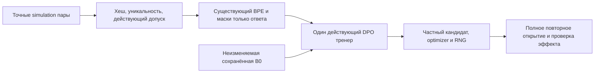

# Короткая калибровка и обучение на программно созданных парах

## Диагностика первого выбора токена — 16 октября 2026

Отдельная явная команда `first-decision-enru` сравнивает C50 и C100 на уже раскрытом `enru-e01`, не читая выбранный/отклонённый ответы. Это новый диагностический запуск с одним токеном на состояние, а не повтор прежнего экзамена на 128 токенов. Зафиксированы точные SHA256 panel, 70 UTF-8 bytes prompt и обоих checkpoints; `MaxNewTokens=1, temperature=0, topK=0, topP=1, seed=20261014`. Загрузка каждого arm создаёт независимый model context через прежние `LoadModels`/`OpenStudent`; генерация создаёт свежий KV cache. Два arm дают два prefill и два выбора sampler, без decode-продолжения, обучения, scorer, внешнего автора или grader.

Наблюдение opt-in находится внутри того же `TextGenerator.GenerateCore`: приватная копия конечных float32 логитов снимается до действующего sampler, фактически выбранный token ID — после него. Обычные `Generate`/`GenerateDetailed` и схема `TextGenerationReceipt` сохранены. Веса checkpoint, все параметры и tokenizer проверяются до/после; отдельно сохраняются ключи и keyed values базы/адаптера. Полные векторы, их little-endian raw bits/SHA256, входные token IDs, top-5, gap top-1/top-2, проверка реального выбора против argmax с первым индексом при tie, source/runtime pins и времена находятся в create-only каталоге `.kiro/xiigen-slices/work/results/RP01-first-decision-20261016/<new-run-id>`. `issued.json` и отдельные arm intents записываются до вызовов. Повтор/overwrite отсутствуют; неизвестный частичный эффект сначала сверяется вручную. Сохраняется Ctrl+C, скрытого timeout или порога RAM нет.

Сравнение сообщает exact raw-bit equality, максимальную абсолютную разницу logits и устойчиво вычисленных в double log-softmax. Равномерный сдвиг raw logits классифицируется отдельно, поскольку не меняет вероятности. Научного порога принятия нет; даже ненулевая разница распределений при прежнем argmax не доказывает полезного обучения. Один token ID может декодироваться в невалидный отдельный UTF-8 фрагмент. Собственная память процесса/лимит GC не выдаются за память всего ПК или жёсткий лимит процесса. Старые ответы и grades не меняются.

```powershell
dotnet tools/Rp01SimulationDpo/bin/Release/net9.0/Rp01SimulationDpo.dll first-decision-enru C:/Projects/llm_mvp_core <frozen-panel-free4.jsonl> e5f7a31f28cad6d0dd2de31843bb1efa55d06f57cf881cce84d9418f288861a8 <new-run-id> <C50.bin> 6f4d0284ea823ba99932b0f28576855c14205703115b48c983c7a9f03749179b <C100.bin> 3acb5a9080d0454942c261eca4c1b886aab011db83729947509be4463785fab5
```

Единственный выданный парный запуск `paired-20261016-01` завершился с native exit 0: [comparison.json](../../.kiro/xiigen-slices/work/results/RP01-first-decision-20261016/paired-20261016-01/comparison.json). Фактически 2 prefill, 2 выбора и 0 decode; оба выбранных ID — `388` и совпадают с argmax. Статус `CHANGED_DISTRIBUTION_SAME_ARGMAX`: max |Δlogit| `0.01064920425415039`, max |Δlog-softmax| `0.010844490962134579`; raw bits различаются, сдвиг неравномерный. В обоих состояниях 629 конечных логитов; совокупное состояние 39 base tensors совпадает между arm, совокупное состояние 16 adapter tensors различается, внутри каждого arm все параметры и checkpoint до/после неизменны. Полезное качество не оценивалось.

Load C50/C100 — `1766.8644/1399.6138 мс`, prefill — `438.3026/305.9748 мс`, интервалы arm от начала load до построения completed receipt — `2497.5008/1934.505 мс`. Парный интервал от выдачи intent до построения comparison — `4700.318 мс`; он исключает предварительное чтение/pinning и финальную запись comparison. Эти вложенные времена не суммируются как независимые расходы. Peak working set собственного процесса к завершению второго arm — `565198848 bytes`. Сохранённые `rawBitsInt32` позволяют восстановить точные float32; при пересчёте из десятичных JSON `values` сначала требуется округление к float32.

## Фактический итог двух доменов — 16 октября 2026

EN→RU500 действительно продолжил полный C# state 50→100: 500 уникальных пар, 50 новых updates, неизменные 39 base tensors и изменившиеся конечным образом 16 LoRA tensors. Reference остался отдельной замороженной копией C50; сохранённые weights/optimizer/RNG повторно открыты и сверены. Это изменение параметров, а не доказательство полезного навыка.

Независимая слепая оценка была заморожена до раскрытия arms. Для четырёх EN→RU случаев средняя доля выполненных смысловых clauses осталась `0→0`, полностью правильные ответы — `0/4→0/4`, invalid — `4/4→4/4`. Деноминаторы случаев — 2,3,3,3. Из бессвязного ответа критические противоречия не оценимы; отсутствие записанного противоречия не означает правильность. Средний preference margin по 20 случаям изменился `0.012293052673339844→0.012403059005737304`, paired Δ `+0.00011000633239746093`; chosen-preferred осталось `12/20→12/20`. Это небольшой сдвиг preference, без показанного semantic improvement.

Три C# retention-ответа побайтово совпали с сохранёнными C50 ответами. Их старые frozen grades повторно связаны с точными исходными JSON и UTF-8: `0/3→0/3` правильных, все три invalid. Нового grading или baseline Generate для одинаковых байтов не было. Такой результат не доказывает сохранение первоначально полезного навыка. Исходная B0 была случайной и необученной; это ограничение источника, а не доказательство единственной причины неудачи. Panel теперь раскрыт для диагностики и не является новым будущим слепым подтверждающим экзаменом; 500 строк не означают 500 независимых смысловых семейств.

Фактически выполнены EN→RU `80 scorer/8 Generate` и C# retention `6/3`. Main product whole — `2330.1254304 с` (owner native wall `2330.4531116 с`); четыре EN→RU процесса — `183.1306279 с`, retention — `23.3167834 с`. Сумма owner native wall — `2536.9005229 с`, product clocks — `2535.3445335 с`; peak собственного процесса — `2430550016 bytes`, не всего ПК. Вложенные сохранения повторно не прибавляются. Inner compute остаётся `NULL_NOT_INSTRUMENTED`; orchestration, подготовка данных и API cost — `NOT_TOTALIZED`, а не ноль. Сравнение разных C#/EN→RU нагрузок не доказывает whole-training speedup. `MaxAnswerChars=4096` не обрезает текст: native сохранил полные ответы, превышений 4096 нет; examiner отдельно оставил truncation/limit по raw как UNKNOWN.

Итог: `PARAMETERS_CHANGED_PREFERENCE_MARGIN_ONLY_NO_SEMANTIC_IMPROVEMENT`, `RESEARCH_ONLY_NOT_ADOPTED`. Текущий ограниченный объём исполнения RP01 выполнен: две кампании по 500 пар, проверка сохранения прежних ответов и публичное сравнение допуска памяти 05C; независимая фактическая проверка завершена. Полезное улучшение свободных ответов не установлено, оба нейронных кандидата остаются RESEARCH_ONLY_NOT_ADOPTED. Это завершение текущих экспериментов и узкого исправления, а не готовность всей платформы. [Независимая фактическая проверка RP01 и 05C](../../.kiro/xiigen-slices/work/results/RP01-05C-domain-law-20261016/independent-review/review.md). [Scientific result](../../.kiro/xiigen-slices/work/results/RP01-enru-continuation-20261016/runtime-20261016-01/analysis-20261016-01/scientific-result.json), [pure-file checker](../../.kiro/xiigen-slices/work/results/RP01-enru-continuation-20261016/runtime-20261016-01/analysis-20261016-01/recompute-scientific-result.js), [hash/binding proof](../../.kiro/xiigen-slices/work/results/RP01-enru-continuation-20261016/runtime-20261016-01/analysis-20261016-01/analysis-proof.json), [native custody](../../.kiro/xiigen-slices/work/results/RP01-enru-continuation-20261016/runtime-20261016-01/runtime-custody-packet.json). Повтор pure-file проверки: `node <checker-path> --verify`; он не вызывает Student или grader. Команды ниже сохранены как контракт выполненного запуска, а не как разрешение повторить его.

## Измерение фаз в следующем разрешённом запуске — 16 октября 2026

В действующий `StepVector` добавлено отдельное наблюдение `DpoStepVectorTiming`. Старый вызов без этого аргумента и сериализация `DpoMetrics` сохранены. Этот offline runner включает наблюдение для каждого нового вызова: в `stages.jsonl` появляется `training_step_phases`, а в новом `receipt.json` — `stepVectorTiming` со сводкой и отдельными попытками. Изменение не запускает обучение и не разрешает повтор старой попытки. Старые receipts и результаты выше не изменены; отсутствующие в них внутренние времена остаются неизвестными.

Для reference и policy один helper call означает один forward **одной стороны** пары вместе с подсчётом её likelihood; для backward — построение градиента logits и обратный проход одной стороны. При N успешно обработанных `DpoVectorBatch` ожидаются по 2N завершённых вызовов каждой из этих фаз, а `ApplyOptimizer` вызывается один раз на весь набор. Число наборов, сторон пары и optimizer updates нельзя подменять друг другом.

`applyOptimizer` измеряет весь существующий helper: проверку получателя до и после AdamW, выбор параметров и сам update. Последующий `ZeroGrad` не входит в эту фазу. Чистое время ядра AdamW по-прежнему не измерено: `uninstrumented.optimizerOnlyMilliseconds=null`. Внешнее `ElapsedMilliseconds` попытки включает admission, snapshot, публикацию и освобождение ресурсов; существующее `training_step_total` имеет свои внешние границы журнала. Внутренние интервалы содержатся в этих внешних временах и повторно к ним не прибавляются. Отдельные накладные расходы и остаток внешнего времени автоматически фазам не приписываются.

Каждая фаза сообщает `startedCalls`, `completedCalls`, `incompleteCalls` и сумму времени **только завершённых** helper calls. Если ни один не завершился, время — `null`; незавершённый вызов не получает выдуманного времени. Полностью завершённые фазы сохраняются даже при последующем отказе публикации и rollback. `THREW` описывает исход вызова, но само по себе не устанавливает состояние commit/rollback; для него сохраняются прежние transaction receipts. Сводка включает выполненную работу всех попыток, в том числе отменённые эффекты.

Внутри trainer измерение делает только чтение монотонных часов и обновление скаляров в памяти: без callback и дисковой записи на каждую пару. Новый diagnostic event записывается после возврата и увеличения completion counters; его нефатальная ошибка отражается в `journalWriteFailures` и не превращает возвращённый update в ошибку trainer. При падении процесса память последней попытки может не попасть в журнал; отсутствие записи не доказывает нулевую работу. Проверка на маленьких детерминированных fixtures — инженерная проверка учёта и численной совместимости, без вывода об ускорении или полезном обучении.

## Продолжение C# step 50 → EN→RU step 100 — 16 октября 2026

Новый явный arm `train-enru` продолжает **полное исследовательское состояние** завершённого C# Main500. Калибровка и C# Main500 для него повторно не запускаются. Сохранённая корневая B0 используется действующим loader только для канонической конфигурации и топологии; B0 была случайно инициализирована и не является pretrained моделью. Затем в отдельные policy/reference импортируются все C50 base+LoRA веса. Reference — заранее объявленная отдельная замороженная копия C50 на весь EN→RU запуск. Это исследование без принятия кандидата в production.

Фиксированный источник: `training-artifacts/experiments/code-documentation-simulation/simulation-csharp-main500-20261015-01`. Проверяются реальные байты checkpoint, AdamW, RNG, state/profile, metrics, completed marker и receipt. Источник с неизвестным/частичным эффектом отказывается. Через существующие `DpoContinuationProof` и `TryRestoreContinuationState` восстанавливаются **настоящие step 50, все 16 keyed moment slots и RNG**, с проверкой совпадения байтов после импорта и повторной проверкой неизменности источника. Материал, framing, summed-response objective и разрешённая parameter map должны точно совпадать с новым получателем. Производственный accepted-manifest loader не ослаблен; исследовательский state не выдаётся за production manifest.

EN→RU импорт принимает только точные 500 строк `simulation-enru-500-v1`, `domain=en-ru`, `pair_kind=TRANSLATION`, `provenance=simulation`, SHA256 `39e462279314d1b4076a8ac25ebf4f46b4ade5649dc022f16b5425277bdffb03`. Файл и уже зафиксированный порядок не переписываются. Действующий translation lease использует namespace `translation-dpo`. Один прежний DPO trainer получает ровно 50 minibatch по 10 пар, одну эпоху, LR `1e-5`, beta `0.1`, существующий AdamW `(0.9,0.95,decay=0.01,eps=1e-8)`. База 39 tensors заморожена; разрешены те же 16 q/v LoRA tensors. Все checkpoint/optimizer/RNG/metrics сохраняют **глобальные шаги 51…100**; `completedNewUpdates=50` учитывается отдельно от `finalGlobalStep=100`.

Реализация была подготовлена без обучения и inference; последующий отдельный runtime work order выполнен и описан выше. Для уже выданной попытки команды ниже повторно не запускать:

```powershell
$k = 'C:/Projects/llm_mvp_core'
$cli = "$k/tools/Rp01SimulationDpo/bin/Release/net9.0/Rp01SimulationDpo.dll"
$train = "$k/training-data/dpo/translation-en-ru/simulation-enru-500-v1/train500.jsonl"
$c50 = "$k/training-artifacts/experiments/code-documentation-simulation/simulation-csharp-main500-20261015-01/checkpoints/dpo_policy_step_000050.bin"
$c50sha = '6f4d0284ea823ba99932b0f28576855c14205703115b48c983c7a9f03749179b'
dotnet $cli inspect-enru-source $k
dotnet $cli inspect-enru $k $train 39e462279314d1b4076a8ac25ebf4f46b4ade5649dc022f16b5425277bdffb03 500
# Сначала tokenizer-only preflight обоих panels из следующего блока; затем отдельный разрешённый запуск:
dotnet $cli train-enru $k $train 39e462279314d1b4076a8ac25ebf4f46b4ade5649dc022f16b5425277bdffb03 <new-enru-run-id> 10 50 none
```

Create-new once guard связывает content/domain/arm независимо от нового run ID. Неизвестное или прерванное действие не сбрасывается и автоматически не повторяется. Общего crash-resume API нет. Существующие C# `inspect/calibrate/train/evaluate` и их прежние marker names сохранены. `none` не добавляет временного дедлайна; сохраняется явная отмена и необязательный положительный конечный budget.

**До `train-enru` и первого будущего forward/scorer/Generate** оба panels проходят tokenizer-only preflight. Он читает только явно переданный pinned файл программно, не печатает тела и не выделяет `LlmModel`. Проверяются отдельные lossless prompt/chosen/rejected roundtrip, response-only masks/targets, context fit и для free-arm длина каждого Gold ответа ≤128 BPE tokens. Выводятся только hash/count/target min-max сводки. Наличие ≤99 UTF-8 bytes само по себе не заменяет эту проверку:

```powershell
$panel = "$k/.kiro/xiigen-slices/work/results/RP01-enru500-independent-panel-20261016"
dotnet $cli preflight-enru $k "$panel/panel-score-only16.jsonl" 6fb632366bbb0676766704cd4a7f97a1460d69b6475992fdb08ad11a8eaf5795 0
dotnet $cli preflight-enru $k "$panel/panel-free4.jsonl" e5f7a31f28cad6d0dd2de31843bb1efa55d06f57cf881cce84d9418f288861a8 128
dotnet $cli evaluate-enru $k "$panel/panel-score-only16.jsonl" 6fb632366bbb0676766704cd4a7f97a1460d69b6475992fdb08ad11a8eaf5795 <new-C0-score-id> $c50 $c50sha 0
dotnet $cli evaluate-enru $k "$panel/panel-free4.jsonl" e5f7a31f28cad6d0dd2de31843bb1efa55d06f57cf881cce84d9418f288861a8 <new-C0-free-id> $c50 $c50sha 128
dotnet $cli evaluate-enru $k "$panel/panel-score-only16.jsonl" 6fb632366bbb0676766704cd4a7f97a1460d69b6475992fdb08ad11a8eaf5795 <new-T-score-id> <saved-step100.bin> <observed-step100-sha> 0
dotnet $cli evaluate-enru $k "$panel/panel-free4.jsonl" e5f7a31f28cad6d0dd2de31843bb1efa55d06f57cf881cce84d9418f288861a8 <new-T-free-id> <saved-step100.bin> <observed-step100-sha> 128
```

Контроль EN→RU всегда явно выбирает C50; `B0`/null отказываются. Оба arms используют тот же код, config, BPE, settings `(temperature=0,topK=0,topP=1,seed=20261014,maxAnswerChars=4096)`, один повтор. Эти четыре оценки дают 80 публичных вызовов scorer и 8 Generate; full20 дополнительно не оценивается. Семантическую оценку выполняет независимый владелец, код её не подменяет.

Свободные ответы проходят настоящий normal typed путь: raw English → `SimulationEnRuPrompt.Build` (ровно один `Translate English to Russian:\n`) → `TranslationMachine.GetOrchestratorAsync` → `TranslationRoutingFlow` → `ResearchCheckpointEnRuAdapter` → read-only verified full checkpoint → существующий `TextGenerator`. При оценке известный prefix сначала извлекается, затем normal route строит его заново и проверяет exact framed-input SHA. Cold ordinary запрос принимает отдельный UTF-8 файл **raw English**, без prefix:

```powershell
dotnet $cli translate-enru $k <raw-english.txt> <new-cold-consumer-run-id> <saved-step100.bin> <observed-step100-sha> 128
```

Эта standalone cold-команда подготовлена отдельно и не запускается автоматически в frozen exam. Первые вызовы `evaluate-enru` в новых процессах уже используют тот же cold typed путь; ради доказательства маршрута не требуется добавлять генерацию сверх зафиксированных восьми.

`ordinary-translation.json`/generation receipts сохраняют raw ответ, actual checkpoint path/hash/step, raw/framed input hashes, tokenizer/settings identity и typed flow result. Adapter возвращает confidence `0`, `UNKNOWN_NOT_GRADED`; flow сохраняет raw текст и `TRANSLATION_LOW_CONFIDENCE`. Механическая генерация не доказывает правильный перевод, улучшение навыка или adoption. Имена и данные C# consumer не переименованы в translation; зависимость остаётся `27→14`, обратной `14→27` нет.

Времена whole/load/materialize/step/save/reopen сохранены. Внутренние reference/policy forward, backward и optimizer-only остаются `null / NOT_INSTRUMENTED`: действующий observer не предоставляет этих границ. Вложенные сохранения не складываются с полным шагом. Kernel benchmark ниже не доказывает ускорение всего обучения. Независимость 500 смысловых примеров не установлена; результат текущего ограниченного EN→RU-экзамена приведён выше.

Ниже описаны сохранённые команды исходного C# эксперимента; они не являются указанием повторить уже завершённое обучение.

Команда подключает точные C# пары с единственной меткой `provenance: "simulation"` к существующему DPO. Например, для кода `System.Console.Write(2*3);` предпочтителен ответ о произведении 6, а ответ о сумме 5 отклоняется. В Student поступают только `prompt`, `chosen`, `rejected`; идентификаторы, описание закона и другие метаданные служат учёту данных.

Исполнитель проверяет SHA256 всего файла, число записей, уникальность идентификаторов, вопросов и троек текстов. Затем действующие проверки лицензирования, карантина и evidence принимают текущую авторизацию пользователя на программные simulation-данные. Существующая серверная граница допуска создаёт content-bound lease для `DeterministicGenerator`, с пустым списком внешних источников и нулевым бюджетом внешних вызовов. Новых source enum, профилей, паспортов внешней модели или исключений для платных ответов здесь нет.

Мутационный запуск и его параметры доступны только внутри learning-сборки и доверенной CLI-сборке `Rp01SimulationDpo`. Публичные inspect/evaluation не выдают разрешение на изменение весов. Точные проверки разрешённых dataset, B0, config и canonical root остаются в этой CLI.



Базовые 39 тензоров заморожены; разрешены существующие 16 тензоров q/v LoRA. Независимая копия B0 остаётся reference в течение всего запуска. Один `StepVector` накапливает градиенты выбранного minibatch и вызывает существующий оптимизатор один раз. 500 пар не означают 500 обновлений. Тренер, optimizer и reference не пересоздаются между minibatch; производственный wrapper с ограничением 1–5 шагов не изменён.

Сначала собирается Release и выполняется **одна отдельная калибровка** на исключённой из 500 паре:

```powershell
dotnet build tools/Rp01SimulationDpo/Rp01SimulationDpo.csproj -c Release
dotnet tools/Rp01SimulationDpo/bin/Release/net9.0/Rp01SimulationDpo.dll inspect C:/Projects/llm_mvp_core <input.jsonl> <sha256> <count>
dotnet tools/Rp01SimulationDpo/bin/Release/net9.0/Rp01SimulationDpo.dll calibrate C:/Projects/llm_mvp_core <calibration-pair.jsonl> c4391d3d75432533e3faa0712119af81016312a5f1bbc85de3e46baf81f085ae <unique-calibration-run-id> 1 1
```

После фактического измерения, независимого ревью кода и фиксации отдельного heldout-протокола родитель выбирает конечные batch/update budgets и при необходимости положительный конечный лимит времени. Основной кандидат начинает с той же неизменяемой B0, а не продолжает калибровку или старый отрицательный эксперимент:

```powershell
dotnet tools/Rp01SimulationDpo/bin/Release/net9.0/Rp01SimulationDpo.dll train C:/Projects/llm_mvp_core <train500.jsonl> c78a620a01cd2ab1d35962eb3521a9e87ee51deeedc325dfc809112b0e035935 <unique-main-run-id> <batch-size> <ceiling-of-500-divided-by-batch-size> none
```

Это ровно одна эпоха: все 500 записей должны завершиться по одному разу. В журнале отдельно фиксируются фактические предъявления пар, уникальные завершённые IDs, выданные/завершённые вызовы `StepVector` и optimizer step. Последний аргумент `none` означает отсутствие временного лимита основного запуска. Вместо него можно явно передать положительное конечное число секунд; тогда лимит проверяется между транзакционными шагами. Ноль, отрицательные числа, NaN и бесконечность отвергаются. Число эпох и точное максимальное число обновлений ограничены в обоих вариантах. Калибровка не имеет скрытого автоматического timeout. Явная отмена остаётся доступна через Ctrl+C.

Результаты находятся в `training-artifacts/experiments/code-documentation-simulation/<run-id>`, с закрытым локальным доступом. Перед первым возможным обновлением создаётся общий marker для точного input hash и arm. Повтор с другим run ID также отказывается: прерванное или неизвестное действие нельзя автоматически переиграть. Файлы не удаляются и не обнуляются при ошибке. Журналы и metrics commit marker нужно сверить перед любым дальнейшим ручным решением.

`stages.jsonl` содержит UTC и монотонные измерения загрузки/материализации, полного DPO шага, реальной сериализации checkpoint, сохранения optimizer/RNG и повторного открытия. Сериализация checkpoint — вложенный интервал полного шага, складывать их как независимые расходы нельзя. Внутренние forward/backward и optimizer-only пока не инструментированы и записаны `null / NOT_INSTRUMENTED`. Внешний Teacher и evaluator не вызываются; Student generation/scoring в обучающей команде также не выполняются. Полный runtime и CPU/RAM текущего процесса записываются отдельно. Численный выигрыш времени до измерения не заявляется.

`receipt.json` показывает по каждому ключу реальные хеши параметров до/после, численную конечную LoRA-разницу, неизменность in-memory reference, равенство сохранённых и живых весов, повторное открытие optimizer/RNG. Проверка, сохранение и повторное открытие не являются улучшением качества. Обновление весов тоже не доказывает качество на новых задачах: для этого нужен отдельный заранее зафиксированный panel и независимая оценка ответов. Эти команды не публикуют и не принимают кандидата в production; исторические результаты, исходная B0 и закрытые экзамены остаются у своих владельцев.

Отдельная параметризованная оценка принимает новый заранее замороженный JSONL-panel от независимого владельца. Обязательные поля каждой строки: `id`, `prompt`, `chosen`, `rejected`; остальные поля остаются у владельца и не поступают в Student. Автор кода не создаёт этот panel и не оценивает смысл ответов:

```powershell
dotnet tools/Rp01SimulationDpo/bin/Release/net9.0/Rp01SimulationDpo.dll evaluate C:/Projects/llm_mvp_core <new-panel.jsonl> <panel-sha256> <unique-control-run-id> B0 B0 <fixed-max-new-tokens>
dotnet tools/Rp01SimulationDpo/bin/Release/net9.0/Rp01SimulationDpo.dll evaluate C:/Projects/llm_mvp_core <same-panel.jsonl> <same-panel-sha256> <unique-treatment-run-id> <private-candidate.bin> <candidate-sha256> <same-fixed-max-new-tokens>
```

Команда использует существующий публичный Student likelihood с точными response-масками. Сохраняются средние log-prob по токенам ответа, их chosen-minus-rejected margin и суммы, восстановленные из действительного числа shifted targets. Обучающая summed-likelihood objective не меняется. Autograd отключается через временные inference-флаги параметров, затем флаги восстанавливаются; хеши фактических весов сравниваются до/после. При положительном token budget тот же ordinary code-documentation consumer отдельно генерирует и сохраняет реальные ответы. Нулевой budget означает, что свободная генерация не запрошена. Встроенного grader или доступа к старому закрытому Gold нет; независимый владелец отдельно сравнивает новый heldout-сигнал, смысл свободных ответов и retention.

## Локальное ускорение MatMul backward — 16 октября 2026

В существующем `TensorOps.MatMul` вычисление градиента левого операнда (`gradA = grad @ Bᵀ`) использует готовый SIMD-helper. Строки B уже имеют нужное расположение; дополнительного транспонирования нет. Вычисление gradB, суммирование broadcast-пакетов, накопление прежних градиентов и флаги `RequiresGrad` сохранены. Обратный проход сохраняет прежний контракт без cancellation token; контракт отмены прямого прохода не меняется. Нового тренера или режима обучения нет.

Отдельный конечный tensor-only benchmark вызывает настоящий `Tensor.Backward`: 2 прогрева и 5 измерений для каждой формы, с одинаковыми seed 1701–1703. Замер включает обход графа, выделение и публикацию градиентов; создание входов, forward и скалярная проверка вынесены за интервал. Машина: Intel i7-1165G7, 4 ядра / 8 потоков, Windows x64, .NET 9.0.18, `Vector<float>.Count = 8`, Release. Медианы одного вызова:

| A × B | Градиенты | До, мс | После, мс | Отношение до/после |
|---|---|---:|---:|---:|
| [150,512] × [512,512] | только A | 125,474 | 19,674 | 6,38 |
| [150,512] × [512,1408] | только A | 317,551 | 41,166 | 7,71 |
| [150,1408] × [1408,512] | только A | 249,112 | 44,956 | 5,54 |
| [150,512] × [512,8] | A и B | 3,442 | 2,855 | 1,21 |
| [150,8] × [8,512] | A и B | 3,721 | 2,726 | 1,37 |

Максимальная абсолютная разница gradA со скалярным эталоном — `8.6426735e-7`; gradB совпал точно. Это локальное сравнение backward на пяти формах, без статистического вывода о малых LoRA-разницах. Доля MatMul в полном обучении и ускорение всего запуска не измерены. Обучение, optimizer и генерация этим benchmark не вызываются; прежние результаты simulation не пересчитываются.

Исходник измерения: [MatMulBackwardBenchmark/Program.cs](MatMulBackwardBenchmark/Program.cs). Сырые интервалы, численные ошибки и SHA256 источника/сборки: [scalar-before.json](../../.kiro/xiigen-slices/work/results/RP01-matmul-backward-20261016/scalar-before.json), [simd-after.json](../../.kiro/xiigen-slices/work/results/RP01-matmul-backward-20261016/simd-after.json). Повтор на текущем коде:

```powershell
dotnet build tools/Rp01SimulationDpo/MatMulBackwardBenchmark/MatMulBackwardBenchmark.csproj -c Release
dotnet tools/Rp01SimulationDpo/MatMulBackwardBenchmark/bin/Release/net9.0/MatMulBackwardBenchmark.dll simd-after C:/Projects/llm_mvp_core <new-receipt.json>
```

Скалярный результат получен до правки настоящего TensorOps на `58d12ecfe7af05e3221f984bf6c4c67d82fe3b96`; смена метки CLI сама по себе старую реализацию не восстанавливает.
