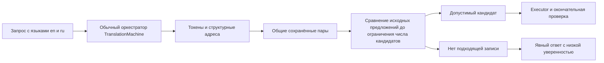

# Один публичный контраст translation memory

Обычный `TranslationMachine` теперь отбрасывает запись «the box is empty» при запросе «the box is not empty». Если позже в том же пуле есть допустимое «a box is not empty», поиск достигает этой записи. Если подходящего перевода нет, пользователь получает явно обозначенный Bootstrap с `TRANSLATION_LOW_CONFIDENCE`, предупреждением и `Summary.Passed=false`.

Это узкое детерминированное ограничение допуска, а не обученный ranker, adaptive k или изменение нейронных весов. Переводы берутся из сохранённой памяти. Само правило не содержит русских ответов и не генерирует перевод.

## Реальный путь и граница правила



`TranslationMemorySourceLaw.Compare` читает **оба** исходных текста. Поддерживается только отдельное английское предложение вида `the/a/an + noun + is/was + [not] + predicate`, с необязательной конечной точкой или восклицательным знаком. Разрешённые существительные: box, door, file, room, house, window, container, document, folder, account, connection. Предикаты: empty, full, open, closed, ready, available, valid, invalid, enabled, disabled, safe, unsafe, null. Это закрытая область анализа частей речи, не полный английский parser.

| Вычисляемое поле | Источник и смысл | Читатель |
|---|---|---|
| subject | Явное существительное в поддержанном шаблоне; без местоимений и разрешения ссылок | Сравнение роли query–candidate |
| copula | Одинаковое `is` либо одинаковое `was`; разные времена дают UNKNOWN | То же сравнение |
| predicate | Одинаковый предикат из закрытого списка | То же сравнение |
| polarity | Наличие `not` именно перед этим предикатом | То же сравнение |
| compatibility | Compatible при одинаковой полярности, Contradiction при противоположной, UNKNOWN вне области | `TranslationKnnStore.FindExactWithSourceGuard`, до `Take(k)` |

Например, у одного запроса «the box is not empty» кандидат «the box is empty» получает Contradiction, а «a box is not empty» — Compatible. Это зависимость от кандидата, которая действительно меняет состав пула. Различие английских артиклей допускается: этот опыт сохраняет одно и то же именованное свойство, русский ответ артикль не выражает. Модель не делает утверждений о тождестве объектов в дискурсе.

Кавычки, `not only`, составные предложения, неизвестная часть речи, местоименная ссылка, неполный ввод, другой субъект/предикат/время дают UNKNOWN. UNKNOWN не запрещается этим правилом: прежние similarity checks и окончательная проверка продолжают действовать. Правило не доказывает корректность любого оставшегося перевода. Оно не исправляет прежние word/phrase mappings и не проверяет семантическую истинность самих сохранённых targets.

Политика исполнения: `en-simple-copular-polarity-v1`. Она вычисляется из уже сохранённого `Source`; сериализованная схема checkpoint остаётся 1, reindex не требуется. В памяти обучаемые примеры, exact-source/word/phrase maps и исправления tokenizer остаются у `TranslationMachine`; ранжирование и пороги здесь не обучались. `TrainedTranslationAdapter` и `QualityVerifierUnit` сохраняют окончательное решение о кандидате. Bootstrap через `TranslationRoutingFlow` больше не выдаётся за успешный перевод даже при его прежней нейтральной confidence 0.5.

## Воспроизведение

Запуск из корня репозитория. Инициализация создаёт только публичные фиксированные simulation-примеры через существующий memory API. Она отказывается перезаписывать checkpoint. Измеряемый запуск лишь восстанавливает состояние; если его нет, запуск завершается с ошибкой.

```powershell
dotnet build tools/Rp01TranslationDomainLawContrast/Rp01TranslationDomainLawContrast.csproj
dotnet tools/Rp01TranslationDomainLawContrast/bin/Debug/net9.0/Rp01TranslationDomainLawContrast.dll tools/Rp01TranslationDomainLawContrast/fixtures.json <new-state-directory> <unused-result-path> --initialize
dotnet tools/Rp01TranslationDomainLawContrast/bin/Debug/net9.0/Rp01TranslationDomainLawContrast.dll tools/Rp01TranslationDomainLawContrast/fixtures.json <same-state-directory> <result.json>
```

Первичный опыт: [before.json](../../.kiro/xiigen-slices/work/results/RP01-05C-domain-law-20261016/before.json) и [after.json](../../.kiro/xiigen-slices/work/results/RP01-05C-domain-law-20261016/after.json). `fixtures.json`, source pools и шесть checkpoint имеют одинаковые hashes между arms. Исходник стенда также неизменён после окончательной фиксации baseline. Его DLL пересобрана с новой зависимостью, поэтому hash DLL стенда отличается; это записано, а идентичность бинарников не заявляется. Отдельные ранние receipts сохраняют исправленную ошибку сериализации стенда и неточный вспомогательный null target из предварительной проверки; они не входят в сопоставимое сравнение v2.

В JSON поле `actual`, `adapterId`, `verdict`, `summary` получено из **обычного** `TranslationMachine.GetOrchestratorAsync().RunAsync`. `tokens`, `cascade` и `executorTrace` — отдельные диагностические наблюдения на восстановленных KNN entries. В частности, `executorTrace` использует новый `ExecutorUnit` без его exact-source/word/phrase maps и **не является внутренней трассой вызова машины**. Поэтому в exact-memory контроле его adapter может отличаться от реального `adapterId`. `source-law-feature-trace.json` отдельно наблюдает результат `Compare` из фактически собранной DLL через reflection; это также отдельный probe, а не скрытая инструментальная трасса оркестратора.

## Наблюдаемый результат и цена

| Шесть публичных запросов | До | После |
|---|---:|---:|
| Ошибочно принятый перевод | 4 | 0 |
| Правильный перевод | 2 | 3 |
| Явное отсутствие перевода | 0 | 3 |
| Покрытие ответом | 6/6 | 3/6 |
| Доля правильных среди выданных переводов | 2/6 | 3/3 |

Отказ не засчитывается переводом. В одном запросе с допустимой поздней записью её наблюдаемое достижение изменилось 0/1 → 1/1. Положительный контроль и точная сохранённая фраза с `not only … but also …` сохранились. Последний случай показывает сохранение exact memory, а не обобщение на неизвестную область отрицания. Это открытые примеры и проверка алгоритма; независимый закрытый экзамен и качество на других семействах не измерены.

Процесс стенда измерил restore + диагностические probes + шесть обычных запросов: 145.6381 → 220.0017 ms; CPU 140.625 → 203.125 ms; выделение managed memory 2,866,624 → 3,066,200 bytes; observed peak working set 40,464,384 → 45,703,168 bytes. Сумма времени только обычных запросов: 13.6861 → 20.3912 ms. Это один короткий cold process на arm без повторов; статистического вывода об эффективности нет. Внешнее время команды отдельно хранится в `before-outer-ms.txt` / `after-outer-ms.txt`; build, инициализация и весь PC не входят во внутренний таймер. Нулевые внешние model calls; Student θ effect и interaction — NOT_MEASURED. Нейронные C#/ENRU outcomes этим опытом не переоцениваются.

Ближайшие проверки защищают три новых риска: исключение до ограничения числа кандидатов на всех уровнях каскада; отсутствие жёсткого veto для UNKNOWN; явный низкоуверенный результат обычного consumer после восстановления. Уже существующие source-aware fallback, rule-tagged mapping и ordinary ENRU KNN checks переиспользованы. Целевой запуск: 12 passed, 0 failed, 0 skipped ([TRX](../../.kiro/xiigen-slices/work/results/RP01-05C-domain-law-20261016/tests/rp01-05c-targeted.trx)). Theory принудительно размещает записи под реальными query signatures для проверки ветвей; естественный путь training-key collision подтверждён отдельным сохранённым публичным опытом. Полная Windows/coverage кампания не запускалась.

Falsifier: если поддержанный opposite-polarity кандидат всё ещё выбран, допустимая поздняя запись теряется из-за раннего `Take(k)`, UNKNOWN получает veto либо пустой пул возвращается как успешный перевод, утверждение об этом стыке опровергнуто. Более широкая гарантия требует отдельного контекста частей речи/ролей и нового независимого опыта.

Передача RP02.01D: actual symbols `TranslationMemorySourceLaw.Compare` → `TranslationKnnStore.FindExactWithSourceGuard` → `ExecutorUnit.TrySelectKnnCandidate`; policy v1, checkpoint schema 1. Открытый gap: candidate-conditioned отношения для остальных грамматических форм и learned scoring среди допустимых кандидатов. Триггер — следующий разрешённый informative contrast/feature passport. RP02.02D владеет actual next-step decoder binding; этот answer-memory опыт не даёт next-token результата. Many-to-many Units/learned Flow остаются RP03, async Orchestrator/higher Graph — RP04, continual — RP05, projection — RP18.
